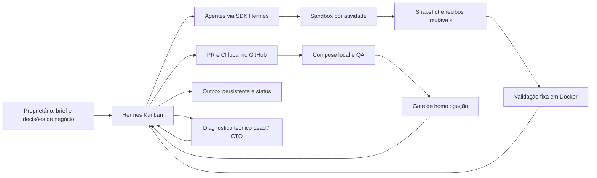
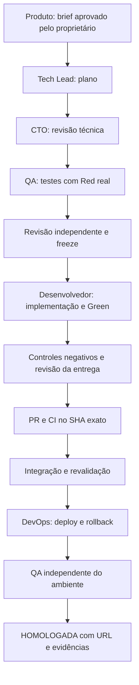

# Fabriquinha

Uma equipe de agentes para transformar um brief em software revisado, testado e
entregue em homologação, com GitHub e infraestrutura própria.

**Experimental. Autonomia ponta a ponta ainda não qualificada.** O caminho em
validação usa **Hermes + Kanban nativos**, com operações determinísticas para
qualidade, publicação e implantação. Multica e Temporal não são dependências
desse caminho. A instalação legada está preservada e pausada.

[Status atual](docs/STATUS.md) · [Próximos passos](docs/ROADMAP.md) ·
[Revisão crítica de 25/10/2026](docs/EXECUTION-REVIEW-2026-10-25.md) ·
[Documentação](docs/README.md)

## O que queremos construir

O proprietário informa o objetivo de uma versão e aprova seu brief. A equipe
planeja, escreve testes, implementa, revisa, integra e entrega uma URL de
homologação com evidências. Impasses técnicos pertencem ao Tech Lead e ao CTO;
decisões de negócio pertencem ao proprietário.

A release só termina com sucesso em `HOMOLOGADA`. Worker ativo, card concluído
ou testes do controlador passando não equivalem a uma release entregue. Uma
pausa humana ou dependência externa também não significa cancelamento.

## Arquitetura atual



Kanban é o dono do ciclo de vida. O controlador executa operações fixas e verifica
artefatos; os agentes não recebem credenciais de infraestrutura nem socket Docker.
O journal de efeitos evita duplicar ações com confirmação incerta e não é um
segundo gerenciador de tarefas.

O suporte atual é limitado a uma stack Python/HTTP local, containers Linux ARM64
na instalação de referência e uma release ativa por projeto. Não há instalador
completo qualificado para terceiros. A matriz de nove perfis permite especialistas
sob demanda; não exige nove passagens para toda atividade.

## Fluxo da equipe



O código conecta essas etapas; as provas determinísticas exercitam a cadeia.
A tentativa com agentes reais mais recente chegou ao freeze independente e
iniciou implementação, antes da pausa humana. **Ainda não completou esse fluxo.**

A [auditoria atual](docs/EXECUTION-REVIEW-2026-10-25.md) encontrou um gate de
mutações incompatível com um teste auxiliar congelado e caminhos incompletos de
recuperação. A proposta de correção está documentada, não instalada. Memória
compartilhada entre versões e portabilidade continuam pendentes.

## Qualidade e segurança

- Red real → revisão independente dos testes → freeze → Green → controles
  negativos → revisão da entrega → PR/CI → QA da implantação.
- Testes existentes e descoberta protegidos; nenhum skip ou aprovação textual
  substitui execução. Correções legítimas exigem outra revisão, nunca alteração
  silenciosa do snapshot.
- Revisores leem entregas imutáveis. Validações executam comandos fixos em
  containers sem credenciais, sem socket e com rede restrita à fase.
- Aprovações vinculadas a autoria, execução e artefato; integração e QA conferem
  o commit e a imagem efetivamente implantados.
- Pausa persistente, limites explícitos de consumo, nenhuma troca automática
  de modelo ou ampliação automática de orçamento.
- Recuperação técnica já foi demonstrada em cenários delimitados. Não há
  garantia de recuperação de todo impasse ou ausência universal de starvation.

## Organização do código

```text
src/fabriquinha/       Caminho novo: runtime, Kanban, qualidade e entrega
tests/                Testes offline do núcleo
scripts/              Preparação parcial, qualificações e publicação segura
docs/                 Status, plano vigente, arquitetura e provas delimitadas
Dockerfile*           Receitas de imagem; veja limites de reprodução
team-delivery-kit/    Legado preservado e utilitário de agrupamento Docker
bootstrap/infra/      Histórico; não iniciar junto ao caminho novo
```

Os caminhos legados permanecem para recuperação e referências de builds.
Não são o ponto de partida de uma instalação nova. Histórico detalhado e versões
anteriores deste README continuam no Git; o README não é diário de operação.

## Começar sem gastar tokens

A suíte do núcleo foi verificada com Python 3.14, inclusive sem pacotes de
`site-packages`. Ela não precisa do SDK Hermes, Docker ou chave de modelo:

```bash
git clone https://github.com/codifydeep/fabriquinha.git
cd fabriquinha
python3.14 -m venv .venv
. .venv/bin/activate
PYTHONPATH=src python -m unittest discover -s tests -q
python scripts/check_publication.py
```

Isso testa o controlador, não inicia agentes e não instala a plataforma. As
qualificações com Hermes/Docker têm dependências próprias e procedimentos em
[SETUP](docs/SETUP.md). Não execute overrides de instalações históricas como
se fossem um instalador. Imagens locais por digest ainda não asseguram
reprodução a partir de um clone limpo.

## Situação das validações

Em 25/10/2026, os 233 testes do núcleo passaram. As provas S1–S3 e extensões
qualificam fronteiras específicas; decisões programadas não são julgamento de
um agente real. Falta a primeira release S4 completa sem intervenção técnica
externa, depois uma segunda versão com regressão/memória/recuperação e uma
instalação em outro repositório. Veja [STATUS](docs/STATUS.md).

## Retirada de recursos de teste

Todo container novo deve aparecer em um grupo Compose no Docker Desktop.
Serviços, testes descartáveis e homologação têm grupos próprios por instância.

Antes e depois de um ciclo, inventarie apenas recursos com propriedade comprovada.
Confirme ausência de leases ativos, preserve logs e recuperação e remova por ID
exato. O preview `team-delivery-kit/cleanup_port2_history.py --tests-only` vale
somente para os helpers port2 qualificados, não para qualquer nome parecido.
A limpeza de imagens usa `cleanup_obsolete_images.py` e o hash do plano revisado.

Não usar prune global, force ou apagar volumes/snapshots como rotina. Preservar
deploy atual, referências de build, rollback e projetos alheios, incluindo
`toso-*` e `reforma`. Consulte [AGENTS.md](AGENTS.md).

## Contribuição e licença

Não publicar chaves, instalações privadas, bancos, conversas, snapshots ou
worktrees de produtos. Rodar `python scripts/check_publication.py` sobre o
conteúdo staged antes de publicar. Mudanças da automação e entregas de produtos
têm contratos de revisão distintos; nunca transportar uma dispensa entre eles.

Código próprio sob [MIT](LICENSE). Dependências mantêm suas licenças.
