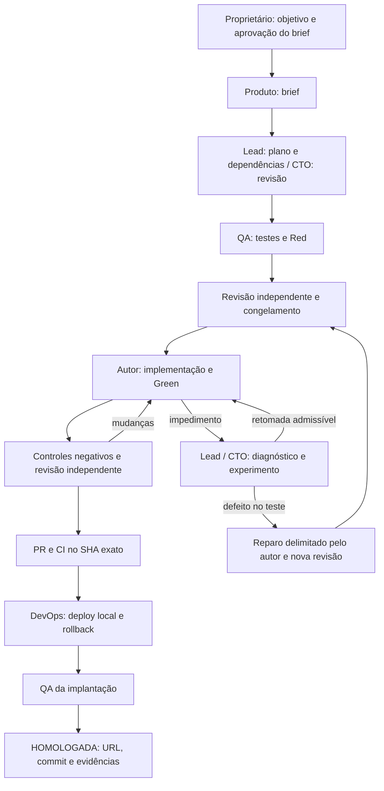
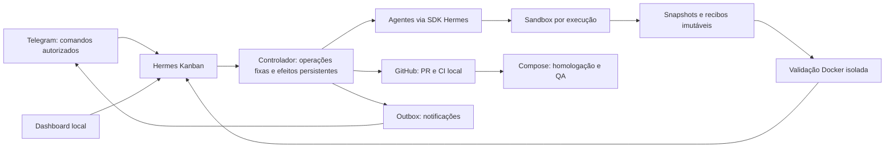

# Fabriquinha

Equipe de agentes para transformar um brief aprovado em software testado,
revisado e entregue em homologação, usando **Hermes + Kanban**, GitHub e Docker local.

**Experimental.** Há entregas delimitadas comprovadas, mas a recuperação de todos
os impedimentos e a instalação reproduzível por terceiros ainda não estão
qualificadas. O escopo atual é Python/HTTP web local, um host e uma release ativa.
Multica e Temporal não fazem parte da arquitetura atual.

[Instalação](docs/SETUP.md) · [Arquitetura](docs/ARCHITECTURE.md) ·
[Qualificação](docs/STATUS.md) · [Roadmap](docs/ROADMAP.md) · [Documentação](docs/README.md)

## Fluxo de entrega



Uma resposta do agente ou uma suíte verde não homologa uma release. Decisões
tecnológicas ficam com Lead/CTO; decisões de negócio e mudanças de escopo ficam
com o proprietário. Impedimentos não são concluídos artificialmente.

## Componentes



O Kanban controla o ciclo de vida. O controlador verifica identidades, artefatos,
revisões e efeitos externos; não é um segundo gerenciador de tarefas. Agentes não
recebem credenciais de infraestrutura nem o socket Docker.

## Qualidade e segurança

- Red real → revisão independente dos testes → freeze → Green → controles
  negativos → revisão da entrega → PR/CI → QA da implantação.
- Testes existentes e descoberta protegidos; nenhum skip ou aprovação textual
  substitui execução. Correções legítimas exigem outra revisão, nunca alteração
  silenciosa do snapshot.
- [Regressões conhecidas](docs/S5-CONTRACT-QUALIFICATION.md) usam o teste existente
  vermelho, revisão e freeze, produto corrigido e cabeça verde. A CI admite somente
  as falhas de base revisadas no SHA e inventário exatos.
- Instalações novas fixam os scripts de validação em snapshot imutável; edição
  do checkout não altera os jobs nem reinterpreta provas anteriores.
- Revisores leem entregas imutáveis. Validações executam comandos fixos em
  containers sem credenciais, sem socket e com rede restrita à fase.
- Aprovações vinculadas a autoria, execução e artefato; integração e QA conferem
  o commit e a imagem efetivamente implantados.
- Na stack com browser TDD e papéis de entrega, Green, revisão e CI executam
  também o QA congelado, pelo mesmo interpretador do pós-deploy. Texto esperado
  significa texto completo normalizado; uma suíte unitária verde não o substitui.
- Pausa persistente, limites explícitos de consumo, nenhuma troca automática
  de modelo ou ampliação automática de orçamento.
- Recuperação técnica já foi demonstrada em cenários delimitados. Não há
  garantia de recuperação de todo impasse ou ausência universal de starvation.

## Começar sem consumir modelo

```bash
git clone https://github.com/codifydeep/fabriquinha.git
cd fabriquinha
python3.14 -m venv .venv
. .venv/bin/activate
PYTHONPATH=src python -m unittest discover -s tests -q
PYTHONPATH=team-delivery-kit python -m unittest discover -s team-delivery-kit/tests -q
python scripts/check_publication.py --self-test
python scripts/check_publication.py
```

Esses comandos validam código; não instalam serviços nem iniciam agentes.
Leia [SETUP](docs/SETUP.md) antes de provisionar o SDK, imagens, GitHub ou provedor.

## Organização

| Caminho | Responsabilidade |
|---|---|
| `src/fabriquinha/` | Runtime, contratos, Kanban, ferramentas e entrega |
| `tests/` | Regressões offline do núcleo atual |
| `scripts/` | Preparação, operação e qualificações delimitadas |
| `examples/python-http/` | Exemplo de configuração, sem credenciais |
| `docs/` | Guias, contratos e histórico de qualificação identificado |
| `team-delivery-kit/` | Utilitários de agrupamento/limpeza ainda usados e seus testes |
| `Dockerfile*` | Receitas de validação e aplicação |

O nome histórico de `team-delivery-kit` é mantido por compatibilidade de imports
e exportações. Controladores e ensaios aposentados ficam no histórico Git,
não no caminho de instalação. Veja [a política de manutenção](docs/REPOSITORY-MAINTENANCE.md).

## Contribuição

Leia [CONTRIBUTING](CONTRIBUTING.md), [SECURITY](SECURITY.md) e [AGENTS](AGENTS.md).
Não publique instalações, conversas, chaves, bancos, snapshots ou worktrees de
produtos. Containers devem ser agrupados por Compose; limpeza exige propriedade
comprovada, sem prune global nem exclusão de volumes.

Código próprio sob [MIT](LICENSE); [dependências mantêm suas licenças](THIRD_PARTY_NOTICES.md).
