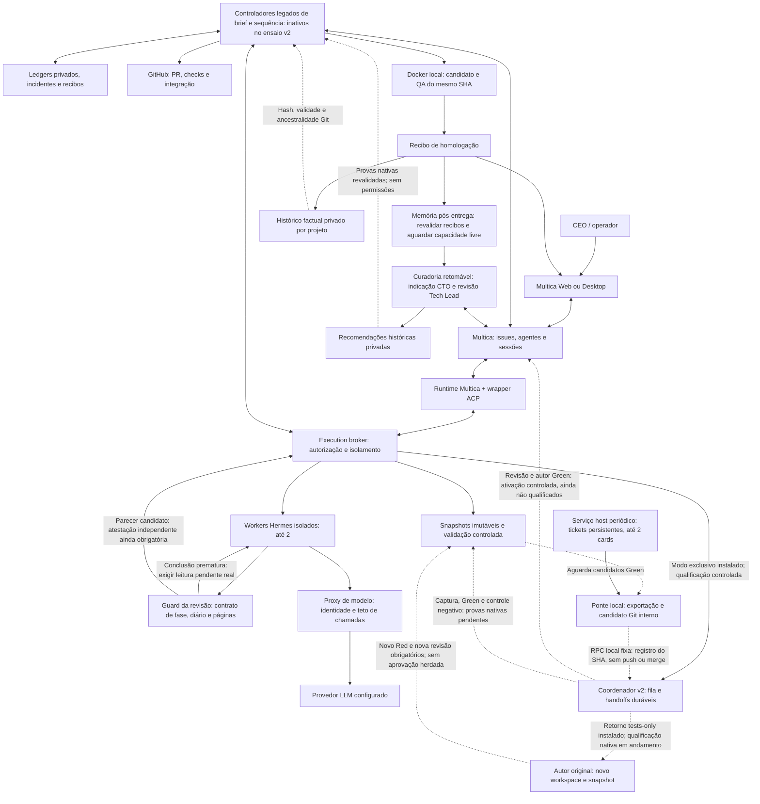
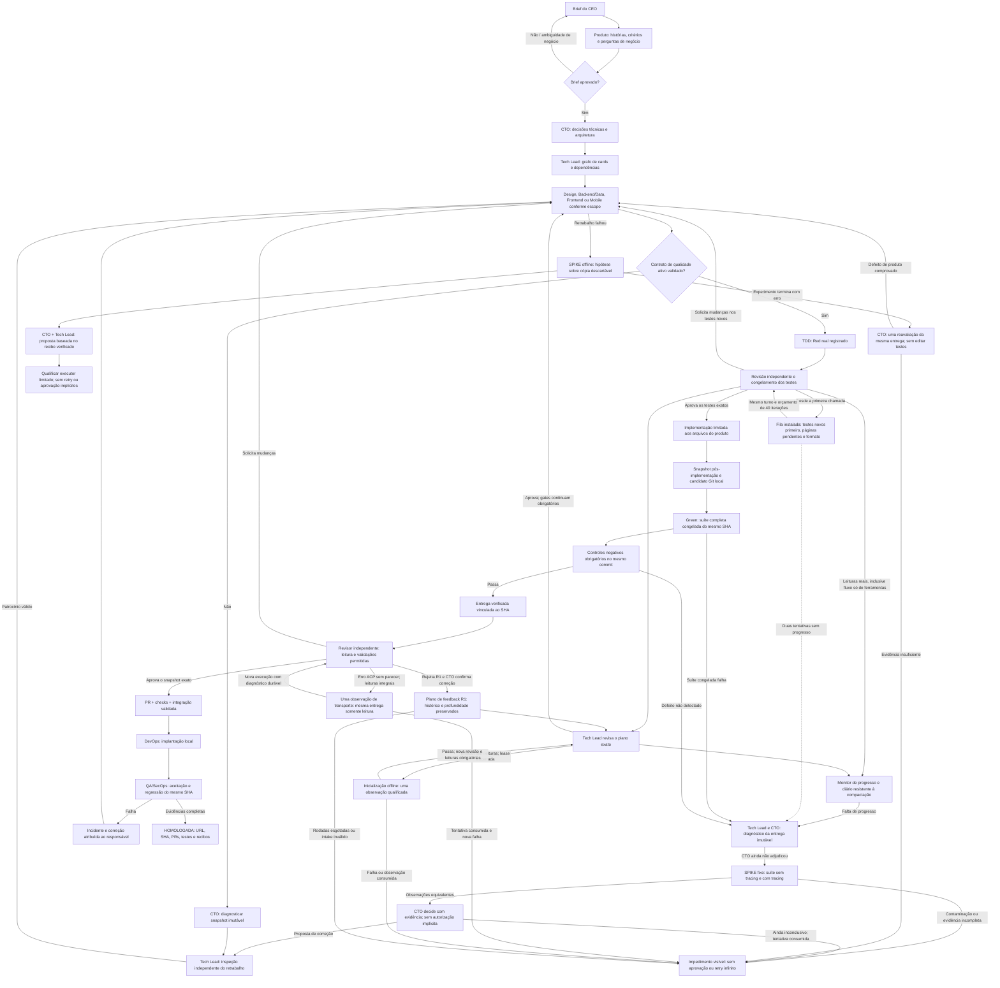
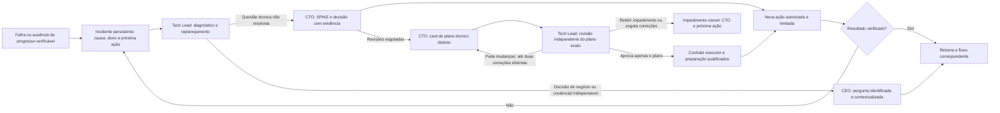
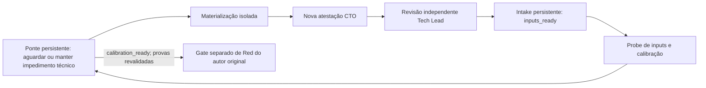
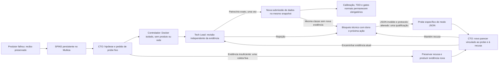

# Fabriquinha

Uma equipe de agentes de IA para transformar um brief de produto em software revisado, testado e entregue em homologação, usando GitHub e infraestrutura própria.

**Revisão estratégica — 24/10/2026:** a [análise e o plano de simplificação](docs/SIMPLIFICATION-REVIEW-2026-10-24.md)
avaliam o custo do desenho atual e propõem uma retomada com Hermes + Kanban,
condicionada à validação de uma integração pequena e isolada. O plano e as
mudanças de contrato foram aprovados; [S0/S1 passaram](docs/HERMES-S1-QUALIFICATION.md)
na prova sem modelo. A [primeira fatia S2](docs/HERMES-S2-QUALIFICATION.md) passou
com TDD real, testes congelados, revisão imutável e recuperação de timeout;
os autores e pareceres ainda são fixtures sintéticas. A [fatia de integração S3](docs/HERMES-S3-QUALIFICATION.md)
já conecta revisão, Git real, PR/CI simulados, suíte real no commit de merge,
build, Compose, QA em Chromium e rollback, inclusive após confirmações perdidas.
A publicação e o build/deploy também passaram por novas claims nativas sem
duplicar efeitos, e o handoff TDD selecionou um suplente aprovado para evitar
conflito de autoria. Rollback e QA aceitaram a proveniência preservada das etapas.
Essas retomadas foram acionadas pelo roteiro, não por um serviço autônomo.
A [ponte de ferramentas/sessões nativas](docs/HERMES-AGENT-QUALIFICATION.md)
também passou com `AIAgent` real, respostas locais fixas e retomada em outro processo.
As ferramentas de submissão/parecer já percorreram o ciclo TDD pelo dispatcher
nativo: dois cards, seis atividades, mudanças/correção e testes congelados.
O [serviço contínuo](docs/HERMES-RUNTIME-QUALIFICATION.md) passou depois em ambiente
isolado: reinício preservando worker saudável e recuperação de crash com sessão/
arquivo preservados e sandbox órfã retirada antes da substituta. O
[diagnóstico executável](docs/HERMES-RECOVERY-QUALIFICATION.md) também passou:
Lead → CTO → SPIKE real → orientação → autor → gates TDD, sem duplicar a retomada.
A [outbox e observabilidade](docs/HERMES-NOTIFICATIONS-QUALIFICATION.md) passou
com indisponibilidade de conexão, ACK perdido e reinício: 21 mensagens locais,
sem duplicação dos envios aceitos ou bloqueio do TDD. A
[integração pelo serviço](docs/HERMES-INTEGRATION-QUALIFICATION.md) passou depois:
espera nativa de CI libera claims, reinício retoma o mesmo PR e build/deploy/
rollback/QA reais terminam por handoff independente. Houve um crash de partida
recuperado nativamente; autores/CI continuam sintéticos. A continuação do brief
e do aceite está descrita abaixo; ainda faltam admissão do provedor,
Telegram/modelos/GitHub reais e instalação reproduzível.
[Pausa/retomada e admissão](docs/HERMES-OPERATIONS-QUALIFICATION.md) também passaram
com SDK real: duas interrupções, reinício pausado, perfil restaurado sem falso
cooldown e TDD concluído preservando sessão/fase. Não liberam o provedor pago.
A [entrada do brief e plano revisado](docs/HERMES-INTAKE-QUALIFICATION.md) passou
também: Produto pergunta, CEO aprova o documento exato, Lead planeja e CTO pede
mudanças/revisa, com sessões reais e respostas locais. O plano aprovado ainda
não gerava cards naquela fatia. A continuação agora passou pelo ciclo offline
inteiro: dois pacotes dependentes geraram seis cards, integraram dois commits,
preservaram regressões e produziram aceite integral com QA/rollback reais.
O recibo é de qualificação, não aprovação de produto: autores/CI são fixtures.
Duas tentativas anteriores permanecem falhas; a terceira passou após corrigir
vinculação do PR e vida útil das conexões SQLite, sem patch upstream.
A instalação antiga descrita abaixo permanece como referência
pausada; ainda não houve migração nem entrega autônoma pelo novo caminho.

Fluxo qualificado em ambiente isolado — autores/revisores e transporte GitHub
ainda são sintéticos; Kanban, Git e jobs Docker são reais:

```mermaid
flowchart LR
    CEO[Operador: objetivo e aprovação do brief exato] --> IN[Produto: brief e perguntas de negócio]
    IN --> HP[Revisão humana nativa; espera sem worker]
    HP -->|Resposta somente ao documento correspondente| CEO
    HP -->|Brief aprovado| PL[Lead: DAG; CTO: revisão independente]
    PL --> DG[Grafo imutável: cards e bases dependentes]
    DG --> K
    N[AIAgent real: ferramentas de entrega; respostas locais] --> K
    C[Serviço contínuo isolado: reinício e recuperação qualificados] --> N
    F[Pausa persistente e preflight sem modelo] -->|Fence de spawn e ferramentas| C
    K[Hermes Kanban] --> T[TDD e revisão imutável com suplência]
    K --> L[Diagnóstico Lead/CTO: SPIKE e orientação]
    L -->|Retomada nativa; gates preservados| T
    K --> O[Outbox durável; sender sem modelo]
    O --> B[Transporte local qualificado; Telegram real pendente]
    T --> S[Snapshots e recibos privados]
    S --> G[Git: commit da entrega]
    G --> P[PR/CI simulados; gate nativo]
    P -->|Pendente: encerra claim| W[scheduled; retomada automática pelo serviço]
    W --> K
    P --> M[Merge e suíte no SHA integrado]
    M --> D[Build e deploy retomáveis; rollback e retorno]
    D --> Q[QA real em Chromium; evidência preservada]
    Q --> E[Recibo de QA: commit e imagem exatos]
    E --> RG[Gate integral: critérios, histórico, CI e serviço atual]
    RG --> RA[Aceite de qualificação; não é entrega autônoma]
    RA -. S4 ainda pendente .-> A[Fluxo com agentes e GitHub reais]
```



O detector de navegador para o feedback mais recente foi calibrado em Chromium
isolado e sem rede: aceitou uma referência sintética correta e rejeitou 16 defeitos
conhecidos, incluindo filtros, Unicode, mutação indevida, schema, resposta obsoleta
transitória, acessibilidade, bloqueio do formulário e ausência de polling. Essa
referência é somente um controle de teste, nunca implementação ou evidência de
entrega do produto. O novo cenário compõe as regressões de modo demo, detalhe e
contagem; o próximo ciclo real ainda precisa passar por todos os gates.

**Estado: experimental — autonomia completa ainda não qualificada.** Este repositório publica o código da plataforma em construção, não uma promessa de instalação pronta para produção. Ensaios descartáveis já percorreram implementação, revisão independente, PR, CI e QA no mesmo commit. Ainda faltam demonstrar um novo ciclo integral sem reparos do operador e simplificar a instalação para terceiros.

O [contrato de qualidade v2](team-delivery-kit/contracts/quality-lifecycle-v2.md)
foi aprovado: Red real → revisão e congelamento dos testes → Green → controles
negativos obrigatórios antes do merge. A política, o executor offline e o cadastro
persistente e imutável de novas execuções estão implementados em fonte, incluindo
bloqueios contra uso do fluxo legado por uma issue v2.
O controlador v2 está instalado **somente para qualificação nativa controlada**,
em modo exclusivo que mantém os fluxos legados inativos. A manutenção de
bootstrap foi concluída. A revisão continua tecnicamente bloqueada; instalação,
fim de turno e aprovação independente são estados distintos. Os bloqueios
anteriores permanecem preservados.
O proxy corrigido foi qualificado em HTTP real isolado e instalado sob manutenção:
capacidade de requisição de 2 MiB, contador e teto de chamadas preservados, sem
credenciais nos testes. A recuperação da falha por tamanho foi registrada e o
ensaio seguinte ultrapassou o limite antigo sem aquela rejeição, mas falhou ao
esgotar as iterações: 57 dos 71 arquivos tiveram leitura integral comprovada.
O hardening de paginação já foi instalado: controlador `20261023.36` e worker
`20261023.11`, com diário limitado, captura no loop e paradas estruturadas.
O canário Hermes/ACP percorreu 219 páginas e 563 KB; uma compactação real
retirou 64 pares da conversa sem perder cobertura no diário. Foram 16 respostas
locais fixas, sem chamadas externas: 157 leituras fora da recomendação,
quatro lotes mistos e um lote de 274 mil caracteres preservado sem spill.
Após uma recuperação anterior, o coordenador iniciou uma revisão real que parou
por falta de progresso depois de sete chamadas, com 16/71 arquivos completos
e 33 iterações restantes. A fila dependia de uma resposta final prematura.
A versão atual projeta fila, schema e gate desde a primeira chamada, prioriza
testes novos e preserva a rejeição fundamentada sem leitura do escopo inteiro
de aprovação. O canário extenso agora começa por ferramentas, sem prosa prematura.
A instalação verificou backup/restauração e preservou dados, fila e contador.
Após recuperação específica e liberação da manutenção, o coordenador despachou
a sucessora. Ela terminou após seis chamadas, 36 páginas aceitas e 26/71 arquivos
completos: o handler negou páginas pendentes fora do lote recomendado e o modelo
interpretou isso como perda de acesso. A candidata seguinte separa ordem
recomendada e tuplas pendentes permitidas, mantendo negação de repetição, EOF
e caminhos estranhos. Ela foi qualificada e instalada. Essa tentativa voltou à
manutenção sem aprovação, congelamento ou entrega nessa linhagem v2.
O ensaio posterior completou 53/71 arquivos, mas teve 33 prévias de spill
e quatro deduplicações sem conteúdo. O executor agora preserva páginas completas só
na revisão autenticada, sob o teto de 8 MiB do diário, mantendo o corpo de 2 MiB
do proxy, a compactação e os demais gates. A correção está instalada. A sucessora
comprovou 71/71 arquivos, mas o controlador rejeitou o parecer: `request_changes`
sem achados concretos e dependência circular de Green/controles negativos antes
da aprovação dos testes. A apresentação persistente do contrato da fase,
diagnóstico específico e decisão final sem ferramentas em modo JSON de sintaxe
passaram no canário físico e foram instalados. O coordenador iniciou outra
revisão independente; ela voltou a bloquear com 46/71 arquivos e duas promessas
em prosa de continuar depois. A continuação com leitura real, sem ampliar
permissões ou orçamento, passou no canário seguinte e foi instalada com
backup/restauração verificados, para nova revisão pelo coordenador. Ainda não há parecer nativo
aceito, congelamento ou homologação. A revisão após essa correção comprovou
71/71 arquivos, mas teve o primeiro parecer rejeitado e recebeu HTTP 402 na
continuação. A instância está selada e o proxy parado após pausa persistente
por pagamento, sem reset de contador ou aprovação fictícia. A nova recuperação
específica passou em canário Linux com oito consultas HTTP locais, nenhuma ao
provedor real, e está instalada com execução desligada. Uma consulta diagnóstica
autorizada confirmou saldo e limite disponíveis, sem remover a pausa ou chamar
o modelo; a causa do 402, remediação, registro e ativação continuam pendentes.
O pin foi migrado preservando a fila e
o histórico, mas o scheduler permanece desabilitado/descarregado. A suíte offline
mais recente executou 4.522 testes,
com oito skips preexistentes e nenhuma falha. Isso não comprova autonomia.
O estado datado está em
[STATUS](docs/STATUS.md).

O executor fixo da revisão final também passou em canário Docker, reexecutando
a suíte da fixture com snapshots somente leitura, escrita negada e cinco pedidos
inválidos recusados, sem chave, socket ou provedor. Ele não está conectado à
admissão nativa do revisor nem concede aprovação; a ponte após Green permanece
em desenvolvimento. Consulte o [mapa atualizado](docs/ARCHITECTURE.md).
Handoff/admissão e autenticação do recibo do controlador já existem em fonte,
desligados por padrão e testados com fixtures, mas não estão instalados ou
roteados. O adaptador de worker/transporte final também existe em fonte: exige
recibo de validação, snapshot somente leitura e handlers sem escrita ou shell.
O parser do parecer e a atestação das leituras/execução também existem em fonte,
com fixtures: aprovação, mudanças fundamentadas ou escalonamento ao CTO.
O coordenador em fonte já atravessa essa revisão e registra o despacho da
correção ao autor original, sem editar testes. Aprovação segue para
`awaiting_publication`, nunca para homologação automática. Ainda faltam admissão,
execução e revalidação da correção, qualificação nativa e publicação/implantação.
A candidata de imagem compilou sem ativação; não foi instalada.

**Documentação:** [índice de leitura](docs/README.md),
[status e estimativas de prontidão](docs/STATUS.md),
[validações](docs/VALIDATION.md) e [próximos marcos](docs/ROADMAP.md).
As notas detalhadas a seguir preservam etapas históricas; suas referências a
“candidata”, instalação pendente ou próximo ensaio não são inventário vivo.
A ativação foi verificada sob manutenção; depois, a barreira foi liberada e
um único card foi atribuído ao autor real. A instalação preservou os
volumes de dados, a configuração de workers/modelos e os outros contêineres,
após backup compactado e prova real de restauração. Isso não habilita nem
qualifica a cadeia nativa de entrega; nenhum modelo é acionado pela instalação.
O ensaio comprovou autoria nativa e Red real: 381 testes Python executados,
com falhas de asserção somente no teste novo, e 36 testes Node aprovados,
sem erros ou skips. Ainda não há congelamento de testes aprovado pelo revisor real.
Tentativas anteriores detectaram um vínculo de
imagem inválido e, no sucessor, um teste vazio após leituras/escrita negadas.
O preflight de imagem já foi corrigido e verificado no runtime; o prompt de
caminhos absolutos foi corrigido, testado e instalado. O canário físico
autor/Red/revisão somente leitura passou sem modelo e com autoridade sintética;
isso ainda não comprova o fluxo nativo com agentes reais.
Os bloqueios e arquivos originais continuam preservados, sem aprovação fictícia.
O primeiro handoff real de revisão falhou antes de admissão: o adaptador não
decodificava o envelope de wakeup do Multica para esse modo. A correção em fonte
usa o mesmo parser estrito de envelopes, sem autorização por substring. Seu
canário Docker/ACP passou com autoridade sintética, sem modelo e sem aprovação.
`recover_quality_review.py` permite uma única recuperação desse erro pré-admissão,
sob manutenção selada e após mudança comprovada do adaptador: preserva o autor,
o snapshot e o Red, registra a execução falha e cria outro marcador de handoff.
Não recupera uma revisão já admitida nem aprova testes. Falhas nativas anteriores
à admissão são encaminhadas imediatamente ao CTO, sem aguardar o timeout.
A revisão real seguinte foi admitida, leu a entrega e pediu mudanças por uma
asserção tautológica no teste novo. Não foi aprovada: a atestação bloqueou por
leituras incompletas. Essa execução e seu bloqueio permanecem preservados.
A correção instalada distingue rejeição de aprovação: uma rejeição
concreta exige leitura integral de todos os testes novos e arquivos citados;
aprovação continua exigindo o snapshot inteiro. A citação de um helper Python
deve corresponder à função, linha e bytes realmente lidos. Essa correção ainda
não converte o veredito bloqueado em aprovação. O adaptador de devolução ao autor
está instalado, ainda em qualificação nativa: mantém o mesmo card, autor,
brief e plano; registra uma solicitação de correção separada e cria uma execução
tests-only com seed verificado do snapshot rejeitado. Não apaga o bloqueio antigo,
não permite mudar testes de baseline nem editar produto. Outra revisão e outro
Red completo são obrigatórios. Um teste novo sem alteração é recusado antes do
novo Red. Falhas de diagnóstico deixam um hold persistente do CTO, sem repetição
idêntica; históricos nativos só são filtrados por vínculos autenticados exatos.
O canário físico autor → Red → revisão somente leitura → correção tests-only
passou em Docker/ACP, com rejeição nativa sintética, sem prompts/modelo ou
aprovação. Verificou o seed e as permissões reais; nove auxiliares foram retirados.
O retorno real ocorreu pelo próprio coordenador, no mesmo card e autor, sem
atribuição manual: o agente corrigiu os testes e o novo snapshot passou pelo Red
completo (381 Python, falhas somente no teste novo; 36 Node aprovados, sem skips).
A revisão seguinte foi acionada e admitida, mas falhou no bootstrap antes de ACP
ou chamada ao modelo. Essa tentativa permanece preservada. Após instalação e
recuperação versionada sob manutenção, o coordenador acionou outra revisão
automaticamente, no mesmo card e snapshot: ACP e modelo funcionaram. O agente
emitiu parecer favorável com prosa antes do JSON e não leu todos os arquivos
obrigatórios. O controlador rejeitou a conclusão; não há congelamento aprovado,
Green ou homologação. Apenas tolerar o formato não resolveria a leitura incompleta.
O diagnóstico em fonte agora relata separadamente o formato e a cobertura de
todos os arquivos, sem converter o parecer rejeitado em aprovação. Essa melhoria
diagnóstica não implementa, por si só, a recuperação autônoma dessa falha.
Uma candidata posterior acrescenta feedback **antes de encerrar o turno**:
formato e páginas ausentes voltam ao mesmo revisor, sem novo grant, tarefa ou
reinício do orçamento. O ACP v2 passa a fixar explicitamente 40 iterações.
Duas conclusões sem progresso verificável interrompem a ação; progresso real
pode continuar dentro do orçamento original, sem um teto menor de handoffs.
Um canário passou pelo Hermes, handlers e ACP reais com respostas fixas em
loopback: tentou aprovar cedo, recebeu feedback, leu os arquivos e retornou só
o JSON final ao cliente. Rascunhos ficaram separados em diagnósticos sem
autoridade. Não houve modelo, aprovação nativa nem alteração do produto. Essa
candidata também passou pelo encadeamento físico autor/Red/revisão/correção e
nova revisão, com autoridade sintética e retirada de doze auxiliares. Ainda
precisa de instalação e ensaio nativo;
o bloqueio já encerrado não será apagado nem reinterpretado como aprovação.
O adaptador de recuperação de conclusão está implementado em fonte: mantém
admissões, pareceres e relógios das sucessoras em registros separados, sem
migrar tabelas históricas durante leitura. Uma nova revisão exige instalação
verificada, worker anterior aposentado e qualificação Docker/ACP vinculada à
imagem e aos hashes reais do código. A mesma condição não pode ser reaplicada
com outro nome de imagem, task ou qualificação. O registro não fecha o incidente,
não emite grant e não aprova testes; o coordenador continua responsável pelo
despacho após liberar a manutenção. A integração foi testada também após uma
recuperação anterior de bootstrap, preservando ambos os pareceres antigos e
exigindo novo congelamento antes do Green. Instalação e prova nativa pendentes.
Foi reproduzida em testes uma corrida compatível com essa falha: a observação do
watchdog avançava o estado antes do ACK de criação/start e a rotina rejeitava a
confirmação tardia. A correção em fonte preserva a observação mais forte somente
com recibo de política, payload, contêiner e estado nativo exatos; não repete
comandos. O bootstrap agora também registra fase, classe e localização sanitizada
de falhas futuras, sem texto da exceção, caminhos privados ou credenciais. O
registro histórico não contém essa localização e não é reescrito como prova da
causa. O canário ampliado passou em Docker/ACP até a revisão após a correção,
forçando as duas intercalações antes do ACK, sem modelo; doze auxiliares foram
retirados e nenhuma aprovação foi concedida. A recuperação da execução nativa já admitida
permanece separada: não se pode reutilizar o grant nem apagar a atestação falha.
`quality_review_bootstrap_recovery.py` implementa em fonte essa recuperação
restrita, ainda não instalada: exige manutenção selada, instalação comprovada
do novo guard, worker retirado e arquivado e ausência de ACP, transporte, sessões
e ferramentas. Mantém os registros antigos e cria apenas a possibilidade de uma
nova revisão somente leitura, no mesmo snapshot. Admissão, atestação e relógio
de observação da nova execução são separados. Aprovar a execução nova exige
todas as leituras/provas normais; a falha antiga continua consultável por request.
Não é recuperação genérica nem autorização de um segundo reparo idêntico.
Na migração do scheduler, `--preserve-interrupted-tick` permite carregar um
primeiro tick interrompido somente com fila vazia, serviço descarregado e
desabilitado, controlador selado/ocioso e ambos os locks exclusivos. Seu estado
é preservado literalmente, não convertido em sucesso; trabalho enfileirado e
falhas anteriores continuam bloqueando essa exceção.
O runtime de referência também já recebeu seletores explícitos para as seis
imagens imutáveis de qualidade e os responsáveis nativos Tech Lead/CTO.
`quality_runtime_configuration.py` confere o modo
dos responsáveis cadastrados e os metadados das imagens (usuário sem privilégios,
entrypoints fixos, fases suportadas, ausência de volumes herdados e credenciais).
O instalador aceita esses oito seletores por `--runtime-config`; não aceita
flags de ativação, modelo, comandos, sockets ou credenciais nesse documento.
Os seletores ficam presos à identidade da instalação e em arquivo privado.
As imagens atuais passaram novamente pelo encadeamento Docker/ACP autor → Red →
revisão somente leitura e pelo bloqueio de testes/cópia pós-Green. Esses probes
usam autoridade nativa sintética e não aprovam testes, produto ou homologação.
O preflight da aplicação real revelou uma dependência inicialmente ausente nos
gates v2: a CI do repositório de avaliação executa Python **e** Node,
incluindo regressões de navegador em VM Node. O runtime opcional
`Dockerfile.quality-runner-base` reúne Python/Node sem downloads ou npm na
instalação de referência. `quality_node_baseline.py` executa descoberta Node
completa, confere inventário/hashes, rejeita falhas/skips/todos e filtra saída de
testes para não aceitá-la como protocolo. `quality_baseline_probe.py` executa as
duas suítes sobre uma cópia dos blobs Git, sem alterar o checkout.
O diagnóstico real passou com 380 testes Python e 36 Node, sem skips, em Docker
sem rede, credenciais, socket ou escrita no snapshot. Seu helper foi retirado.
**Esse diagnóstico não é Red, Green ou aprovação nativa.** A integração aos
gates já está implementada em fonte: planos mistos exigem `node_baseline_tests`
para todos os testes Node reconhecidos e protegidos. Red, Green e controle
negativo devem executar a suíte Node completa e vincular seu recibo ao snapshot
correto; Green/controle preservam hashes, versão e identidade dos casos, não
apenas a contagem. Evidência ausente, skips, troca de casos ou recibos antigos
de diagnóstico não são aprovação. Um canário Linux real percorreu esses
executores com entradas/revisão/commit sintéticos, sem modelo ou entrega.
**Essa integração está instalada, ainda não qualificada nativamente.** Os novos gates e
pins foram instalados após backup/restauração verificados; a migração preservou
journals, fila, tickets, prazos e contadores de falha. O scheduler próprio foi
registrado novamente com o pin atualizado. Falta comprovar o encadeamento
nativo completo; um worker ativo não é evidência de conclusão. O modo misto qualificado em fonte
é unittest Python com baseline Node protegida; não é suporte genérico a Vitest,
Jest ou autoria de novos testes em qualquer framework.
O observador de Red real
também passou por controles sintéticos em Docker isolado, sem uma implementação
positiva prévia. A ingestão persistente de Red também está implementada em fonte:
exige fase, tarefa, cópia e job reais vinculados pelo controlador, sem aceitar
relatos do agente como prova. O produtor persistente de snapshots está implementado
em fonte; a cópia real em Docker passou pelos controles de duplicação e alteração
indevida, preservando os hashes e a execução sem privilégios. Isso ainda não
qualifica uma entrega dos agentes nem autoriza workers. A primeira admissão v2
está implementada em fonte, com fase/capacidade atômicas e seleção de edição
restrita aos testes novos. A integração opt-in ao lançamento passou por Docker e
ACP reais com autoridade nativa sintética, sem chamada ao modelo. A reconciliação
persistente término do autor → snapshot → Red → pacote para revisão está ligada
ao watchdog em fonte, com atendimento alternado entre cards, manutenção e
bloqueio de falhas repetidas. A ativação fica restrita à qualificação nativa;
manutenções seladas continuam impedindo novas execuções.
A atribuição, o encaminhamento nativo único e a admissão da revisão independente
estão implementados em fonte, em modo separado e restrito ao ensaio: leitura paginada
do snapshot, sem permissões de implementação. O lançamento do revisor está ligado
em fonte à admissão, startup e sessão ACP, com snapshot somente leitura e sem
acesso ao workspace do autor. O encadeamento técnico autor/handlers → snapshot →
Red real → abertura do revisor passou em Docker/ACP, usando identidades nativas
sintéticas e sem modelo; seis contêineres foram retirados. A atestação da revisão
está implementada em fonte: exige tarefa nativa concluída, lease encerrado,
inspeção do worker, leituras ACP reais byte a byte e veredito estruturado no mesmo
snapshot. Seus controles passaram com fixtures de autoridade; as leituras dos
handlers reais também coincidiram com o manifesto em Docker. A qualificação com
o agente real e a instalação seguem pendentes. A admissão da primeira execução
Green está implementada em fonte: exige congelamento
atestado, nova tarefa do autor original, mesmo brief/base e identidade do volume
imutável. O preparo aceita os testes congelados como entrada somente leitura e
os handlers permitem escrita exclusivamente nos arquivos declarados do produto.
A fila de capacidade registra a espera antes de acionar o autor, sinaliza dez
minutos e encaminha trinta minutos sem vaga ao Tech Lead; confirmações incertas
não repetem o acionamento nativo. O lançamento Green está ligado em fonte à
admissão nativa, startup, sessão e handlers com edição somente de produto,
reutilizando o journal de criação única. Seus testes de integração usam
autoridade nativa/Docker sintética; a feature continua desligada no controlador
instalado. O workspace Green passou pela prova técnica real em Docker: seed dos
testes congelados, lockdown, escrita de produto e recusa de alterações dos testes
por handlers, chmod, exclusão, renomeação e subprocesso. Os quatro helpers foram
retirados; a primeira tentativa, com proprietário incorreto no snapshot sintético,
continua registrada como falha. Isso não é implementação do agente nem Green.
O observador da suíte Green está implementado em fonte e executa testes reais
com hashes congelados, mas não atesta sozinho a origem nativa ou o commit Git.
A cópia pós-implementação passou em Docker depois dos handlers Green, com todas
as entradas somente leitura, hashes dos testes preservados e saída imutável;
cinco helpers foram retirados. É um canário sem modelo, não uma entrega do agente.
O verificador Git passou em repositórios locais reais: confere parent, escopo,
modos e blobs de todos os arquivos contra o snapshot e os testes congelados,
sem alterar o checkout, publicar branches ou aprovar merge. Ainda é um componente
separado, não uma captura nativa completa.
O produtor do primeiro candidato Git local está implementado em fonte. Ele usa
índice temporário, objetos determinísticos e referência interna por execução;
preserva checkout, índice e `main`, não faz push nem merge. O journal privado
mantém a mesma identidade após reinício e observa a referência original quando
a confirmação se perde. Seus testes usam repositórios Git reais descartáveis,
inclusive interrupção antes da publicação e corrida com referência simbólica.
A ponte local ao registro persistente está implementada em fonte, mas ainda
falta qualificá-la com a origem nativa e ligá-la ao despacho instalado.
Esse caminho exige clone local completo: repositórios parciais/promisor são
recusados para não iniciar fetch ou autenticação de rede implicitamente.
A captura persistente pós-implementação está implementada em fonte, ainda sem
despacho automático: exige admissão Green, identidade nativa, prompt ACP bem
sucedido, lease fechado, inspeção do worker e workspace original. Se o worker
já foi retirado, exige também seu recibo exato de retirada; ausência isolada não
vale como término. Volume e job têm intenções persistidas antes dos efeitos,
com reconferência após a cópia, alerta aos dez minutos e impedimento técnico
após trinta, sem reiniciar o prazo ou repetir uma execução incerta. Seus testes
usam autoridade sintética e terminam em `awaiting_git_binding`, nunca em Green.
A ponte local de exportação está implementada em fonte: seu descritor é obtido
do registro durável dessa captura, reconferindo a revisão congelada e a
identidade do volume, sem aceitar instruções do agente como autoridade.
Um helper agrupado, nunca iniciado e sem rede, socket ou credenciais, exporta
o volume somente para leitura; hashes, intenção de cópia e retirada por ID
ficam em journal privado. Confirmações perdidas são observadas, não repetidas;
uma cópia incompleta permanece como impedimento explícito. Esse componente
passou em Docker real com entrada sintética, sem modelo nem aprovação nativa.
O encadeamento automático exportação → candidato Git → Green ainda não está
ativado ou qualificado; o teste isolado não substitui esse ensaio.
A ponte local agora registra o candidato no controlador após verificar o
repositório esperado, todos os objetos Git e a captura original novamente.
Os journals da exportação e do candidato permitem retomar uma gravação de
confirmação perdida sem novo helper, commit ou referência. Testes de integração
usam Git real e autoridade de captura sintética; não há endpoint para o agente
enviar provas, escolher repositório ou aprovar a própria entrega.
A ponte do host possui transporte local fixo ao controlador instalado,
restrito às operações `about`, `pending`, `inspect` e `record`, com imagem e identidade do
contêiner conferidas antes e depois da chamada. Não há endpoint HTTP, terminal
genérico ou montagem privilegiada nova para os workers. A perda de confirmação
de gravação leva à leitura do vínculo durável antes de qualquer nova cópia ou
efeito Git. A consulta real ao controlador passou com execução desabilitada;
o despacho persistente da ponte do host ainda precisa ser ligado e qualificado.
O adaptador de consulta fixa `pending` está instalado com execução desabilitada.
Em fonte, `quality_candidate_dispatch.py` usa essa consulta e uma fila privada
SQLite, protegida por `flock`, com tickets que preservam a
alternância entre cards após reinícios. Cada passagem atende no máximo dois
cards; manutenção não gera efeitos, falhas de consulta ficam registradas e
capturas corrompidas não bloqueiam a descoberta das seguintes. Após o prazo,
somente um vínculo já gravado pode ser reconhecido: não se inicia outra
exportação ou operação Git. Os testes incluem paginação, corrupção, perda de
resposta e Git local real com autoridade sintética. O despachante passou por
uma sondagem contra o controlador instalado: registrou manutenção sem efeitos.
O serviço host periódico `quality_candidate_service.py` está instalado na
referência macOS, com passagens independentes a cada 15 segundos e registro para
o próximo login. A configuração é fixada por hash; duas falhas/interrupções
inesperadas bloqueiam novas passagens no journal para diagnóstico do CTO.
Atualizações do pin usam `migrate_quality_candidate_pin.py`, somente com o
serviço descarregado e desabilitado, controlador em manutenção e nenhuma
execução ativa. A migração arquiva e verifica o SQLite, preserva tickets,
prazos, bloqueios e journals dos cards, e troca apenas os vínculos de autoridade
e de configuração. Uma interrupção retoma a mesma operação; não reinicia
contadores nem transforma evidências antigas em aprovações. Cada configuração
gera um plist imutável próprio; a preferência de login tem troca condicional.
Essas garantias estão cobertas por testes isolados; não substituem a validação
de entrega ponta a ponta com agentes reais.
O status lê apenas registros locais, sem consultar Docker ou iniciar trabalho:

```sh
.venv/bin/python team-delivery-kit/quality_candidate_service.py \
  --config /caminho/privado/quality-candidate-dispatch.config.json \
  --pin <sha256-da-configuracao> --status
```

Para um cadastro v2 novo, `prepare_quality_enrollment.py` gera contrato/plano a
partir da árvore Git inteira da main verificada e de uma seleção privada fixada
por hash. `enroll_quality_lifecycle.py` confere controlador e manutenção e faz
somente o cadastro imutável; `--observe` lê o mesmo pedido após perda de resposta.
O primeiro card nativo de qualificação está cadastrado e foi atribuído: o
primeiro task e worker reais foram observados em execução, sem afirmar Red,
revisão ou entrega concluídos. Os artefatos operacionais permanecem fora do Git público.
O novo modo de isolamento `BROKER_QUALITY_EXCLUSIVE_ENABLED=1` está implementado
e testado em fonte: exclui coordenadores legados e rejeita grants antigos ou
issues não cadastradas. O código já foi instalado em prévia, após backup e
restauração verificados. O modo exclusivo e as quatro flags de execução foram
habilitados por `activate_quality_runtime.py`, ainda sob manutenção. Só depois
o proxy foi ligado, o orçamento conferido, a manutenção liberada e o card
atribuído. Nenhuma dessas etapas autoriza merge ou homologação.

O gerador `--register --persist-login` cria somente o registro próprio do
usuário; o bootstrap do launchd é uma operação separada. No macOS, os logs usam
`~/Library/Logs/DeliveryKit/<instancia>`, com arquivos privados, em vez de exigir
que o launchd abra logs em Documents. O serviço já executou passagens reais em
manutenção e terminou com saída zero. **Ainda não há execução nativa de cards
qualificada nem prova de recuperação de um card real pendente**; ausência do
adaptador é bloqueio explícito, não fila vazia. Alterar
imagem ou mapa de repositórios requer uma migração operacional revisada,
preservando os journals; trocar o diretório privado não é uma recuperação.
Em fonte, esse registro libera um job Green fixo sobre o volume imutável:
comando e suíte completa são definidos pelo controlador, com rede desligada e
montagens somente leitura. Seu recibo deve existir no journal de validação e
concordar com SHA, testes congelados e revisão independente. O coordenador
observa o mesmo job após reinício e avança para `awaiting_sensitivity`, nunca
para homologação. Esses novos encadeamentos ainda usam fixtures nativas nos
testes; o ensaio instalado com modelo continua pendente.
O primeiro controle negativo pós-Green agora é executável em fonte: a suíte
congelada inteira é reexecutada contra o snapshot Red revisado, comparado à base
e à entrega Green. Produto anterior, candidato e testes permanecem somente para
leitura. O controlador exige um novo job e seu recibo persistente; não transforma
o Red histórico em prova de controle executado depois do Green.
Somente critérios com falha real de assertion no corpo do teste contam como
cobertos. Se a reversão não cobrir todos, a evidência parcial é preservada em
incidente do CTO para controles adicionais de QA, sem repetição idêntica ou
aprovação fictícia. O executor desses controles adicionais ainda falta.
Cobertura completa avança apenas para `awaiting_independent_delivery_review`;
revisão, PR/CI e homologação continuam obrigatórios. O controle de reversão
passou isoladamente em Docker real com entradas sintéticas, sem modelo.
O job Green fixo também passou isoladamente em Docker real, na versão de
Python da imagem, executando os dois testes da suíte sintética completa e
preservando o snapshot. Essa qualificação não autentica Git ou revisão nativa;
o helper foi retirado e nenhuma chamada ao modelo foi necessária.
O coordenador v2 também está ligado ao watchdog em fonte, sob uma flag separada
desligada por padrão. Ele encaminha Red → revisão dos testes → autor Green →
captura por registros persistentes, com fila por observação mais antiga, limite
de dois workers e espera antes de acionar um perfil ocupado. Um card com
autoridade inválida é colocado em quarentena sem impedir os seguintes; saúde,
etapas, responsáveis e configuração bloqueada podem ser consultados sem modelo.
Seus testes usam identidades nativas sintéticas. Solicitações de revisão ainda
registram `test_revision_adapter_required`; falta o executor dessa correção e da
recuperação técnica hierárquica, além dos gates posteriores. Não está habilitado
no ambiente instalado e não qualifica autonomia completa.
A instalação do encadeamento Git/Green, seu despacho automático e sua execução
nativa ainda precisam ser qualificados. Um pacote,
uma admissão, sessão aberta ou canário fixo não aprova os testes do produto.
O registry e os handlers reais do Hermes já passaram pelo canário de revisão em
Docker: leitura registrada funciona; escrita, terminal e tentativa direta de
chmod/escrita no volume somente leitura são recusados, sem chamadas ao modelo.
O preparo persistente do workspace (seed e lockdown) está implementado em fonte;
o bloqueio real de arquivos já passou por qualificação sintética Docker como
usuário sem privilégios, inclusive contra chmod, renomeação e subprocessos.
O transporte ACP agora pode vincular a fase à execução exata; o registry e os
handlers diretos do Hermes passaram por prova real em Docker: leitura declarada
e escrita do teste novo funcionam, enquanto shell, Python e alterações de código
ou testes antigos são recusados. A ligação ao lançamento nativo e ao bootstrap
assíncrono está implementada em fonte, desligada por padrão. Seus testes isolados
cobrem confirmações Docker perdidas e abertura única do transporte. Uma prova
isolada também percorreu admissão, seed/lock, lançamento e initialize/session-new
com Docker e Hermes ACP reais, sem prompts ao modelo. A identidade nativa dessa
prova é sintética, com DB separado: ainda faltam agentes nativos reais, revisão
independente e entrega completa pela nova cadeia antes de habilitar o produto.
Não é uma dispensa dos gates existentes nem uma aprovação de ensaios bloqueados.

Se um diagnóstico do CTO mantiver um incidente de transporte por falta de
evidências históricas, o controlador pode produzir uma única evidência nova com
um experimento fixo, sintético e isolado, sem chamadas ao modelo ou testes do
produto. O novo handoff preserva a recusa e vincula seu hash ao resultado real.
CTO e Tech Lead continuam podendo recusar a continuação; não há aprovação
automática nem repetição ilimitada. Esse caminho ainda exige validação nativa
completa e não libera o Truco por si só.

O supervisor possui uma entrada genérica de planejamento para uma falha de suíte
congelada após duas revisões de testes novos. Ela preserva a base Git, todos os
critérios de aceite, recibos e tentativas, pausa a rota anterior e registra um
único pedido de plano CTO → revisão independente do Tech Lead. Reinício observa
a mesma intenção. Uma comparação numérica não prova defeito do teste; aprovação
do plano não autoriza escrita ou entrega. A execução genérica dessa recuperação
e o ciclo autônomo completo ainda precisam de qualificação. Veja o
[contrato de remediação](team-delivery-kit/docs/technical-remediation-plan.md).

O limite de novos testes continua em 32 KiB, aplicado também na captura de Red.
Arquivos de código do produto, cópia da base, snapshots e preservação após reinício
usam o limite de artefato do contrato (2 MiB). Isso evita que um código válido deixe
de ser editável ao crescer além do tamanho reservado aos testes. A escrita continua
restrita a arquivos precriados, pertencentes ao controlador e graváveis na fase atual;
essa capacidade não amplia caminhos autorizados nem altera aprovação ou revisão.

O orçamento de chamadas do ensaio não aumenta o limite financeiro da chave no
provedor. Recusas HTTP 401/403 suspendem novas chamadas do proxy, assim como HTTP
402: o incidente persiste após reinício e exige resolução pelo operador. Somente
status, hash e pistas de uma lista fixa saem do corpo de erro do provedor; nenhuma
credencial ou resposta privada é publicada. Esse bloqueio não aprova a entrega,
não muda o modelo e não autoriza aumento de gastos.

Uma recuperação de falha funcional detectada no navegador percorreu diagnóstico
do Tech Lead, novo card TDD, revisão independente, PR/CI e QA no mesmo commit,
sem edição manual do produto durante essa recuperação. O controlador preservou
a tentativa recusada e reconciliou o pai pela entrega do filho. Isso comprova
essa recuperação específica em um ensaio assistido; não qualifica todo brief,
memória entre releases ou instalação independente para terceiros.

O controlador mantém também histórico factual de entregas concluídas, privado
e separado por repositório e instalação. Novos planejamentos podem receber até
dois registros revalidados por hash do recibo, QA no mesmo commit e ancestralidade
Git, com validade de 30 dias. O contexto é fixado no ledger do planejamento para
não mudar numa retomada. Esses fatos não carregam conversas, credenciais,
aprovações antigas nem permissões. A memória semântica de decisões e aprendizados,
com curadoria independente, e o uso desse histórico por agentes em um novo ciclo
continuam pendentes de qualificação.

A fundação da memória de decisões aceita somente indicações originadas em uma
proposta nativa do CTO concluída e hash-verificada. A indicação fica privada e
não aparece no contexto compartilhado antes de uma decisão independente do
Tech Lead sobre seu hash exato. Rejeição é terminal; substituição exige nova
revisão, mesma identidade de assunto e preservação da versão anterior. Retomar
uma indicação não renova sua validade. O adaptador confere o modo de planejamento,
o agente e o lease encerrado diretamente no controlador. O contrato estruturado
foi instalado no proxy isolado, sem alterar modelo, chave ou medição. Uma resposta
recusada por comprimento percorreu uma recuperação de formato limitada: o
controlador correlacionou tarefa encerrada e diagnóstico do proxy, preservou a
falha e exigiu nova decisão sobre o mesmo hash, sem relaxar o limite. A curadoria
real subsequente aprovou essa indicação; outra falha não permite nova retentativa.
Novos planejamentos podem receber recomendações após revalidar ambas as execuções
nativas, validade, isolamento do projeto e ancestralidade Git. O contexto mantém
as recomendações como dados históricos, nunca requisitos atuais ou permissões.
Essa recuperação e a leitura pelo controlador foram verificadas; consumo por
agentes em um novo ciclo completo continua pendente de qualificação.

Após a sequência de entrega ser revalidada, o supervisor pode indicar as decisões
nativas do CTO para curadoria independente do Tech Lead, com intenção e identidade
persistidas antes dos efeitos. Esse trabalho é auxiliar: não aprova o produto nem
altera sua entrega. Antes de criar uma execução, confere tarefas nativas inclusive
enfileiradas, leases, admissões pendentes, manutenção e reserva de chamadas.
Falta de capacidade ou orçamento adia somente a admissão; um resultado incerto não
vira retry. Reinícios observam a mesma curadoria. Falhas de memória ficam separadas,
com responsável técnico e próxima ação. A ligação automática ainda precisa ser
comprovada no término de uma entrega real.

O estado auxiliar pode aparecer no card final da sequência no campo
`post_delivery_memory_status`: fase, responsável técnico, motivo de admissão
adiada e referência à issue da curadoria. Esse campo não altera status, merge,
homologação nem permissões do produto. A publicação usa intenção persistida e
confirmação por leitura; uma resposta perdida não causa reenvio cego. Conversas,
credenciais e justificativas livres do modelo não são publicadas nesse campo.

Um contexto de planejamento acima do limite pode substituir somente a apresentação
das políticas do controlador por uma versão concisa dos mesmos gates e escopos.
Brief, propostas aceitas e memória histórica permanecem byte-idênticos, com hashes
antes/depois. A recuperação de um bloqueio anterior ao despacho exige fontes
nativas concluídas e revalidadas, nenhuma issue do Tech Lead existente e uma única
retomada registrada. Não aumenta limites, reexecuta autores ou concede aprovação.
A instalação dessa correção durante BRIEFLATEST-1 conta como intervenção do operador:
mesmo que a entrega termine, esse ciclo não comprova autonomia integral sem reparos.

No planejamento, duas propostas encerradas do Tech Lead com a mesma rejeição
formal comprovada podem abrir um diagnóstico independente do CTO. O controlador
confere identidade, configuração, base, leases encerrados e hashes das propostas;
preserva o plano recusado e exige outra proposta do Tech Lead passar pelo compilador
inalterado. Ele não inventa testes, responde pelo CEO ou concede aprovação.
O diagnóstico tem uma tentativa; uma nova falha permanece visível com o CTO.
Um prazo de observação expirado retoma a mesma issue, sem reiniciar o agente.
Essa recuperação ainda precisa de qualificação ponta a ponta por agentes reais.
O replanejamento preserva integralmente o brief e as propostas aceitas de Produto
e CTO; apresenta as decisões e riscos do diagnóstico adicional, cujo registro
completo permanece preservado. Uma falha de tamanho anterior ao despacho admite
uma recuperação de transporte após conferir a execução e o hash do diagnóstico
e a ausência da nova issue. Não reexecuta o CTO nem converte o ensaio em autônomo.

A captura de Red, suíte completa e Green conserva saída completa limitada a
1 MiB: assertions de testes
podem incluir arquivos inteiros e ultrapassar 64 KiB. Uma falha antiga de captura
admite leitura do mesmo job registrado, com identidade e isolamento revalidados;
não recria contêiner, reexecuta testes nem reinicia o autor. Logs acima do limite
continuam bloqueados, nunca truncados para produzir evidência válida. A retomada
do supervisor exige recibo Red durável correspondente, sem aprovação de entrega.
Se o CTO já encaminhou uma correção antes da instalação, a tentativa antiga não é
recapturada por cima dela. A projeção de status só retoma após provar a conclusão
nativa do CTO e do autor corrigido, a identidade do wakeup e o novo Red validado.
Essa trilha registra que os testes foram reexecutados por decisão do CTO, sem
atribuir falsamente essa execução à recuperação de logs do mesmo contêiner.

Correções de planos rejeitados usam referências a registros completos do controlador,
vinculadas ao card, CTO, wakeup ativo e hash da revisão. O gateway expande esses
registros sem truncamento e guarda um recibo de apresentação; referências antigas
ou de outro agente são rejeitadas. Os limites de handoff e transporte permanecem
inalterados. Essa melhoria de contexto não concede aprovação nem qualifica, por
si só, a entrega autônoma.
O fluxo de diagnóstico de timers também verifica equivalência integral entre
cópias da base original antes de provisionar a correção. Falhas semânticas dessa
continuação são persistidas com responsável técnico e próxima ação, sem repetir
indefinidamente a mesma operação ou converter o plano aprovado em entrega aprovada.
Rejeições de patches pelo limite de tamanho do arquivo recebem diagnóstico
estruturado a partir dos resultados reais das ferramentas. Uma execução falha,
encerrada e com snapshot preservado pode gerar um novo diagnóstico independente
do CTO quando a primeira escalada recebeu evidências vazias. O registro é único
por card, não aumenta limites e não autoriza automaticamente repetir o autor.

O encaminhamento de falhas anteriores ao início do worker possui uma extensão
instalada, ainda em validação ponta a ponta: exige capability consumida, execução nativa falha, erro persistido
de criação e o contêiner original identificado, nunca iniciado, sem eventos ACP
ou ferramentas executadas. Antes do planejamento técnico, congela a nova entrega
e compara todos os bytes com a anterior. CTO e Tech Lead recebem decisões novas,
sem reaproveitar aprovações ou repetir o autor. A qualificação instalada do worker
e do proxy continua obrigatória. A instalação preserva o worker e o proxy
qualificados; o handoff nativo completo ainda precisa ser comprovado. Os testes
offline não liberam o Truco.

Uma recuperação administrativa específica do CTO exige falha anterior ao ACP,
zero ferramentas, capability de planejamento consumida e a política completa do
worker conferida. Somente a omissão de `NetworkDisabled=false` na inspeção Docker
é normalizada; modo de rede, mounts, imagem e demais controles continuam exatos.
A intenção de retirada do worker terminal precede o novo planejamento, e um
resultado incerto de remoção é observado sem repetir o DELETE. Decisão anterior,
startup e identidade da execução ficam preservados; a nova identidade de handoff
não aprova entrega, reinicia o autor nem amplia limites. Esta recuperação ainda
exige validação instalada e não qualifica a autonomia ponta a ponta.

Inspeções de workers registrados agora têm recibos persistentes, deduplicados,
gravados antes do transporte ACP e antes da retirada Docker. Os recibos guardam
identidade, hash da política e categorias de divergência, sem configuração Docker
completa, variáveis ou credenciais. Uma política divergente continua impedindo a
continuação; registrar a observação não concede retry ou aprovação. Execuções
antigas sem recibo não são convertidas retroativamente em evidência válida. O
probe integrado pode exercitar o booleano de rede padrão e conferir a sobrevivência
dos recibos após a retirada, sem sessões, prompts ou chamadas de modelo.
O [probe instalado de 7 de outubro](team-delivery-kit/evaluation/STARTUP-POLICY-OBSERVATIONS-2026-10-07.json)
comprovou esse comportamento com Docker, wrapper, ACP e inicialização Hermes reais:
uma criação, um start e um transporte, sem chamadas ao modelo. A identidade nativa
desse teste é uma fixture descartável, não um handoff real do Multica. O incidente
legado do CTO continua sem a inspeção original; esse probe não a reconstitui nem
aprova uma entrega.

Para um incidente legado cujo worker já foi retirado sem inspeção arquivada, uma
manutenção pode abrir **um novo diagnóstico somente leitura**, não confirmar a
causa antiga. Ela exige execução nativa do CTO falha, capability de planejamento
consumida, zero ACP e ferramentas, retirada comprovada, entrega imutável conferida
e o arquivo privado do probe instalado validado contra os hashes atuais. O novo
contexto declara a inspeção ausente e a causa não comprovada. Há identidade nova,
intenção persistida antes do despacho e nenhuma aprovação herdada. CTO e Tech Lead
ainda precisam ler a entrega e tomar decisões independentes; autor, Red, revisão,
PR/CI e homologação continuam protegidos pelos gates originais. Essa admissão de
diagnóstico não é uma recuperação genérica nem uma entrega autônoma qualificada.

## O que queremos construir

O diagnóstico agora distingue execução do agente concluída de falha posterior
na suíte congelada. Esse caminho exige snapshot completo, escopo fechado,
testes preservados e reprodução controlada da falha antes da proposta do CTO e
inspeção independente do Tech Lead. Ele não concede edição de testes ou aprovação
da entrega. A validação ponta a ponta desse caminho continua em andamento.
Uma continuação específica agora executa um experimento fixo de contagem de
requisições e encaminha a evidência ao planejamento do CTO e à revisão do Tech
Lead. Intenções Docker persistem antes das ações, e uma resposta incerta é
observada sem repetição. Isso autoriza planejamento, não implementação ou
homologação; o novo plano e os gates posteriores ainda precisam ser validados.
O primeiro plano dessa continuação já recebeu aprovação independente. A passagem
à execução exige equivalência física completa das cópias da base e, para os
novos testes, calibração com tráfego paralelo. Recebimentos antigos não são
convertidos retroativamente em evidência desses controles novos.

O CEO descreve o resultado desejado. Produto refina o brief; CTO decide arquitetura; Tech Lead organiza o trabalho. Os agentes implementam com TDD, corrigem apontamentos de revisão e integram entregas pelo GitHub. A versão só é entregue quando o ambiente de homologação e suas evidências são verificáveis.

Não é um chat de bots que considera uma promessa como ação executada. Responsabilidade, dependências, snapshots, incidentes e recibos ficam em estado persistente. O término de uma resposta não encerra uma release.

## Arquitetura atual



Multica é o plano de colaboração; Hermes executa os agentes; os controladores e o broker implementam as restrições e a recuperação que não podem depender apenas de prompts. **Temporal foi estudado, mas não está integrado ao runtime atual.** Telegram pertence à instalação Hermes anterior, não é requisito deste caminho de avaliação.

Diagnósticos de revisões imutáveis têm uma recuperação de formato limitada,
qualificada offline: recibo sanitizado do proxy fixado, execução encerrada,
leitura completa dos snapshots e revisão original preservada permitem um novo
diagnóstico somente leitura. O proxy admite uma única correção JSON sob o mesmo
schema, sem executar ferramentas, ecoar argumentos inválidos ou aprovar a entrega.
O controlador não renova essa recuperação após outra falha. Este caminho ainda
precisa de validação com agentes reais; não comprova autonomia nem resolve,
sozinho, disputas sobre o conteúdo de uma revisão.

O contrato `broker/review_reconsideration.py` foi validado offline para uma
contestação do CTO com leitura completa e citações nos dois snapshots. Ele
preserva o parecer anterior e pede uma única nova revisão independente do mesmo
snapshot; não aprova a entrega nem autoriza mudanças nos testes. Sua ligação ao
schema dos agentes e ao despacho está instalada no ambiente de referência, mas
ainda não foi validada com agentes reais. Uma migração administrativa em
manutenção selada preserva a decisão antiga e pede um novo diagnóstico sob o
contrato ampliado; não transforma a decisão anterior em contestação ou aprovação.
O contrato isolado não comprova resolução autônoma de disputas. Se um plano
sucessor já estiver registrado, a migração recusa reativar a rota original:
essa linhagem deve ser reconciliada explicitamente, nunca apagada ou contornada.
O código de reconciliação aceita apenas um sucessor ainda em `plan_dispatch`,
sem tarefas, wakeups ou registro de execução/admissão. Ele preserva o plano e a
rodada consumida, bloqueia seu despacho e migra a revisão em uma transação;
a admissão do autor permanece bloqueada. A extensão foi instalada e a transição
administrativa foi conferida na linhagem real do ensaio: sucessor preservado,
rodada consumida e autor bloqueado. O diagnóstico e a reconsideração pelos
agentes ainda precisam ser comprovados; essa intervenção não qualifica um ciclo
autônomo sem operador.

O transporte da mediação possui uma projeção específica para Haiku, assim como
a revisão imutável: somente o schema enviado ao provedor omite `anyOf`. A
validação local mantém os combinadores, as citações observadas e a consistência
entre ação e findings. Schemas estrangeiros ou sem leitura completa não podem
usar essa projeção. A extensão está instalada e testada, inclusive pelo handler
do proxy com upstream simulado. `model_mediation_smoke.py` recebeu HTTP 200 do
provedor real para uma fixture sintética, com validação canônica e recibo
persistente; isso não representa leitura real de artefatos nem aprovação do
produto. A retomada qualificada do diagnóstico real foi executada.
O código `broker/mediation_diagnosis_recovery.py` permite uma única nova análise
após qualificação durável do transporte: preserva o diagnóstico falho, os
recuperadores já consumidos e os snapshots. Exige leitura completa, CTO
independente, modo de planejamento, lease encerrada e proxy qualificado exato.
Não afirma a causa histórica quando o recibo ACP a registra como desconhecida.
A política foi instalada e a qualificação registrada a partir dos logs e ledger
do proxy real. A retomada administrativa foi conferida: snapshot e contadores
preservados, nenhum reinício do autor ou aprovação. O novo diagnóstico pelos
agentes foi concluído; esta admissão não equivale à aprovação da entrega.
O CTO concluiu a tarefa retomada com `request_review_reconsideration`, mas o
leitor central legado recusou a nova ação. A correção no código exige os três
marcadores de mediação, findings de divergência, nenhum arquivo opcional e
reason limitado; a revalidação administrativa usa a mesma tarefa concluída,
sem nova chamada ao modelo. Essa correção foi instalada e a revalidação passou,
preservando o snapshot e registrando intenção persistente de nova revisão.
O despacho foi liberado; a conclusão da revisão independente continua pendente.
A nova revisão foi criada automaticamente e leu integralmente as duas versões.
Sua submissão terminal foi rejeitada pelo validador canônico, com diagnóstico
de seleção de localização e consistência entre ação e findings. O HTTP 502
exposto ao worker foi gerado por essa rejeição local; não comprova indisponibilidade
do provedor. Nenhum parecer foi aceito e a entrega não foi aprovada. Recuperar
esse caso exige correção limitada de formato com recibo durável e preservação
do schema, não repetição cega nem alteração das evidências.
O código de transporte agora explica ao modelo as combinações de citações e
as restrições por ação omitidas do schema upstream, sem escolher citações,
fabricar findings ou aceitar decisões. A projeção de revisão exige igualdade
com o contrato canônico regenerado; o validador local permanece inalterado.
Essa extensão passou pela suíte offline, mas ainda não foi instalada ou
qualificada com o provedor real. A recuperação limitada da revisão falha e a
continuação ponta a ponta permanecem pendentes.
A recuperação já instalada consumiu sua única tentativa de nova observação de
transporte e criou outra tarefa independente, que concluiu a revisão. Sua
decisão nativa coincide com a decisão persistida, as duas leituras estão completas
e o manifesto imutável foi revalidado. Isso aprova somente o gate de testes R1;
não autoriza R2, PR, implantação ou homologação. O recibo ACP da falha anterior
continua com causa desconhecida, embora o ledger do proxy comprove rejeição
local de schema; essa distinção não deve ser apagada do histórico. A extensão
de explicação das unions acima ainda não participou dessa recuperação real.
O controlador instalado resolve a admissão suspensa por um sucessor retirado
somente após aprovação independente R1 no mesmo manifesto e revalidação do
plano CTO/TL original. `broker/review_successor_resolution.py` preserva o hold,
o sucessor arquivado e a rodada consumida; não reabre R1 ou concede permissões
de produto. As verificações comuns de contexto, orçamento e capacidade ainda
precedem qualquer ativação de R2. A suíte offline e o preflight com os registros
reais passaram. O controlador resolveu o hold automaticamente e admitiu R2
após os gates normais; implementação, revisão de produto e homologação ainda
precisam de evidências próprias. Esse avanço não transforma o ensaio assistido
em prova de entrega integral sem intervenção.
A recuperação automática de JSON inválido do diagnóstico deve usar o proxy
qualificado atualmente instalado, não uma imagem aposentada. O pin foi alinhado
no código e validado offline; sua instalação ainda está pendente. Identidade,
leituras completas, rejeição correlacionada e tentativa única continuam
obrigatórias; o alinhamento não aceita um parecer nem renova recuperações.
O código também oferece correção única de `optional_files` não vazio em
propostas técnicas não autorizadoras. O marcador explícito e a igualdade com
o schema canônico são obrigatórios. `MODEL_PROXY_OPTIONAL_FILES_FEEDBACK=1`
permite ao proxy habilitar esse marcador somente após leitura completa das duas
árvores; a opção permanece desligada por padrão. O modelo deve ressubmeter
`optional_files=[]` mantendo ação e justificativa exatamente iguais. O adapter
não remove campos por conta própria, não muda o parecer e não edita testes.
O limite persistente é compartilhado com correções de comprimento para impedir
renovação de tentativas, e toda chamada continua sujeita ao teto pago. A extensão
passou nos testes offline e foi instalada no proxy `.124`, mantendo o roteamento
anterior. O controlador `.441` adiciona somente o registro da qualificação; seus
handlers de handoff permanecem inalterados. Uma chamada sintética real passou,
com evento e recibo persistente conferidos no ambiente instalado. A recuperação
automática usa agora um consumidor separado no controlador `.443`. Ele confere a
falha da suíte executada, snapshot completo, autor concluído, CTO falho com lease
fechado, leituras reais, rejeição exclusiva de cardinalidade, qualificação do
proxy exato e capacidade disponível. Só então grava uma intenção de despacho
atômica, uma vez por entrega. O handoff normal cria ou observa o mesmo wakeup.
Reinícios não renovam essa tentativa; a entrega e contadores antigos permanecem
preservados. A nova inspeção exige também os testes da árvore anterior. Preview
elegível não é execução nem aprovação; conclusão real e entrega ponta a ponta
continuam sendo evidências obrigatórias posteriores.
A recuperação real de CTO já produziu uma execução única concluída, com leituras
completas das duas árvores e parecer validado. Isso comprova recuperação de
transporte, não resolução técnica: um parecer que ainda pede adjudicação ao
próprio CTO permanece bloqueado e precisa de experimento/decisão técnica
fundamentada. Não libera o autor nem conta como entrega autônoma.
O controlador `.444` acrescenta um SPIKE não-mutante para esse impasse. A receita
atual é limitada a suítes Python com harness Node: observa as assertions reais,
repete a suíte com tracing de eventos e exige mesmo manifesto, falhas e
observações, sem skips, erros de infraestrutura ou truncamento. Registra um card
filho de acompanhamento, sem atribuir um agente antes das permissões; os jobs são
do controlador e o diagnóstico do CTO permanece vinculado ao pai. Resultados e
intenção de retorno são duráveis. Uma execução ambígua é observada pelo mesmo
handle. Evidência contaminada bloqueia o SPIKE; resultado equivalente não
classifica automaticamente o defeito nem concede edição. Outras stacks exigem
receitas qualificadas próprias, não comandos arbitrários fornecidos pelo modelo.
A entrada de sub-issues usa estágio positivo, conforme a API do commit Multica
fixado. O controlador `.445` preserva a tentativa antiga com estágio zero e só
corrige esse intake uma vez após conferir o backend exato, ausência do card e
nenhum job iniciado. Essa é uma correção de entrada provadamente recusada antes
de escrita, não uma política de repetir POSTs incertos nem uma retomada do autor.
O primeiro experimento real foi bloqueado pelo controle de cobertura: o probe
descobria somente `tests/`, omitindo testes na raiz e em pacotes irmãos. A fonte
corrigida usa a raiz e só admite a receita qualificada `unittest discover -s .`;
O controlador `.446` instala essa receita. Uma única substituição diagnóstica
exige ambos os jobs antigos concluídos, recibos íntegros e equivalentes exceto
pela cobertura incompleta, entrega/Red inalterados, requalificação do diagnóstico
e hash exato do probe novo. Configuração e recibos antigos são arquivados numa
tabela histórica; um novo card e novos handles identificam a receita corrigida.
Isso não renova tentativas do autor nem os gates de revisão. Recibos parciais
antigos permanecem inválidos; a nova execução ainda precisa comprovar cobertura
integral antes do retorno ao CTO.
O retorno ao CTO usa um dicionário de eventos sem perda: cada relatório lista
índices dos eventos completos, em ordem e com repetições. O recibo integral
permanece armazenado e seu hash continua vinculando a decisão. Se somente o
tamanho bloquear o transporte, uma retomada exige comparação válida, ambos os
jobs concluídos, hashes conferidos, source inalterada exceto pela anotação do
próprio bloqueio e ausência de handoff já aceito. Ela arquiva o estado anterior
e retoma apenas `decision_pending`, sem repetir testes nem renovar tentativas.
Notas nativas de handoff têm um limite menor que o prompt: os novos retornos de
SPIKE enviam um marcador autenticado, não o recibo inteiro na mensagem de wakeup.
O broker expande esse marcador com a falha e o experimento completos antes do
modelo, vinculando source, wakeup e hash do recibo. O contexto permanece no
estado durável e acompanha diagnósticos posteriores que usam o mesmo marcador.
Uma recuperação por evidência antes ausente preserva o diagnóstico anterior e
permite somente uma nova inspeção CTO, sem repetir jobs ou ampliar autoridade.
Essa inspeção entra em `diagnose_cto`: o mecanismo padrão gera marcador e
intenção antes do wakeup. A correção de um intake antigo sem marcador exige o
`KeyError` exato anterior à chamada nativa, registro da recuperação, ausência de
wakeup/tarefa e nenhuma execução pendente; não se aplica a timeouts ou resultados
incertos. A falha fica registrada e não renova tentativas funcionais.
A receita legada de request-scope exige as três falhas qualificadas de
`service-mode`; uma revisão de teste de outro domínio não autoriza sua execução.
O reconciliador de bootstrap deixa de consultar externamente workers históricos
somente quando o start foi reconhecido, a lease é terminal e há recibo `gone`
do mesmo contêiner, vinculado ao payload por observação de política ou fato
durável. Essa aposentadoria preserva o estado anterior e não aprova a entrega.
Criação/start incertos, remoção sem confirmação, identidade divergente e leases
ativas continuam sob observação; encerrar uma lease isoladamente não basta.
O probe sintético tem um contrato separado: não lê artefatos reais nem aprova
entrega. Seu registro exige evento e recibo correlacionados, opção de feedback
habilitada, hashes exatos dos três módulos instalados e o roteamento qualificado.
HTTP 200 sozinho, uma imagem diferente ou leituras incompletas não bastam.
Os testes negativos preservam a recusa a leituras com offset inválido e a
qualificações que aleguem edição, revisão de produto ou aprovação. O registro
não reativa autores; a recuperação depende do consumidor de incidente separado.
HTTP 400 histórico comprova recusa de transporte, mas
não identifica sozinho qual parâmetro foi rejeitado pelo provedor.

O diagnóstico de incidentes de publicação aceita o envelope nativo exato de
wakeup do Multica, sem tratá-lo como outro contrato ou autorização. Quando Tech
Lead e CTO falharam por essa incompatibilidade local, recibos ACP e rejeições
persistentes do proxy permitem qualificar o transporte corrigido com os dois
envelopes reais, sem chamada ao modelo. A nova evidência abre outro ciclo de
diagnóstico e revisão independente; não reabre tarefas falhas, aprova entrega
ou reinicia a publicação por si só. Falhas contra essa nova evidência continuam
visíveis, sem repetição automática idêntica. A qualificação do transporte não
substitui a recuperação ponta a ponta.

Diagnósticos e revisões de incidentes de publicação possuem uma única correção
de formato para `reason` entre 601 e 4.000 caracteres quando esse é o único erro
do schema. O modelo deve produzir novos argumentos válidos; o proxy não trunca
texto, não altera a decisão e rejeita mudanças em qualquer outro campo. O ledger
registra o consumo antes da nova chamada e impede outra correção na mesma
execução, inclusive após reinício. Duas falhas técnicas antigas desse formato
só admitem novo diagnóstico após qualificação model-free da receita instalada;
essas falhas e seus recibos permanecem preservados, sem aprovação de entrega.

Uma submissão de incidente com JSON malformado admite uma única nova chamada
de formato, registrada antes do envio. Isso vale apenas para a ferramenta
esperada e uma resposta terminal sem conteúdo paralelo; argumentos inválidos
não são executados, reaproveitados ou tratados como decisão. Uma revisão antiga
que falhou por esse motivo só pode receber novo wakeup após prova durável da
falha e qualificação sem modelo da receita instalada. O novo revisor continua
vinculado à proposta original e aos mesmos gates; a falha anterior é preservada.
Esse mecanismo não aprova a entrega nem comprova autonomia ponta a ponta.

Uma revisão de incidente com `request_changes` retorna ao autor técnico original.
Proposta, crítica e execuções independentes ficam preservadas e registradas no
controlador antes de um novo wakeup. A aprovação anterior não é reaproveitada;
repetir a proposta rejeitada ou insistir na mesma operação sem nova evidência
mantém um impedimento explícito, nunca conclui a release. Uma retenção revisada
após os quatro probes distintos e bem-sucedidos admite uma única reavaliação
com o contrato de retomada qualificado. Isso esclarece que fatos iniciais de
entrega incompleta não proíbem recuperação: ainda são necessárias proposta do
CTO, revisão do Tech Lead e verificação fresca pelo controlador antes do launch.
CI, implantação, QA e homologação continuam sujeitos aos gates normais.

Uma retenção de publicação diagnosticada e revisada pode receber uma única
reavaliação quando o catálogo fixo de capacidades foi qualificado e ainda não
constava da evidência original. Esse catálogo explica que ausência do processo
não impede observar sua ausência ou verificar snapshot, CI e implantação por
seus próprios identificadores duráveis. Ele descreve operações, não comprova
resultados nem concede ferramentas. A nova ocorrência continua sujeita a
diagnóstico, revisão independente e verificação pelo controlador; a decisão
antiga é preservada. Outra retenção com o mesmo catálogo não dispara repetição.

O transporte ACP distingue prompts de cliente (até 12.000 caracteres) de contextos completos registrados, construídos e qualificados pelo broker (até 32.000). A qualificação é interna: JSON, marcadores de texto e declarações do agente não ampliam o limite nem concedem ferramentas. Isso preserva o contexto dos handoffs, mas não substitui a qualificação de recuperação e entrega ponta a ponta.

Uma falha comprovada do diagnóstico do CTO antes de `session/prompt`, causada pelo antigo limite de contexto, admite uma única recuperação após validar a condição corrigida. O controlador preserva a tentativa anterior, registra a intenção antes do wakeup e apenas observa um envio de resultado incerto; não repete o POST. Essa recuperação não reinicia o autor, não produz Red e não aprova a entrega. Nova falha permanece visível e bloqueada para diagnóstico técnico.

Falhas de suíte com Red herdado de um card dependente usam referências verificadas à evidência completa, sem copiar logs extensos para o wakeup limitado. O broker expande os dados apenas para o destinatário e a execução efetivamente registrados; snapshots de código e testes continuam montados somente para leitura. O diagnóstico não aprova testes nem autoriza homologação.

Uma rota pausada pode fornecer sua referência de Red exclusivamente para diagnóstico de uma execução encerrada e autenticada. A qualificação normal de entrega continua exigindo rota habilitada e seus gates independentes. Erros do worker saem do transporte somente como categorias fixas; categorias ausentes permanecem indeterminadas e não podem ser inferidas pela quantidade de chamadas nem usadas como autorização de retry.

Os probes de patch distinguem uma proposta válida do provedor de uma edição
realmente executada pelo worker ACP. O ensaio real verifica o conteúdo exato,
sintaxe, preservação do baseline e pareamento dos eventos de ferramenta;
evidências de arquivo e transporte ficam exclusivamente no armazenamento privado.
Uma resposta com múltiplas chamadas onde o contrato exige uma só permanece
rejeitada. A aprovação isolada do proxy não qualifica o worker, a recuperação
automática ou a entrega ponta a ponta.

O proxy oferece uma única correção persistente de formato por execução para
respostas completas com múltiplas chamadas do mesmo tool forçado: leitura de
artefato com caminho/página fixados ou patch estreito do novo teste. Nenhuma das
chamadas rejeitadas é encaminhada; o modelo precisa propor uma nova chamada única,
validada pelo contrato original. Leituras e patches compartilham o mesmo limite;
reinícios, uma segunda falha ou resposta incompleta não rearmam a correção.

Rejeições de argumentos forçados de leitura/patch podem registrar o campo e a
restrição violada (enum, tipo, tamanho, bytes UTF-8 ou patch sem alteração), sem
armazenar caminhos ou conteúdo propostos. O recibo é vinculado à execução e à
chamada, não comprova execução de ferramenta e não autoriza retentativa. Eventos
antigos sem essa informação permanecem com causa específica desconhecida; não
se pode inferir o argumento errado apenas pela categoria genérica da rejeição.

O controlador pode encaminhar uma rejeição de argumento comprovada para novo
diagnóstico independente do CTO, desde que a execução encerrada tenha snapshot
preservado, não exista Red nem worker ativo e autor/revisor permaneçam distintos.
O fingerprint usa ferramenta, categoria e restrição; mudar IDs ou contagens de
tamanho não rearma a mesma falha. Há no máximo dois diagnósticos distintos desse
tipo por card, persistidos antes do despacho. Sem a restrição violada comprovada,
uma decisão de repetir o trabalho do autor é bloqueada: o CTO deve especificar
qual evidência ou experimento diagnóstico falta. Isso não constitui recuperação
ponta a ponta, aprovação de entrega ou autorização para enfraquecer testes.

O experimento `probe_frozen_patch_provider.py` pode solicitar uma proposta ao
modelo usando código de um snapshot verificado e montado somente para leitura.
Os frames de leitura são explicitamente sintéticos: não contam como leituras
nativas ou execução do autor. Nenhum patch retornado é executado. Intenção e
identidade do experimento são persistidas antes da chamada; resultado incerto
não rearma a solicitação. O recibo distingue proposta válida, rejeição do proxy
e falha do contrato da fixture. Mesmo um resultado positivo não prova a causa
histórica, calibração, Red, revisão, implantação ou recuperação autônoma.
Rejeições locais novas registram a restrição allowlisted (fragmento, sintaxe,
tamanho, assertions ou descoberta), tamanho e hash da resposta, sem gravar seu
conteúdo no recibo público. Erros desconhecidos permanecem não classificados;
recibos anteriores não recebem causas inferidas retroativamente.
Uma sucessora de instrumentação exige um recibo terminal falho sem classificação,
os mesmos inputs e imagem do proxy, código diagnóstico diferente e uma intenção
única vinculada ao experimento anterior. Um resultado já classificado não permite
essa sucessora; ela não rearma o worker nem concede aprovação de produto.
Um experimento congelado com rejeição de tamanho pode alimentar uma única decisão
independente do CTO por card, mediante arquivo privado administrado pelo
controlador, identidade/hash conferidos, snapshot completo e ausência de workers
ou Red. O handoff mantém a causa histórica desconhecida e não muda limites.
Somente uma decisão técnica independente pode propor uma recuperação tests-only;
calibração, Red, revisão e homologação permanecem obrigatórios.
Restrições de argumentos medidas são apresentadas ao CTO com campo, valor
allowlisted e significado explícito. Um diagnóstico com `no_change` não recebe
o roteiro de causa desconhecida. Após escalonamento terminal, há no máximo uma
reanálise por card com essa apresentação corrigida, preservando a decisão
anterior e sem conceder autorização ao autor. Repetir IDs não rearma esse caminho.
O wrapper de calibração com tráfego de fundo preserva rejeições estruturadas
(fase e fatos) em vez de reduzi-las à classe da exceção. Para recibos antigos que
perderam esses dados, `run_calibration_diagnostic.py` permite uma única observação
offline do snapshot congelado com imagem diagnóstica identificada: sem rede,
credenciais, escrita no snapshot ou repetição da tarefa nativa. O resultado novo
é separado do original e não concede Red, retry do autor ou aprovação de entrega.
Essa correção está ativada na imagem de calibração do fluxo normal. Execuções
antigas continuam vinculadas à sua imagem original; seus recibos não são atualizados.
Observações separadas são verificadas pelo controlador contra o contêiner terminal,
imagem, isolamento, snapshot e hash reais. A recuperação existente exige leitura
completa pelo CTO e revisão independente do Tech Lead antes de patrocinar o autor.
O contexto dos planejadores destaca os controles negativos não detectados, mesmo
quando todos os testes da referência positiva passam. Isso não aprova Red ou entrega.
Para essa proposta estreita, o validador também preserva a forma estática de
descoberta, decorators, assinaturas, escopo das assertions e transferências de
controle; rejeita `skip`, renomeação ou sobrescrita de métodos, remoção de
`TestCase` e novas saídas antecipadas. Essas barreiras não demonstram ausência
de enfraquecimento semântico: calibração e revisão independente continuam
necessárias. Nenhum resultado desse experimento concede permissão de escrita.

A cópia test-first e a execução de Red usam jobs duráveis do controlador:
intenções de criação e início são registradas antes das chamadas Docker. Um
timeout mantém a observação do mesmo contêiner, sem repetir criação ou início;
o resultado e seu hash são guardados antes da retirada do job parado. A identidade
inclui imagem, comando, ambiente e isolamento. O limite de observação gera um
impedimento visível, não aprovação nem retry do autor. A migração de um timeout
legado exige manutenção selada, ausência de workers e snapshot íntegro, preservando
o recibo anterior. A suíte offline e uma sonda isolada no Docker real foram
validadas; isso não comprova Red legítimo do artefato, revisão independente ou
entrega autônoma. Outros caminhos Docker não recebem implicitamente essa garantia.

A identidade da imagem confere o ID canônico resolvido pelo Docker para a
referência imutável solicitada: `repositório@sha256:...` não é comparado
textualmente ao ID do contêiner. Todos os demais campos continuam obrigatórios.
Uma rejeição histórica causada apenas por essa comparação pode ser recuperada
em manutenção selada somente com calibração aprovada, autor terminal, snapshot
íntegro e o mesmo job Red comprovadamente nunca iniciado. A recuperação preserva
o recibo anterior e observa o job existente; não recria contêiner, reinicia autor,
dispensa testes ou renova seu orçamento de iterações.

O writer isolado analisa a sintaxe dos bytes propostos para arquivos Python antes
de abrir ou truncar o arquivo existente. Uma rejeição preserva o último conteúdo
válido e retorna uma mensagem fixa sem expor a linha submetida. Essa análise não
importa nem executa código e não comprova comportamento, cobertura ou TDD; Red,
Green, suíte completa e revisão independente continuam obrigatórios.

O probe nativo de patch usa argumentos fixos com `LocalEnvironment` e
`ShellFileOperations` reais, como usuário sem privilégios, em contêiner sem rede,
credenciais ou socket Docker. Ele verifica rejeição de sintaxe sem perda dos bytes
anteriores e preservação exata das aspas em um patch válido. Não chama modelo,
não qualifica a serialização ACP nem aprova autoria, TDD ou entrega; o ensaio com
modelo continua sendo uma validação separada.

Há também um ensaio ACP integrado com respostas fixas servidas apenas no loopback
de um contêiner sem rede. Ele percorre o SDK e o Hermes instalados, duas leituras,
rejeição de um patch com sintaxe inválida e um patch corretivo, verificando os
eventos ACP e o conteúdo final exato. Essa fixture não chama o provedor, não
comprova autoria pelo modelo e não substitui uma entrega autônoma com TDD,
revisão independente, PR, CI e QA do mesmo commit.

Qualificações offline podem reabrir uma análise técnica bloqueada somente quando
o controlador as vincula ao worker/writer atualmente instalados e ao mesmo
snapshot integralmente preservado. O certificado registra que a causa histórica
continua desconhecida e não concede retry ao autor. O CTO decide independentemente
se há um experimento corretivo concreto sustentado pelas condições novas; outro
impasse não rearma o mesmo certificado. A decisão anterior permanece registrada,
e calibração, Red e revisão continuam necessários antes de implementar o produto.

Quando o CTO propõe corrigir testes de um Red herdado, a proposta mantém a origem, profundidade e critérios do contrato e segue para inspeção independente do Tech Lead. Essa inspeção não concede edição, cria uma terceira revisão recursiva ou aprova entrega. Um eventual ajuste exige experimento fundamentado e emenda do contrato independentemente revisada; o executor dessa emenda ainda é uma etapa de qualificação, não uma capacidade presumida.

O experimento de sintaxe de harness verifica os hashes do snapshot antes e depois,
extrai uma constante Python sem importar os testes e compila o JavaScript sem
executar o produto. Seu resultado é somente diagnóstico: sintaxe válida não
comprova funcionamento, Red legítimo ou homologação. O planejamento de uma emenda
preserva a linhagem e exige uma nova revisão independente; a nova execução ainda
precisa demonstrar compilação do harness, controles negativos comportamentais,
Red no baseline original e todos os gates posteriores.

A emenda do harness possui agora um gate de calibração antes da captura de Red.
O diagnóstico da fase com polling legítimo inclui os 16 controles esperados,
inclusive timers que apenas alteram o indicador e timers com a mesma duração do
polling. Controles ausentes são apresentados como inválidos; passar a referência
positiva não oculta defeitos não detectados. Esse resumo não autoriza uma nova
execução nem substitui a revisão do snapshot.

Se a correção patrocinada terminar em falha e produzir uma nova calibração
rejeitada, o controlador pode abrir um diagnóstico separado para CTO e Tech Lead.
Isso exige a última execução do autor, checkpoint rejeitado, novo manifest e hash
de teste, contrato e responsáveis inalterados, job e saída conferidos, nenhum
worker ativo e nenhum Red aprovado. O incidente anterior é arquivado antes da
troca; ambos os pareceres produzem somente um plano de experimento em cópia
descartável, sem nova execução do autor, reset de limites ou aprovação de entrega.

O experimento fixo de atribuição de timers por escritas no indicador roda sobre
uma cópia descartável, sem rede, credenciais ou socket. Ele altera somente a
constante literal do harness, verifica a identidade da AST restante e os hashes
do snapshot antes e depois, e calibra os 16 controles com polling legítimo.
Também registra separadamente a observação do produto original: referência
positiva verde não implica produto verde. O ensaio real sustentou essa hipótese,
mas não constitui submissão do autor, Red/Green válido ou aprovação de entrega.
Resumos de planejamento podem compactar listas históricas de nomes de métodos;
contagens, controles inválidos e evidência integral permanecem disponíveis. Uma
recuperação por excesso de contexto retoma apenas a revisão pendente, uma vez,
sem repetir o parecer técnico ou patrocinar implementação.

Para a hipótese fixa de escritas no indicador, o controlador pode executar um
job durável após as duas propostas independentes. Confere a nova calibração,
controles comportamentais, limite de arquivo e observação separada do baseline;
somente então registra a intenção de uma correção tests-only pelo autor original.
Intenções ambíguas são observadas, nunca reenviadas. A cópia diagnóstica não é
montada como entrega do autor. A submissão real ainda exige nova calibração,
Red da suíte completa, revisão independente e todos os gates de PR, CI e QA.

O gate verifica compilação, referência correta e 12 defeitos controlados (respostas indevidas,
requisições duplicadas, estado pendente, timers e interferência). O job usa o
snapshot somente leitura, sem rede, credenciais ou socket Docker. Erros de runtime,
skips ou uma referência correta rejeitada não contam como controles negativos
válidos. O recibo persistente fica vinculado ao mesmo manifesto e é revalidado na
revisão. A rejeição do harness antigo inválido foi verificada; a aprovação de uma
nova entrega e o ciclo integral continuam pendentes. Este gate especializado do
ensaio não constitui calibração genérica para qualquer projeto.

O writer mantém o limite de 32.768 bytes e distingue rejeições de caminho e de
tamanho sem alterar o arquivo. Para testes novos herdados próximos desse teto,
o contexto de patch usa as leituras completas para orientar uma redução estreita
de comentários redundantes, preservando métodos, assertions e critérios. Uma
requalificação administrativa única exige arquivo preservado, identidade do
workspace, duas rejeições reais e política corrigida; apenas reabre o diagnóstico
independente do CTO. Não reinicia diretamente o autor, aumenta limites, reinicia
profundidade ou aprova Red e entrega.

Rejeições de calibração registram o CTO a partir da rota persistente, não do
objeto de qualificação do harness. A reconciliação de um job rejeitado observa
somente o contêiner e a imagem originais, mesmo após atualizar o controlador;
não recria jobs, reexecuta o autor ou transforma rejeição em aprovação.

O diagnóstico de calibração distingue compilação, referência positiva e controles
comportamentais. Rejeições retêm contagens, nomes dos métodos que falharam e hashes,
sem tracebacks ou código submetido. Esses fatos são vinculados ao manifesto do job
e não concedem retry, edição, Red, revisão aprovada ou homologação. O supervisor
possui uma trilha de retrabalho para a rejeição autenticada da calibração: CTO e
Tech Lead inspecionam integralmente o mesmo snapshot somente leitura e patrocinam
independentemente uma correção pelo autor original. Há uma entrada por card, sem
reset de profundidade ou limites, e todas as validações continuam obrigatórias.
Envios incertos são somente observados, nunca repetidos. Na instalação de
referência, CTO e Tech Lead concluíram decisões independentes e o controlador
acionou o autor original. A entrega mais recente passou pela calibração completa
(15 casos positivos e 16 controles negativos), produziu Red na suíte completa
de 323 testes sobre o produto-base e recebeu revisão independente do Tech Lead.
Isso qualifica R1, não o ciclo integral. Uma execução patrocinada que falha transfere
o impedimento ao CTO, preservando as decisões e sem novo despacho automático.

Na fase R1, o autor corrige e inspeciona somente o harness. O controlador executa
a calibração e a suíte completa sobre a entrega imutável. Falta da funcionalidade
no produto-base é Red esperado, não motivo para implementar o produto dentro do
harness ou perseguir Green. Orientação no proxy não substitui controles de acesso
nem comprova correção; o snapshot, as validações e a revisão independente continuam
sendo as evidências obrigatórias.

Quando uma entrega R1 preservada recebe esse gate verificado, o controlador
resolve somente o impedimento `author_execution_failed` correspondente. A sessão
original continua registrada como falha; o impedimento e sua resolução permanecem
no histórico. Não há reinício do autor nem autorização automática de R2: preparação,
admissão, capacidade e revisão do produto continuam obrigatórias. Outros impedimentos
não são apagados. A resolução exige conferir novamente as evidências reais do gate,
inclusive a leitura completa dos dois snapshots pelo revisor.

As validações de estrutura, suíte Green e preservação dos testes congelados usam
jobs persistentes, com intenção de criação/início gravada antes da operação Docker.
Um timeout exige observar o mesmo handle, não repetir o efeito nem reiniciar o
autor. O resultado e o hash do log ficam salvos antes da limpeza assíncrona; um
timeout de exclusão não substitui o veredito da suíte. A suíte de revisão tem
identidade própria por execução do revisor, sem reutilizar o Green do autor.
Falhas funcionais continuam bloqueando a entrega. Essa implementação não é,
isoladamente, comprovação de recuperação ponta a ponta ou homologação.

Uma suíte de revisão ainda em andamento retorna estado tipado `pending`, não
falha funcional. O worker observa a mesma operação fixa durante uma janela
limitada, sem fallback local ou nova execução do modelo. Se faltar resultado de
suíte numa solicitação de mudanças, o handoff registra impedimento de infraestrutura
e encaminha diagnóstico ao Tech Lead; não despacha correção pelo autor. Apenas
evidência funcional pode sustentar retrabalho de produto. Aprovação exige o recibo
completo da execução independente vinculada ao snapshot exato.

O supervisor reconhece a identidade exata do Python do host, incluindo o launcher
`Python.app` das distribuições macOS, além de conferir script e label da execução.
Um alerta falso de handle ausente só pode ser resolvido ao observar novamente o
mesmo PID registrado e a mesma identidade; isso não relança o controlador nem
aprova a entrega. Outros impedimentos permanecem bloqueados.

Imagens incrementais antigas podem atingir o limite de camadas do Docker.
`team-delivery-kit/import_controller_base.py` permite importar um export privado
de um contêiner próprio, nunca iniciado, conferindo imagem de origem e metadados.
O arquivo exportado não deve entrar no Git. Esse procedimento preserva a imagem
anterior para rollback; não limpa Docker globalmente nem exporta volumes montados.

Para uma falha posterior do autor, um SPIKE fixo pode testar uma hipótese de
observação assíncrona numa cópia descartável, sem modificar a entrega original.
Na instalação de referência, essa hipótese passou nos 15 testes da referência
positiva e nos 12 controles negativos. Isso é evidência diagnóstica, não entrega
do autor nem Red. O supervisor aceita somente o recibo vinculado ao job offline,
imagem, manifesto e execução falha; encaminha-o ao CTO e depois ao Tech Lead para
uma proposta independente. O resultado dessa trilha não despacha implementação
por si só: um executor limitado exige admissão separada para o contrato exato. Esse
experimento é específico ao ensaio de service-mode, não uma calibração universal.

A capacidade V5 de manutenção de harness foi qualificada separadamente no
registro real Hermes/ACP, sem chamadas de modelo. Ela permite somente edição
hash-bound do literal `NODE_HARNESS_TEMPLATE`, preserva todo o restante da AST
Python e verifica sintaxe Node antes de gravar. Escrita genérica, patch, terminal,
Python, enfraquecimento de testes e chamadas diretas sem permissão são bloqueados.
O adaptador de admissão vincula uma tentativa ao autor, wakeup, hash da entrega,
propostas independentes e imagens qualificadas; persiste a intenção antes do
despacho e não repete uma criação de resultado incerto após reinício. Uma falha
terminal permanece bloqueada para diagnóstico, sem aprovação fictícia. O primeiro
ensaio instalado expôs uma incompatibilidade entre `task_binding` e o registro
completo da tarefa: a instrução V5 não chegou ao prompt e dois patches foram
corretamente rejeitados. A correção resolve a identidade/status na fonte nativa e
possui teste de regressão no montador real do prompt; isso ainda não comprova
entrega do autor. Calibração, Red e revisão continuam necessários antes de
implementação do produto. Os protocolos anteriores permanecem disponíveis apenas
sob suas próprias permissões; V5 não é uma autorização global para editar testes.

Uma recuperação específica de admissão exige duas rejeições reais de patch,
ausência de outras operações de escrita, execução/lease encerradas, patrocínio
independente preservado e nova qualificação do registro, prompt nativo e proxy.
Um job fixo sem rede compara o inventário e todos os bytes dos dois snapshots,
antes de admitir uma única execução separada. O executor anterior continua
bloqueado e intacto; criar o job ou o wakeup tem intenção persistida e retomada
por observação, sem repostar após resultado incerto. Nem essa admissão nem a
preservação dos arquivos comprovam Red, revisão ou entrega autônoma ponta a ponta.
O ensaio seguinte chegou à ferramenta restrita, mas suas propostas foram
rejeitadas por crescimento excessivo do arquivo e por fragmento inexistente.

Essa combinação possui uma trilha de diagnóstico persistente: os retornos reais
das ferramentas identificam o incidente, um job fixo compara todos os arquivos
congelados e mede o orçamento de bytes, e somente então CTO e Tech Lead recebem
uma proposta de planejamento somente leitura. Reiniciar o controlador não recria
um job ou wakeup de resultado incerto. O plano não reinicia o autor, não altera
limites nem substitui calibração, Red ou revisão. Executores históricos bloqueados
não concorrem com uma permissão ativa, mas duas permissões ativas são rejeitadas.
Essa recuperação ainda exige qualificação instalada e evidência ponta a ponta;
seus testes offline não constituem prova de entrega autônoma.

Se o handoff de diagnóstico omitiu os nomes das falhas executadas, uma migração
controlada admite uma única reconciliação com o recibo empírico conferido contra
o mesmo manifesto. Configuração, propostas e execuções anteriores ficam
arquivadas; os novos wakeups têm identidade distinta e não reproduzem decisões.
Concordância entre CTO e Tech Lead não prova a hipótese: calibração e revisão da
entrega efetiva continuam obrigatórias, sem retry de implementação nessa migração.

Um `escalate_cto` autenticado, com leitura completa das evidências, é uma retenção
técnica válida: conserva a decisão, aponta CTO e próxima ação, e não concede
reexecução nem aprovação. Registros antigos que classificaram essa decisão como
erro de protocolo podem ser reconciliados uma vez por observação, sem despertar
novamente o agente. O teto de 40 iterações não elimina o limite separado de duas
propostas de edição: duas rejeições exigem diagnóstico, não uma terceira escrita.

A preparação de edição por linhas do `NODE_HARNESS_TEMPLATE` já possui testes de
hash, intervalos originais disjuntos, limite UTF-8, AST externa e sintaxe Node.
Um probe somente leitura produziu, no snapshot real, exatamente o hash da variante
diagnóstica validada anteriormente e reduziu o arquivo em três bytes. Essa operação
continua **não admitida para os workers reais**. O protocolo V6 passou pelos
handlers, registro nativo/ACP, prompt com binding real e validação local do proxy
em um contêiner descartável, com código público montado somente para leitura.
O canary rejeitou escrita genérica, terminal, Python, alterações de assertions,
intervalos sobrepostos, sintaxe inválida e hash obsoleto. A prova inicial com
overlays foi repetida na imagem candidata imutável do broker sem overlays de
código. Um segundo canary na imagem candidata do proxy validou seus contratos
reais de request/response e rejeitou protocolos misturados, payload antigo e
caminho/hash divergentes. Isso qualifica as candidatas, não os serviços instalados
nem a admissão independente, que continuam pendentes. O resultado não modifica a entrega nem substitui calibração,
Red ou revisão; nenhum grant existente foi ampliado. O recibo reproduzível está em
[TEMPLATE-LINES-V6-SOURCE-CANARY](team-delivery-kit/evaluation/TEMPLATE-LINES-V6-SOURCE-CANARY-2026-10-07.json).

O contrato de recuperação V6 agora separa a retenção técnica da nova proposta:
um experimento fixo somente leitura deve ser autenticado por imagem, comando,
snapshot, hash e recibo antes de reabrir o planejamento. A decisão anterior fica
arquivada; CTO e Tech Lead precisam ler novamente e produzir decisões distintas.
O supervisor só admite o autor após essas decisões e revalidação da instalação,
contrato e ausência de execução concorrente. Essa integração possui testes de
contrato e preflight somente leitura com o bloqueio real. A base V6 está instalada,
mas **a recuperação ainda não foi validada com agentes reais**. A manutenção
versionada conserva intenções de criação/start e observa resultados incertos sem
repetir mutações. Um experimento ancestral é resolvido pela cadeia de predecessores
preservados, exigindo o mesmo contrato, perfis, manifest e hash; seu recibo jamais
é copiado para fingir que pertence a uma execução recente. A imagem corrigida foi
qualificada e instalada; o experimento fixo terminou com sucesso e sua autenticação
reabriu **somente o planejamento**. O autor continua dependendo das novas decisões
independentes e de todos os gates posteriores. O preflight também encontrou e
corrigiu um contexto excessivo: o contexto específico cabe no limite original,
inclusive com a justificativa máxima do revisor, sem ampliar capacidades.

O código de feedback informa orçamento UTF-8 e rejeição atômica antes da escrita,
sem aumentar limites. Essa melhoria ainda exige qualificação instalada e nova
proposta técnica; a correção da integração não é conclusão da entrega.

A primeira execução real admitida em V6 falhou antes de ferramentas ou ACP:
o Docker excedeu o prazo de criação e materializou o worker depois da falha.
O código agora conserva o payload e a intenção antes do `create`; uma resposta
incerta não provoca repost ou exclusão às cegas. O watchdog observa a identidade
e política do mesmo contêiner, sem iniciar uma tarefa já terminal, e registra a
ação necessária. A correção instalada não autoriza outra execução por si só:
a recuperação ainda deve preservar a tentativa atual e ter patrocínio técnico.
O `start` também tem intenção persistida antes da operação e tratamento de
acknowledgement incerto, inclusive após reinício do controlador. Sua observação
não repete `start`, não adota contêiner com política divergente e não transforma
uma tarefa terminal em sessão pronta. Mesmo a observação de Docker `running`
exige validação da autorização atual e do transporte ACP; não é aprovação de
entrega.
O wrapper agora usa abertura assíncrona: uma solicitação `/v1/acp-startup`
seguida de consultas `/v1/acp-ready` com a mesma capability. A intenção de
transporte é persistida antes do exec, e um resultado incerto após reinício
exige diagnóstico, nunca uma segunda abertura silenciosa. A prontidão exige
contêiner observado em execução, política íntegra, tarefa nativa atual e
transporte vivo; o `initialize` continua sendo respondido pelo Hermes real.
Os testes determinísticos não substituem a qualificação das imagens e do
startup real sem chamadas ao modelo. A imagem candidata inicial
`delivery-kit-execution-broker:20261007.327` passou pelo
canário do registro V6 e pelo `initialize` do Hermes real, ambos em probes sem
rede, credenciais ou socket. O digest qualificado nesses dois escopos é
`sha256:c0e364d078f642f5996b687fb0c1178d1ab1faafa75b177747f9c28418040171`.
Isso não valida ainda a abertura assíncrona ponta a ponta entre wrapper,
controlador e Multica: essa integração permanece necessária antes de outra
execução do autor. A suíte inicial passou com 2.240 testes e sete
skips existentes; os probes não enviaram sessões ou prompts ao modelo.

A integração de fontes do controlador e wrapper foi exercitada no Linux do
controlador autorizado, com Docker, transporte ACP e Hermes reais, mas com
identidade nativa **descartável**, não com um novo handoff do Multica. O probe
injeta perda da confirmação de criação e verifica uma única criação, início,
abertura de transporte e consumo da capability. Também exige observação da
remoção física antes de reconciliar a lease como `closed`; não envia prompts.
O contrato agora preserva bootstrap incerto durante reinício, registra o payload
Compose já normalizado e persiste a intenção de retirada antes de `DELETE`.
Uma retirada pendente não repete a exclusão nem impede o watchdog de atender
outras leases. A suíte correspondente passou com 2.248 testes e sete skips.
Essas correções estão instaladas no controlador `20261007.330`, digest
`sha256:8f7ffa82da370e8c8f5feffafbc70b4f28e411af717b324afd587956c0bcc9db`,
com wrapper `20261007.1`, digest
`sha256:2bca79425cfe904932e8ec00eb641c28dc91db95ea3b88d7ef7ec0d6d4dd6f56`.
O canário V6 e o initialize real passaram na imagem final. O probe integrado
também passou usando `/broker.py` instalado (sem overlay do controlador), com
uma criação, início, exec e consumo da capability, além de retirada observada.
Sua identidade nativa continuou sendo uma fixture: integração nativa real e
recuperação do autor continuam sendo gates abertos. O caminho pós-falha ainda
precisa tratar startup sem ferramentas, não apenas rejeições de ferramentas;
uma anotação de responsabilidade ao CTO não substitui o handoff executado.

A ativação do adaptador de decisão tipada é parte explícita desse contrato. Uma
execução fechada que falhou após ler integralmente o snapshot, mas recebeu o
handoff antigo sem esse marcador, admite uma única recuperação com a política
corrigida. A resposta anterior não é reaproveitada; o histórico e as leituras são
preservados e nenhum retry do autor é autorizado por essa recuperação de formato.

A observação de falhas ACP agora conserva no controlador um recibo sem mensagens,
prompts ou stderr bruto: código, categorias fixas, contagem e hash do stderr.
Erro interno sem categoria continua com causa **desconhecida**. Uma revisão
tipada que falhou sem parecer, após leituras integrais comprovadas, pode receber
uma única nova execução somente leitura da mesma entrega imutável, com diagnóstico
durável ativado. Isso não reaproveita um parecer, reinicia o autor ou aprova testes.
Uma segunda falha permanece bloqueada; não existe retentativa infinita.
No ensaio real, o candidato mais recente passou o controle positivo, os 12 controles
negativos e o controle de background, e teve Red recuperado pelo controlador.
Sua primeira revisão independente falhou no transporte antes de emitir parecer.
A recuperação limitada concluiu uma nova revisão independente, com leituras
integrais de ambas as revisões e aprovação do manifesto exato. O controlador
criou, preparou e despachou o card dependente de implementação sem intervenção
manual nessas transições. Isso valida essa recuperação e o handoff R1→R2,
**não** Green, revisão da implementação ou entrega ponta a ponta.

Um experimento de correção do harness que termina com erro não comprova defeito
nos testes. Seu contêiner e recibos são preservados, e o controlador encaminha
uma única reavaliação ao CTO, com o resultado verificado e a mesma entrega congelada.
O CTO só pode pedir uma correção de produto sustentada pelas leituras completas
ou manter um impedimento técnico explícito. Essa retomada não autoriza edição de
testes, repetição do experimento ou aprovação. O caminho possui testes offline;
sua recuperação ponta a ponta ainda precisa ser comprovada com os agentes reais.

Falhas identificadas em outro módulo não são evidência causal quando um experimento
fixo foi aplicado ao cenário errado. Para uma suíte congelada que herdou Red de
uma recuperação anterior, há uma entrada genérica de planejamento: diagnóstico
do CTO concluído, leituras integrais do candidato e dos testes anteriores,
recibos imutáveis e autorização do mesmo projeto precisam corresponder. O CTO
propõe um novo contrato R1→R2→R3 e o Tech Lead o revisa independentemente.
O registro não executa testes, não libera implementação nem reinicia contadores;
uma aprovação futura continua sujeita a Red real, revisão dos testes, Green,
PR/CI e QA no mesmo commit. Essa entrada possui validação offline e qualificação
por leitura do caso instalado; sua execução com agentes ainda não comprova autonomia.

Uma rejeição dessa qualificação permanece visível com o fingerprint da entrada,
responsável e próxima ação; entradas idênticas não repetem a qualificação.
A equivalência de bases entre fases também atende ao contrato genérico herdado,
mas continua exigindo o mesmo commit, manifesto e comparação integral dos bytes
em volumes pertencentes ao controlador. Uma correção de compatibilidade do
adaptador só pode reconciliar um impedimento antigo durante manutenção selada,
com aprovações nativas revalidadas e ausência comprovada de execução ou job
pendente. O recibo anterior é preservado; nenhum teste, parecer ou contador é resetado.

A memória de fases R1/R2 usa um único delimitador de controle em linha própria
seguido de uma string JSON completa. Marcadores dentro da string continuam sendo
dados históricos, nunca comandos. A procedência fica antes desse registro,
permitindo novas rodadas de feedback sem quebrar o JSON ou resumir o brief.
Wrappers desconhecidos, múltiplos registros de controle, conteúdo extra e dados
incompletos permanecem rejeitados. A correção de um contexto antigo só pode
retomar uma preparação ainda não registrada, durante manutenção selada, com
base e plano revalidados; contextos já instalados não são sobrescritos.

Uma recuperação de bootstrap pré-prompt exige ausência comprovada de eventos ACP
e ferramentas, lease encerrado, identidade nativa exata, replan independente
inalterado e imagem antiga auditada com incompatibilidade de limite de arquivo.
Um job fixo, sem rede, credenciais ou socket, verifica o workspace real somente
para leitura e ensaia seed/lockdown em tmpfs separado. O recibo precisa confirmar
hashes e testes congelados intactos. Uma única retomada de infraestrutura conserva
dispatch, falha, contadores e grant originais; não aprova entrega nem autoriza
enfraquecer testes. Falha depois de um prompt, drift ou repetição ficam bloqueados.
Esse caminho não substitui a qualificação ponta a ponta da autonomia.

A conclusão de uma execução é persistida antes de validadores abrirem outra
conexão SQLite. Contenção do banco do controlador é espera de infraestrutura,
nunca evidência de defeito de produto ou dos testes. A observação é limitada;
contenção repetida fica visível para diagnóstico sem gastar tentativas do autor.
A recuperação de uma falha antiga reabre somente a validação da mesma execução
concluída, preservando o diagnóstico anterior, contadores e provas de TDD.
Ela não repete implementação, não aceita um parecer e não altera critérios.

O controle de manutenção tem estado persistente,
sem endpoint para os workers. `drain` suspende novas reconciliações; tarefas já
existentes podem concluir normalmente. `seal` exige inventário nativo completo,
ausência de leases ativos/fechando, ciclos de reconciliação e grants consumidos
ainda sem lease. Somente então novos grants e execuções ficam bloqueados.
Os ciclos são registrados em SQLite, não em um contador invisível a outro processo.
O estado permanece fechado após reinício; `release` exige o mesmo identificador
da operação e conserva seu histórico, sem reaproveitar grants ou aprovações.
Inventário indisponível e ciclos de resultado desconhecido não autorizam atualização.
Esses contratos passaram pela validação offline. Na instância de avaliação,
a imagem final foi instalada após backup SQLite íntegro e confirmação de ausência
de tarefas nativas e leases ativos. O controlador preservou `sealed` após a troca;
uma requisição HTTP autenticada foi recusada sem criar grants, e a admissão de
novos ciclos permaneceu bloqueada. Isso qualifica a atualização **ociosa**, não
a drenagem sob carga nem a recuperação de um ciclo interrompido.

Para migrar um controlador antigo sem essa barreira, o operador pode usar
`bootstrap_controller_maintenance.py`. Ele exige IDs imutáveis, propriedade
Compose, inventário nativo completo e ausência de leases ativos; cria um backup
exclusivo, verifica sua integridade, para exatamente o controlador selecionado
e sela o estado com um helper descartável agrupado. O helper não recebe socket
Docker ou chave do modelo. Esse bootstrap não inicia a nova imagem e não pode
ser repetido cegamente após resultado desconhecido.

O procedimento de atualização dos controladores com essa barreira será:

1. Suspender os serviços host de despacho da instância, preservando seus registros.
2. Executar `controller_maintenance_cli.py --namespace <instância> --action drain --operation <UUID>`.
3. Consultar `seal` com o mesmo UUID até obter `stage=sealed` e `drained=true`.
4. Construir **e aguardar** a imagem final, atualizar somente o controlador e conferir seu ID imutável. Usar `docker compose -p <instância>` explicitamente: `DELIVERY_KIT_COMPOSE_PROJECT` configura o namespace dos serviços, mas não substitui o `name` fixo do Compose. Conferir também o label `com.docker.compose.project` do contêiner selecionado antes e depois da atualização.
5. Validar o controlador, executar `release` com o mesmo UUID e restaurar os serviços host.

Um estado `draining` não permite trocar a imagem. Não interromper workers para
forçar a drenagem; resolver o impedimento com seus arquivos e recibos preservados.

Uma sessão de diagnóstico interrompida pela manutenção pode receber **uma nova
observação somente de leitura**, qualificada por
`diagnostic_maintenance_recovery.register` no controlador selado. Ela exige o
incidente atual, o CTO independente no modo `planning`, a tarefa anterior
terminal, ausência de execução residual e as duas entregas congeladas montadas
somente para leitura. O resultado do transporte anterior permanece `unknown`:
ausência de eventos não é convertida em prova de zero chamadas. Um recibo
atômico preserva o handoff antigo e limita a observação por origem; reinícios ou
nova manutenção não renovam esse limite. Grants, sessões, experimentos e retries
do implementador não são reaproveitados ou autorizados por essa operação.
O registro real e sua idempotência foram validados; o diagnóstico pelos agentes
e a posterior entrega ainda não são evidências de sucesso concluídas.

A operação fixa `service_mode_harness_observation.py` mede a suíte original e
acrescenta, somente a uma cópia em memória do template, a origem dos timers.
Todos os campos originais do relatório precisam permanecer iguais; código,
assertions e manifesto do snapshot são conferidos antes e depois. O sandbox
não tem rede, credenciais ou socket, e monta a entrega somente para leitura.
A observação real reproduziu as duas falhas e localizou o intervalo contabilizado
no polling preexistente do board, não no probe de ambiente. Essa evidência
diagnóstica foi preservada, mas **não** aprova uma mudança do harness nem Green:
uma correção ainda exige autoria separada, controles positivos/negativos,
revisão independente e as etapas normais de entrega.

O intake de atribuição de timers transforma esse recibo persistente em um
**novo plano técnico**, sem substituir propostas, snapshots ou experimentos
anteriores. Confere o CTO independente, sua leitura completa, o Red aprovado
de origem, todos os critérios e a mesma profundidade de revisão. O CTO propõe;
o Tech Lead revisa o plano exato; só então o executor prepara R1→R2→R3.
Falhas de intake permanecem visíveis no handoff, sem retentativas idênticas;
uma interrupção antes da gravação local pode reconciliar a mesma intenção.

Para essa correção, a calibração antiga de tráfego não basta. A política
`behavioral_timer_attribution_v1` exige aceitar polling e debounce legítimos e
rejeitar 16 defeitos, incluindo timers que apenas escrevem no indicador e timers
do probe com a mesma duração do polling. A imagem deve passar por preflight de
imports. Os recibos anteriores não são promovidos a essa política. Assertions,
baseline, Red novo, revisões independentes e CI/deploy/QA no mesmo SHA continuam
obrigatórios; instalar esse intake não comprova entrega autônoma.

A trilha usa um marcador próprio de calibração e o contrato técnico simples, não
o diagnóstico especializado que exige `findings`. O teste integrado verifica a
instrução real após leituras completas contra schema e adaptador do proxy. Uma
rejeição de preflight permanece bloqueada até qualificar a condição corrigida;
a instalação da política, por si só, não rearma o card nem reinicia tentativas.

Uma qualificação administrativa de preflight vincula o recibo sanitizado do
proxy à execução fechada do CTO, exige suas leituras completas e verifica o schema
simples corrigido. Ela preserva o hold anterior e registra uma única retomada de
decisão; não reaproveita respostas, reinicia o autor ou dispensa nenhum gate.

O proxy dispõe de uma única correção persistente de formato por execução para
chamadas forçadas elegíveis. Propostas paralelas ou um patch com textos antigo e
novo idênticos são rejeitados antes de encaminhamento. O feedback não escolhe,
executa ou inventa uma edição: o modelo deve propor uma nova chamada, sujeita aos
mesmos schemas e fences. Ambos os casos compartilham o mesmo limite; a chamada
adicional conta no teto do provedor. Uma segunda proposta inválida permanece
bloqueada, inclusive após reinício. Isso não aprova testes nem rearma um worker
que já falhou; a recuperação técnica continua exigindo evidências próprias.

Rejeições de decisão distinguem constraints principais de falhas internas das
alternativas `anyOf`. Categorias fixas identificam seleção de ação, snapshot,
quantidade de findings, arquivos opcionais e seleção de localização observada.
O diagnóstico não registra argumentos, citações, valores nem paths arbitrários.
Uma categoria de diagnóstico não modifica a decisão e não autoriza retentativa.

O retorno de mudanças em R1 possui intake próprio: rejeição independente e
patrocínio observado do CTO alimentam um novo plano R1/R2/R3, que precisa de
revisão independente do Tech Lead. O plano anterior e seu Red permanecem
imutáveis; sua admissão fica bloqueada para impedir reativação concorrente.
O novo contexto cita o brief original sem acumular instruções de fases antigas.
Critérios, baseline e profundidade 2 são preservados. Até duas rodadas de feedback
são contabilizadas na linhagem; esgotamento ou falha semântica gera impedimento
persistente com CTO e exigência de novo experimento, não outra tentativa idêntica.
Instalar esse caminho não comprova sua entrega ponta a ponta.

Uma revisão de plano que falha no transporte sem leituras ou eventos ACP pode
receber uma única observação adicional, após encerramento da lease e inicialização
real isolada da imagem do worker. A causa histórica permanece desconhecida. O
controlador preserva proposta, falha e experimento; uma nova tarefa precisa ler
todas as evidências e produzir seu próprio parecer sobre o mesmo SHA. Essa
observação não aprova o plano nem renova limites de implementação.

O provedor usado na instalação de referência é OpenRouter. A política compartilhada
em `team-delivery-kit/model_policy.py` seleciona `anthropic/claude-haiku-5.5`.
A migração do DeepSeek preserva recibos históricos e só admite a configuração
anterior exata em workers. Modelos e custos não são gratuitos por definição:
o teto de chamadas é uma proteção, não um orçamento monetário. Não há fallback
automático para outro modelo. O canário de texto e chamada de ferramenta passou;
isso qualifica transporte, não a entrega autônoma pelo novo modelo.

## Fluxo da equipe



Este é o contrato da equipe; nem todos os nove papéis estão exercitados em cada ensaio. Consulte [o catálogo de papéis](team-delivery-kit/team.example.json). Mobile fica desabilitado quando o produto é somente web. Papéis futuros de observabilidade e análise de produto estão reservados, ainda desabilitados.



Voltar a existir um worker não resolve um incidente. Falta de evidência não vira sucesso. A plataforma bloqueia ações repetidas quando a recuperação exige nova decisão; não promete eliminar todo impedimento automaticamente.

O novo caminho de replanejamento preserva as tentativas anteriores e os critérios
aprovados; não zera contadores nem abre uma terceira revisão recursiva. A etapa
de plano/revisão é não executora: sua aprovação ainda precisa ser consumida por
um adaptador de execução validado. Veja o [contrato de replanejamento](team-delivery-kit/docs/technical-remediation-plan.md).

O driver genérico conecta o plano aprovado aos adaptadores existentes: contrato
exato, preparação da base original e testes preservados, publicação do contexto
de trabalho e admissão com orçamento/capacidade. Reinício segue o ledger do
adaptador; rejeição semântica permanece visível, sem retentativa idêntica. Os
testes do driver não qualificam a recuperação completa: ainda é necessário
comprovar Red, revisões independentes, Green, PR/CI e QA no mesmo commit.

## Qualidade e segurança

- Red-Green-Refactor com recibos históricos; o revisor não reexecuta Red destruindo a implementação.
- Revisão independente ligada ao autor, execução e snapshot exato; alterações invalidam aprovações anteriores.
- Proteção contra exclusão, `skip` e enfraquecimento de testes; análise semântica também exige revisão independente.
- PR, CI, implantação e QA ligados ao commit correto. Um teste verde não equivale a uma release homologada.
- Credenciais e estado de execução ficam fora do Git; workers não recebem o socket Docker nem credenciais de infraestrutura.
- O controlador com socket Docker tem poder amplo sobre o host. Use máquina de avaliação dedicada e não exponha serviços locais na Internet.
- Containers devem aparecer nos grupos Compose `delivery-kit-<instância>`, `delivery-kit-<instância>-tests` e `delivery-kit-<instância>-homologation`.

Leia [SECURITY.md](SECURITY.md) antes de executar qualquer instalação.

## Organização do código

```text
fabriquinha/
├── README.md                   # Visão atual e diagramas
├── docs/                       # Arquitetura, instalação, limites e roadmap
├── scripts/                    # Verificação da publicação e desenvolvimento
├── .github/workflows/          # Checks offline; sem chave LLM ou Docker do host
├── team-delivery-kit/          # Implementação ativa (layout preservado)
│   ├── broker/                 # Execução, handoffs, isolamento e recuperação
│   ├── deploy/                 # Construção e homologação controladas
│   ├── contracts/              # Contratos compartilhados
│   ├── projects/               # Exemplos e fixtures de ensaios, não configuração universal
│   ├── tests/                  # Testes determinísticos e controles negativos
│   ├── evaluation/             # Proveniência e fixture público do guard
│   ├── compose*.yaml           # Serviços e overrides dos ensaios
│   └── *.py / Dockerfile*      # Entrypoints e módulos existentes
└── bootstrap/infra/            # Código histórico Hermes; não iniciar junto ao kit
```

Os arquivos da implementação ativa não foram movidos: builds e testes dependem dos caminhos atuais. [O mapa de módulos](docs/ARCHITECTURE.md) fornece as entradas corretas. Dockerfiles numerados e scripts de recuperação histórica ficam preservados para rastreabilidade; não são o ponto de partida de uma instalação nova.

## Começar sem gastar tokens

Pré-requisitos para testes offline: Git, Python 3.14, `venv` e Node.js executável
no sistema host (a referência atual foi testada com Node 24). Um binário Linux
copiado de um container não funciona no macOS, mesmo em ARM64: confira
`node --version` antes de rodar a suíte. A referência operacional utiliza macOS
com Docker Desktop e containers Linux ARM64. Outras plataformas não foram
qualificadas ponta a ponta.

```bash
git clone https://github.com/codifydeep/fabriquinha.git
cd fabriquinha
python3.14 -m venv .venv
. .venv/bin/activate
python -m pip install -r team-delivery-kit/requirements-test.txt
python scripts/check_publication.py
cd team-delivery-kit
PYTHONPATH=. python -m unittest discover -s tests -q
```

Esses testes não precisam de chaves, não disparam agentes e não demonstram autonomia completa. Para subir **somente o plano de controle**, veja [SETUP.md](docs/SETUP.md). Não execute scripts de ensaios ou overrides específicos da instalação de referência como se fossem um instalador genérico.

## Situação das validações

O estado vigente em **24 de outubro de 2026** está em
[STATUS.md](docs/STATUS.md). A revisão nativa v2 mais recente terminou bloqueada
sem leitura integral, não congelou os testes e não chegou à homologação. A suíte offline
da candidata seguinte executou 4.384 testes: 4.376 aprovados e oito skips preexistentes,
sem falhas. O canário Hermes/ACP, incluindo escala/compactação, passou com respostas fixas, sem modelo;
a correção seguinte também está instalada, mas ainda exige
qualificação nativa. A estimativa de prontidão
não substitui um novo ciclo sem intervenções nem uma instalação limpa.

**Resultados históricos, referência em 8 de outubro de 2026:**

- `BRIEFSTATUS-1` percorreu dois cards dependentes, PRs, CI e QA HTTP/browser em dois contextos; reparos anteriores do operador impedem classificá-lo como prova integral sem intervenção.
- `BRIEFDEMO-2` concluiu os cards dependentes, PR/CI e homologação com QA no mesmo SHA. Exigiu reparos do operador: não prova uma execução integral sem intervenção.
- `BRIEFDETAIL-1` utiliza QA independente de API/interface, com vínculo por hash à regressão existente no mesmo commit, imagem e implantação. O detector de interface passou na referência sintética e rejeitou nove defeitos intencionais. Isso não substitui a entrega do produto pelos agentes. A receita de regressão anterior permanece intacta, sem ampliar o limite dos artefatos.
- Uma proposta de planejamento rejeitada pelo esquema não é uma falha funcional do produto. O controlador pode tentar uma única nova proposta com limites explícitos, somente após correlacionar tarefa, agente, issue e rejeição real do proxy. O erro anterior permanece preservado; falhas sem evidência não são retentadas. Diagnósticos expõem apenas palavras-chave de restrição e hash, nunca conteúdo privado. Essa recuperação não aprova brief, entrega ou homologação.
- Perguntas repetidas após a releitura de Produto podem receber uma revisão independente de fonte pelo CTO. Respostas precisam de citação literal validada no brief e retornam a Produto para reconciliação, sem simular uma decisão humana. Decisões ausentes continuam com o CEO; falhas de revisão ficam com o CTO, sem retentativas idênticas.
- Uma contradição comprovada nessa revisão pode gerar uma tarefa real de diagnóstico do CTO, com o recibo rejeitado e o brief intactos. A intervenção é única, usa outro contexto e identidade, exige transporte estrito sem ferramentas e evidência de fonte válida. Uma decisão verificada pode retomar Produto; repetir a falha não encerra a release nem habilita um ciclo infinito.
- Uma resposta humana após revisão de fonte fica vinculada à pergunta original, ao seu autor, brief, configuração e recibo da revisão, preservando tentativas posteriores. Não basta responder a uma pergunta parecida nem usar a tarefa mais recente por conveniência. O contexto retomado não concede autorização de ferramentas, merge, exceções ou aprovação integral do brief.
- A troca de modelo precisa ser qualificada também com os parâmetros usados na execução real. O canário simples de texto/ferramenta não prova compatibilidade com geração de testes, decisões, revisão e recuperação. `model_strict_tool_smoke.py` compara duas chamadas metradas de transporte com o mesmo esquema e roteamento exigido, sem executar as ferramentas propostas ou escrever arquivos do produto.
- Para o Haiku, o proxy ajusta somente o filtro de seleção de provedor `require_parameters` em chamadas de ferramenta explicitamente nomeada, após validar que ela existe uma única vez no registro. Modelo, escolha obrigatória, esquema, limites e validadores locais permanecem iguais. O ajuste fica registrado em métricas; não concede escrita, aprovação nem dispensa de TDD. Planejamento sem ferramentas mantém o contrato estrito original. Um canário de transporte verde não qualifica a entrega completa nem o adaptador de execução.
- A recuperação de uma linhagem pré-Red perdida exige o mesmo diagnóstico registrado, um único ponteiro histórico para CTO, a tarefa correspondente terminada com falha e nenhuma execução ativa ou Red existente. O controlador preserva o bloqueio perdido em um recibo e restaura somente o ponteiro, sem novo handoff, autorização ao autor ou aprovação. Falhas do provedor não são reinterpretadas como rejeições de formato por uma imagem histórica.
- Uma falha do provedor no diagnóstico do CTO pode receber uma única retomada após qualificação do transporte técnico na imagem instalada. `model_technical_smoke.py` executa uma chamada metrada sem ferramentas executáveis; o controlador confere o esquema exato, hash da resposta, recibo do adaptador e log correlacionado do proxy. A recuperação preserva a falha original e registra intenção antes do wakeup. Após reinício, um efeito incerto é observado, nunca repetido como novo POST. Somente o CTO é reacionado; o recibo não autoriza retry do autor, Red, merge ou homologação.
- A conclusão nativa de uma tarefa não prova que sua lease já terminou. Antes de capturar Red, o controlador aguarda o fechamento da lease de implementação; jobs de cópia/Red pendentes são observados pelos mesmos identificadores. O estado de espera é persistente e possui prazo, sem disparar agentes por timeout de observação. Uma lease fechada continua sujeita a todas as verificações de snapshot, testes e revisão.
- HTTP 400 do provedor pode produzir um diagnóstico sanitizado: hash do corpo e marcadores lexicais fixos, nunca texto livre, credenciais ou metadados completos. Esses marcadores são pistas, não prova causal nem autorização de retry. O canário técnico com `--with-tool-history` usa um histórico explicitamente sintético, não evidência de leitura ou revisão de produto.
- O Truco continua fora dos ensaios de qualificação. Não confundir a aplicação descartável com o produto final.
- Instalação limpa, configuração portátil, recuperação totalmente autônoma e entrega de um produto completo ainda são lacunas.

Resumo público e limites: [VALIDATION.md](docs/VALIDATION.md). O diário completo do operador permanece privado. Estado vivo, conversas e recibos privados não são publicados. Veja [ROADMAP.md](docs/ROADMAP.md).

## Retirada de recursos de teste

Pausas financeiras/de acesso do provedor não são falhas do produto. Após resolução
explicitamente autorizada pelo operador, `provider_pause_resolution.py` verifica
saldo e limite pelos endpoints oficiais, arquiva a pausa e mantém o contador de
chamadas. A recuperação administrativa do broker exige manutenção selada e
execuções inativas; preserva o incidente, o trabalho parcial e os testes Red,
e encaminha evidências executadas ao CTO. Não aprova entrega, reinicia o autor
às cegas, altera limites financeiros ou concede ferramentas aos agentes.
Uma contradição no diagnóstico pode gerar uma única releitura pelo CTO, inclusive
de trabalho interrompido, somente quando o snapshot diagnóstico e seu resultado
executado correspondem ao recibo durável. Isso não transforma o snapshot parcial
em entrega aprovada nem concede permissão para enfraquecer testes.
Diagnósticos extensos usam uma referência lossless: o handoff carrega o hash e
o controlador expande a evidência durável somente para o destinatário e wakeup
correspondentes. Os limites do gateway e da expansão continuam ativos; não há
truncamento de falhas ou retentativa idêntica para contornar um limite.
O contrato de replanejamento de candidatos interrompidos está em desenvolvimento:
a proposta do CTO é vinculada ao snapshot e recebe revisão independente do Tech
Lead, sem autorizar execução, mudar testes ou resetar tentativas. A instalação de
referência só ativará esse caminho após validar seu adaptador de execução limitado;
uma revisão de plano não é uma entrega nem evidência de autonomia completa.
O helper de preparação já possui seleção separada, vinculada por hashes, para
reaproveitar código parcial autorizado sem substituir testes ou políticas. Esse
transporte permanece inativo no controlador até a validação da admissão limitada;
reiniciar a preparação não sobrescreve o progresso existente do autor.
O ledger de admissão registra uma única execução por issue, preserva o contador
anterior e exige intenção durável antes do efeito nativo. Uma falha dessa execução
continua bloqueada sob responsabilidade técnica; conclusão do worker exige nova
validação e não aprova a entrega. A integração instalada ainda precisa verificar
os fatos diretamente nos validadores, snapshots e identidades nativas antes de
ativar esse ledger; ele não é uma ferramenta disponível aos agentes.
O adaptador interno de admissão consulta a rota instalada, o recibo diagnóstico,
leases, decisões nativas, leituras completas e inventários dos validadores para
o candidato e as tentativas anteriores. Recibos ausentes não são convertidos em
evidência positiva. O código de despacho e preparação está conectado ao
controlador: intenção durável antes do efeito nativo, observação do mesmo wakeup
após respostas desconhecidas e transporte separado dos hashes de código e testes.
A imagem de referência incorpora esse caminho e passou no canário real de
preparação isolada. A retomada CTO → Tech Lead → autor e a entrega posterior ainda
precisam de evidência ponta a ponta; instalação ou testes verdes não comprovam
autonomia completa.
Um helper separado de inventário do candidato valida os volumes somente leitura
e calcula hashes dos arquivos de produto editáveis, inclusive JavaScript, HTML e
CSS. Ele preserva os recibos diagnósticos Python existentes, não executa testes e
não aprova entregas. Sua ligação à admissão exige recibos duráveis de execução;
um canário ou metadados isolados não autorizam o autor.
Os jobs de inventário são duráveis e vinculados aos hashes dos manifestos
originais. A admissão espera o mesmo job pendente, sem consumir tentativas do
autor, e confere a preservação do Red e da base antes de criar uma autorização.

Cada ciclo deve inventariar e retirar recursos obsoletos antes de começar e após
terminar, somente com execuções inativas e efeitos Docker anteriores resolvidos.
Os serviços são agrupados por Compose; homologação atual, evidências, volumes e
projetos externos são preservados. Não utilizar `prune` global ou remoção forçada.

Na instalação de referência port2, os previews são:

```bash
python3 team-delivery-kit/cleanup_port2_history.py --tests-only
python3 team-delivery-kit/cleanup_obsolete_images.py
```

Para imagens, a aplicação exige `--apply --expect-plan <plan_sha256>` com o hash
da prévia revisada; uma seleção diferente é recusada antes de remover qualquer
tag. A ordem de `docker image ls` não comprova idade: versões numéricas são
ordenadas explicitamente, e tags opacas/hashes permanecem preservadas até terem
uma regra de retirada qualificada separadamente.

`--apply` executa o plano com arquivamento privado e revalidação dos IDs. A seleção
de imagens preserva tags `toso-*` e seus aliases, imagens em uso, referências de
fonte, seletores de imagens configurados nos serviços (mesmo sem helper ativo)
e duas versões recentes por família. Esses seletores e aliases são revalidados
imediatamente antes da remoção, sem imprimir o ambiente. Uma exclusão sem confirmação deve ser
observada, não repetida. As regras port2 não autorizam limpar outra instalação.

## Calibração genérica: limite de qualificação

`team-delivery-kit/generic_harness_calibration.py` fornece um motor offline de
calibração com contrato e recibo vinculados aos hashes do plano, da execução,
dos testes e dos controles. O primeiro adaptador suporta `unittest` com uma
variável de caminho para substituir a referência de produto somente no processo
descartável. Executa todos os métodos declarados contra a referência positiva e
exige falhas por assertion nos controles negativos, cobrindo todos os critérios.
Métodos históricos não podem desaparecer; erros, skips, seleção parcial,
manifestos divergentes e comandos arbitrários são rejeitados.

Esse motor ainda **não está integrado nem autorizado no fluxo instalado**.
As primitivas em `broker/generic_calibration_gate.py` verificam proposta e revisão
independentes com leitura completa, mantêm registro imutável e executam um job
Docker de comando fixo com intenções duráveis. Respostas incertas observam o
mesmo job; não repetem criação ou início. Um canário Docker real verifica mounts
somente leitura e ausência de socket, sem aprovar uma política instalada.
O coletor `broker/generic_calibration_registration.py` consulta tarefas e leituras
nativas, exige leases de planejamento encerrados e vincula o candidato ao job
de cópia concluído. O probe de entradas verifica os manifestos e extrai métodos
por AST, sem executar testes.
O job de entradas possui intenções persistentes próprias: uma perda de resposta
na criação ou no início observa o mesmo contêiner, sem repetir a operação.
Recibos inválidos e prazos vencidos preservam o job para diagnóstico, e um
recibo concluído só é reutilizado para a mesma entrada e execução vinculadas.
Os gates de Red e revisão têm um caminho genérico
que exige esse registro e o recibo do mesmo candidato; revisão não reexecuta
a calibração. Esse caminho permanece **não instalado**, até validar o produtor
durável dos controles/intents e o fluxo real de proposta e revisão pelos agentes.
Não há aprovação implícita quando uma dessas entradas está ausente.
O produtor `broker/generic_calibration_proposal.py` coleta dados da tarefa nativa
do CTO, exige leitura completa e leases encerrados, e calcula os vínculos com o
plano e a cópia imutável do autor. Não aceita comandos ou declarações de aprovação
na proposta. `generic_calibration_bundle_writer.py` materializa somente controles
e política em destinos novos do controlador; não executa testes nem sobrescreve
arquivos divergentes. Esses componentes não representam uma política instalada
ou uma entrega autônoma já validada.
O despacho de proposta possui agora uma máquina persistente em
`broker/generic_calibration_workflow.py`, conectada aos hooks do supervisor e
dos mounts de planejamento no código-fonte. Intenções precedem wakeups; após
resposta incerta, só é permitida observação. A tarefa exata do CTO lê candidato
e histórico somente para leitura, e sua proposta é coletada pela identidade
nativa. Falhas mantêm responsável e próxima ação; uma proposta válida segue para
materialização de controles, sem reacionar o autor ou aprovar a entrega.
`broker/generic_calibration_materialization.py` grava intenções antes de criar
cada volume, contêiner ou execução. Seu helper fixo possui somente dois volumes
novos graváveis, raiz somente leitura, nenhuma rede, credencial ou socket. A
perda de resposta observa os mesmos recursos; não cria substitutos. Os bytes
do bundle e os manifestos são conferidos, e o recibo não executa testes nem
autoriza Red ou entrega. A imagem do helper deve ser fixada por digest em
`BROKER_GENERIC_CALIBRATION_WRITER_IMAGE`.
A imagem dedicada é construída com `Dockerfile.calibration-writer-1`, separada
do executor de testes. Antes de qualquer efeito Docker, o controlador rejeita
imagens com volumes herdados ou variáveis fora da lista permitida; depois da
criação, confere os mounts realmente observados, não apenas os solicitados.
O canário local de materialização validou esse caminho no Docker real, sem
aprovações nativas ou execução dos testes do produto. Recibos divergentes
produzem um bloqueio persistente com responsável CTO, sem derrubar o supervisor
ou repetir a execução. Isso não qualifica o executor de testes nem a entrega
ponta a ponta.
No código-fonte, `generic_calibration_approvals.py` despacha uma nova execução
de atestação do CTO e outra de revisão do Tech Lead. Ambas leem candidato,
histórico, controles e política em quatro volumes somente leitura. Cada decisão
exige o wakeup exato, lease de planejamento encerrado, leitura completa e hashes
da política; a execução que escreveu a proposta não pode se autoatestar.
Intenções de despacho são persistidas antes dos efeitos, respostas incertas
observam o mesmo marcador e a gravação do intake é imutável e retomável.
`generic_calibration_pipeline.py` conecta esse intake ao probe fixo de leitura
e AST, revalida tarefas/leases nativos antes do registro e observa a calibração
original. Os resultados ficam vinculados por hash a cada transição. Falhas de
evidência e observações sem progresso por 30 minutos geram impedimento persistente
do CTO, sem dispensar controles ou reiniciar o autor.



Esse diagrama descreve o caminho implementado no código, não um ensaio autônomo
já aprovado. O caminho está instalado no controlador isolado, mas ainda não foi
validado ponta a ponta com agentes reais; instalação não é aprovação de entrega.
`generic_calibration_red_bridge.py` conecta a entrada no gate de Red à calibração
persistente. Enquanto CTO ou Tech Lead atuam, o handoff observa o mesmo workflow,
sem reiniciar o autor nem substituir os prazos de cada fase pelo timeout genérico
de dez minutos. Impedimentos da calibração preservam responsável e próxima ação;
não são interpretados como falha dos testes do autor ou enviados à recuperação
legada de testes. Ao chegar a `calibration_ready`, registro, entrega e resultado
real são conferidos novamente, antes de executar o Red pelo gate separado.
A identidade da correção do autor segue o contrato nativo: o workspace pode
permanecer na issue ou sessão de chat, enquanto planejamento e revisão usam
execuções isoladas. `native.scope_source` é a fonte compartilhada dessa regra;
lease fechada, tarefa, ator, workspace e issue são conferidos separadamente.
Para jobs fixos de cópia/Red, `maintenance_job_clock.py` desconta somente intervalos
comprovados de manutenção selada do orçamento original, sem reiniciar o prazo.
Durante a manutenção selada não inicia jobs; pausa do provedor, espera comum e
draining não ampliam o orçamento. Uma intenção Docker incerta continua vinculada
ao mesmo nome/ID e não autoriza repetir criação ou início.
O relógio de espera do handoff usa os mesmos intervalos comprovados; uma troca de
imagem não reinicia o orçamento nem transforma a espera em falha dos testes.
`controller_route_isolation.py` permite ao operador, somente com manutenção
selada e ausência comprovada de agentes/leases ativos, manter uma rota habilitada
e pausar as históricas. A configuração original fica no ledger persistente;
contratos, estados nativos, incidentes e evidências não são cancelados ou
concluídos. Repetição exige o mesmo alvo e estado exato; não há restauração
automática nem endpoint administrativo disponível aos agentes. Essa operação é
isolamento de um ensaio, não limitação do grafo de trabalho de uma release.
O controlador agora rejeita volumes automáticos da imagem antes dos efeitos e
confere os mounts efetivos somente leitura antes de iniciar probe ou calibração;
imagens históricas com `/opt/data` não são uma alternativa autorizada.
`Dockerfile.generic-calibration-4` propõe reconstruir o filesystem do runtime
local sem herdar metadados Docker ou o ambiente dos workers. A imagem foi fixada
por ID e passou pelo canário Docker real de isolamento e calibração em 11/10/2026;
isso não qualifica a integração com agentes ou a entrega de um produto.
`tests/generic_calibration_executor_canary.py` prepara volumes sintéticos próprios,
executa probe, controles positivos/negativos, revalidação dos hashes e tentativas
de acesso gravável; também verifica ausência de socket/credenciais e execução
local do Node. Intenções e evidências são arquivadas antes dos efeitos; falhas
preservam os recursos, sem repetição automática. `--resume` observa a mesma criação
ou início cujo reconhecimento foi perdido, sem repetir o efeito; uma cópia sem
confirmação permanece bloqueada. Os fixtures sintéticos ficam preservados para
retomada, sem substituir evidências do produto. Helpers concluídos são retirados
por ID exato, mantendo volumes. Esse canário não fabrica aprovações nativas,
não altera o produto e não qualifica, sozinho, QA de navegador ou homologação.
`inputs_ready` e `calibration_ready` não são
conclusão de card, aprovação de entrega ou homologação.
O contrato `calibration_response_contract.py` separa a proposta de fixtures das
decisões técnicas históricas presentes no contexto. Uma cápsula vinculada por
hash à fase e aos arquivos congelados seleciona o formato atual, sem conceder
permissão de execução. Leituras obrigatórias exigem recibos reais completos;
o produtor pode consultar dependências adicionais somente nos snapshots. Seus
mapas dinâmicos de fixtures são validados localmente, sem anunciá-los como um
schema fechado incompatível com o provedor. Attestation e revisão usam schemas
fechados vinculados aos hashes exatos; nenhuma dessas respostas autoriza uma
entrega. Recibos nativos de leitura dos controles e da política são reconhecidos
separadamente de alegações textuais. A suíte offline qualifica esse contrato,
mas não comprova recuperação do produtor bloqueado ou homologação com agentes.
`generic_calibration_protocol_recovery.py` permite uma única migração operacional
de um produtor que falhou antes de executar ferramentas, por aplicação comprovada
do schema técnico legado. Exige manutenção selada, ausência de tarefas/leases
ativos, autor e cópia originais revalidados, fonte instalada idêntica no proxy e
controlador e diagnóstico privado vinculado à execução. Preserva integralmente
o estado anterior em ledger e reabre apenas o pré-requisito, com identidade nova.
Reinícios observam o mesmo dispatch; uma segunda falha não reinicia a migração.
Esse bootstrap usa log arquivado pelo operador, identificado como diagnóstico,
não como aprovação ou recibo retroativo do modelo. Não há endpoint administrativo
para workers. O contrato atual prevalece em toda a cadeia de adapters do proxy,
inclusive sobre marcadores históricos de autoria e submissão tipada.
As rejeições estruturadas futuras usam `structured_rejection_receipts.py`:
identidade da execução/chamada, hash da resposta e somente campos/keywords
conhecidos do schema ficam em ledger durável. Texto, valores rejeitados, paths
arbitrários e mensagens de exceção não são publicados. Uma falha de persistência
é erro de infraestrutura; não encaminha a resposta rejeitada ao worker. Esses
recibos não reconstroem bytes históricos nem autorizam outra tentativa ou entrega.
O prompt nativo da calibração valida sua cápsula contra o workflow persistente,
o ator e o wakeup exatos. Não acrescenta o contrato técnico legado; attestation
e revisão reconhecem também os snapshots somente leitura de controles/política.
Declarar uma cápsula no texto não permite assumir outra fase, papel ou escopo.
Isso corrige a preparação do contexto, não transforma uma proposta rejeitada
em válida nem autoriza repetir automaticamente um produtor bloqueado.
`calibration_diagnostic_probe.py` prepara experimentos isolados de formato a
partir de leituras preservadas. Exige identidade distinta da tarefa original e
leituras completas, mas não as promove a novas provas nativas. Não despacha
tarefas, executa ferramentas, muda o workflow ou aprova entregas. O transporte
externo e a coleta do resultado ainda dependem de execução autorizada; preparar
o experimento offline não demonstra recuperação do produtor.
O runner operacional `scripts/calibration_diagnostic_runner.py` limita o
diagnóstico explicitamente autorizado a quatro chamadas. Resultados e conteúdos
ficam somente em diretório privado; o resumo registra hashes e pedidos de
leitura validados. `calibration_diagnostic_read.py` confere o manifesto e os
bytes de cada arquivo, rejeita symlinks e lê somente código/testes em helpers
Docker agrupados, sem rede e com mounts somente leitura. Atingir o limite
durante paginação não equivale a uma proposta final, nem prova a causa de uma
rejeição histórica cuja resposta não foi preservada. Leituras desse diagnóstico
não substituem recibos de inspeção da tarefa nativa.
`scripts/prepare_calibration_diagnostic_context.py` completa localmente a
paginação apenas dos arquivos já solicitados pelo diagnóstico. O contexto
preparado entra como dados, não como chamadas de ferramenta fictícias. Limites
de páginas/bytes, manifestos e hashes continuam obrigatórios. O recibo preparado
vincula o hash da requisição completa e preserva o vínculo com a entrada anterior.
Essa preparação não faz chamadas de modelo nem reabre workflows bloqueados;
sua integração ao fluxo nativo ainda exige qualificação independente.
`scripts/run_prepared_calibration_diagnostic.py` pode fazer uma única chamada
explicitamente autorizada com esse contexto. Reconfere os hashes e a origem,
registra a intenção antes do envio, preserva a resposta privadamente e não executa
ferramentas solicitadas. Contexto já submetido ou intenção sem confirmação não
é reenviado automaticamente. Objeções técnicas são hipóteses a conferir no código,
não evidência automática de defeito do harness nem decisões nativas aprovadas.
O controlador não pode executar o código de testes diretamente:
deve usar um contêiner sem rede, credenciais ou socket, com snapshots somente
leitura e limites de recursos. A revisão semântica de assertions continua
obrigatória. Calibração aprovada não equivale a Red, Green ou homologação.
O adapter candidato `generic_harness_calibration_v2.py` usa uma política e um
recibo versionados separadamente para múltiplas variáveis `Path` no mesmo
módulo. Cada variável deve apontar originalmente ao arquivo declarado no
snapshot; controles negativos substituem apenas os alvos explícitos e os demais
retornam às referências positivas. Descoberta completa, métodos anteriores,
hashes e falha por assertion continuam obrigatórios. Recibos v1 não são
convertidos para v2. `tests/generic_calibration_v2_canary.py` qualifica o executor
com dados sintéticos em Docker sem rede, credenciais ou socket e com mounts
somente leitura; conserva esses dados em arquivo privado para observação após
uma confirmação perdida. Esse canário não instala o adapter no controlador,
não constitui uma decisão nativa de CTO/revisor e não libera o produto.
O dispatcher fechado `calibration_policy_adapter.py` verifica o par exato
versão/engine, sem fallback, e mantém operações de prova de entrada distintas
para v1 e v2. O probe de entrada v2 registra hashes de todos os arquivos de
produto declarados sem importar ou executar os testes. A imagem candidata
`Dockerfile.generic-calibration-6` empacota essa leitura; sua existência não
implica autorização de execução. Os contratos multiarquivo estão instalados
no ambiente de qualificação, mas sua ativação em um workflow exige seleção
persistente auditada e comprovação no ensaio nativo da equipe.
As funções de proposta aceitam v2 somente com seleção explícita do chamador
controlador; a coleta instalada continua no contrato v1. A materialização
preserva todos os controles declarados, exige digest exato do bundle e não
sobrescreve arquivos divergentes. Seu recibo de gravação permanece sem autoridade
de execução ou entrega, e não substitui a revisão independente da política.
Os contratos de revisão e pipeline verificam todos os arquivos e
recibos pela versão exata. Execução v2 exige configuração própria
`BROKER_GENERIC_CALIBRATION_V2_IMAGE`, com image ID, e usa somente o entrypoint
fixo do adapter em sandbox restrito. Ausência dessa configuração não permite
fallback para a imagem v1. O workflow antigo permanece em v1 e bloqueado;
uma recuperação auditável e um ensaio nativo completo continuam pendentes.
O workflow pode registrar `calibration_engine` ao criar uma nova
execução. Essa seleção integra o hash da configuração e da cápsula de resposta;
propostas v2 são recusadas em contexto v1. O coletor v2 reconsulta o estado
persistente, a seleção e o wakeup exato antes de aceitar a proposta. Configurações
já registradas não mudam silenciosamente: um bloqueio antigo continua exigindo
recuperação explícita e auditável. A instalação não converte recibos antigos
nem comprova o ensaio nativo v2.
As receitas de imagens do controlador (`463`), proxy (`128`),
executor (`6`) e materializador (`2`) incluem os módulos v2; o overlay de
qualificação fixa seus IDs. O canário do executor verifica a prova de entrada multiarquivo
e a rejeição de recibo v1 em sandbox; `tests/calibration_writer_v2_canary.py`
verifica hashes dos módulos empacotados, gravação idempotente e rejeição de digest
obsoleto usando apenas dados sintéticos em tmpfs. Recibos desses canários são
privados, não autorizam execução nativa e não substituem o ensaio da equipe.
`scripts/backup_sealed_controller.py` exige a operação de manutenção exata,
selada e sem trabalho ativo. Cria um backup privado uma única vez, verifica
integridade e restauração em memória e confere as contagens de todas as tabelas.
Uma confirmação perdida exige observar o arquivo existente, nunca sobrescrevê-lo.
Backup e instalação não liberam cards nem concedem aprovação de produto.
O probe candidato `generic_calibration_seam_probe.py` lê hashes e AST, sem
importar os testes, para demonstrar múltiplas referências `Path` existentes
em um mesmo módulo. Raízes não reconhecidas ficam bloqueadas. As primitivas
de `generic_calibration_capability_recovery.py` permitem uma única mudança
auditada v1→v2, preservando configuração/falha anteriores e o ledger da
migração de protocolo já consumida. Elas não são uma API de worker: o wrapper
operacional `migrate` autentica a manutenção, a execução real do probe,
as identidades nativas e a entrega original antes da aplicação. Calibração e
recuperação não autorizam Red, Green ou entrega.
`controller_calibration_capability_cli.py` seleciona apenas o controlador Compose
exato; nunca recebe uma prova ou decisão fornecida pelo operador/worker. O job
fixo exige `BROKER_GENERIC_CALIBRATION_SEAM_IMAGE` por image ID e monta somente
o snapshot, para leitura, sem rede ou credenciais. Intenções Docker são persistidas
antes dos efeitos; confirmação perdida observa o mesmo handle. A configuração
anterior só muda depois da evidência real, e o recibo preserva a identidade do
probe. A imagem `465` verifica o payload efetivo do adaptador de agrupamento,
preservando a intenção original e observando o mesmo contêiner após uma
confirmação incerta. O proxy `129` persiste também os campos sanitizados do
contrato multiarquivo. A instalação e o probe não comprovam o ensaio nativo:
proposta, revisão independente e execução calibrada continuam obrigatórias.
O proxy `130` reconhece a cápsula atual de calibração também no despachante
determinístico de leituras. Recalcula o próximo pedido canônico a partir das
leituras efetivamente observadas e vincula sua identidade à execução e ao hash
do contrato. Caminho/página divergentes são recusados. O pedido emitido não é
evidência de leitura; respostas reais da ferramenta, decisões do modelo e todos
os gates de entrega continuam separados. Uma rejeição local anterior não pode
ser reinterpretada como resposta inválida do modelo nem autoriza novo retry.
O controlador oferece uma recuperação administrativa limitada para esse defeito
local: `controller_calibration_local_cli.py` exige manutenção selada, execução
falha do CTO fechada, zero ferramentas executadas, recibo do proxy para o erro
exato anterior ao upstream e um canário sem chamadas externas na imagem corrigida.
Compara os hashes instalados no proxy/controlador e revalida autor, snapshot,
rota e ausência de atividade. Registra uma tentativa separada e imutável, sem
zerar migrações anteriores, alterar configuração, reiniciar autor ou dispensar
revisão/TDD. Nova falha permanece bloqueada; o mesmo recibo não rebobina o fluxo.
A retomada sem seleção explícita reutiliza o engine persistido e revalida toda
a configuração; selecionar outro engine continua exigindo uma migração própria.
O bridge do Red reconcilia um pré-requisito durável antes do reparo legado de
testes. Uma projeção desatualizada é restaurada com referência ao estado anterior,
sem novas mensagens/eventos idênticos a cada tick, sem alterar testes e sem
converter falha de calibração em uma tentativa de correção pelo autor.
Os diagnósticos novos usam `calibration-constraint-v2`, com `failure_code` de
vocabulário fechado e hash da resposta. Não persistem texto, valores rejeitados
ou mensagens de exceção; recibos v1 não são reclassificados. O parser admite
somente um trailer terminal vazio com papel `assistant` opcional e o mesmo
término. Texto novo, ferramentas, papel diferente, término divergente ou um
segundo trailer continuam bloqueados. Essa compatibilidade de transporte não
altera o artefato, não aprova entregas e não prova a causa de uma falha antiga
cuja resposta completa não foi preservada. Instalar o diagnóstico tampouco
rearma qualquer limite de tentativa.

### Incidente de resposta do produtor de calibração

O controlador implementa uma trilha específica para uma rejeição comprovada no
ledger do proxy: cria um SPIKE filho no Multica, solicita uma decisão sem
ferramentas ao CTO, executa apenas o experimento sintético fixo e solicita revisão
independente ao Tech Lead. A projeção do card original acompanha o responsável
real sem substituir ou esconder seu bloqueio de calibração.



Não há reset das tentativas históricas, reinício do autor ou aprovação de produto.
O patrocínio fica vinculado às duas execuções nativas encerradas, ao experimento
real e ao snapshot exato; é consumido atomicamente antes de um novo handoff.
Confirmações perdidas observam o mesmo handle. A mesma classe de falha e os mesmos
validadores não geram outro orçamento por trocar apenas o task ID ou hash da
resposta. Erros de observação/publicação são persistidos e não impedem o tick de
outros trabalhos. O probe não executa testes do produto nem prova retroativamente
a causa de uma resposta antiga sem bytes preservados.

Se a primeira decisão do CTO mantiver a recusa, somente uma coleta fixa de
evidência nova poderá abrir outro parecer. A recusa original e os hashes de
ambas as evidências ficam preservados; outra recusa não reinicia essa trilha.
O experimento de trailers/ledger só se aplica a falhas de transporte/ferramenta;
JSON inválido ou violações de schema exigem diagnóstico próprio, sem usar esse
probe como pretexto para uma nova submissão.

Para uma rejeição comprovada de JSON, existe uma continuação específica e
limitada: após as leituras obrigatórias, o proxy do Haiku pede `json_object` ao
provedor, mantendo a validação canônica completa no controlador. O experimento
isolado verifica a projeção real de requisição, leituras e rejeição de conteúdo
inválido; não chama o modelo nem prova a causa histórica. Somente um novo parecer
do CTO e uma revisão independente do Tech Lead podem patrocinar outra submissão
de dados no mesmo snapshot. Recusas, tentativas e experimentos anteriores ficam
preservados. Outra falha não rearma essa continuação; a compatibilidade do
provedor e a entrega completa ainda exigem validação por execuções reais.
Novas rejeições registram também um recibo privado com fase de parsing, posição,
tipo de transporte, contagem de ferramentas e hash. O recibo distingue JSON do
conteúdo, argumentos de ferramenta e frames de stream sem guardar o texto
rejeitado. Evidências antigas ausentes não são reconstruídas retroativamente.
Uma decisão de incidente rejeitada somente por comprimento pode receber uma
única correção de formato por fase, comprovada pelo recibo do proxy e pelo lease
nativo encerrado sem ferramentas. O novo acionamento pede justificativa curta,
mas mantém o limite original de validação. Não trunca a resposta, não aceita o
parecer recusado e não autoriza retry do autor nem nova submissão de dados.

### Objeções técnicas de calibração

Quando a confiabilidade do próprio harness está em questão, existe uma inspeção
isolada por contraexemplo: `team-delivery-kit/qualify_harness_protocol.py`. Ela
exige manutenção selada, ausência de workers e uma recusa técnica nativa já
autenticada. Executa o harness Node congelado com um driver diagnóstico sem
proteção contra respostas antigas e compara com uma corrida real entre Promises
ainda pendentes. Assim é possível detectar um teste que aceita comportamento
vulnerável, sem editar o teste ou implementar o produto. Essa ferramenta do
operador é limitada ao formato de relatório reconhecido; não é um verificador
universal nem uma recuperação autônoma já instalada. Seus recibos não autorizam
retry, mudança de teste, Green ou homologação. Uma correção continua exigindo
submissão pelo autor e revisão independente, preservando critérios e assertions.

Uma objeção à construção dos controles de referência é encaminhada ao Tech Lead
para revisão independente. Ele pode manter o impedimento ou autorizar **uma**
proposta corrigida pelo CTO, vinculada à objeção exata. Referências positivas
podem implementar o comportamento esperado em arquivos separados; não são uma
implementação do produto nem evidência de Green. O controlador revalida a decisão
antes de usá-la; outra objeção não renova o orçamento. Testes, mocks e critérios
continuam imutáveis, e a execução real dos controles permanece obrigatória.

`calibration_objection` é um resultado técnico válido, não um bundle inválido ou
uma aprovação. O controlador confere ator, sessão, hash do contexto, lease
encerrado e leituras completas antes de registrá-lo com responsável técnico.

```mermaid
flowchart LR
    O[CTO: objeção autenticada] --> S[SPIKE filho e intenção persistida]
    S --> P[AST e leitura Node isolada; snapshot somente leitura]
    P --> L[Tech Lead: revisão independente dos fatos]
    L -->|Encaminhar, uma vez| C[CTO: nova proposta de dados no mesmo snapshot]
    C --> G[Calibração completa, TDD e gates normais]
    L -->|Manter objeção| B[CTO: tarefa nativa para planejar novo experimento]
    B --> D[Tech Lead: revisão independente do plano, não dos resultados]
    D -->|Permitir preparar controles| C
    D -->|Recusar ou falta de capacidade| H[Bloqueio técnico visível; sem replay automático]
    H -->|Capacidade diagnóstica isolada| F[CTO produz referências; dados não confiáveis]
    F --> X[Executor fixo: harness completo, positivos e negativos]
    F -->|Objeção técnica autenticada| V[Tech Lead revisa a objeção]
    V -->|Uma proposta corrigida| F
    V -->|Recusar ou orçamento esgotado| H
    X -->|Falha preservada| H
    X -->|Controles passam; falha no corpo do teste| R[Tech Lead revisa evidência medida]
    R -->|Encaminhar uma vez| C
    R -->|Recusar| H
    P -->|Experimento não aplicável ou falhou| B
```



O SPIKE de Path/Node reconhece um padrão específico de interpolação de caminho
do teste congelado e executa somente a leitura de arquivo reconhecida, com
sentinelas positivas e negativas. Não executa o harness inteiro, não substitui
a calibração dos critérios de aceite e não altera testes ou produto. Há uma
única continuação por fonte imutável; mudar o texto da objeção não renova o
orçamento. Este caminho ainda precisa de qualificação nativa completa.

Se o SPIKE parcial for insuficiente, atribuir o nome do CTO não basta: uma
máquina de estados persistente cria sua tarefa de desenho de experimento e a
revisão independente do plano pelo Tech Lead. Ambos operam sem ferramentas e
vinculam seus pareceres à mesma fonte e à recusa anterior. O plano deve propor
uma hipótese, um método e evidências esperadas, sem tratá-las como resultados.
Uma autorização permite somente preparar uma proposta não confiável de fixtures;
a calibração efetiva do harness completo e seus controles positivos/negativos
continua obrigatória. Recusa, prazo excedido ou capacidade ausente conservam um
impedimento técnico do CTO, sem encaminhar arquitetura ao CEO ou repetir o SPIKE.
Este escalonamento ainda não é qualificação de recuperação ponta a ponta.
Uma resposta nativa recusada somente por `maxLength` pode ter uma correção de
formato por fase, com novo marcador e instrução mais curta. Isso exige o lease
encerrado, zero ferramentas, contexto exato e o recibo persistente do proxy;
ausência dessas provas ou segunda recusa mantém o bloqueio. A resposta recusada
nunca é truncada, aceita ou convertida em aprovação.

O diagnóstico isolado `qualify_frozen_harness.py` executa todos os métodos do
módulo candidato congelado, contra os bytes originais do produto, e distingue
falhas no setup das falhas no corpo dos testes. O snapshot é montado somente
para leitura, sem rede, credenciais ou socket Docker. Recibos e logs ficam em
armazenamento privado; uma intenção com confirmação Docker incerta não é
reexecutada. A ferramenta é de qualificação operacional: não é despacho
autônomo, não produz controles positivos/negativos e nunca aprova Red,
calibração, regressão completa ou entrega. Cinco falhas de setup, por exemplo,
não são evidência de que cinco assertions de comportamento foram exercitadas.

O caminho `calibration_controls_diagnostic.py` permite à equipe construir esses
controles em uma tarefa nativa filha, separada da entrega bloqueada. O CTO pode
apenas ler os snapshots e devolver dados; somente um executor fixo roda o harness
em contêiner sem rede, credenciais ou socket, com o candidato somente leitura e
fixtures temporárias próprias. Falhas de setup, teardown ou cleanup não contam
como detecção funcional dos controles negativos. Dados e medições ficam
preservados fora dos worktrees. Uma revisão independente da evidência medida
pode encaminhar uma única nova proposta na fonte original, nunca reiniciar o
autor ou converter fixtures diagnósticas diretamente em entrega. Os gates
normais de revisão de política, calibração, TDD, regressão e homologação continuam
obrigatórios. A instalação desse caminho ainda exige qualificação nativa real;
testes sintéticos não demonstram recuperação ou autonomia ponta a ponta.

Para a coleta desses dados, o transporte opcional
`diagnostic_control_transport.py` mantém as leituras obrigatórias e oferece ao
modelo um retorno estruturado distinto: `return_diagnostic_control_data`.
Esse retorno não é uma ferramenta executável do worker. O proxy confere o
envelope completo e valida os argumentos contra o contrato canônico antes de
encaminhá-los como JSON literal; não remove Markdown, não repara JSON e não
transforma texto em execução. As dicas enviadas ao provedor não substituem a
validação local. Recibos privados persistem hashes da resposta e do payload, sem
seu texto, e a coleta verifica o vínculo com a sessão nativa. Falha comprovada
do transporte antigo pode receber uma única execução diagnóstica com o novo
protocolo qualificado, sem renovar limites de submissão da fonte ou do autor.
O padrão usa o [tool calling do OpenRouter](https://openrouter.ai/docs/guides/features/tool-calling);
a compatibilidade e a recuperação ainda exigem validação nativa, não apenas
testes de formato. Uma proposta original encaminhada após a revisão diagnóstica
também usa o transporte estruturado, mantendo todos os seus gates posteriores.

Nos workers governados, os nudges periódicos que criam forks de auto-revisão de
memória/skills e os títulos pagos de sessão ficam desativados. Memórias existentes
não são apagadas e os contratos de memória curada do controlador permanecem.
A configuração é migrada somente a partir de versões exatas conhecidas. Isso
separa autoaperfeiçoamento local dos agentes da memória compartilhada governada;
não desliga a curadoria explícita nem comprova por si só memória entre releases.

Essa trilha cobre incidentes de resposta do produtor, não todo bloqueio possível.
Testes e probes sintéticos não qualificam a autonomia integral: o ciclo com CTO e
Tech Lead reais, nova submissão, calibração e posterior entrega ainda precisa ser
comprovado ponta a ponta.

## Manutenção isolada de um harness novo

Há uma trilha persistente para um defeito **comprovado por execução** no driver
de um teste novo. Não é permissão genérica para alterar testes nem reiniciar uma
tarefa esgotada. O cadastro é administrativo, com a manutenção selada e sem
workers ativos; a decisão de cada etapa continua sendo dos agentes responsáveis.

```mermaid
flowchart LR
    E[Contraexemplo executado e preservado] --> L[Tech Lead: triagem]
    L --> C[CTO: proposta técnica de escopo]
    C --> P[Tech Lead: permissão independente]
    P --> A[Autor original: nova cópia isolada]
    A --> S[Snapshot imutável]
    S --> V[Verificador fixo sem rede]
    V --> R[Tech Lead: revisão somente leitura]
    R -->|Mudanças: uma nova revisão| A
    R -->|Aprovação vinculada ao snapshot| H[Artefato para admissão TDD normal]
    R -->|Segunda rejeição ordinária| D[CTO: diagnóstico nativo somente leitura]
    R -->|Correção patrocinada rejeitada| B[Impedimento técnico visível]
    D --> X[Experimento fixo: antes x depois da captura]
    X -->|Evidência nova executada| P2[Tech Lead: patrocínio independente]
    P2 -->|Uma única correção adicional| A
    P2 -->|Restrição concreta| B
```



O verificador permite mudar apenas o literal Python declarado `NODE_HARNESS`;
todos os bytes externos, métodos, assertions e demais arquivos devem permanecer
idênticos. Executa o harness com dois drivers diagnósticos: um com proteção contra
respostas atrasadas e outro vulnerável. Um relatório constante de sucesso não
passa nessa comparação. Esses drivers não são implementação do produto nem
referências de calibração aprovadas. A revisão independente deve avaliar também
se o novo driver realmente exercita os comportamentos exigidos.

Wakeups têm intenção persistida antes do envio, observação do mesmo identificador
quando o ACK é incerto, prazo, ator e instrução exatos. A revisão não ganha escrita
no workspace do autor. Uma rejeição preserva a entrega anterior e retorna ao mesmo
autor; a segunda aciona uma única tarefa nativa do CTO, sem retentativa idêntica
infinita. O controlador reautentica as duas rejeições, jobs concluídos, leases
fechadas e snapshots preservados antes do despacho e durante a observação. O CTO
lê integralmente as duas revisões rejeitadas em mounts somente leitura, compara
as medições e questiona as recomendações anteriores. ACK incerto observa a mesma
intenção; não cria outro diagnóstico. Sua proposta, por si só, não executa um
experimento, não autoriza uma terceira implementação e não aprova produto.

No caso qualificado de captura prematura da contagem de polling, o controlador
tem uma operação fixa: executa o harness original e duas variantes temporárias,
com um ciclo antes ou depois da atribuição da métrica. As seis medições usam os
mesmos drivers diagnósticos com e sem proteção contra respostas atrasadas.
Snapshots são montados somente para leitura; variantes existem apenas em memória
e não são entregas do autor. Não há rede, credenciais, socket Docker ou comandos
escolhidos pelo modelo. Um journal persistente observa o mesmo job em reinícios
ou ACK incerto, sem executar novamente um experimento já capturado.

Somente evidência causal nova, vinculada ao diagnóstico e ao snapshot exatos,
pode seguir ao Tech Lead. Seu patrocínio independente permite **uma** correção
adicional pelo autor original; não reseta o orçamento ordinário nem a tarefa
original. Cada criação de workspace revalida esse patrocínio e o job preservado.
Uma nova rejeição mantém todas as três entregas e encerra essa estratégia de
correção, com impedimento visível: não dispara outro diagnóstico ou retry idêntico.
Mesmo uma manutenção aprovada continua sujeita à admissão TDD normal.

**Limite de qualificação:** além dos testes offline de protocolo, isolamento e
seletividade, a execução nativa comprovou submissão imutável, revisão independente,
retorno ao autor, segunda rejeição e acionamento automático do CTO com recibos de
leitura integral das duas entregas. O experimento real confirmou as contagens
2/3/2 (original/antes/depois da captura), sem mudar snapshots. O Lead patrocinou a
correção adicional, mas ela voltou a alterar o bloco de stale e manteve a contagem
em 2; a revisão independente a rejeitou e o limite impediu outro retry. Portanto,
o encadeamento executa e preserva evidências, mas a correção funcional não foi
obtida. Aprovar uma manutenção não comprova Red/Green, suíte completa do produto,
PR, deploy, QA nem homologação e não libera automaticamente a tarefa original.
A autonomia integral permanece não comprovada até a entrega ponta a ponta.

### Feedback diagnóstico ao autor: RPC e ferramentas qualificados, ensaio nativo pendente

`team-delivery-kit/literal_author_feedback.py` mede os dois drivers fixos e
devolve dados estruturados: campos que falham, resultados observados, expectativas
imutáveis e a atribuição exata que captura a métrica, com linha relativa ao
literal. Assim, a falha `poll_requests` não é confundida com o bloco posterior de
stale que já passa. A operação aceita hashes e caminhos controlados, não shell,
comandos de teste fornecidos pelo agente ou alterações de critérios.

A qualificação offline reproduziu a contagem 2 e localizou a captura na linha 177
do literal nas três entregas rejeitadas, sem modificar seus bytes ou fazer chamadas
ao modelo. O verificador rejeita hash desatualizado, symlink, mudança externa ao
literal e alteração concorrente durante a medição. Ele **não verifica os demais
arquivos do workspace**, não importa módulos Python do produto e não substitui
snapshot, calibração, TDD, suíte completa ou revisão independente.

O código agora inclui um RPC restrito à lease de implementação atual e uma
capacidade HMAC por execução, card, autor, wakeup, instrução e imagem. O agente
envia somente o hash do candidato: não escolhe comandos, caminhos ou imagens.
A leitura do arquivo real é limitada, sem extração de arquivos Docker; o journal
deduplica por hash e limita a quatro candidatos distintos por execução. Uma
capacidade antiga, expirada, de outro autor ou de uma execução substituída não
autoriza sequer a leitura de resultados em cache.

Os handlers do worker entregam feedback após uma edição literal autorizada e
oferecem a leitura virtual `/feedback/current.json`. Exigem leitura atual do
arquivo antes de editar; bloqueiam terminal, escrita genérica, mudanças em
assertions e alterações externas ao literal. O formatter ACP preserva o feedback
sem transformá-lo em aprovação. O helper de medição não tem rede, credenciais ou
socket Docker e recebe as duas entregas somente para leitura.

Uma qualificação executou o registro real de ferramentas e os handlers na imagem
do worker, sem rede, como UID 10000 e sem capabilities Linux. A tentativa de
edição proibida foi rejeitada e o feedback atravessou o formatter real. **O
transporte ao controlador foi simulado nesse probe**: ele não comprova o RPC
com um agente nativo, não chamou modelos nem executou a suíte completa do produto.
O cadastro continua opt-in pelo controlador; instalar o código não cadastra
capacidades nem libera uma quarta tentativa idêntica. O impedimento permanece
visível, e nenhuma entrega foi aprovada por essa qualificação.

`broker/author_feedback_admission.py` liga a seleção da imagem à emissão da
capacidade. O registro exige uma proposta nativa concluída do CTO e patrocínio
independente do Lead; o handoff do Lead inclui o hash e o resultado exato da
proposta do CTO. Ambas as decisões precisam corresponder ao mesmo escopo e a
execuções de planejamento encerradas sem ferramentas. O escopo fixa snapshot,
critérios, imagens e qualificação; não seleciona comandos ou libera gates.

Somente o handoff exato do autor pode consumir esse registro, uma vez, por tarefa,
wakeup e request. A imagem é selecionada antes da criação do worker; a capacidade
só é emitida após a lease estar em execução. Revisor, tarefa histórica, execução
duplicada, grant substituído ou decisão adulterada não recebem a permissão.
O controlador aposenta o escopo automaticamente apenas depois de confirmar tarefa
nativa terminal, lease encerrada e ausência real do container. Incerteza fica
registrada com o CTO responsável, sem classificar a entrega como concluída ou
bloquear cards de outros escopos.

Testes executam o construtor real do controlador e o caminho de emissão RPC até
o ambiente ACP, mas **simulam os registros do Multica e as respostas Docker**.
`enroll_literal_feedback.py` cadastra esse fluxo em um card filho separado,
somente sob o ID exato de uma manutenção selada. A matrícula reautentica os três
snapshots rejeitados e suas revisões, o experimento e o patrocínio anteriores.
O novo ciclo tem identidade própria e começa com proposta do CTO; o scheduler
persistente conduz patrocínio do Lead, preparação, autor, snapshot, inspeção e
revisão independente. A primeira chamada ao modelo só ocorre após liberar a
barreira. Um POST de criação sem confirmação é observado pelo mesmo journal,
nunca repetido cegamente. O predecessor, seus cards e seus limites não mudam.
O registro da revisão deriva do predecessor imediato, preservando a restrição
real de um filho por pai no SQLite. Conflitos de integridade tornam-se incidentes
persistentes com responsável CTO; não ficam escapando para um loop do watchdog.
O limite da justificativa vem do próprio schema tipado, sem uma segunda regra
local divergente. Uma recuperação pré-autor desse conflito de metadados exige
manutenção selada, reautenticação das duas decisões nativas, ausência de autor ou
capacidade já iniciada e um recibo durável do estado anterior. Ela retoma somente
a preparação, sem reescrever respostas, repetir modelos, alterar prazo ou testes,
rearmar um autor ou conceder aprovação de entrega.

O prompt dessa execução vem do escopo corrente autenticado, sem herdar a regra
legada que forçava um patch antes da consulta ao feedback. Isso não amplia
permissões: os handlers continuam bloqueando shell, escrita genérica, assertions
e alterações fora do literal. Rejeitar a nova entrega preserva seu snapshot e
gera um impedimento técnico, não outra tentativa idêntica. Notificações com falha
não alteram a autoridade técnica do predecessor. A execução nativa ainda precisa
demonstrar o resultado completo; instalar ou cadastrar não é sucesso do ensaio.

O encaminhamento de uma rejeição desse fluxo ao CTO é persistente e limitado a
um diagnóstico nativo, não apenas uma atribuição de responsável. Antes do
despacho, o controlador reautentica a revisão, a inspeção e a entrega preservada.
O CTO recebe três snapshots somente leitura: teste original, versão herdada do
predecessor e correção atual. A resposta exige leituras completas dos três, para
não atribuir alterações herdadas à última execução nem confundir código dentro
do literal autorizado com código externo. Wakeups sem confirmação são observados
pelo mesmo identificador; não se repetem autor ou revisor. O diagnóstico registra
uma proposta técnica: **não anula a rejeição nem autoriza edição, TDD ou
entrega**. O controlador precisa reautenticar essa proposta e registrar a
autoridade limitada da próxima operação antes de despachar outro worker.
O ensaio nativo demonstrou o despacho automático, mas **não validou o diagnóstico**:
o proxy instalado conduziu apenas as leituras `candidate` e `previous`, ignorando
o terceiro root `seed`. O controlador rejeitou a decisão sem a leitura obrigatória;
não houve aprovação ou nova tentativa do autor. O preflight agora verifica cada
caminho separadamente, sem inventar recibos de leitura, para recusar essa
incompatibilidade antes de outra chamada paga. O helper fixo
`literal_diagnosis_bundle.py` agora projeta os bytes exatos do original e da versão
herdada em `previous/original` e `previous/seed`, com relatório de limites do
literal em `previous/report.json`; o candidato continua no próprio snapshot.
O helper roda como UID 10000, sem capabilities, rede, credenciais ou socket,
verifica os três manifests antes/depois e não executa o código entregue.
Seu diretório de saída tem propriedade preparada na imagem para o volume novo;
os workers recebem a projeção somente leitura. Criação de volume e execução são
journaladas: confirmações incertas são observadas, nunca repetidas cegamente.

Os três snapshots reais passaram nessa projeção e no preflight dos quatro
caminhos com o proxy inalterado. `recover_literal_diagnosis_reads.py` exige
manutenção selada, nenhuma execução ativa, a tarefa nativa concluída e lease
fechada, seu marcador/handoff exatos e recibos completos de apenas duas leituras
com a terceira ausente. Preserva a execução defeituosa e permite uma única nova
execução diagnóstica sobre o mesmo artefato, não uma repetição do autor ou revisão.
Não se aplica a falhas arbitrárias nem pode ser usada para rearmar limites.
Uma execução nativa dessa retomada completou as quatro leituras, com recibos
autenticados, e o controlador aceitou o diagnóstico do CTO. O diagnóstico
distinguiu as alterações herdadas das atuais e propôs reexaminar a rejeição.
Isso **não aprovou a entrega**. O encaminhamento implementado solicita uma única
nova revisão independente do mesmo snapshot quando o CTO propõe uma operação
técnica (`request_test_revision`), sem interpretar palavras da justificativa
como autoridade. Essa reavaliação precede qualquer alteração; não significa
que o controlador ou CTO concordem com uma aprovação. A autoridade persistida
vincula configuração, rejeição anterior, diagnóstico real, manifesto, autor e
pacote de evidências. Reinícios reautenticam as decisões nativas e as quatro
leituras; uma confirmação de wakeup incerta é observada, nunca recriada.
O autor não ganha outra execução. A nova revisão pode aprovar somente o manifesto
exato com verificações fixas aprovadas, ou preservar uma nova rejeição com CTO
responsável e sem loop de reconsiderações. O caminho passou por uma execução
nativa com as quatro leituras e uma nova rejeição preservada. Essa execução
validou o handoff e a coleta do resultado, **não a qualidade factual da revisão**:
o revisor atribuiu ao delta atual mudanças de um bloco herdado, enquanto o diff
verificado mostrou apenas duas linhas novas antes da captura de polling.
Permanece pendente qualificar achados estruturados com localização e evidência,
separando um defeito da entrega de uma alegação contradita pelos próprios
snapshots. Não se repetem revisões até obter aprovação e nenhuma aprovação é
inferida dessa divergência.

`literal_review_claims.py` fornece o verificador factual para esse próximo
contrato. Cada consulta declara base de comparação (`original_to_seed`,
`seed_to_candidate` ou `original_to_candidate`), árvore, caminho, linha, coluna,
citação e predicado (`line_changed` ou `outside_literal`). Uma citação inexistente
é rejeitada; uma linha herdada ou apenas deslocada não se torna uma alteração
atual. O escopo é conferido pelo intervalo em bytes do literal, incluindo offsets
UTF-8. `line_changed` mede a linha, não afirma que toda substring nela mudou.
O helper verifica os três manifests antes/depois, não executa o código entregue
e nunca concede aprovação semântica, Red, retry ou substituição de revisão.

`qualify_literal_review_claims.py` reautentica a revisão nativa preservada e
executa consultas diagnósticas explícitas em um helper agrupado, UID 10000,
somente leitura, sem rede, credenciais ou socket. O código do helper deve ter
o hash local esperado. Resultados e intent ficam privados, com deduplicação;
uma conclusão incerta não causa repetição cega. Essa qualificação passou nos
snapshots reais e não consumiu modelos. As consultas não são conversão de
prosa antiga nem um motivo para reabrir o card ou autorizar outra revisão.

A integração nativa usa uma única auditoria nova do CTO após a reconsideração
rejeitada. Antes do despacho, reautentica as decisões anteriores, o manifesto,
o pacote somente leitura e a política imutável dos dois scripts verificadores.
O schema existente de diagnóstico com citações observadas exige quatro leituras
completas e não contém uma ação de aprovação. `literal_review_findings.py` liga
seus campos ao verificador: `expected` e `observed` são tokens fechados como
`seed_to_candidate.line_changed=true` / `seed_to_candidate.line_changed=false`,
com a mesma base e predicado e valores opostos. A citação deve ser única na linha
do código, não uma paráfrase do relatório ou uma inferência sobre a prosa antiga.
O helper mede a observação do CTO nos snapshots antes de aceitá-la como fato.

Essa auditoria tem limite próprio de uma execução e não rearma a reconsideração,
o autor ou a release. Um contrato inválido, observação contradita, restrição
retida ou necessidade de experimento semântico fica preservado com responsável
CTO; não vira falha fictícia da implementação nem aprovação automática. Um fato
confirmado também não substitui revisão independente: a próxima resolução
técnica ou reatribuição de revisor precisa ser qualificada. A integração passou
nos testes offline, casos positivo/negativo com fontes reais e preflight do
schema terminal completo. Uma execução nativa completou as quatro leituras e apresentou dois
achados estruturados e teve as observações confirmadas pelo helper nos mesmos
snapshots. Isso qualificou a integração de coleta e verificação factual, não a
entrega. A justificativa livre ainda continha uma frase contraditória e não foi
usada como prova. O fluxo preservou as rejeições e os limites e não concedeu
aprovação ou outra tentativa de revisão.

O próximo handoff implementado é uma única revisão de escalonamento pelo CTO,
distinto do autor do código e do revisor anterior. A autoridade é vinculada ao
manifesto, à auditoria nativa e aos fatos medidos; não rearma a reconsideração do
Lead nem permite nova implementação. Antes de aceitar o parecer, o controlador
reconstrói e confere os hashes dos quatro arquivos a partir dos recibos de leitura
da própria tarefa. Aprovação exige os controles fixos; rejeição exige citações
observadas do código. Os pareceres anteriores permanecem preservados. O prazo da
nova operação é persistido antes da autenticação remota, para não herdar um prazo
vencido após falha transitória de observação. Essa extensão está instalada: a
revisão nativa independente concluiu com aprovação restrita à manutenção. O
controlador verificou os quatro arquivos lidos byte a byte, aceitou o parecer no
manifesto exato e manteve os históricos, sem reiniciar o autor ou a revisão do
Lead. A suíte completa passou com 3.695 testes e oito skips preexistentes. O
estado resultante é `maintenance_approved`, não aprovação de produto; a sequência
posterior ainda precisa concluir a calibração normal e comprovar o Red funcional.

O código de continuação `broker/maintained_test_calibration.py` usa uma projeção
offline dos mesmos bytes aprovados para o formato de entrada test-first. O helper
`maintained_test_snapshot.py` verifica o manifesto, a base inteira e os hashes dos
testes; não importa nem executa o código entregue. Uma intenção persistente por
volume e os journals de jobs impedem repetir efeitos após perda de confirmação.
O adaptador `broker/calibration_source.py` vale somente para a calibração: ele
reautentica a revisão nativa e o plano original, exige a rota filha desabilitada
e não substitui o guard de permissões dos workers. A proposta, a aprovação
independente da política e os controles positivos/negativos usam a calibração
normal. Só depois dela o controlador pode executar a suíte real na base original
com os mesmos testes, rejeitando erros de setup e regressões na base como Red
funcional. Esse Red não habilita automaticamente implementação, merge ou deploy.
A extensão está instalada e passou na suíte offline (3.717 testes, oito skips
preexistentes). O job real de projeção concluiu com o mesmo manifesto e hashes do
artefato aprovado. O controlador iniciou a tarefa nativa de proposta de
calibração sem reiniciar o autor. A conclusão da calibração e o Red funcional
continuam pendentes; uma tarefa em execução não comprova nenhum desses gates.
Um impedimento recuperável na calibração permanece observado pelo coordenador,
em vez de virar outro estado terminal que impediria a retomada do mesmo fluxo.
O marco anterior de manutenção deixa de sobrescrever o status da continuação;
falhas de notificação não repetem os efeitos Docker nem autorizam novas tarefas.

A primeira proposta dessa continuação foi rejeitada pelo proxy por JSON inválido.
O incidente técnico foi criado automaticamente; seu pedido nativo de experimento
de framing não se aplicava à classe `invalid_json`. A resposta histórica não foi
preservada e seu hash não permite afirmar a causa. A transcrição também não
comprovou leitura completa de uma dependência grande do teste. O código
`calibration_dependency_probe.py` resolve estaticamente globais `Path` nos testes
imutáveis, sem importá-los, e demonstra que incluir essas dependências na cápsula
existente força a paginação completa. Isso é nova evidência de um contrato de
entrada mais forte, não prova de conserto da falha JSON.

`broker/calibration_read_recovery.py` exige essa medição, reautentica o incidente
anterior e pede duas novas avaliações técnicas: CTO e Tech Lead independente.
Somente ambas favoráveis permitem uma nova proposta de **dados de calibração**,
com o mesmo snapshot e todos os controles posteriores preservados. O limite é
um por configuração de origem, não um por erro ou resposta do provedor. A decisão
e o experimento anteriores não são convertidos retroativamente em autorização.
A autorização e o estado do coordenador são gravados na mesma transação; uma
interrupção não pode liberar uma proposta sem seu recibo. A projeção do handoff
principal acompanha o SPIKE ativo, mas mantém a rota de produto desabilitada.
Essa extensão está instalada e passou na suíte completa (3.732 testes, oito skips
preexistentes). O controlador aceitou o experimento na fonte real, registrou a
dependência sem leitura completa, reparou a projeção do handoff principal e criou
automaticamente o SPIKE técnico. As duas avaliações nativas e a nova proposta
ainda precisam concluir; nada disso comprova Red funcional ou homologação.
Projeção íntegra, diagnóstico ou manutenção aprovada não substituem calibração
completa, TDD, revisão de produto ou homologação.

```mermaid
flowchart LR
    C[Proposta nativa do CTO] --> P[Patrocínio independente do Lead]
    P --> E[Registro de um handoff exato]
    E -->|Imagem qualificada + capacidade por execução| W
    A[Autor: leitura atual e edição literal] --> W[Handler do worker]
    W -->|Hash do arquivo + capacidade por execução| R[RPC do controlador]
    R --> L{Lease, autor, tarefa e bytes atuais válidos?}
    L -->|Não| N[Rejeitar sem executar]
    L -->|Sim| J[Journal por hash: máximo 4 candidatos]
    J --> S[Helper fixo: sem rede, entregas somente leitura]
    S --> F[Feedback diagnóstico pelo formatter ACP]
    F --> A
    A --> I[Snapshot e revisão independente]
    I -->|Rejeição preservada| B1[Original + seed projetados em previous; candidato preservado]
    B1 --> C1[CTO: quatro leituras verificadas e proposta técnica]
    C1 -->|Proposta reautenticada; sem editar| RR[Lead: uma reconsideração independente do mesmo manifesto]
    C1 -->|Restrição não resolvida| H[Impedimento técnico visível com CTO; sem retry idêntico]
    RR -->|Rejeita| FA[CTO: auditoria única com achados estruturados]
    FA --> FV[Helper verifica citação, base do diff e literal]
    FV -->|Divergência não confirmada| H
    FV -->|Fatos confirmados e autoridade reautenticada| ER[CTO: uma revisão independente do mesmo artefato]
    ER -->|Rejeita com citação observada| H
    ER -->|Aprova + bytes lidos e controles válidos| M
    RR -->|Aprova + verificações fixas válidas| M[Manutenção aprovada; calibração e TDD ainda exigidos]
    M -->|Revisão escalonada qualificada| CP[Projeção idêntica: entrada de calibração, sem novo autor]
    CP --> NC[Calibração normal: proposta, revisão independente e controles]
    NC --> FR[Red funcional: base original e mesmo teste congelado]
    NC -->|JSON inválido; experimento anterior inaplicável| DP[Descoberta estática de dependências e paginação completa]
    DP --> DR[CTO + Lead: duas avaliações novas do contrato de leitura]
    DR -->|Duas decisões favoráveis; uma proposta de dados| NC
    FR --> DA[Admissão independente ainda necessária; sem habilitar rota de produto]
    F -. Não aprova nem substitui .-> G[TDD, snapshot, revisão, CI, deploy e QA]
```



Esse diagrama descreve o caminho implementado opt-in; não afirma que um ensaio
nativo completo já o tenha percorrido. O worker não emite sua própria capacidade.

A proposta do CTO tem preflight no contrato tipado antes do despacho. Uma falha
local anterior só pode ser recuperada uma vez pelo controlador em manutenção
selada: a lease deve estar fechada, sem ferramentas, e o ledger do proxy deve
vincular a rejeição exata à execução. O próprio proxy valida o contrato corrigido
offline, sem incrementar chamadas. O incidente, a decisão de triagem e os limites
da fonte permanecem preservados. Isso habilita somente uma nova decisão do CTO,
nunca a implementação ou a aprovação de produto; a retomada nativa ainda requer
validação real.

Uma correção de instalação não substitui identidades já persistidas. Quando uma
base legada foi copiada para um nome incompatível com a API, a recuperação verifica
o recibo do job concluído, o manifesto e todos os hashes protegidos usando um
contêiner sem rede e com mount somente leitura. O volume e o journal anteriores
ficam preservados; uma intenção separada materializa a base canônica a partir
da cópia inspecionada. O cadastro exige manutenção selada, decisões independentes
autenticadas e nenhum autor iniciado. Não reinicia cards, não recria Red histórico
nem concede aprovação de entrega. Esse caminho também exige validação nativa;
os testes isolados não demonstram autonomia ponta a ponta.

O bootstrap dessa manutenção usa metadados explícitos do teste-semente,
autenticados pelo card, perfil, wakeup e fase atuais. Não fabrica um `old_red`
para satisfazer caminhos legados: a obtenção dos hashes e a instrução nativa têm
um ramo próprio, enquanto as revisões TDD históricas mantêm seu contrato original.

Cards novos dessa manutenção também recebem um briefing próprio: a rota filha
preserva papéis, caminhos e contratos de testes, mas não herda a cápsula de
contexto de produto da rota pai. A cápsula original permanece intacta e o guard
de contexto continua ativo. Para um card antigo já registrado com a cápsula
incorreta, essa correção de criação não altera a rota imutável automaticamente;
a recuperação do bootstrap existente ainda precisa ser qualificada separadamente.

A recuperação desse bootstrap é administrativa e única: exige manutenção selada,
lease encerrada, os eventos exatos de inicialização sem prompt/tarefas de ferramenta
e as decisões de escopo ainda autenticadas. Um probe isolado do construtor deve
reproduzir a rejeição da rota antiga e aceitar a rota filha corrigida. Isso prova
o erro pré-transporte, não uma ausência universal de HTTP histórico, nem execução
nativa bem-sucedida. A rota antiga e a falha ficam no recibo privado; só o contexto
do card de manutenção muda. O digest do recibo distingue o novo despacho do antigo,
sem repetir o wakeup falho ou reiniciar o card original. A retomada nativa continua
sendo uma validação separada, e não comprova a entrega ponta a ponta.

### Isolamento da admissão durante a calibração

A revisão de fonte separa o mutex de admissão nativa da coordenação de
calibração (`broker/calibration_coordination.py`). Cadastro, reconciliação e
validação da entrega mantida compartilham um lock reentrante próprio; leituras
externas demoradas não podem ocupar o mutex usado para admitir novos agentes.
Transações SQLite, identidades imutáveis e controles de revisão permanecem ativos.
Testes concorrentes reproduzem o bloqueio anterior e verificam tanto a admissão
livre quanto a serialização preservada da calibração.

O wrapper também compartilha um prazo de 95 segundos entre obtenção da
capacidade e inicialização do worker, em vez de limitar a primeira operação a
15 segundos. Cada observação usa somente o prazo restante. A emissão da
capacidade continua sendo um único POST: um timeout não autoriza repetição nem
novo orçamento. A instalação port2 usa as imagens broker `20261020.509` e
wrapper `20261020.2`, com digests fixados no Compose. A instalação conferiu
hashes de fonte, backup/restauração e isolamento dos locks no processo instalado.
A suíte offline Linux executou 3.740 testes, com 8 skips existentes.
**A recuperação nativa ainda precisa de qualificação própria**: a instalação
não recupera automaticamente tarefas falhas, não autoriza novo ensaio e não
comprova entrega autônoma.

O qualificador administrativo `controller_calibration_admission_cli.py` limita a
recuperação pré-prompt a uma vez por experimento de leitura. Exige manutenção
selada, tarefas/leases ociosos, a tarefa CTO e seu wakeup exatos, uma única
capacidade expirada e nunca usada, nenhuma lease/inicialização/ocorrência ACP ou
de ferramenta, e emissão posterior ao encerramento nativo. O horário de emissão
é derivado somente da versão fixa do controlador que usa validade de 480 segundos.
Os hashes e o isolamento dos locks instalados são conferidos por código local,
nunca por declaração de um agente. Uma transação grava o recibo e a retomada
juntos; falha intermediária não pode deixar meia autorização.

O novo despacho usa o hash desse recibo no marcador. A tarefa, o wakeup e a
capacidade antigos permanecem intactos; um timeout de publicação observa o mesmo
marcador, sem repetir a criação. O qualificador não renova o orçamento de dados
nem do autor, não aprova testes e não prova a causa histórica do bloqueio.
Essa recuperação tem testes offline; a qualificação nativa deve distinguir
inicialização, decisão técnica, revisão independente e continuação da entrega.

Na instalação port2, o broker `20261020.510` já conferiu e aceitou a qualificação
administrativa: fonte instalada, ausência dos efeitos vedados e backup com
restauração foram verificados antes da retomada. O estado técnico foi rearmado
uma vez, preservando a falha e a capacidade anterior. Isso prova a transição
administrativa. O novo despacho CTO completou `initialize`, `session/new` e
`session/prompt` com sucesso e terminou em 25 segundos, com lease encerrada e
decisão estruturada `request_correction`. A tarefa anterior continua falha e
preservada. Isso comprova uma retomada técnica real, não as duas decisões
independentes nem a continuação integral da entrega. O controlador aceitou a
decisão e transferiu a responsabilidade para o Tech Lead. A tarefa independente
concluiu em 16 segundos, também com ACP bem-sucedido e lease encerrada; seu
recibo foi aceito. A revalidação dos dois recibos e do probe e a transição
atômica para `armed` foram confirmadas; o workflow comum retornou a
`bundle_dispatch`, limitado a uma nova submissão. Ainda são necessárias a
nova proposta de calibração e todos os gates posteriores. Essas decisões não
autorizam o autor a alterar a entrega nem constituem aprovação de produto.

A execução seguinte observou integralmente os quatro arquivos obrigatórios,
mas devolveu uma `calibration_objection` sobre o escopo dos controles sintéticos,
não um bundle válido. O controlador preservou esse resultado, atribuiu o
impedimento ao Tech Lead e abriu automaticamente um SPIKE limitado. Seu probe
Path/Node isolado concluiu com código zero e evidência aceita para revisão;
isso não resolve por si só a objeção de escopo nem valida controles completos.
A decisão independente e a continuação da calibração permanecem necessárias.

### Referências executáveis não são alterações no candidato

`reference_fixture_capability_probe.py` é uma prova fixa e sintética dessa
distinção no adaptador `unittest_path_fixtures_v2`. Usa o mesmo executor da
instalação, com fontes conferidas por hash, e executa referências JS/HTML
separadas que implementam um comportamento ausente no candidato sintético.
Três testes positivos passam; dois controles negativos falham nas assertions
do corpo dos testes. O candidato e os testes permanecem byte a byte iguais.
O sandbox não monta snapshots do produto, rede, credenciais ou socket Docker.

Isso comprova uma capacidade do adaptador, não a viabilidade de controles para
qualquer feature nem a calibração do produto atual. Todos os indicadores de
Red, produto verde, autorização do autor e entrega continuam falsos. A prova
não autoriza repetir uma proposta rejeitada.

`broker/calibration_capability_review.py` acrescenta a revisão independente da
capacidade declarada ausente. O ramo é habilitado por imagem fixa de probe e
preserva o pedido do CTO, o parecer anterior, a fonte e os orçamentos originais.
Depois da medição sintética, uma tarefa nova do Lead decide se cabe **um
diagnóstico separado** de referências ou se o impedimento deve permanecer.
Não aprova o plano rejeitado. A admissão é vinculada ao source, à medição e à
execução nativa exatos; drift, falha ou retenção não repetem a mesma intervenção.

O diagnóstico reutiliza o sandbox e os gates existentes, mas mantém todos os
arquivos de leitura integral do pedido original e explicita que referências
executáveis não alteram o candidato. Uma decisão antiga ou um simples texto
do modelo não concede essa admissão. A revisão de capacidade é código com
testes offline. A integração port2 está instalada no broker `20261021.511`, com
hashes e backup/restauração conferidos; **o ciclo nativo dessa admissão ainda
precisa de evidência própria**. A suíte offline executou 3.767 testes com 8 skips
existentes, sem substituir esse gate nativo.

A conferência de dependências encontrou ainda o executor v2 coexistindo com um
materializador v1 no broker incremental. A imagem `Dockerfile.broker-capability-review-511`
inclui o materializador versionado e valida um bundle v2 durante o build. O
adaptador mantém a seleção explícita v1/v2 e rejeita recibos misturados; essa
correção não converte evidências históricas nem dispensa a calibração real.

O verificador de jobs também trata `HostConfig.Mounts=null` como lista vazia
somente quando o contrato exige zero mounts, o inventário real está completo e
não há bind, herança de volumes ou volumes implícitos da imagem. Os demais
controles permanecem exatos. A recuperação administrativa
`controller_calibration_mount_cli.py` exige manutenção selada, decisões nativas
reautenticadas e o mesmo contêiner comprovadamente nunca iniciado. Preserva os
estados anteriores em recibo atômico e concede uma única janela de observação,
sem repetir criação/start, reiniciar autor ou renovar orçamento de tentativas.
Essa recuperação foi instalada no broker `20261021.512`, com hashes e
backup/restauração conferidos. O controlador iniciou o mesmo helper preservado
e capturou a medição sintética com sucesso; a revisão nativa do Lead e a
continuação diagnóstica ainda precisam de evidência própria. A suíte Linux
revisada passou 3.778 testes, com 8 skips preexistentes; isso não comprova
autonomia ponta a ponta.

Uma falha funcional nos witnesses não é aprovação nem falha estrutural. O
classificador separa ordem das respostas, requisição inicial e contagem de polling,
usando os valores das assertions congeladas. O campo legado de seletividade agrega
esses checks; por isso `false` não significa necessariamente que a ordem falhou.
Na versão de fonte revisada, uma entrega estruturalmente preservada com check
funcional vermelho segue para revisão independente **somente para pedir mudanças**.
Mesmo que o revisor tente aprovar, o controlador recusa enquanto o gate estiver
vermelho. Uma rejeição devolve a entrega ao autor original, com fatos e histórico,
sem baixar thresholds nem renovar limites. Falhas de preservação continuam
bloqueadas. A adaptação dos registros antigos parados nessa barreira ainda exige
qualificação antes de retomar; esse handoff negativo ainda precisa de ensaio nativo.

O cadastro administrativo de um registro legado confere o payload e o resultado
exatos no journal do verificador, incluindo identidade do contêiner, manifesto,
snapshot e autoria encerrada. Não executa o helper novamente, mesmo se o prazo
de observação original já tiver expirado. O recibo anterior permanece preservado
e a única transição liberada é revisão somente leitura — não uma nova tentativa
do autor nem a aprovação de uma entrega reprovada.

## Espaço ocupado pelos backups

O backup administrativo do controlador selado pode usar
`team-delivery-kit/scripts/backup_sealed_controller.py --namespace <instância>
--operation <UUID> --compressed`. Essa opção exige a mesma barreira selada,
nenhuma lease/tarefa ativa e margem de disco. Usa uma única cópia temporária:
verifica o SQLite, comprime, zera os bytes da cópia e restaura a partir do gzip,
conferindo hashes, integridade, identidade da manutenção e contagens de tabelas.
O limite preventivo do arquivo comprimido é 64 MiB. Se for atingido, a operação
falha e preserva os arquivos para observação; não sobrescreve nem repete a cópia.
Um recibo durável válido permite consultar a mesma operação sem recriá-la.
O backup convencional continua disponível e também verifica margem de disco.

Os ciclos do controlador têm identidade de geração Docker (ID e `StartedAt`).
Um ciclo interrompido por reinício só é classificado como `interrupted` depois
de comprovação Docker; timeout não é prova de morte. Ciclos legados sem essa
identidade exigem recuperação explícita com o controlador parado, backup e
restauração verificados. Nenhuma dessas operações conclui cards ou releases,
reproduz grants ou aprova entregas.

Backups históricos de bancos podem ser compactados sem descartar seu conteúdo.
Use somente diretórios de **cópias offline** chamados `backups`, nunca o banco
ativo do controlador, diretórios de snapshots ou volumes Docker:

```sh
python3 team-delivery-kit/compact_backup_databases.py --root /caminho/privado/backups
# Após conferir a prévia e confirmar ausência de consumidores dessas cópias:
python3 team-delivery-kit/compact_backup_databases.py --root /caminho/privado/backups --apply
```

A ferramenta preserva os dois bancos elegíveis mais recentes sem compactar.
Nos demais, verifica SQLite, o hash SHA-256 da ida/volta gzip e a identidade do
original antes de retirar a cópia descompactada. Arquivos com WAL/SHM/journal,
links, mudanças concorrentes ou verificações recusadas permanecem preservados.
Recibos privados ficam no próprio diretório de backups, nunca no Git. A ferramenta
não descobre consumidores Docker nem autoriza uso em backups montados por serviços.

Para consultar ou restaurar um banco compactado no seu caminho original, primeiro
use `gzip -dk /caminho/privado/backups/arquivo.sqlite.gz`. O conteúdo restaurado
é idêntico; o arquivo `.gz` permanece. Manifestos antigos que esperam `.sqlite`
precisam dessa descompactação antes da verificação. Essa manutenção não inicia
agentes, não chama modelos e não remove volumes, imagens ou backups completos.

## Contribuir e reutilizar

O código próprio está sob a [licença MIT](LICENSE), permitindo reutilização e uso comercial com preservação do aviso. Leia [CONTRIBUTING.md](CONTRIBUTING.md) e [os avisos de terceiros](THIRD_PARTY_NOTICES.md). Dependências e patches sobre projetos externos mantêm suas próprias licenças.
