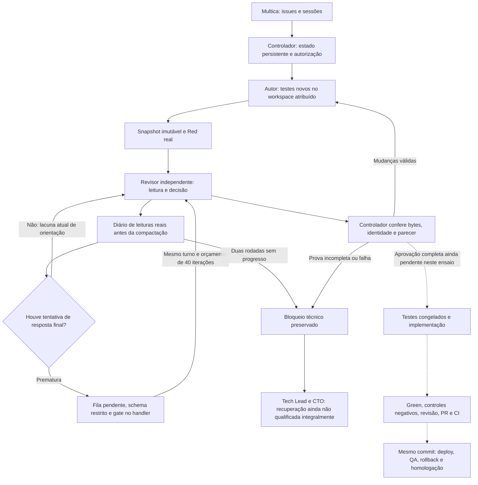

# Mapa da implementação

Este documento mapeia o código existente e distingue a instalação de referência
das etapas ainda não qualificadas. A presença de um módulo não comprova sua
ativação no runtime. Não descreve uma arquitetura futura como se Temporal já
estivesse instalado.

Estado de referência: **23 de outubro de 2026**. Componentes existentes não
significam fluxo completo qualificado; consulte [STATUS.md](STATUS.md).

| Área | Entradas principais |
|---|---|
| Configuração e contratos | `team.example.json`, `kit_contract.py`, `project_selection.py`, `portable_contract.py`, `portable_run_spec.py` |
| Brief e planejamento | `planning_intake.py`, `planning_schema.py`, `planning_contract_review.py`, `materialize_plan.py`, `compile_planned_sequence.py` |
| Coordenação persistente | `brief_delivery_supervisor.py`, `dependent_sequence.py`, `sequence_supervisor.py`, `portable_supervisor.py` |
| Multica e ACP | `acp_wrapper.py`, `broker/native.py`, `broker/acp_transport.py`, `broker/acp_probe.py` |
| Broker e handoffs | `broker/server.py`, `broker/handoffs.py`, `broker/handoff_runtime.py` |
| TDD e entrega congelada | `broker/tdd_evidence.py`, `broker/test_first_protocol.py`, `review_instruction.py`, `additive_test_policy.py` |
| Qualidade v2 | `broker/quality_team_progress.py`, `broker/quality_review_attestation.py`, `quality_phase_tools.py`, `quality_review_stop.py` |
| Provas de leitura | `broker/quality_review_reads.py`, `broker/read_stream_receipts.py`, `artifact_read_evidence.py` |
| Paginação instalada, ativação inicial incompleta | `quality_review_paging.py`, `quality_review_stop.py`, `install_quality_review_stop.py` |
| Modelo e limites | `model_policy.py`, `model_proxy.py`, `broker/worker_model_config.py` |
| Capacidade e recuperação restrita | `proxy_capacity_contract.py`, `qualify_model_proxy_capacity.py`, `install_model_proxy_capacity.py`, `broker/quality_review_capacity_recovery.py` |
| Qualificação de paginação/compactação | `review_execution_evidence.py`, `qualify_quality_review_stop.py`, `tests/quality_review_stop_canary.py` |
| CI, publicação e QA | `portable_delivery.py`, `publication_access.py`, `portable_qualification.py`, `portable_browser_qa.py`, `browser_feedback_acceptance.py`, `deploy/` |
| Memória e contexto | `generated_context.py`, `broker/session_resume.py`, módulos de recuperação contextual no broker |
| Supervisão host | `register_brief_delivery_service.py`, `register_portable_host_service.py`, `host_awake_guard.py` |
| Docker e limpeza segura | `docker_grouping.py`, `cleanup_delivery_test_containers.py`, `cleanup_obsolete_images.py` |

Os caminhos acima são relativos a `team-delivery-kit/`. Não são APIs estáveis ainda.

## Caminho de revisão v2 e limite atual

As setas tracejadas indicam etapas ainda não comprovadas nesta linhagem nativa
v2, não uma dispensa de execução. Feedback, planejador, diário e paradas estão
instalados no controlador `20261023.30` e worker `20261023.6` da referência.
Ainda falta ativar a orientação de paginação desde a primeira chamada:
`apply_request()` retorna sem projetar a fila quando não existe estado de uma
resposta final prematura. O caminho só de ferramentas pode alcançar o detector
de falta de progresso sem receber essa orientação. A correção está pendente,
não representada como funcionalidade já implantada.

O diário é limitado a 512 pares/8 MiB, vincula execução e manifesto, não descarta
evidências para caber no limite e sugere até 16 páginas com um offset comum
quando a fila está armada. IDs diferentes não transformam os mesmos bytes em
progresso. Divergências de conteúdo bloqueiam, não reiniciam a inspeção.

Os hooks capturam antes da preparação da próxima chamada e depois das
ferramentas, antes de sua compactação. A projeção do schema restringe caminho,
offset e limite sem remover restrições anteriores. O despacho apenas verifica;
o handler consome atomicamente a página, inclusive em chamadas diretas/paralelas.
Essa distinção foi necessária: consumir no despacho e no handler bloqueava
leituras legítimas no registry real. O canário falho permanece preservado.

O conjunto inicial do canário que qualificou a instalação passou no Hermes
real com sete respostas locais: ACP normal, negação de duplicatas, duas rodadas
sem progresso e saída no fim do orçamento. O controle desta última fronteira
usa uma iteração sintética;
a fábrica ACP permanece fixada em 40. A extensão de escala percorreu 219 páginas
de 71 arquivos (563.066 bytes), com 23 chamadas principais, duas sumarizações
locais e duas compactações reais. Elas removeram 197 pares da conversa sem
perder cobertura no diário. Esse caminho começa por uma resposta prematura;
não qualificou a orientação inicial do fluxo só de ferramentas.
A instalação foi seguida de uma revisão nativa: sete chamadas, 16/71 arquivos
completos e parada `read_progress_stalled` com 33 iterações restantes.
A atestação bloqueou o diagnóstico como parecer inválido; não houve aprovação.
A projeção da interface e o diário consultivo do worker não substituem os recibos
ACP do controlador. O diário não é persistência entre reinícios ou memória de
projeto; nenhuma evidência sintética da fixture vira leitura nativa do revisor.

O proxy aceita um conjunto finito de limites de corpo, até 2 MiB, separado do
teto persistente de chamadas. Capacidade de transporte não é capacidade de
ferramenta nem autorização para novas tentativas. Workers continuam sem
credenciais de infraestrutura ou socket Docker. A recuperação de uma falha por
tamanho exige prova dessa falha exata; não se aplica ao esgotamento de iterações.

`quality_review_completion_recovery.py` também possui uma rota administrativa
restrita de inspeção nativa falha: exige leituras incompletas mas válidas, nenhum
byte divergente, encerramento real da execução e outro worker fisicamente
qualificado. O erro original e a incerteza causal são preservados. A rota não
reutiliza a prova de capacidade do proxy, não libera o autor e não aceita um
parecer ausente. O coordenador despacha outra revisão só após instalação,
registro e liberação explícita da manutenção. A sucessora precisa produzir
seus próprios recibos antes de congelar testes ou habilitar implementação.
Esse registro e o despacho ocorreram, mas a sucessora permaneceu bloqueada.
Uma nova recuperação exige condição realmente modificada e qualificada,
não outra identidade para repetir o mesmo perfil.

O coordenador `quality_team_progress.py` termina seu acompanhamento atual em
`awaiting_independent_delivery_review`. Esse checkpoint não é `HOMOLOGADA`;
a continuidade da cadeia v2 até revisão da entrega, PR/CI e deploy/QA/rollback
ainda precisa ser implementada e qualificada.

## Fontes de verdade e responsabilidade

Multica apresenta issues, atribuições e sessões. Os controladores mantêm ledgers e recibos; GitHub mantém commits, PRs e checks. Snapshots preservam a entrega que o revisor examinou. Texto de um agente não substitui nenhum desses registros.

Sessões são contexto de conversa, não a única memória de um projeto. Decisões, critérios, evidências e incidentes devem ser recuperáveis por identidade durável. Contexto ou memória não concedem novas permissões. A recuperação entre perfis e projetos continua sendo uma dimensão de qualificação, não uma garantia universal.

O watchdog exporta classe, localização e hash de erros, nunca o texto privado da
exceção ou variáveis locais. Um handle de calibração anteriormente observado e
comprovadamente ausente fica bloqueado com responsável técnico, identidade e
observação anteriores preservadas. Não é recriado nem convertido em calibração
aprovada. Ausência confirmada não equivale a timeout de inspeção: resultados
incertos continuam sob observação. Esse tratamento não comprova resiliência
universal; a continuidade entre cards ainda exige evidência ponta a ponta.

### Contexto integral sem truncamento

`execution_context.py` permite registrar conjuntamente o contexto de implementação e as instruções de revisão, com hash SHA-256 e limite explícito de 12.000 caracteres por conteúdo. A issue pode transportar apenas uma referência. O broker resolve a referência a partir da rota imutável do controlador, verifica issue, perfil e modo e registra um recibo por execução antes de apresentar o conteúdo integral ao agente. Não há leitura de URLs arbitrárias nem concessão de ferramentas por essa referência. Uma alteração de conteúdo invalida o hash; uma referência não registrada é rejeitada.

A compilação usa esse mecanismo somente quando habilitado explicitamente. As rotas legadas mantêm seus limites anteriores. Sua validação offline não equivale à qualificação de uma entrega autônoma; a instalação e o ensaio ponta a ponta continuam necessários.

### Revisão de testes e recuperação sem permissões implícitas

`broker/test_revision_review.py` separa a aprovação dos testes da aprovação da entrega. Uma revisão aprovada permite implementar contra o Red congelado; não permite alterar testes, integrar código ou declarar homologação. O revisor lê snapshots completos e não dispõe de terminal ou escrita.

`typed_decision_contract.py` permite uma única correção de comprimento por execução, registrada no ledger do proxy. Somente os campos textuais excedidos podem mudar. Parecer, achados, identificadores e referências não podem ser trocados ou removidos. A resposta original permanece rejeitada; o proxy não executa ferramentas nem aceita o parecer em nome do controlador.

`broker/review_format_recovery.py` qualifica uma nova revisão somente leitura após uma mudança comprovada do contrato. Preserva a rejeição anterior, as leituras e o snapshot; não reinicia o autor nem repõe tentativas de bootstrap. A imagem instalada é verificada por um teste fixo sem chamadas ao provedor.

`broker/technical_replan_certificate.py` certifica uma decisão efetivamente tomada pelo CTO após inspeção integral do candidato que falhou na suíte congelada. O certificado liga issue, execução, falha, Red e leituras. `portable_test_revision_recovery.py` continua impondo profundidade limitada: uma revisão adicional exige esse certificado, novo Red e revisão independente. Não há autorização para editar a baseline ou concluir a release. Falhas além do limite permanecem visíveis para um novo diagnóstico, não viram retries idênticos.

`pre_red_supervision.py` reconcilia projeções antigas com esses registros e tarefas nativas atuais, mesmo quando uma revisão termina entre duas observações. Essa retomada é de acompanhamento: não cria um parecer, um worker ou uma permissão.

## Limites reais de portabilidade

Há contratos genéricos, mas também scripts com nomes de cards, repositórios, caminhos locais, SHAs e imagens de ensaios. `projects/` preserva esses exemplos para testes e rastreabilidade; não deve ser ativado automaticamente em instalações novas. Overrides `port2` e LaunchAgents históricos exigem revisão antes de uso em outra máquina.

O código histórico em `bootstrap/infra/` não deve ser ligado simultaneamente ao kit. Configurações pessoais dessa instalação, vendors, worktrees e estados não fazem parte da exportação pública.

## Observabilidade e evolução de papéis

Todo recurso deve avaliar se instrumentação é necessária, desnecessária ou adiada. A infraestrutura de análise de produto/A-B ainda não está instalada. O contrato de evolução está em [`contracts/observability.md`](../team-delivery-kit/contracts/observability.md). DevOps consome métricas operacionais; Produto consome dados agregados; observabilidade não concede autoridade para coletar dados pessoais.
