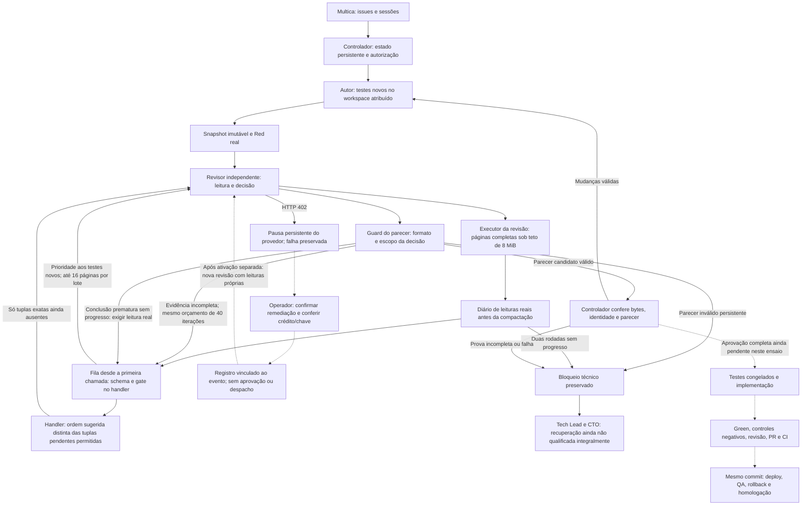
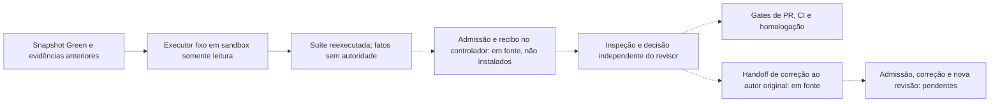

# Mapa da implementação

Este documento mapeia o código existente e distingue a instalação de referência
das etapas ainda não qualificadas. A presença de um módulo não comprova sua
ativação no runtime. Não descreve uma arquitetura futura como se Temporal já
estivesse instalado.

Estado de referência: **24 de outubro de 2026**. Componentes existentes não
significam fluxo completo qualificado; consulte [STATUS.md](STATUS.md).

## Caminho Hermes isolado em construção

[S0/S1](HERMES-S1-QUALIFICATION.md) qualificaram dispatcher, recuperação nativa
e isolamento. A [fatia S2](HERMES-S2-QUALIFICATION.md) acrescenta o fluxo abaixo,
sem instalar um novo gateway nem migrar o Multica. Autores/revisores são fixtures.

O journal não mantém tarefas ou releases. O store não é montado nos workers;
somente o snapshot necessário atravessa a fronteira. Não há import do broker
histórico, ACP ou um segundo scheduler no caminho novo. A [prova S3](HERMES-S3-QUALIFICATION.md)
usa Git real e transporte GitHub simulado, com checks processados pelo Hermes
upstream. Não foi exercitada publicação GitHub real. O adaptador contínuo,
incidentes executáveis e os agentes reais continuam pendentes.
Build/deploy/rollback e QA em Chromium já passaram na stack Python/HTTP local.
O navegador tem rede interna própria; só o web publica porta em loopback e
pode ter egress pela bridge. Não se afirma airgap do produto; ver
[ADR 0002](ADR-0002-LOCAL-WEB-AND-QA-NETWORKS.md).
O toolchain de navegador ainda usa cache local e precisa de base pública em S6.
A [ponte de ferramentas e sessões](HERMES-AGENT-QUALIFICATION.md) já passou com
`AIAgent`, ferramentas nativas, SQLite e Docker reais, usando respostas HTTP locais.
Isso não conecta ainda o serviço contínuo a toda a cadeia. `hermes.py` registra um
backend pela API de plugins, sem patch upstream; sua política de registry exige
processo isolado por claim e nunca deve ser instalada num gateway compartilhado.

Publicação e build/deploy separam autorização atual da identidade do efeito:
nova claim não renova CI nem repete build/Compose já aceitos. Artefatos e etapas
preservam seus recibos de origem; o QA independente aceita proveniência de várias
claims do mesmo card/contrato/entrega, não de outros autores ou revisões. A branch
é revalidada antes do rollout, antes da restauração e antes/depois do QA. Essa
retomada passou no Kanban/Docker reais com perda de confirmação simulada; o
roteiro acionou os wakeups, portanto ainda não é serviço contínuo autônomo.

## Instalação de referência antiga, preservada e pausada

| Área | Entradas principais |
|---|---|
| Configuração e contratos | `team.example.json`, `kit_contract.py`, `project_selection.py`, `portable_contract.py`, `portable_run_spec.py` |
| Brief e planejamento | `planning_intake.py`, `planning_schema.py`, `planning_contract_review.py`, `materialize_plan.py`, `compile_planned_sequence.py` |
| Coordenação persistente | `brief_delivery_supervisor.py`, `dependent_sequence.py`, `sequence_supervisor.py`, `portable_supervisor.py` |
| Multica e ACP | `acp_wrapper.py`, `broker/native.py`, `broker/acp_transport.py`, `broker/acp_probe.py` |
| Broker e handoffs | `broker/server.py`, `broker/handoffs.py`, `broker/handoff_runtime.py` |
| TDD e entrega congelada | `broker/tdd_evidence.py`, `broker/test_first_protocol.py`, `review_instruction.py`, `additive_test_policy.py` |
| Qualidade v2 | `broker/quality_team_progress.py`, `broker/quality_review_attestation.py`, `quality_phase_tools.py`, `quality_review_stop.py` |
| Provas de leitura | `broker/quality_review_reads.py`, `broker/read_stream_receipts.py`, `artifact_read_evidence.py` |
| Paginação instalada desde a primeira chamada | `quality_review_paging.py`, `quality_review_stop.py`, `install_quality_review_stop.py` |
| Modelo e limites | `model_policy.py`, `model_proxy.py`, `broker/worker_model_config.py` |
| Capacidade e recuperação restrita | `proxy_capacity_contract.py`, `qualify_model_proxy_capacity.py`, `install_model_proxy_capacity.py`, `broker/quality_review_capacity_recovery.py` |
| Recuperação de pagamento assistida pelo operador | `quality_provider_resolution.py`, `quality_review_provider_access.py`, `broker/quality_review_payment_recovery.py`, `qualify_quality_provider_access.py` |
| Qualificação de paginação/compactação | `review_execution_evidence.py`, `qualify_quality_review_stop.py`, `tests/quality_review_stop_canary.py` |
| Transporte completo na revisão | `quality_review_budget.py`, hook fixo em `agent/tool_executor.py` |
| Revisão final: componentes ainda não conectados ao despacho | `quality_delivery_review_policy.py`, `quality_delivery_review_job.py`, `Dockerfile.quality-delivery-review-job` |
| Admissão e validação final em fonte, não instaladas | `broker/quality_delivery_review_handoff.py`, `broker/quality_delivery_review_validation.py` |
| Worker/transporte final em fonte, não roteado | `broker/quality_delivery_review_launch.py`, fase de handlers `delivery_review_v2`; exige recibo original e snapshot somente leitura |
| Parecer e atestação final em fonte, não roteados | `quality_delivery_review_verdict.py`, `broker/quality_delivery_review_attestation.py`; só o stream do controlador prova leitura |
| Correção/continuação em fonte, não instaladas | `broker/quality_delivery_revision.py`, `broker/quality_delivery_review_progress.py`; opt-in em `quality_team_progress.py`, sem admissão do autor ou publicação implementadas |
| CI, publicação e QA | `portable_delivery.py`, `publication_access.py`, `portable_qualification.py`, `portable_browser_qa.py`, `browser_feedback_acceptance.py`, `deploy/` |
| Memória e contexto | `generated_context.py`, `broker/session_resume.py`, módulos de recuperação contextual no broker |
| Supervisão host | `register_brief_delivery_service.py`, `register_portable_host_service.py`, `host_awake_guard.py` |
| Docker e limpeza segura | `docker_grouping.py`, `cleanup_delivery_test_containers.py`, `cleanup_obsolete_images.py` |

Os caminhos acima são relativos a `team-delivery-kit/`. Não são APIs estáveis ainda.

## Caminho de revisão v2 e limite atual

As setas tracejadas indicam etapas ainda não comprovadas nesta linhagem nativa
v2, não uma dispensa de execução. Feedback, planejador, diário e paradas estão
instalados no controlador `20261023.36` e worker `20261023.11` da referência.
O controlador novo está com execução desligada, manutenção selada/drenada e
serviço host descarregado. Instalação não significa despacho habilitado.
`apply_request()` agora arma a orientação e o gate desde a primeira chamada,
sem depender de uma resposta final prematura. Testes novos têm prioridade;
uma rejeição fundamentada continua possível sem completar todo o escopo de
aprovação. A revisão sucessora terminou com 26/71 arquivos completos após seis
chamadas, sem parecer aceito: o gate de lote negou páginas legítimas ainda
pendentes que não estavam na recomendação daquela chamada.

A correção instalada mantém a recomendação de até 16 páginas, mas enumera
separadamente todas as tuplas pendentes verificáveis. Páginas de um arquivo
com total observado podem ser lidas fora de ordem; um arquivo ainda desconhecido
só permite offset 1. O schema enumera alternativas finitas e o handler valida
a tupla exata, não o produto cartesiano de caminhos e offsets. Cada página é
consumida uma vez. Negativas de plano trazem orientação distinta de operações
realmente proibidas; não concedem novos caminhos ou evidência de inspeção.
A qualificação física passou; o parecer nativo da nova revisão continua necessário.

O ensaio subsequente completou 53/71 arquivos, mas o orçamento agregado do
executor produziu 33 prévias de spill; outras quatro respostas eram deduplicações
sem conteúdo. Nenhuma delas contou como inspeção. A isenção de
`read_file` por resultado não impedia esse segundo mecanismo. O novo hook
`quality_review_budget.py` limita o agregado ao teto de 8 MiB já imposto pelo
diário, somente para a revisão autenticada. Assim os resultados podem chegar
inteiros à captura e à compactação; prévias não viram evidência. Outros modos,
permissões, limite de corpo do proxy e orçamento de iterações permanecem iguais.

A sucessora nativa comprovou 71/71 arquivos no controlador. Naquela tentativa,
o bloqueio estava no parecer: o JSON de `request_changes` não continha achados e
exigia Green e controles negativos antes de aprovar os testes. O controlador
recusou a decisão, preservando `technical_blocked`. O transporte completo foi
exercitado, mas não houve aprovação ou congelamento naquela tentativa. A
correção instalada repete o contrato da fase, hashes e critérios em cada pedido,
inclusive após compactação, e informa categorias fixas de rejeição. Após a
inspeção exigida, o pedido não oferece ferramentas e usa modo JSON somente
para sintaxe. Parser, inspeção, citações e identidade continuam obrigatórios.
O coordenador iniciou outra revisão nativa; ela terminou com 46/71 arquivos e
duas promessas em prosa, antes da decisão final sem ferramentas. A correção
seguinte exige uma leitura real pendente após conclusão prematura sem progresso;
depois dessa leitura, permite outra decisão independente e rejeição fundamentada
sem forçar todo o escopo de aprovação. JSON de sintaxe acompanha o modo
automático; o handler e os gates locais continuam obrigatórios. A correção
passou no canário real e foi instalada; ainda requer parecer nativo aceito.
A revisão seguinte comprovou os 71 arquivos no controlador, mas o primeiro
parecer final foi rejeitado como JSON inválido. A chamada de continuação recebeu
HTTP 402, propagado como falha nativa e bloqueio técnico. O proxy mantém uma
pausa persistente independente do teto de chamadas; não há parecer aceito ou
aprovação herdável. A recuperação específica passou na qualificação isolada
descrita abaixo, mas não foi exercitada com o provedor real.

### Recuperação de pagamento e autoridade do operador

O CLI host `quality_review_provider_access.py` exige confirmação explícita
antes de qualquer efeito. O programa fixo roda dentro do mesmo proxy, único
componente desse caminho que recebe a chave real. Consulta apenas crédito e
limites da chave, sem comandos arbitrários, compra ou chamada ao modelo.

O controlador revalida o evento original, execução nativa, snapshot, identidades,
lease fechada, worker retirado, contador e recibo com prazo de 15 minutos. O CLI
exige qualificações separadas do worker e do canário de pagamento na manutenção
corrente. O proxy deve estar parado no registro. A condição modificada fica
persistida com a falha anterior; o registro não cria task/grant nem aprova testes.
Uma revisão nova precisa produzir suas próprias leituras e decisão independente.

Intenção persistida e locks distinguem efeito em curso, conclusão parcial e
resultado não observado. Confirmação perdida permite observar o mesmo efeito;
conclusão parcial só pode finalizar o recibo positivo original sem repetir HTTP.
Isso não concede ao worker ferramentas financeiras ou administrativas.

O canário Linux usa uma fixture HTTP loopback e chave falsa, sem rede externa,
credencial real ou socket Docker. Seus oito pedidos locais não comprovam saldo
disponível. O adaptador foi instalado desligado e o pin migrado com histórico
preservado; remediação real, registro e ativação continuam pendentes. O caminho é assistido pelo operador,
não uma recuperação financeira autônoma já demonstrada.

### Revalidação própria na revisão da entrega

`quality_delivery_review_job.py` oferece uma operação fixa para executar a suíte
congelada novamente sobre o candidato Green e ligar os fatos à tarefa do revisor.
Exige Red, revisão dos testes, Green e sensibilidade completos e correspondentes;
não aceita comando, caminhos alternativos, seleção parcial de testes ou edição.
O resultado contém fatos de execução, sem se declarar autenticado ou aprovado.

Somente o executor passou na qualificação física com fixture; as setas
tracejadas não estão implementadas como ponte nativa completa. O job não pode
fornecer seu próprio recibo confiável ou provar sua admissão nativa. Esses
controles pertencem ao controlador e não podem ser substituídos por campos do
input ou declarações do agente. O coordenador instalado continua no checkpoint
`awaiting_independent_delivery_review`, sem aprovação da release.

O adaptador em fonte já prepara contexto imutável, confere a linhagem dos jobs
anteriores, registra intenção antes do wakeup e admite uma única tarefa nativa
com fase `delivery_review_v2`. O segundo módulo liga essa admissão ao job fixo
de suíte, confere seu recibo durável e revalida a origem antes/depois da execução.
Confirmação perdida, capacidade e prazos têm estado persistente; não renovam o
direito de repetir uma intervenção. Os testes usam native/SQLite/jobs de fixture,
não o Multica e um revisor reais. O flag dedicado é desligado por padrão.

O worker somente leitura, parser do parecer e atestação da decisão já existem
em fonte. A atestação confere conclusão nativa, execução fechada, política
inspecionada, sessão ACP, stream próprio e citações byte a byte. Mudanças apontam
para o autor original; incidentes técnicos apontam para o CTO, sem autorizar
execução. O despacho de mudanças e a continuação do coordenador já existem em
fonte, opt-in: uma aprovação aguarda publicação, não encerra a release. Ainda
faltam admissão/execução do autor corrigindo, revalidação da nova entrega,
publicação e qualificação nativa. Os adaptadores não foram
adicionados ao despacho instalado: uma capability criada em fixture não prova
que um worker real foi lançado ou que o produto foi aprovado.

### Fronteiras entre as decisões de qualidade

| Fase | O que uma decisão válida permite | O que não permite |
|---|---|---|
| Revisão independente dos testes | Congelar a revisão exata dos testes; o controlador ainda valida a admissão da implementação | Exigir Green como pré-condição, aprovar produto, merge ou release |
| Implementação e Green | Produzir código contra testes congelados e registrar suíte completa | Editar os testes aprovados ou revisar o próprio trabalho |
| Controles negativos | Demonstrar sensibilidade dos testes a regressões registradas | Substituir revisão independente da entrega |
| Revisão da entrega | Avaliar a entrega exata, com leitura e validação próprias do revisor | Usar aprovação de outro snapshot ou dispensar PR/CI |
| Homologação | Comprovar deploy, QA e rollback no commit qualificado | Declarar sucesso por encerramento de task ou worker ativo |

Essa tabela descreve o contrato e não afirma que todas as transições estejam
implementadas no coordenador v2. A inspeção integral permite decidir; nunca
seleciona automaticamente o resultado da revisão. `request_changes` exige
defeito concreto com evidência, e não ausência de uma etapa futura.

### Diário e qualificação da leitura

O diário é limitado a 512 pares/8 MiB, vincula execução e manifesto, não descarta
evidências para caber no limite e sugere até 16 páginas com um offset comum
quando a fila está armada. IDs diferentes não transformam os mesmos bytes em
progresso. Divergências de conteúdo bloqueiam, não reiniciam a inspeção.

Os hooks capturam antes da preparação da próxima chamada e depois das
ferramentas, antes de sua compactação. A projeção do schema restringe caminho,
offset e limite sem remover restrições anteriores. O despacho apenas verifica;
o handler consome atomicamente a página, inclusive em chamadas diretas/paralelas.
Essa distinção foi necessária: consumir no despacho e no handler bloqueava
leituras legítimas no registry real. O canário falho permanece preservado.

O conjunto inicial do canário que qualificou a instalação passou no Hermes
real com sete respostas locais: ACP normal, negação de duplicatas, duas rodadas
sem progresso e saída no fim do orçamento. O controle desta última fronteira
usa uma iteração sintética;
a fábrica ACP permanece fixada em 40. A extensão de escala percorreu 219 páginas
de 71 arquivos (563.066 bytes), com sete chamadas principais, uma sumarização
local e uma compactação real. Ela removeu 64 pares da conversa sem
perder cobertura no diário. Essa extensão usa ferramentas desde a primeira
resposta, sem inicializar estado de conclusão prematura. A candidata também
exerceu 157 leituras fora da recomendação e quatro lotes com offsets mistos.
O lote de 274.113 caracteres não gerou spill; o controle legado gerou, como esperado.
Após a leitura completa e a compactação, a fixture emitiu uma rejeição sem
findings; o guard a recusou com diagnóstico específico e a decisão seguinte
permaneceu sem ferramentas. Outro controle começou pelos testes novos e
obrigou a leitura restante após uma promessa prematura. São 16 respostas locais
no conjunto, sem provedor;
o resultado fixo da fixture não é um parecer independente real.
A revisão nativa anterior terminou com sete chamadas, 16/71 arquivos
completos e parada `read_progress_stalled` com 33 iterações restantes.
A atestação bloqueou o diagnóstico como parecer inválido; não houve aprovação.
A projeção da interface e o diário consultivo do worker não substituem os recibos
ACP do controlador. O diário não é persistência entre reinícios ou memória de
projeto; nenhuma evidência sintética da fixture vira leitura nativa do revisor.

O proxy aceita um conjunto finito de limites de corpo, até 2 MiB, separado do
teto persistente de chamadas. Capacidade de transporte não é capacidade de
ferramenta nem autorização para novas tentativas. Workers continuam sem
credenciais de infraestrutura ou socket Docker. A recuperação de uma falha por
tamanho exige prova dessa falha exata; não se aplica ao esgotamento de iterações.

`quality_review_completion_recovery.py` também possui uma rota administrativa
restrita de inspeção nativa falha: exige leituras incompletas mas válidas, nenhum
byte divergente, encerramento real da execução e outro worker fisicamente
qualificado. O erro original e a incerteza causal são preservados. A rota não
reutiliza a prova de capacidade do proxy, não libera o autor e não aceita um
parecer ausente. O coordenador despacha outra revisão só após instalação,
registro e liberação explícita da manutenção. A sucessora precisa produzir
seus próprios recibos antes de congelar testes ou habilitar implementação.
Esse registro e o despacho ocorreram, mas a sucessora permaneceu bloqueada.
Uma nova recuperação exige condição realmente modificada e qualificada,
não outra identidade para repetir o mesmo perfil.

O coordenador `quality_team_progress.py` termina seu acompanhamento atual em
`awaiting_independent_delivery_review`. Esse checkpoint não é `HOMOLOGADA`;
a continuidade da cadeia v2 até revisão da entrega, PR/CI e deploy/QA/rollback
ainda precisa ser implementada e qualificada.
`quality_delivery_review_policy.py`, em fonte, qualifica fatos vinculados a
Red, revisão de testes, Green, controles negativos e validação própria do
revisor no mesmo SHA. Seus seis testes são sintéticos; o módulo não está
instalado ou despachado. Essa política pura não altera
essa fronteira: não autentica por si só a proveniência nativa, não cria um
revisor, não executa validação e não concede merge.

## Fontes de verdade e responsabilidade

Multica apresenta issues, atribuições e sessões. Os controladores mantêm ledgers e recibos; GitHub mantém commits, PRs e checks. Snapshots preservam a entrega que o revisor examinou. Texto de um agente não substitui nenhum desses registros.

Sessões são contexto de conversa, não a única memória de um projeto. Decisões, critérios, evidências e incidentes devem ser recuperáveis por identidade durável. Contexto ou memória não concedem novas permissões. A recuperação entre perfis e projetos continua sendo uma dimensão de qualificação, não uma garantia universal.

O watchdog exporta classe, localização e hash de erros, nunca o texto privado da
exceção ou variáveis locais. Um handle de calibração anteriormente observado e
comprovadamente ausente fica bloqueado com responsável técnico, identidade e
observação anteriores preservadas. Não é recriado nem convertido em calibração
aprovada. Ausência confirmada não equivale a timeout de inspeção: resultados
incertos continuam sob observação. Esse tratamento não comprova resiliência
universal; a continuidade entre cards ainda exige evidência ponta a ponta.

### Contexto integral sem truncamento

`execution_context.py` permite registrar conjuntamente o contexto de implementação e as instruções de revisão, com hash SHA-256 e limite explícito de 12.000 caracteres por conteúdo. A issue pode transportar apenas uma referência. O broker resolve a referência a partir da rota imutável do controlador, verifica issue, perfil e modo e registra um recibo por execução antes de apresentar o conteúdo integral ao agente. Não há leitura de URLs arbitrárias nem concessão de ferramentas por essa referência. Uma alteração de conteúdo invalida o hash; uma referência não registrada é rejeitada.

A compilação usa esse mecanismo somente quando habilitado explicitamente. As rotas legadas mantêm seus limites anteriores. Sua validação offline não equivale à qualificação de uma entrega autônoma; a instalação e o ensaio ponta a ponta continuam necessários.

### Revisão de testes e recuperação sem permissões implícitas

`broker/test_revision_review.py` separa a aprovação dos testes da aprovação da entrega. Uma revisão aprovada permite implementar contra o Red congelado; não permite alterar testes, integrar código ou declarar homologação. O revisor lê snapshots completos e não dispõe de terminal ou escrita.

`typed_decision_contract.py` permite uma única correção de comprimento por execução, registrada no ledger do proxy. Somente os campos textuais excedidos podem mudar. Parecer, achados, identificadores e referências não podem ser trocados ou removidos. A resposta original permanece rejeitada; o proxy não executa ferramentas nem aceita o parecer em nome do controlador.

`broker/review_format_recovery.py` qualifica uma nova revisão somente leitura após uma mudança comprovada do contrato. Preserva a rejeição anterior, as leituras e o snapshot; não reinicia o autor nem repõe tentativas de bootstrap. A imagem instalada é verificada por um teste fixo sem chamadas ao provedor.

`broker/technical_replan_certificate.py` certifica uma decisão efetivamente tomada pelo CTO após inspeção integral do candidato que falhou na suíte congelada. O certificado liga issue, execução, falha, Red e leituras. `portable_test_revision_recovery.py` continua impondo profundidade limitada: uma revisão adicional exige esse certificado, novo Red e revisão independente. Não há autorização para editar a baseline ou concluir a release. Falhas além do limite permanecem visíveis para um novo diagnóstico, não viram retries idênticos.

`pre_red_supervision.py` reconcilia projeções antigas com esses registros e tarefas nativas atuais, mesmo quando uma revisão termina entre duas observações. Essa retomada é de acompanhamento: não cria um parecer, um worker ou uma permissão.

## Limites reais de portabilidade

Há contratos genéricos, mas também scripts com nomes de cards, repositórios, caminhos locais, SHAs e imagens de ensaios. `projects/` preserva esses exemplos para testes e rastreabilidade; não deve ser ativado automaticamente em instalações novas. Overrides `port2` e LaunchAgents históricos exigem revisão antes de uso em outra máquina.

O código histórico em `bootstrap/infra/` não deve ser ligado simultaneamente ao kit. Configurações pessoais dessa instalação, vendors, worktrees e estados não fazem parte da exportação pública.

## Observabilidade e evolução de papéis

Todo recurso deve avaliar se instrumentação é necessária, desnecessária ou adiada. A infraestrutura de análise de produto/A-B ainda não está instalada. O contrato de evolução está em [`contracts/observability.md`](../team-delivery-kit/contracts/observability.md). DevOps consome métricas operacionais; Produto consome dados agregados; observabilidade não concede autoridade para coletar dados pessoais.
