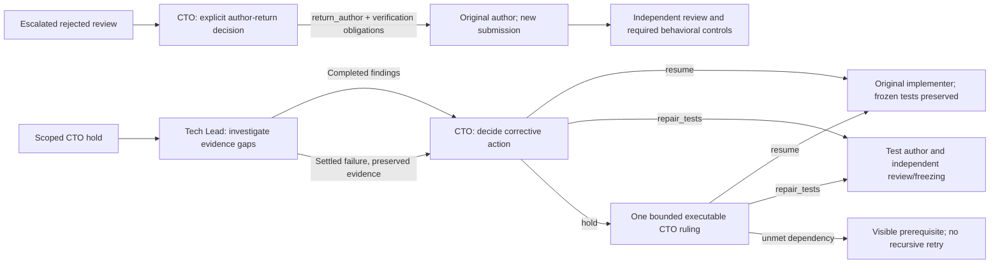

# Evidence-directed resolution of mixed technical holds

An implementation hold may contain both a product defect and an unreachable
frozen-test setup. Repeating the generic test-repair probe loses that distinction.
After a completed scoped CTO hold, the existing reconciler now creates at most
one native investigation/decision pair for the exact incident:

The investigator is read-only and can record findings only. The decision card
is created after that investigation settles. If it fails, the CTO depends on the
already completed original diagnosis, receives the investigator's recorded
failure and does not wait for an impossible completed-parent condition.
Neither role can modify the implementation or waive TDD/review/CI/QA gates.

Both cards receive the previous decision and observed failures/HTTP paths/status
with context origins. Repeated case inventories are projected out of the prompt,
not removed from the immutable receipts. Repeated assertion text must be compared
with actual response events and observer lifetime before alleging another request.
Existing evidence is not a delivery approval or a new experiment.

A hold in this pair requires `next_step`: a technical owner, concrete operation,
expected evidence and unmet precondition. Status exposes that structured step.
A completed decision-stage hold admits one idempotent `executable-decision-1` CTO follow-up, bound to the same unchanged incident. It does not create another investigation pair. The follow-up requires a ruling with a chosen alternative, bounded correction, remaining obligations and a classified blocker. A hold with no blocker is rejected. This structural check does not prove the semantic quality of the ruling. There is no automatic successor after that final hold. A further
failure remains visible and assigned, not homologated or automatically retried.
This does not promise recovery from every model failure; it removes the known
failed-parent dependency and gives the CTO a bounded executable decision stage.

Admission binds completed CTO identity, exact source run/contract/snapshot and
settled effects. Idempotency is per incident and role; interrupted reconciliation
cannot duplicate tasks. Existing holds remain historical, not retroactive test
repair authorization. Native parent gating and existing resume/repair contracts
continue to control any subsequent implementation or fixture change.

Qualification uses a copied native board with no model or worker: one Lead card,
one CTO card after an injected investigator failure, unchanged source workspace,
HTTP evidence available to the decision, structured hold, idempotent creation and
no recursive chain. Unit tests retain legacy recovery and forbid investigator
resume or CEO assignment. Production delivery remains assisted and unqualified
until the team completes all gates; this change itself is not homologation.

## Experiment and partial-correction boundaries

Diagnostic hypotheses are prose, not instrumentation. The fixed validator exposes
suite assertions and browser HTTP error path/status/case/context observations;
it does not promise response bodies or successful join responses. Product-only
replacements can test a concrete hypothesis in a disposable copy, keeping frozen
tests unchanged. They never become an author delivery.

A `resume` returns bounded corrective guidance to the original implementer;
it does not require every unrelated failure to have been diagnosed first and
never approves a failing suite. All remaining failures, independent review,
PR, CI and QA remain required. No gate or native recovery budget is reset.

## Incident-scoped fixture succession

Controller-admitted technical test repairs are limited by the exact incident,
frozen-test receipt, authorized paths and cases, rather than the lifetime count
of fixture repairs in the release. The controller reads immutable graph ancestry
and its reviewed repair authorities; a repeated identity is rejected even after
restart. Different evidence/scopes still require a newly validated CTO admission.
Historical receipts gain no permissions, and `fixture_depth` remains an audit
count. Legacy generic continuations retain their previous limits.

This does not waive independent review/freezing, source identity, idle downstream
checks or deployed-repair incompatibility. Replacement cards become available
only after the new graph is durable. Replaying that handoff uses the same cards.
A technical test repair is not delivery approval.

## Returning an escalated review to its author

A completed CTO hold on an exact rejected review may create one native CTO
author-return decision. The old hold is never converted into permission.
`return_author` requires fresh diagnostic evidence and explicit obligations for
a reachable scenario and a targeted negative control. The experiment may still
be Red; that alone does not demonstrate reachability or approve the test.

The controller validates the original independent rejection, snapshot, source
run, author provenance and settled effects. It returns the blocked review to the
original author using native parent gating and a `review_reopened` event, in the
same transaction as durable guidance. Failure/recurrence counters are preserved.
A rollback leaves the review blocked; replay does not duplicate the handoff.
No synthetic reviewer run, source edit or approval is created.

Author and subsequent reviewer receive the verification obligations. The author
must correct the setup without testing a different rejection rule. Independent
review must assess reachability and retain the specific regression risk; the
implementation must satisfy the existing behavioral controls before delivery.
The controller validates identities and structure, not the semantic adequacy of
prose: independent review and actual negative-control results remain essential.

## Strict fixture-author syntax recovery

The assertion/early-exit guard is unchanged. Exact assertion expressions include
message literals; adding assertions is not allowed by this narrowly scoped
contract. Local assignment/comprehension setup can preserve existing assertions
without `break`, `continue`, `return` or `raise`. Passing this structural check
does not prove behavioral equivalence.

A triaged fixture author with a matching structural submission refusal and exact
completed CTO diagnosis may receive one successor under the original repair
authority. The controller validates the incident, refused snapshot, original
freeze/paths/cases, idle graph tail and immutable diagnosis. The old triage and
counters remain historical; no reset occurs. A second syntax successor under
that authority is refused. New Red, independent review, freeze, full Green and
targeted negative controls remain required. The preserved implementation and
author snapshots remain separate. Offline prototypes are never agent deliveries.

Old held review decisions whose source run has advanced are historical and are
not reapplied to the new run. This avoids stale reconciliation alerts without
ignoring mismatches in a current recovery.
