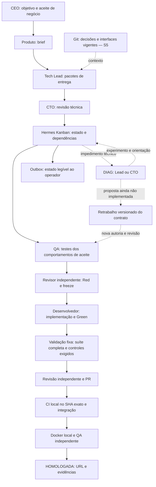

# Revisão da execução e próximos passos

Data: 25 de outubro de 2026. Código auditado: `98e0906947674134ea567b16188db5a6c1c61c90`.
Plano de referência: [simplificação aprovada em 24/10](SIMPLIFICATION-REVIEW-2026-10-24.md).
Destinatário da execução: GPT 6.1 Sol.

**Atualização posterior à auditoria:** o proprietário aprovou F1, registrado no
[ADR 0003](ADR-0003-BEHAVIOR-CONTROL-TARGETS.md). O contrato 2 foi implementado
e passou na prova física de navegador com teste auxiliar preservado. O feedback
completo do plano também passou no SDK/Kanban reais com respostas locais.
Este documento preserva o diagnóstico sobre a base auditada; consulte
[STATUS](STATUS.md) para execução atual. R2 foi qualificado no escopo offline
delimitado, incluindo recuperação de plano/integração e triagem com responsável
CTO. O S4 real continua pausado, aguardando nova fronteira e pré-condições.

**Natureza deste documento:** auditoria e proposta de sequência atualizada. A
estratégia anterior continua aprovada. Os refinamentos de contrato abaixo são
propostas explícitas; esta revisão não os instala, não retoma agentes e não
autoriza consumo adicional. Evidências operacionais completas ficam privadas.

## 1. Parecer

**Manter Hermes + Kanban. Corrigir o contrato de qualidade e completar as saídas
de recuperação existentes antes de acrescentar ferramentas ou infraestrutura.**

A mudança de estratégia foi bem executada na fronteira de infraestrutura:
Kanban nativo controla claims, dependências e revisões; o upstream está fixado
e sem patches; o modelo trabalha com ferramentas úteis em sandbox; snapshots,
recibos e efeitos externos têm identidades verificáveis. Multica e Temporal não
participam do caminho novo. Não há evidência que justifique outra troca agora.

A execução não está igualmente madura na semântica do trabalho. Há um gate de
qualidade incompatível com um teste já congelado, recuperação que cobre apenas
parte das fases e ausência de uma operação para corrigir legitimamente um
contrato de testes depois do freeze. Esses problemas podem paralisar inclusive
um modelo que implemente corretamente o produto.

O erro estratégico a evitar é tratar cada parada como necessidade de mais um
ensaio genérico ou de um novo módulo. Precisamos demonstrar que os contratos
podem ser cumpridos, que os agentes recebem o feedback necessário e que existe
uma saída autorizada quando um contrato está errado.

## 2. O que foi verificado

- Fontes do caminho novo, scripts de preparação, documentos de qualificação e
  semântica do Hermes fixado em `e06df9c2eae6901f4c88f464e0ae6e753c0428b8`.
- Board e runs nativos da tentativa mais recente, recibos de Red/revisão/freeze,
  manifesto e arquivos da entrega congelada; não apenas resumos de mensagens.
- Fronteiras das tentativas reais e checkpoint de pausa.
- Reexecução offline dos **233 testes do núcleo: todos passaram**.
- Contraexemplo isolado da condição de cobertura de mutações, usando o
  inventário congelado e o método real `Quality.controls`. Sem executar código
  do produto, modelo, Docker de validação, transições ou recibos de aprovação.
- Estado do relay: parado. Política do provedor: desabilitada. Desenvolvimento
  e objetivo persistente permanecem pausados.

Não foram refeitas chamadas ao modelo, publicações GitHub de produto, implantações
ou provas de instalação limpa. Resultados anteriores dessas partes conservam
seus limites originais. Testes unitários verdes não contradizem os achados:
faltava representar esses casos nos testes do controlador.

## 3. Estado real, sem porcentagem artificial

| Marco | Situação verificada | O que ainda não comprova |
|---|---|---|
| S0/S1 | Referência preservada e integração nativa qualificada | Entrega autônoma |
| S2 | Isolamento, Red, freeze, ferramentas e recibos funcionam; há defeito semântico no gate de controles | Contrato de qualidade satisfazível para qualquer conjunto aceito |
| S3 | Cadeia determinística de publicação/deploy/QA exercitada; CI local publicou status real da base | PR de feature entregue por agentes reais nesta sequência |
| S4 | Brief aceito, plano revisado, Red de navegador corrigido e congelado independentemente; implementação iniciada | Green, revisão da entrega, PR, integração e homologação completos |
| S5 | Mecanismos parciais já existem | Segunda versão real, regressão, memória compartilhada e recuperação pela equipe |
| S6 | Preparação parcial e configuração versionadas | Instalação limpa por terceiros sem caches privados |
| S7 | Não iniciado | Retomada do Truco sobre plataforma qualificada |

Há cinco fronteiras identificadas de tentativa S4. As quatro anteriores não
produziram uma entrega qualificável; a atual foi **pausada pelo proprietário**,
não deve ser classificada como falha simplesmente por estar parada. Até esta
auditoria, nenhuma release S4 foi homologada autonomamente.

Na tentativa atual, o autor de testes recebeu mudanças, corrigiu e obteve freeze
independente. Esse avanço é real. Foram congelados 13 casos: dois de baseline e
11 novos; o Red teve dez falhas de assertion. A aprovação de negócio reutilizou
um documento idêntico, conforme autorização: isso valida continuidade do aceite,
não uma nova descoberta autônoma de produto.

**Atenção:** o bloqueio descrito a seguir é uma previsão fundamentada do gate
futuro. Não é a causa da pausa humana atual e ainda não foi observado numa
submissão Green desta tentativa.

## 4. Achados prioritários

### F1 — O gate de mutações exige algo que um teste aceito não pode demonstrar

**Prioridade: P0, antes de novo consumo.**

Em [quality.py](../src/fabriquinha/quality.py), `red` registra todos os métodos
novos como `new_cases`. `controls` exige que cada um desses métodos apareça entre
as falhas de assertion produzidas por mutações. As mutações, corretamente,
podem alterar apenas o produto; testes e configurações ficam protegidos.

O snapshot congelado contém um teste que lê exclusivamente um JSON de cenários
QA dentro de `tests/` e valida suas chaves, tipos e identificadores. Ele já passa
no Red e não depende do aplicativo. O revisor pediu melhorias nesse teste e
depois o aprovou. Entretanto, o gate exige também que ele seja derrubado por uma
alteração no aplicativo.

O contraexemplo offline concedeu cobertura ideal de todos os dez casos novos
dependentes do produto. Mesmo assim, o gate rejeitou a entrega por faltar o
teste do JSON. Alterar produto de maneira legítima não muda esse JSON imutável.
Provocar efeitos colaterais no processo de testes seria sabotagem do executor,
não um controle negativo de comportamento aceitável.

**Diagnóstico:** foi implementada a regra “derrubar todos os métodos novos”, mais
forte e diferente de “controles negativos dos comportamentos concretos do card”
prevista na seção 8 do plano aprovado. Contar métodos não mede cobertura de
requisitos; testes auxiliares não são comportamentos do produto.

**Refinamento proposto:**

1. Derivar os alvos obrigatórios das falhas de assertion do Red validado, que
   já estão no recibo. O revisor confirma a cobertura dos comportamentos de
   aceite e pode acrescentar casos de risco que passaram no Red. Não pode
   excluir um alvo obrigatório nem aceitar comportamento de aceite sem cobertura.
2. Congelar esse conjunto explícito junto dos testes. O implementador não
   escolhe depois quais casos excluir. Os controles precisam derrubar todos
   esses alvos por falha funcional legítima, não por sabotagem do executor.
3. Testes auxiliares que já passam no Red continuam na suíte completa e
   protegidos. O revisor verifica sua finalidade; um teste crítico que passa
   no Red não fica automaticamente dispensado de controle negativo. Um teste
   de configuração independente do produto não precisa ser alvo de mutação dele.
4. Manter inventário integral, ausência de skips/erros, Red real, Green e revisão
   semântica. Não introduzir seleção parcial de suíte nem percentual arbitrário
   de mutação. Controles sobreviventes nos alvos exigidos bloqueiam.
5. Registrar a relação critério/risco → teste → defeito esperado com os IDs e
   recibos existentes. Não começar por outro cadastro, linguagem de regras ou
   serviço de cobertura. Se não for possível justificar os alvos, devolver os
   testes antes do freeze, em vez de transferir a contradição ao implementador.

Essa é a intervenção mínima recomendada. Trocar simplesmente `new_cases` por
falhas do Red sem a revisão de cobertura também seria insuficiente: deixaria
passar um teste vacuamente verde ou um risco relevante não exercitado. O cálculo
automático reduz o trabalho de formato; o julgamento independente continua
necessário. Não existe equivalência mecânica entre quantidade de métodos e
correção de todos os requisitos.

Não corrigir removendo silenciosamente o teste congelado, aceitando qualquer
mutante que falhe ou convertendo o recibo antigo para o contrato novo. O teste
auxiliar pode continuar útil; o defeito principal está na exigência do gate.

Há ainda uma simplificação preventiva: o controlador já valida o formato de QA
em `browser.load_contract`. Novos projetos não precisam duplicar toda essa
validação nos testes de produto. Testar o protocolo pertence à suíte do kit;
testar a experiência pertence à suíte do aplicativo. Isso não autoriza retirar
agora o teste que já foi congelado.

### F2 — A política de recuperação não cobre todo o ciclo de vida

**Prioridade: P1; corrigir os caminhos conhecidos antes do próximo S4.**

[Recovery.discover](../src/fabriquinha/recovery.py) admite origens `tests` e
`implementation`. `reconcile` procura `blocked`, mas não `triage`. Brief,
planejamento, integração e erros do próprio controlador não têm a mesma rota.
O Hermes encaminha a `triage` após reincidência do mesmo `block_kind`; o código
novo não consome essa transição. “Mesmo tipo” também não significa mesma causa.

| Situação | Caminho atual | Lacuna |
|---|---|---|
| Autor de testes/implementação bloqueado | DIAG Lead; escalada ao CTO; SPIKE e retomada | Retomada da mesma tarefa é a principal intervenção disponível |
| Revisor desses cards pede escalada | DIAG CTO | Reincidência pode cair em `triage` |
| Planejamento termina sem operação terminal | Bloqueio nativo | Não cria o diagnóstico técnico correspondente |
| Integração aguarda efeito conhecido | Agendamento e observação | Falha terminal de integração não recebe diagnóstico equivalente |
| `triage` | Proteção nativa interrompe a repetição | Falta consumidor técnico, sem resetar o breaker |
| Admissão/grafo/aceite final inválido | Erro em status, recusa de spawn ou registro de issue | Registro não executa reparação nem garante próxima ação |
| Falta de atendimento/progresso | Outbox aos 10/30 minutos | O alerta nomeia Lead/CTO; não cria necessariamente trabalho para eles |

[notifications.alerts](../src/fabriquinha/notifications.py) trata `ready`,
`review` e `running`; não cobre genericamente `blocked`/`triage`. É uma função
de notificação, não um escalonador de incidentes. Em consequência, “impasse sobe
na hierarquia” é verdade em parte do sistema, não uma garantia global.

A outbox existe, mas o transporte real de notificações não foi configurado na
instalação auditada. Mensagens enfileiradas não comprovam visibilidade pelo
Telegram. A ativação do canal único deve ser explícita; não é necessário
ressuscitar nove gateways antigos para entregar status sem modelo.

**Correção proposta:** uma única classificação de impedimentos sobre eventos
nativos. Cada não terminal deve ter trabalho executável, espera legítima com
condição de retomada, ou impedimento com dono e próxima operação. Usar o mesmo
card DIAG para os tipos admitidos; não criar um subsistema por mensagem de erro.
Estados sem reparação segura devem permanecer visíveis, sem tentativas pagas
idênticas e sem encaminhar decisões técnicas ao CEO.

Não desabilitar `triage` nem usar `unblock` indiscriminadamente. Preservar a fase
de revisão, autoria, contratos e breaker. Testar o segundo bloqueio e reinícios,
não somente a primeira recuperação bem-sucedida.

### F3 — Autoridade do CTO é menor que a responsabilidade atribuída a ele

**Prioridade: P1 para explicitar a saída; recuperação completa de contrato em S5.**

Em `Diagnostic.decide`, as operações são `resume`, `escalate` e `hold`. O SPIKE
pode mudar produto descartável e validar, mas não corrigir testes congelados,
revisar o grafo ou reatribuir trabalho. `Releases.check_card` rejeita alterações
diretas no contrato e nas dependências. São proteções corretas, mas falta uma
operação legítima entre “proibido alterar” e “pedir ao operador para consertar”.

**Freeze significa versão imutável; não significa especificação infalível.**
Um erro de teste deve permitir uma solicitação de retrabalho com causa e escopo,
dirigida ao autor de testes. A versão antiga permanece intacta; outra revisão é
produzida, revisada e congelada; aprovações e jobs dependentes antigos deixam de
ser elegíveis. O CTO não recebe escrita sobre a entrega nem autoridade para
enfraquecer baseline. Mudança de escopo de negócio continua com o CEO.

Implementar primeiro uma saída limitada para esse caso, usando cards e relações
nativos. Não construir replanejamento universal. Não arquivar um pai antigo
para “liberar” um filho: é necessário provar que o filho depende do novo freeze.
Até essa operação existir, anunciar claramente o limite da autonomia e produzir
impedimento técnico acionável, em vez de manter o mesmo autor tentando cumprir
um contrato impossível.

### F4 — Feedback de revisão ainda não é uniforme entre fases

**Prioridade: P1, correção pequena junto da cobertura de planejamento.**

[Board.review_feedback](../src/fabriquinha/board.py) recupera achados completos
das duas últimas revisões de testes/implementação, com vínculo ao artefato.
Para plano, `DraftTools.evidence` não oferece recuperação equivalente. O contexto
nativo inclui o resumo e o hash do parecer, mas não garante todos os `findings`;
o planejador documental não tem ferramenta para resolver esse hash.

O fluxo deve transmitir os achados estruturados completos ao destinatário da
correção, inclusive após reinício. A razão resumida não substitui os achados.
Usar a mesma semântica de decisão e erros de campo para os pareceres, sem criar
um compilador genérico de contratos. Qualificar uma devolução de plano em que
o achado importante aparece apenas em `findings`.

### F5 — Persistência de sessão ainda não é memória da equipe entre versões

**Prioridade: S5, sem bloquear a primeira entrega por isso.**

Há sessão por contexto de atividade, contexto nativo limitado do Kanban e recibos
compartilhados. Isso é útil. Porém [run_activity](../src/fabriquinha/hermes.py)
usa `skip_memory=True` e `skip_context_files=True`; a preparação cria perfis
com `no_skills=True`. Não se deve presumir que os SOULs, skills corporativas e
memórias dos perfis antigos estão ativos no caminho novo.

O planejador recebe o brief e limites da stack; não recebe um pacote canônico de
ADRs/interfaces da release anterior. A arquitetura atual circula em recibos
privados e prompts, sem publicação equivalente em Git nesta implementação.
Ler código a partir da sandbox não resolve a fase documental sem ferramentas
de leitura. Recordar uma conversa do mesmo card também não resolve outro perfil
planejando a versão seguinte.

**Solução pequena:** documentos versionados de brief/aceite, decisões de
arquitetura, interfaces e operação; um índice curto identifica os documentos
vigentes e os substituídos. O controlador fornece referências e conteúdo
relevante com leitura limitada adicional, sem leitura integral obrigatória.
Um ADR substituído continua consultável, mas não orienta trabalho novo. Não
introduzir banco vetorial ou outro serviço de memória.

### F6 — Preparação reproduzível e configuração ainda estão incompletas

**Prioridade: correções de configuração antes do S4; portabilidade completa em S6.**

[prepare_hermes_project.py](../scripts/prepare_hermes_project.py) declara
corretamente que não é instalador completo. Exige SDK/upstream e imagens já
disponíveis; branch, CI e relay têm preparação separada. O preparo ainda fixa
4.096 tokens de saída, enquanto o ensaio recente precisou de política explícita
de 8.192. Uma instalação nova pode não reproduzir a configuração validada.

[Dockerfile.validation-browser](../Dockerfile.validation-browser) depende de
uma imagem local histórica fixada por digest. Fixar o digest garante identidade,
mas não torna os bytes acessíveis ou reconstruíveis por outro usuário.

Manter uma fonte declarativa para capacidades, modelo e limites; preparar e
executar devem consumir os mesmos valores. Não aumentar limites automaticamente.
Em S6, reconstruir a imagem a partir de origem acessível e dependências fixadas,
e provar instalação a partir do clone sem caches antigos. O suporte atual é
Python/HTTP local, não uma plataforma genérica para qualquer stack SaaS.

### F7 — Crescimento documental e estrutural voltou a esconder o caminho principal

**Prioridade: limitar agora; organizar sem bloquear S4.**

O núcleo tem 19 módulos funcionais mais `__init__`, **5.060 linhas**, incluindo
a lane de qualificação S1. A meta original era aproximadamente 12/~3.000. Não
é motivo para compactar código artificialmente ou apagar controles corretos:
parte do crescimento corresponde a fronteiras necessárias. Exige, porém, uma
lista de responsabilidades e dependências ativas, não só registrar o desvio.

A dependência direta encontrada para código legado é o utilitário de agrupamento
Docker; não houve importação de todo o broker antigo. A lane S1 ainda fornece o
import nativo usado em produção. Separar futuramente esse pequeno adaptador do
harness é mais útil que fundir arquivos para reduzir a contagem.

README, status e roadmap misturavam progressos recentes, planos já cumpridos e
instruções históricas. Havia “preparar S4” onde S4 já estava em execução, e uma
tabela de percentuais legados dentro do status atual. Isso pode fazer a próxima
sessão repetir tarefas ou retomar o caminho errado.

Usar um status curto, um roadmap vigente e relatórios técnicos datados. História
de código permanece no Git; não acrescentar o diário de cada ensaio ao README.
Evoluir a documentação do caminho único antes de anunciar instalação pública.

## 5. Desenho recomendado

O diagrama é o destino proposto, com extensões pendentes indicadas. A política
de controle por comportamento ainda não substitui o gate atual. Entrega, memória
e recuperação completas não estão qualificadas por esse desenho.

Não criar mais papéis agora. Manter os nove disponíveis, ativados conforme o
entregável, sem nove aprovações obrigatórias. Especialistas acrescentam trabalho
quando necessário; não uma etapa fixa de passagem. No pequeno S4, a separação
Produto, coordenação/CTO, testes, implementação e integração/QA já é suficiente.

O Tech Lead deve administrar o trabalho, o CTO os impasses técnicos e o executor
as invariantes mecânicas. Nenhum deles precisa reinterpretar toda a história de
todos os agentes a cada handoff. Telegram é uma interface; Git, Kanban e recibos
têm responsabilidades diferentes e não precisam duplicar seus estados.

## 6. Plano executável para Sol

### R0 — Conservar a referência e concordar com o refinamento de qualidade

- Ler esta revisão, o ADR 0001 e o plano aprovado. Conferir pausa, contador,
  limite efetivo do ensaio e ausência de trabalho ativo; não liberar o provedor.
- Preservar os testes, snapshots e fronteiras atuais. A pausa humana não é falha.
- Registrar explicitamente o aceite do detalhamento F1 antes de mudar a regra
  instalada. Não inferir aprovação de gate a partir de uma resposta de produto.
- Se runtime ou contrato mudar para a continuação, usar nova fronteira de ensaio
  e provas novas. A tentativa antiga continua identificada, sem sucesso retroativo.

**Saída:** política inequívoca e referência recuperável. Sem nova implementação
do aplicativo pelo operador.

### R1 — Corrigir a contradição de qualidade offline

Arquivos principais: `quality.py`, `releases.py`, schemas de ferramentas e testes
do núcleo. Reutilizar recibos existentes, acrescentando apenas os alvos e vínculos
necessários; não criar um serviço de mutações.

1. Criar teste de regressão com um comportamento de produto e um teste auxiliar
   independente dele. O gate antigo deve revelar a incompatibilidade.
2. Congelar os alvos derivados do Red e os adicionais justificados na revisão,
   conforme F1, antes da implementação. Reutilizar IDs/recibos existentes.
3. Provar que remoção unilateral de alvo, critério sem controle, teste crítico
   vacuamente verde, mutante sem efeito, skip, alteração de teste e redução da
   descoberta continuam rejeitados na fronteira apropriada. Para julgamento
   semântico, usar o caso adversarial na revisão, sem alegar prova pelo parser.
4. Provar que controles reais dos comportamentos aceitos permitem a entrega,
   mesmo com teste auxiliar correto que continue passando.
5. Manter execução da suíte inteira em todos os gates exigidos. Um caso fora do
   conjunto de mutação não pode esconder erro, teste removido ou comportamento
   de aceite sem prova. A aprovação deve registrar a cobertura considerada.

**Saída:** contrato satisfazível e controles adversariais verdes, sem modelo.

### R2 — Fechar os caminhos conhecidos de feedback e impedimento

Arquivos principais: `board.py`, `intake.py`, `recovery.py`, `runtime.py`,
`notifications.py`. Trabalhar nos componentes existentes.

- Entregar achados completos na devolução de plano e recuperar após reinício.
- Consumir bloqueios de planejamento/integração e `triage` sem repetir a ação
  que acionou o breaker; preservar fase e prova de autoria.
- Distinguir espera externa, falha funcional e falha do contrato/controlador.
  O diagnóstico pode inspecionar sua evidência e recomendar reparação, mas não
  recebe socket, credenciais ou escrita no controlador para executá-la.
- Materializar dono e próxima operação para cada impedimento reconhecido.
  Se a operação não existir, declarar esse limite e estacionar sem novas chamadas.
- Conferir igualdade entre schema, prompt, handler e configuração preparada,
  incluindo orçamento de saída. Não recriar todas as instalações para corrigir
  documentação ou observar status.
- Qualificar deterministicamente: plano devolvido, erro de integração, segundo
  bloqueio para `triage`, reinício e espera de negócio sem escalada técnica falsa.

**Limite de escopo:** não completar todo o replanejamento, todas as falhas de
infraestrutura ou toda S5 antes de S4. A operação de retrabalho versionado de
testes pode ficar em S5 se o próximo S4 não a exigir. Se a exigir, bloquear com
causa precisa e implementá-la uma vez; não improvisar edição de teste congelado.

**Saída:** os caminhos conhecidos têm destino explícito e testado. Não prometer
recuperação automática de toda falha só porque existe um DIAG.

### R3 — Uma tentativa S4 completa, sem condução de etapas

- Usar o pequeno brief já aprovado, a stack qualificada e o mesmo modelo. Evitar
  misturar migração de modelo, framework ou escopo com a validação do processo.
- Pré-verificar navegador, CI, GitHub, quota e configuração. Cota global antiga
  não substitui o limite mais estreito do ensaio; não reservar chamadas extras
  sem autorização. Metadados privados guardam os valores atuais.
- Reaproveitar a configuração reproduzível; não importar aprovações de testes,
  produto implementado pelo operador ou resultados de tentativas antigas.
- Deixar Kanban despachar os handoffs. O operador observa; não escreve produto,
  corrige argumentos do agente, aprova pelo revisor ou libera cada card.
- Concluir Green, controles, revisão, PR, CI local, integração, deploy, QA e
  rollback no artefato correto. Testar a cadeia inteira, não mais um pré-Red.
- Usar a outbox para mensagens de início, término e impedimento. Ativar somente
  o transporte aprovado e configurado; não reativar os gateways antigos.

**Saída:** uma release `HOMOLOGADA` com URL/commit/PR/imagem/testes/QA e zero
intervenções técnicas externas depois do aceite. Uma pausa de orçamento é espera
explícita, não entrega nem motivo para esconder consumo. Um reparo do operador
torna a tentativa assistida; não apagar essa informação.

Se duas tentativas voltarem a falhar pela mesma classe sem evidência nova, parar
ensaios pagos e rever o contrato comum. Não responder aumentando contexto,
iterações ou quota por padrão. Avaliar outro modelo somente depois de separar
falha da plataforma de falha de raciocínio com entrada e ferramentas adequadas.

### R4 — S5: provar evolução, memória e uma recuperação legítima

- Segunda versão real no mesmo repo, com dois incrementos dependentes e todos
  os testes da versão anterior preservados.
- Publicar brief/ADRs/interfaces em Git e fornecê-los a um perfil com sessão nova;
  demonstrar uso da decisão vigente e rejeição de uma decisão substituída.
- Implementar/qualificar o retrabalho versionado F3 antes de declarar autonomia
  sobre contratos defeituosos. Provar que aprovação antiga não libera dependentes.
- Recuperar ao menos um incidente real dentro das capacidades da equipe; demais
  falhas mecânicas podem ser determinísticas. Não usar um modelo pago para cada
  variação de timeout, ACK ou reinício.

**Saída:** nova versão com regressão, continuidade de memória e recuperação por
Lead/CTO; não apenas retomar o mesmo worker.

### R5 — S6: distribuição simples, depois troca do caminho ativo

- Preparação única a partir de configuração; imagem reproduzível sem cache
  histórico; doctor/status/start/pause/resume documentados e testados.
- Segundo repositório alterando configuração, sem copiar instalação privada nem
  editar Python específico para ele. Testar restauração/upgrade/rollback.
- README curto com fluxo vigente, limites e caminho de instalação; documentação
  antiga claramente histórica. Não mover fontes legados que builds ainda usem.
- Retirar serviços antigos apenas após prova, preservando recuperação e sem
  tocar em projetos alheios. Continuar agrupamento e limpeza Docker autorizados.

**Saída:** outra pessoa consegue reproduzir o caminho qualificado pelo Git.
Só então realizar o cutover e avançar S7/Truco. Não exigir suporte universal a
stacks para liberar uma plataforma explicitamente limitada à stack comprovada.

## 7. Métricas e regras para não voltar aos círculos

- Medir releases reais homologadas sem intervenção, tentativas assistidas,
  bloqueadas e pausadas separadamente; explicitar o denominador.
- Medir chamadas, custo e tempo por entrega, não quantidade de testes do kit.
- Medir tempo sem dono/próxima ação, devoluções sem feedback e incidentes que
  repetem a mesma operação sem informação nova.
- Identificar separadamente prova determinística, decisão real de modelo,
  integração real e portabilidade. Nenhuma substitui a outra.
- Cada nova abstração deve substituir algo ou resolver uma necessidade
  observada deste fluxo. Não minificar código para obedecer ao orçamento de
  linhas; não ampliar a lista de qualificações para evitar tentar entregar.
- Continuar fixando upstream. O adaptador usa também funções internas do Hermes;
  zero patches não significa API estável. Atualizações exigem requalificação da
  fronteira, sem upgrade automático durante um ensaio.
- Três marcos finais continuam úteis: primeira entrega, segunda versão com
  regressão/memória e instalação em outro repo. São demonstrações, não SLA
  estatístico nem garantia de que toda tarefa futura terminará sem impedimento.

**Ordem imediata:** R0 → R1 → R2 limitado → um S4 completo. Não retomar diretamente
a implementação sob o gate contraditório; não iniciar outra migração; não
antecipar toda S5/S6. O plano aprovado continua correto na direção e precisa
desses ajustes na execução.
