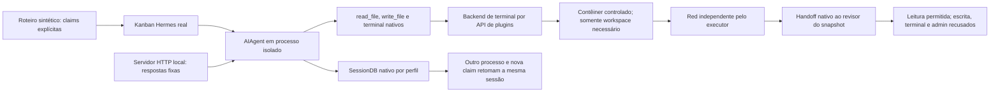

# Ponte nativa de ferramentas e sessões Hermes

Data: 24/10/2026. Parte de [S2](HERMES-S2-QUALIFICATION.md), após a
[cadeia mecânica S3](HERMES-S3-QUALIFICATION.md).

**Passou com `AIAgent`, ferramentas nativas, SQLite e Docker reais; as nove
respostas HTTP foram locais e determinísticas.** Nenhuma chamada à OpenRouter,
alteração de modelo instalado, aprovação de teste/release ou migração.
Esta prova não representa autoria/julgamento por um LLM ou serviço autônomo.

## O que foi executado



1. O autor leu o produto pela ferramenta nativa, tentou sobrescrevê-lo e recebeu
   negação real de filesystem somente leitura. Criou um novo teste na área
   permitida, com hash de escrita confirmado pelo Hermes. Testes existentes
   continuaram protegidos por mounts somente leitura.
2. Executou a suíte pelo terminal nativo e observou a falha de asserção esperada.
   Esse feedback não substituiu o gate: o executor fez depois baseline e Red
   reais em jobs independentes e conferiu a preservação da suíte anterior.
3. O processo terminou. Outra claim e outro processo retomaram a mesma sessão
   usando `SessionDB.get_messages_as_conversation`. O servidor local recebeu
   o histórico de ferramentas. Os dez registros anteriores conservaram seus IDs,
   e somente dois registros novos foram acrescentados, sem duplicação do prefixo.
4. O handoff selecionou outro perfil, que leu o snapshot imutável da entrega,
   não o workspace mutável do autor. A sessão do revisor ficou em seu próprio
   perfil. A tentativa de `write_file` no loop foi recusada; chamadas diretas ao
   registry para escrita, terminal e conclusão administrativa também não tinham
   handler disponível. Não houve parecer de aprovação sintético promovido.

Foram cinco requisições locais do autor, uma de retomada e três do revisor.
`max_iterations=40` foi preservado. O transporte local usa uma credencial fictícia
e não é fallback de modelo. Os eventos de sessão e os resultados completos
permanecem privados; não publicar bancos, conversas ou configurações de instalação.

## Integração pequena, sem patch no loop

`src/fabriquinha/hermes.py` registra um `TerminalEnvironmentProvider` nativo,
com uma implementação de `BaseEnvironment` que executa somente dentro do
contêiner já criado pelo controlador. As ferramentas normais do Hermes conservam
seus schemas, paginação, guard de sobrescrita e execução. Não foram alterados
SDK, inferência, compactação, transcript ou arquivos upstream.

O backend Docker padrão do Hermes cria nomes aleatórios e pode remover com
`rm -f`. Ele não foi usado nem sobrescrito: o controlador usa o journal existente
para criar/iniciar/arquivar/parar/remover o ID exato, com agrupamento Compose,
sem force ou remoção de volumes. A expiração de um cache nativo não apaga a lease
do controlador. Uma regressão também comprovou retirada após confirmação de
criação perdida, sem repetir `create` ou esquecer o contêiner sem ID local.

Cada shell usa UID 65534, raiz somente leitura, rede `none`, limites de recursos,
capabilities removidas e nenhum socket, chave ou diretório privado montado.
O autor de testes só escreve na área de novos testes; o implementador pode editar
o produto com testes/configurações protegidos. A leitura do revisor usa o snapshot
conferido do handoff. O backend revalida a claim e a identidade da sandbox nas
operações; mudança de workspace ou perda de autoridade interrompe novas operações.

**Uma claim por processo.** A política remove handlers não permitidos do registry
desse worker e protege os mantidos com a autorização atual. Não instalar essa
política em um gateway multiplexado ou processo compartilhado entre perfis:
isso alteraria as capacidades das outras sessões. Não é um plugin geral pronto
para habilitar no painel. O worker contínuo ainda precisa encapsular esse caminho.

O loop SDK roda no processo **confiável do adaptador**, que pode consultar o
board e operar Docker. Não se afirma isolamento de SO entre SDK e controlador.
Código e comandos do produto rodam apenas no contêiner; ele não recebe esses
privilégios nem dados privados. O Hermes fixado e as extensões carregadas pelo
adaptador pertencem à base confiável, não podem vir do código gerado do produto.

## Dependências e reprodução

Mesmo upstream `v0.22.0`, SHA `e06df9c2eae6901f4c88f464e0ae6e753c0428b8`,
sem patches. O checkout mínimo de S1 precisou incluir os módulos de runtime que
aquela prova não importava. O venv novo é separado e usa o subconjunto de pins
do lockfile upstream em `scripts/requirements-hermes-agent.txt`. Não foram
instaladas as integrações opcionais pesadas nem baixados modelos/browsers.

Além do checkout S1, disponibilize os diretórios core necessários:

```bash
git -C .local-hermes-s1/upstream sparse-checkout add \
  providers acp_adapter locales plugins/browser plugins/web plugins/video_gen \
  plugins/model-providers plugins/context_engine plugins/memory
python3.14 -m venv .local-hermes-agent/venv
uv pip install --python .local-hermes-agent/venv/bin/python \
  -r scripts/requirements-hermes-agent.txt
.local-hermes-agent/venv/bin/python scripts/qualify_hermes_agent.py \
  --upstream .local-hermes-s1/upstream --root .local-hermes-agent/trial-new \
  --image sha256:ID_EXATO_DO_VALIDADOR
```

Execute as prévias de limpeza do `AGENTS.md` antes/depois e uma prova por vez.
O roteiro recusa raiz já existente, verifica os pins e não usa um home instalado.
Usa o mesmo validador canônico de S2; não cria imagens por tentativa.

Três tentativas anteriores foram preservadas sem aprovação: contexto fictício
abaixo do mínimo do Hermes, módulo de provedores ausente no checkout e guard de
edição ausente. O último erro negava toda escrita; o Red recusou a entrega sem
teste novo. Foram incluídos os módulos originais, não desativado o guard. As
claims falhas foram bloqueadas pela API nativa e as sandboxes retiradas.

Ao encerrar a prova válida, o card também foi bloqueado explicitamente como
experimento sem julgamento/aprovação, com zero runs abertos. Contêineres e jobs
foram arquivados e retirados. Workspace, snapshots e sessões foram preservados.

## O que falta para autonomia

- Registrar as operações fixas de submissão/parecer no worker: o modelo deve
  acionar o gate, não o operador interpretar sua mensagem final.
- Ligar esse worker ao `dispatch_once` nativo para executar a cadeia TDD completa
  com sessões, não apenas esta atividade de testes e leitura de revisão.
- Persistir a referência de continuação no contexto nativo, liberar slots em
  esperas, preservar o modo do revisor e despachar diagnóstico técnico real.
- Conectar status/notificações duráveis e, depois, qualificar modelo/GitHub reais
  com o provedor liberado pelo caminho autorizado. S4 continua não iniciado.
- Validar memória de projeto entre perfis/releases; retomar a sessão de um autor
  não prova memória agentica de toda a equipe ou resistência à compactação.

A suíte do caminho novo totaliza 75 testes sem falhas. A prova física acima
complementa testes unitários; não é substituída por eles. A configuração nova
permanece separada do runtime legado pausado e do Truco.
