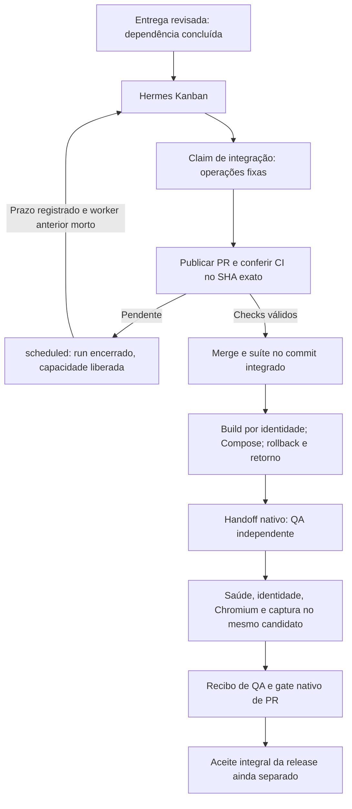

# Integração, espera de CI e QA pelo serviço nativo

Data: 24/10/2026. Continuação de [S3](HERMES-S3-QUALIFICATION.md) e do
[serviço contínuo](HERMES-RUNTIME-QUALIFICATION.md).

Estado desta fatia: **passou em ambiente isolado, sem modelo e com GitHub
simulado**. Não há migração ou liberação de provedor pago. Isso qualifica a
execução mecânica pelo serviço, não uma entrega autônoma por modelos e GitHub reais.

## Fronteira implementada

O mesmo `Runtime` reconhece o modo `integration` a partir do card/claim nativos.
Nesse modo não abre um SDK ou shell para o modelo. Executa as operações fixas já
qualificadas de `Publication`, `Deployment` e `Runner`; autoria/parecer do código
permanecem em cards anteriores com TDD e revisão independente.



- A integração exige o contrato nativo de conclusão por PR do repositório, não
  `local-only`. O recibo de entrega é resolvido de um pai concluído e validado
  contra projeto, release e revisão independente antes da publicação.
- `Pending` externo encerra a claim via `schedule_task`. O motivo referencia um
  recibo imutável com projeto, contrato, responsável, run e horário de retomada.
  Não há tabela/estado de workflow adicional ou worker fazendo polling de CI.
- O tick usa `unblock_task` somente para essa espera reconhecida. Reconfere a
  última tentativa, atribuição, contrato e identidade do worker. Não desbloqueia
  credenciais, falhas técnicas ou decisões humanas como se fossem espera de CI.
- O upstream pode limpar os campos PID de uma tentativa encerrada. Nesse caso,
  a identidade vem do evento nativo `spawned`/`worker_registered` do mesmo card e
  run. PID nulo não prova morte; PID reciclado não herda a identidade original.
- Efeitos já aceitos são reobservados pelo journal existente; prazos originais de
  PR/CI/build/deploy não recomeçam porque uma nova claim foi criada.
- O guard upstream `active_pr` fica intacto. Recibos e metadata carregam a relação
  com o PR; não se adiciona um comentário de URL para forçar um respawn. Uma
  intervenção externa que acione esse guard permanece visível, sem bypass.
- Jobs locais de suíte/navegador são computação real, com espera limitada ao
  prazo do executor. A revisão não usa `scheduled`, que perderia a fase no
  upstream fixado. Uma pendência inesperada no QA continua bloqueada/visível.
- QA usa o perfil independente da matriz, testa a imagem/commit implantados,
  confere CI do merge novamente e conclui pelo gate nativo de PR. Isso produz
  `release_evidence`, não declara automaticamente `HOMOLOGADA`.

## Prova e limites

O roteiro `scripts/qualify_hermes_integration.py` parte do TDD determinístico S2,
com Red/Green, congelamento, controles negativos e pareceres sintéticos. Depois
cria somente o card inicial de integração. Claims, esperas, retomadas, publicação,
handoff de QA e conclusão desse card pertencem ao serviço real.

O transporte GitHub da fixture é persistido entre processos; simula confirmação
perdida e checks pendentes. Não é instalado como opção do serviço de produção.
O código normal continua usando GitHub CLI e não permite escrever no GitHub real
quando `qualification=true`. Não existe endpoint de CI falso na configuração
de produção.

A primeira tentativa chegou ao QA, mas falhou na auditoria do verificador porque
os PIDs já haviam sido limpos pelo upstream. Ficou registrada como não aprovada;
seu deploy e redes vazias foram retirados após conferência das identidades pelos
eventos nativos, preservando evidências, imagens e snapshots. A correção foi
testada antes de uma nova tentativa, não aplicada para aprovar a prova antiga.

A segunda tentativa completou a cadeia sem reparo ou handoff do operador:

1. O serviço criou um PR pela fixture; a confirmação foi perdida depois do
   aceite. A claim foi encerrada em `scheduled` e outra reobservou o mesmo PR.
2. CI ainda pendente provocou outra espera sem run aberto. O dispatcher terminou
   normalmente; a fixture disponibilizou checks verdes e outro dispatcher
   retomou a espera pelo horário persistido, sem `unblock` manual.
3. Git real registrou a proposta e o merge; o executor conferiu CI no SHA de merge
   e reexecutou a suíte completa. Houve um único PR e um único merge simulados.
4. Dois builds reais produziram baseline/candidata. Quatro operações Compose
   fizeram bootstrap, candidata, rollback e retorno, observadas em novas claims
   sem repetir os efeitos já aceitos.
5. O handoff nativo atribuiu QA a outro perfil. Chromium exercitou o comportamento
   HTTP, gerou captura e conferiu a mesma imagem/commit. O gate nativo de PR
   aceitou a conclusão do card, sem declarar uma release homologada.
6. Foram nove runs de integração: seis `scheduled`, um `crashed`, um handoff de
   revisão e um QA concluído. O crash de inicialização foi recuperado nativamente,
   sem reparo do operador. O erro reportava `-shm` não gravável; os arquivos
   posteriormente estavam graváveis. O preflight upstream verifica arquivos
   transitórios em passos separados: uma corrida de desaparecimento do sidecar
   é hipótese plausível, não causa causalmente comprovada. Não se apagou WAL/SHM,
   alterou permissão ou adicionou retry específico para converter o resultado.
7. Serviço e workers terminaram, sem claims abertas. Logs/metadados foram
   preservados e o deploy descartável e suas duas redes vazias foram retirados
   por identidade exata. O demo anterior continuou saudável; Toso e legado não
   foram alterados. A limpeza ficou restrita aos recursos desta qualificação.

A observação operacional deve usar o `runtime status`/API nativa, não abrir o
banco vivo com uma CLI SQLite independente. O erro transitório e a primeira
tentativa permanecem no histórico; não se relata um ensaio sem falhas. O
denominador desta qualificação é duas tentativas, uma aprovada no escopo acima.

Oito testes de regressão novos cobrem contrato nativo de PR, espera durável,
conservação de fase, atribuição/contrato alterados, identidade após limpeza de
PID, ausência/divergência de evento de spawn, prazo local e QA no SHA integrado.
Total: **125 testes do caminho novo**, sem falhas ou skips; **4.523 históricos**,
com oito skips preexistentes e nenhuma falha. Nenhum teste foi removido.

## Reprodução

Use os ambientes/imagens fixados das qualificações anteriores e uma raiz nova.
Faça as prévias de limpeza do `AGENTS.md` antes/depois. O roteiro retira somente
seu deploy descartável e redes próprias vazias ao término, após arquivar logs e
conferir ausência de claims, workers e efeitos pendentes. Nenhum volume ou
snapshot é removido; a URL retirada é evidência histórica, não serviço disponível.

```bash
HERMES_DISABLE_LAZY_INSTALLS=1 .local-hermes-agent/venv/bin/python \
  scripts/qualify_hermes_integration.py \
  --upstream .local-hermes-s1/upstream --root .local-hermes-integration/trial-new \
  --image sha256:ID_EXATO_DO_VALIDADOR \
  --browser-image sha256:ID_EXATO_DO_BROWSER
```

## Próximos limites

Faltam admissão de perfis/recursos, pausa/drain explícitos, brief/plano/aprovação
de negócio e critério integral de aceite da release. Incidentes de integração
ainda não percorrem todo o diagnóstico técnico qualificado para TDD. Telegram,
modelo e GitHub reais, segunda release/memória e instalação portátil permanecem
pendentes. Não converter essas lacunas em mais uma rodada de controles genéricos
antes da primeira entrega pequena S4.

O código ativo tem 15 módulos funcionais, 3.310 linhas físicas incluindo a lane
S1 e `__init__`. A conexão acrescenta cerca de 120 linhas ao módulo operacional,
sem novo módulo/coordenador/DB. O desvio de aproximadamente 310 linhas da meta
inicial de 3.000 continua explícito; não é motivo para minificar o código nem
evidência de autonomia.
