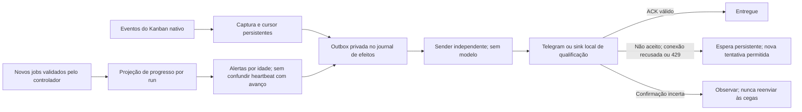

# Outbox e observabilidade sem chamadas ao modelo

Data: 24/10/2026. Continuação do [serviço](HERMES-RUNTIME-QUALIFICATION.md) e da
[recuperação técnica](HERMES-RECOVERY-QUALIFICATION.md). Parte de S2.

**Passou com serviço, Kanban, SDK e Docker reais, usando transporte local de
notificações.** Foram nove execuções e 21 mensagens aceitas, com início/término
únicos por run. O trabalho continuou durante conexão recusada; um ACK perdido
foi recuperado por consulta, sem outro envio. Houve reinício sem perder a fila.
Decisões/autoria continuam programadas: 27 respostas locais, zero chamadas pagas.
Nenhum bot, grupo Telegram ou gateway antigo foi reativado.

## Desenho



`notifications.py` usa o diretório privado de efeitos já existente. Não cria
outro banco ou ciclo de vida de cards. A fila representa somente entrega de
mensagens. O estado das tarefas continua exclusivamente no Kanban.

- O cursor avança apenas depois de persistir as mensagens anteriores. Uma
  âncora de evento detecta troca/reset de banco; não reutiliza IDs silenciosamente.
- A primeira ativação parte do fim do histórico existente, sem republicar o
  board antigo. Eventos posteriores permanecem disponíveis após reinício.
- Início é deduplicado por run: `spawned` e `worker_registered` não geram dois
  anúncios. O ator vem do run, não do assignee atual que pode já ser o revisor.
- Textos são fixos, com namespace/card/run/ator/fase. Não copiam títulos, código,
  brief, stack trace, credenciais ou erro bruto. Conclusão de atividade não é
  anunciada como homologação da release.
- Captura e envio são separados. A thread do sender não ocupa slot de agente,
  não chama modelo e não torna falha de rede uma falha do trabalho.
- Arquivos privados e mensagens são persistidos antes do envio. Uma parada
  durante envio conserva a ambiguidade; a retomada observa, não repete o POST.
- Rejeição explícita fica visível. Retry seguro tem prazo persistente e throttle
  por destino, respeitando `retry_after`. Trocar o chat não encaminha pendências
  antigas para outro destinatário.

O primeiro marco usa um ponto de notificação com o perfil responsável no texto,
conforme o plano de simplificação. Isso não exige nove gateways ou conversa
bot-to-bot para haver progresso.

## Progresso e status

O controlador registra uma projeção somente após observar um **novo job real**,
com recibo e identidade da execução. Repetir resultado em cache, trocar apenas
o texto da hipótese ou enviar heartbeat não renova o prazo. A projeção de monitor
é auxiliar: sua falha não invalida um recibo de qualidade já persistido.

O status consulta cards/incidentes reais e expõe `last_validation` nas execuções
ativas, além de contadores `queued`, `sending`, `uncertain`, `rejected`,
`delivered` e `corrupt`. Há alertas padrão aos 10 e 30 minutos sem evidência
adequada, deduplicados por execução/evidência/limiar. Espera em fila não é tratada
como prova de loop. O alerta atribui atenção técnica; **não** afirma que o CTO
já executou uma ação. A recuperação automática de worker bloqueado é o mecanismo
qualificado separadamente; classes sem run continuam pendentes.

`status.json` é observação datada, não prova independente de liveness. A parada
graciosa grava um último retrato com `dispatcher_state=stopped` e contadores
atualizados. Um smoke sem despacho/modelo conferiu 21 entregues e zero pendentes
após essa parada. O CLI `status` continua consultando fontes atuais, não apenas
o arquivo de observação. Comando Telegram de status ainda não foi integrado.

## Contrato do Telegram e limite de garantia

O transporte implementado usa HTTPS no host fixo `api.telegram.org`, sem seguir
redirects, sem parse mode e com `allow_paid_broadcast=false`. Exige arquivo
privado, destino explícito e não aceita Telegram em modo de qualificação.
**Não foi testado com bot/chave reais.**

`sendMessage` retorna a mensagem no sucesso; a API publica `retry_after` para
flood control. Não lista uma chave de idempotência do cliente ou consulta de
envio por essa chave. Portanto, após resposta perdida, não é correto prometer
entrega exatamente uma vez. [API oficial: requisições](https://core.telegram.org/bots/api#making-requests),
[sendMessage](https://core.telegram.org/bots/api#sendmessage),
[ResponseParameters](https://core.telegram.org/bots/api#responseparameters).

O sink local possui consulta por chave para testar reconciliação. Telegram real
não recebe essa capacidade fictícia: um ACK não observável permanece `uncertain`,
visível, sem reenvio cego ou interrupção do desenvolvimento. A pendência precisa
ser resolvida pelo procedimento operacional antes de se afirmar sua entrega.

## Prova e reprodução

O sink foi inicialmente mantido com socket vinculado, mas sem escutar. A conexão
foi recusada antes de transmitir HTTP, enquanto Lead/CTO/SPIKE/TDD avançavam.
Após reiniciar o serviço, o sink foi ativado. Seu primeiro envio aceito foi salvo
antes de derrubar a conexão sem resposta. A fila observou a mesma chave e não
repetiu o envio aceito. Todos os nove runs tiveram exatamente um início e um
término, com ator igual ao registro nativo. Resultado: 21 mensagens aceitas,
zero pendentes/incertas ao encerrar e nenhum auxiliar Docker próprio restante.

Use as dependências/upstream fixados da [ponte nativa](HERMES-AGENT-QUALIFICATION.md),
o validador S2 e raiz nova. Execute as prévias do `AGENTS.md` antes/depois:

```bash
.local-hermes-agent/venv/bin/python scripts/qualify_hermes_recovery.py \
  --notifications --upstream .local-hermes-s1/upstream \
  --root .local-hermes-notifications/trial-new --image sha256:ID_EXATO_DO_VALIDADOR
```

São 16 testes novos da outbox/transporte/progresso e uma regressão do status no
shutdown, além da recusa de deixar erro de escopo da fila parar o dispatcher:
**117 testes do caminho novo**. Nenhum teste anterior foi removido.
O transporte HTTPS foi verificado com mock; o ensaio HTTP local não substitui
uma validação futura do Telegram. As evidências completas continuam privadas.

Próximo marco: conectar publicação/CI/deploy/QA ao serviço, sem ocupar workers em
esperas. Falta admissão de perfis/recursos e a interface de brief/aprovação. Depois,
liberar o provedor pelo caminho autorizado e executar S4 com modelo/GitHub reais.
Não expandir para toda falha S5 antes dessa primeira entrega.

Complexidade atual: 15 módulos físicos e cerca de 3.200 linhas, incluindo a lane
S1. São aproximadamente 200 linhas acima da orientação inicial de 3.000: a outbox
é requisito explícito, não novo coordenador. Manter esse desvio visível e evitar
um módulo por erro; contagem de código/testes não comprova autonomia.
