# Diagnóstico técnico executável pelo Kanban

Atualizado em 25/10/2026. Continuação do [serviço nativo](HERMES-RUNTIME-QUALIFICATION.md)
e do [plano aprovado](SIMPLIFICATION-REVIEW-2026-10-24.md).

**Passou em ambiente isolado:** um bloqueio de protocolo criou cards nativos de
diagnóstico, houve escalonamento Tech Lead → CTO, SPIKE real em Docker, orientação
ao autor e nova passagem pelos gates TDD. Foram nove runs e 27 respostas HTTP
locais programadas. Zero chamadas pagas, GitHub real, migração ou homologação.
Isso qualifica o mecanismo, não o raciocínio de um modelo real.

## Fluxo implementado

```mermaid
flowchart LR
    F[Worker terminou sem handoff válido] --> B[Card original blocked; falha preservada]
    B --> L[DIAG Lead; falha de revisão vai ao CTO]
    L -->|escalate| C[DIAG nativo do CTO]
    C --> S[SPIKE em cópia descartável; suíte completa]
    S --> D[Decisão técnica tipada e evidência imutável]
    D -->|retomada segura| G[Comentário idempotente de orientação]
    D -->|triagem ou efeito expirado| H[CTO mantém bloqueio; próxima ação explícita]
    G --> U[unblock_task nativo: preserva a fase]
    U --> A[Mesmo autor/revisor retoma o trabalho]
    A --> T[Red, revisão, freeze, Green e controles]
    T --> R[Incidente resolvido somente com evidência válida]
```



O código fica em `recovery.py`. O serviço existente descobre bloqueios de workers,
materializa um card por incidente/estágio e despacha pelo mesmo `dispatch_once`.
Não existe outro banco de tasks, scheduler ou fila de agentes. O diagnóstico não
depende da conclusão do card que precisa destravar; não cria esse ciclo lógico.

Papéis técnicos são configuração explícita e imutável do projeto:

```json
{"technical_roles":{"lead":"techlead","cto":"cto"}}
```

O campo é opcional para as provas anteriores; sua ausência não altera fingerprints
antigos nem transforma bloqueio em recuperação. Sua inclusão muda o contrato do
projeto e exige preparação explícita da instalação, não edição silenciosa em voo.
Problemas de autor vão ao Lead; falha do Lead ou da revisão vai ao CTO. Diagnóstico
técnico não é aprovação de código; a matriz de revisão independente continua
obrigatória quando o trabalho original retorna aos gates.

## Ferramentas e limites

- Diagnóstico recebe leitura/busca do snapshot imutável, sem escrita, patches ou
  terminal genérico. Não monta o workspace mutável do autor para editar.
- `diagnostic_validate` aceita hipótese e substituições limitadas de arquivos do
  produto. O controlador cria a cópia, protege testes/configuração e executa a
  suíte completa no contêiner fixo, somente leitura, sem rede, chave ou socket.
- A experiência nunca copia código de volta ao autor. Um SPIKE pode produzir
  evidência e orientação; não se converte automaticamente em implementação.
- `diagnostic_decide` aceita apenas `resume`, `escalate` ou `hold`, com motivo e
  achados concretos vinculados ao snapshot. Retomar exige experimento real do
  run atual. O Lead pode escalar; o CTO não cria uma recursão de CTOs nem envia
  decisões técnicas ao CEO. Não há ação de aprovar produto ou dispensar testes.
- A ferramenta conclui **o diagnóstico**, não o trabalho original. Depois o
  controlador valida recibo/run/role/projeto, entrega a orientação e retoma pela
  API nativa. Claim, impedimento, contrato, assignee ou workspace divergentes
  recusam uma decisão obsoleta. Revisão não é retomada como implementação.
- Comentário e desbloqueio têm efeitos separados com intenção anterior ao envio
  e observação após confirmação incerta. Reiniciar não renova autoridade de uma
  claim antiga nem duplica a ação já observada.
- Duas retomadas com a mesma causa/conteúdo e sem evidência nova impedem uma
  terceira repetição automática. O impedimento continua visível; não conclui a
  release. A identidade da causa inclui contrato, fase, snapshot e falha.

O status deriva incidentes dos cards/recibos nativos. Worker ativo é
`revalidating`, não `resolved`. Até `done` sem recibo de qualidade resulta em
`evidence_missing`. A resolução depende do recibo exato de testes congelados ou
revisão da entrega do card original. Isso não é `HOMOLOGADA` da release.

## Evidência do ensaio

1. O autor leu o produto e encerrou em prosa, sem ferramenta terminal válida.
   A tentativa ficou bloqueada e a falha foi preservada; a promessa não foi
   interpretada como entrega.
2. O serviço criou o DIAG do Lead. Uma tentativa de retomada sem experimento
   foi negada. O Lead executou a suíte e escalou ao CTO com achados concretos.
3. O CTO teve tentativa de escrita recusada e não conseguiu alterar testes em
   um experimento. Depois mudou somente o produto em cópia descartável e
   observou que a suíte antiga não verificava aquele comportamento.
4. A orientação validada mandou o autor produzir o teste de comportamento e
   executar Red. O controlador comentou e desbloqueou uma vez; o status ainda
   informou `revalidating`, sem encerrar o incidente.
5. O dispatcher reiniciou durante essa retomada. Permaneceram exatamente dois
   cards DIAG, um comentário de orientação e um evento de desbloqueio.
6. O autor passou por pedido de mudanças, correção, revisão/congelamento dos
   testes. O dependente passou por implementação, Green, controle negativo e
   revisão independente. Só então o incidente apareceu `resolved`.

Resultado: dois cards de trabalho e dois diagnósticos `done`, nove runs, nenhum
run aberto e nenhum auxiliar próprio restante. O produto do autor não foi
alterado pelo CTO; a implementação final veio do implementador. Serviços,
snapshots e volumes de outros projetos foram preservados.

Dez testes novos cobrem papéis, evidência real, isolamento do experimento,
autoridade, limite de repetição, classificação do status e roteamento de falhas
de revisão ao CTO. Total atual: **99 testes do caminho novo**, sem falhas.
O roteamento de revisão é teste unitário; esta prova física recuperou falha do
autor. Não apresentar esse escopo como prova de todas as classes de incidente.

## Reprodução e pendências

### Recusa dos controles como contexto durável

Cobertura insuficiente agora cria um recibo `control_refusal`, sem autoridade de
aprovação, vinculado ao Green, snapshot, contrato de testes e execução exatos.
Se o worker terminar sem handoff, seu recibo de falha referencia essa recusa;
o incidente e o diagnóstico recuperam os alvos ausentes e cobertos. O resumo
do erro é limitado, mas o recibo e o contexto guardam as listas completas.
Se o autor modificou o snapshot, a recusa é apresentada como histórica, sem
dispensar novo experimento. Recibos de outro projeto/run/Green são rejeitados.

A prova `qualify_hermes_recovery.py --control-refusal` passou com 12 atividades,
quatro diagnósticos e 38 respostas HTTP locais. Uma mutação deixou de cobrir um
risco numérico congelado pelo revisor. Após a saída do worker e reinício do
supervisor, Lead e CTO receberam o alvo exato; o CTO validou um contrafactual
descartável, o autor corrigiu a proposta e a revisão independente concluiu.
Produção e testes não foram alterados pelo diagnosticador. O incidente só foi
resolvido após a entrega válida. Zero chamadas OpenRouter; decisões programadas,
sem GitHub real nem homologação. Esse modo é independente de `--review-escalation`.

### R2 — Planejamento, integração e triagem

O serviço cobre origens `brief`, `plan`, `tests`, `implementation` e
`integration`. Documentos recebem snapshot do contrato e contexto aprovado;
integração recebe a entrega já revisada e QA recebe o candidato implantado.
O diagnóstico de documento usa o validador fixo de brief/plano; o de produto
executa a suíte completa em Docker isolado. Achados operacionais podem citar
o incidente ou o experimento real, sem inventar uma linha defeituosa do produto.

Uma prova com `--recovery recover` concluiu dois incrementos dependentes,
recuperando uma revisão de plano sem perder sua fase e uma falha de integração
por Lead → CTO. Foram 15 atividades SDK e 24 respostas HTTP locais, incluindo
Git, deploy, QA e rollback; GitHub/CI e decisões eram programados. A orientação
completa chegou à retomada, sem bloquear a fase posterior de QA com uma decisão
antiga do DevOps. Incidentes só foram resolvidos após as evidências terminais
do trabalho original. Deploy e redes descartáveis foram retirados após a prova.

Uma prova separada com `--recovery triage` acionou a proteção nativa após duas
falhas de revisão. O CTO recebeu o diagnóstico e uma tentativa de `resume` foi
negada. O bloqueio com próxima ação concreta sobreviveu ao reinício, sem novas
chamadas: nove respostas locais no total, nenhuma homologação. Triagem nativa
e efeitos do controlador expirados **não** são zerados ou repetidos às cegas.
Nesses casos a próxima ação pode exigir reparação operacional qualificada;
não há declaração de ausência universal de starvation.

As duas provas usaram zero chamadas pagas e o upstream permaneceu sem patches.
Uma execução anterior que revelou vazamento de orientação entre fases foi
preservada como falha; não foi convertida em evidência de sucesso. Alertas
incluem bloqueio/triagem técnica, excluem o card âncora de release e não
interpretam manutenção pausada como falta de progresso.

O S4 real posterior revelou dois problemas de contexto: o SDK ocultava a causa
específica atrás de “sem handoff”, e o diagnóstico tentava usar caminhos do
controlador no contêiner. O contexto agora anuncia `/workspace`; o incidente
privado conserva sua localização original. A falha SDK transmite somente código,
estado e contagem limitados, sem resposta bruta ou credenciais. O relay continua
recusando saída acima da política; não houve aumento do teto de saída.

Essa correção passou em uma prova de revisão/escalada com 11 atividades e 34
respostas locais, verificando leitura efetiva do arquivo montado. Uma segunda
prova com `--provider-error` injetou HTTP 422 pelo transporte real do SDK:
o código `output_budget_exceeds_policy` chegou ao diagnóstico, e a recuperação
concluiu nove atividades e 27 respostas locais até as evidências TDD finais.
Ambas usaram zero chamadas pagas. Isso qualifica propagação e contexto, não a
capacidade do modelo real de decidir a recuperação correta.

A fronteira real seguinte recuperou o QA até o freeze independente e chegou ao
Green, mas não completou os controles. O feedback agora identifica casos ausentes
e cobertos, sem alterar sua exigência. Comandos exploratórios acima de 120 segundos
são recusados pelo handler e pelo schema apresentado ao SDK, antes de executarem;
o gate fixo mantém seu orçamento e a suíte completa. A prova posterior com
`--provider-error` passou com nove atividades e 29 respostas locais: tentou criar
um arquivo com prazo excessivo, confirmou que ele não existia, propagou o HTTP
422 e concluiu a recuperação TDD. Zero chamadas pagas; a triagem real anterior
permanece preservada e não foi convertida em entrega válida.

Para repetir, use uma raiz privada nova para cada modo, imagens verificadas e
o checkout/venv fixados. O script fornece respostas locais; o serviço real
despacha e recupera as atividades:

```bash
PYTHONPATH=src .local-simplification/venv-agent/bin/python scripts/qualify_hermes_release.py \
  --upstream .local-simplification/hermes-upstream --root RAIZ_PRIVADA_NOVA \
  --image sha256:ID_EXATO_DO_VALIDADOR --browser-image sha256:ID_EXATO_DO_BROWSER \
  --namespace delivery-kit-hermes-r2 --recovery recover
```

Use outra raiz e namespace com `--recovery triage`. Não reutilize os recibos
locais como aprovação de entrega real. Julgamento do modelo, GitHub/CI reais,
segunda versão/memória e instalação reproduzível continuam pendentes.

### Escalada explícita de revisão — 25/10/2026

A ferramenta `delivery_review` aceita `escalate`, além de aprovação e mudanças.
O parecer é persistido como **mudanças**, nunca como aprovação/congelamento;
o pedido técnico vincula o snapshot e a execução exatos. O serviço cria um DIAG
do CTO, exige experimento e devolve a atividade à revisão nativa. O diagnóstico
recebe o parecer completo e as capacidades reais do executor. O autor recebe os
dois últimos pareceres estruturados válidos de seu card/contrato, incluindo
arquivos e linhas; hashes isolados não são tratados como orientação suficiente.

A prova com `--review-escalation` passou: 11 runs, três diagnósticos e 34 respostas
HTTP locais programadas. Verificou retomada do mesmo revisor, achados chegando ao
autor, testes congelados, Green e controles, sem alteração do autor pelo CTO.
A primeira execução permaneceu não qualificada: uma categoria compartilhada com
a falha anterior acionou a triagem nativa. Agora apoio ao especialista usa
`needs_input`; falha de capacidade do autor continua `capability`. A proteção
nativa contra reincidência permanece; não há reset dos contadores upstream.

Isso prova o caminho explícito de escalada, **não** a capacidade de um modelo
detectar toda conversa circular. Triagem por reincidência não é desbloqueada
automaticamente. A escolha correta de escalar e o ciclo com modelo real ainda
precisam da validação S4. Não há aprovação retroativa das tentativas antigas.

```bash
.local-simplification/venv-agent/bin/python scripts/qualify_hermes_recovery.py \
  --upstream .local-simplification/hermes-upstream --root RAIZ_PRIVADA_NOVA \
  --image sha256:ID_EXATO_DO_VALIDADOR --review-escalation
```

Use o mesmo checkout/venv fixados do [agente nativo](HERMES-AGENT-QUALIFICATION.md),
validador canônico S2 e raiz nova, após as prévias de limpeza do `AGENTS.md`:

```bash
.local-hermes-agent/venv/bin/python scripts/qualify_hermes_recovery.py \
  --upstream .local-hermes-s1/upstream --root .local-hermes-recovery/trial-new \
  --image sha256:ID_EXATO_DO_VALIDADOR
```

O script não desbloqueia o card nem despacha diagnósticos. Ele configura o grafo,
fornece respostas locais e verifica as operações do serviço real. Há um único
modelo de fixture na rota local; não é fallback de produção. Recibos, conversas,
sessões e bancos permanecem privados, fora do Git.

Na prova inicial de 24/10 ainda faltavam outbox/Telegram, alertas por idade/progresso, admissão de perfis e
recursos indisponíveis antes de haver um run, esperas CI/provedor e ligação da
publicação/deploy/QA ao serviço. As extensões posteriores estão registradas em
[STATUS](STATUS.md). Faltam modelo/GitHub reais, segunda
release/memória e instalação reproduzível. A pausa do provedor segue intacta.
Não ampliar para toda falha S5 antes de conectar a primeira entrega real S4.

Na referência inicial o caminho novo tinha 14 módulos físicos (inclui lane S1) e cerca de 2.900 linhas,
sem contar testes/upstream. Dois módulos além do alvo orientativo inicial são a
entrada operacional e a recuperação comum, não novos bancos/workflows nem um
adaptador por causa de erro. A contagem continua sendo limite de revisão de
complexidade, não medida de autonomia.

## Relatórios negativos no diagnóstico — 26/10

O caminho de diagnóstico agora distingue observar uma execução de aprovar uma
entrega. `Quality.observe` aceita um relatório completo com erros ou skips
somente quando tanto o run nativo quanto a fase são `diagnostic`. Mantém vínculo
ao job, snapshot, imagem, autor e execução. Os gates de Red, Green, controles e
revisão continuam recusando esses resultados. A saída do processo precisa ser
coerente com as falhas e erros; um relatório parcial não vira evidência válida.

O contexto explica a fase do impedimento: o autor dos testes deve produzir Red
por assertions, não implementar o produto para obter Green antes do freeze.
Um erro de teste deve voltar ao autor. Experimento negativo permite orientar
uma nova tentativa; não comprova Red, não aprova testes e não conclui incidente.

A prova `qualify_hermes_recovery.py --invalid-red` passou em raiz limpa com nove
atividades SDK e 31 requisições HTTP locais, sem OpenRouter. O gate recusou um
teste com erro; Lead e CTO observaram esse mesmo erro em jobs reais, o autor
retomou e corrigiu o teste, e a cadeia completou Red, revisão com mudanças,
freeze, Green e revisão da entrega. O incidente só foi resolvido com evidência
de entrega. O verificador anterior tinha uma comparação textual incorreta e foi
encerrado sem qualificação; sua evidência permanece preservada. Decisões nessa
prova eram programadas: julgamento do modelo real ainda precisa de nova fronteira.
