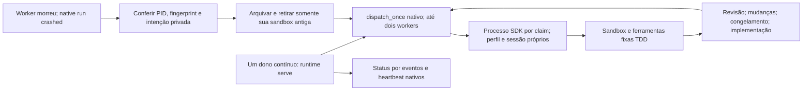

# Serviço contínuo nativo: primeira fatia operacional

Data: 24/10/2026. Parte de [S2](HERMES-S2-QUALIFICATION.md), depois da
[ponte de ferramentas e sessões](HERMES-AGENT-QUALIFICATION.md).

**Passou em ambiente isolado, com dispatcher contínuo, processos, SQLite,
ferramentas `AIAgent` e Docker reais.** As 18 respostas HTTP foram programadas
localmente. Não houve chamadas pagas, GitHub real, migração ou homologação.
Isso não significa equipe autônoma instalada em produção.

## Fronteira implementada

`src/fabriquinha/runtime.py` substitui o loop de despacho do harness por uma
entrada operacional. O Hermes continua dono de claims, tentativas, revisão,
dependências e recuperação. Não foi criado outro banco ou ciclo de vida de tasks.



- Um lock de duração do processo impede dois donos contínuos; cada tick mantém
  também o lock upstream. Intervalo padrão: 15 segundos; até dois workers e um
  por perfil, limitados pelo dispatcher nativo.
- O spawn usa comando fixo, log privado e subprocesso destacado. Não herda chaves
  LLM/GitHub do ambiente. A rota vem de arquivo privado do controlador; o produto
  continua sem credenciais, socket ou acesso ao banco por mounts.
- O worker adota seu PID antes do trabalho e confere que o PID registrado é o
  seu. Outra invocação não pode usar a mesma claim nem bloquear seu dono.
- Parar o dispatcher encerra ticks, não workers saudáveis. Outro processo observa
  os mesmos runs sem recriá-los por ter perdido o objeto `Popen` anterior.
- Um crash pode deixar Docker vivo. A recuperação lê intenções privadas de
  criação reconhecidas, verifica run/identidade do processo e retira a sandbox
  antes do spawn substituto. Não sinaliza processos por nome/prefixo.
- Reconstruir uma lease antiga permite somente sua retirada, não ferramentas ou
  nova autoridade. Logs/metadados são preservados; remoção por ID exato, sem
  force, volumes ou prune. Efeitos incertos conservam suas intenções originais.
- Um impedimento de retirada fica visível; despachar outro card não apaga a
  pendência da observação. Diagnóstico técnico executável continua pendente.

O SDK permanece no plano confiável do controlador: a sandbox isola código/comandos
do produto, não SDK versus controlador. Não instalar a política de registry em
gateway compartilhado. Upstream `v0.22.0`, SHA
`e06df9c2eae6901f4c88f464e0ae6e753c0428b8`, sem patches.

## Prova física

1. O serviço iniciou o primeiro `AIAgent`. Uma resposta local ficou retida,
   mantendo o worker comprovadamente vivo.
2. Somente o dispatcher recebeu SIGTERM e terminou normalmente. O worker e sua
   claim sobreviveram. O segundo dispatcher gravou uma observação própria antes
   de liberar a resposta, sem duplicar run ou processo.
3. Depois de uma escrita real confirmada, o worker exato recebeu SIGKILL. A
   tentativa ficou `crashed`, não foi concluída ou convertida em aprovação.
4. A política nativa retomou o trabalho. O autor leu o arquivo preservado e
   retomou sua sessão. A retirada da sandbox órfã precedeu a intenção de criação
   da substituta, conforme os timestamps privados conferidos.
5. Sem handoffs manuais: revisão pediu mudanças, autor corrigiu, revisão congelou
   testes, dependência liberou implementação, Green e controle negativo passaram
   e a revisão final reexecutou a suíte sobre a entrega imutável.
6. Dois cards terminaram `done` em sete runs: um `crashed` e seis transições TDD
   válidas. Serviço/workers encerrados, zero runs abertos e nenhum auxiliar
   próprio restante. Sessões, snapshots e logs privados preservados.

São injeções de infraestrutura e decisões sintéticas. **Não é** diagnóstico
autônomo do CTO ou comprovação de autoria/julgamento por um modelo.

Uma prova nativa separada manteve um processo dono verificável e invocou outro
worker sobre o mesmo run. O segundo foi recusado antes de modelo/ferramentas,
sem alterar ou bloquear o dono. Ao final, somente a fixture foi encerrada e seu
card bloqueado explicitamente como experimento sem entrega. Zero chamadas ao
modelo e zero jobs Docker nessa prova.

Oito testes novos cobrem dono único, rota privada, provedor pago desabilitado,
spawn sem chaves herdadas, lease antiga somente para retirada, preservação de
worker vivo, visibilidade de pendências, status e recusa de processo duplicado.
Total do caminho novo: **89 testes sem falhas**. Suíte histórica: 4.523 executados,
oito skips preexistentes, nenhuma falha.

## Falhas preservadas

- Tentativa 1: consulta usava `updated_at`, ausente no schema fixado. Corrigida
  para eventos/heartbeat, com preflight antes de spawn e teste de regressão.
  Apenas o worker desse ensaio falho foi encerrado por identidade e sua sandbox
  retirada, mantendo arquivos e evidências.
- Tentativa 2: o TDD e a recuperação terminaram, mas a auditoria esperava uma
  sandbox que a chamada direta ao gate não precisava abrir. A fixture seguinte
  incluiu leitura explícita do arquivo para medir fisicamente a ordem das duas
  sandboxes. O critério de isolamento não foi dispensado; a tentativa 2 permanece
  não aprovada.

Não houve reset de provas antigas, remoção de testes ou ativação do legado. As
prévias de limpeza selecionaram zero recursos obsoletos. A demonstração web
anterior e os projetos Toso, Reforma e não relacionados foram preservados.

## Reprodução e status

Use checkout/venv fixados da [ponte nativa](HERMES-AGENT-QUALIFICATION.md), o
validador canônico de S2 e raiz nova. Faça as prévias do `AGENTS.md` antes/depois.
Não apontar para home instalado ou board de produto.

```bash
.local-hermes-agent/venv/bin/python scripts/qualify_hermes_runtime.py \
  --upstream .local-hermes-s1/upstream --root .local-hermes-runtime/trial-new \
  --image sha256:ID_EXATO_DO_VALIDADOR
.local-hermes-agent/venv/bin/python scripts/qualify_hermes_worker_identity.py \
  --upstream .local-hermes-s1/upstream --root .local-hermes-runtime/identity-new \
  --image sha256:ID_EXATO_DO_VALIDADOR
```

O servidor HTTP de fixture expira ao final; sua rota não é instalação de produção.
O serviço não é um gateway Telegram. Para consultar o board sem modelo/workers:

```bash
PYTHONPATH=src .local-hermes-agent/venv/bin/python -m fabriquinha.runtime status \
  --upstream .local-hermes-s1/upstream --root .local-hermes-runtime/trial-new
```

`status` consulta o banco nativo. `status.json` é uma observação datada, não prova
independente de liveness. Heartbeat não comprova avanço. Ainda não é todo o status
da equipe nem comando Telegram. `installation.json` vincula raiz/projeto/upstream;
o serviço recusa alteração silenciosa do contrato.

## Pendências para autonomia

- O [diagnóstico executável](HERMES-RECOVERY-QUALIFICATION.md) já qualificou a
  recuperação de falha do autor com Lead/CTO, SPIKE e revalidação. Ainda faltam
  classes sem run, como admissão de perfil/recursos indisponíveis.
- Outbox/status/notificações duráveis; esperas CI/provedor sem ocupar slots ou
  perder a fase. Falha de Telegram não deve parar o trabalho.
- Conectar publicação/deploy/QA qualificados separadamente a este serviço,
  preservando claim e evidências do commit integrado exatos.
- Provedor liberado pelo caminho autorizado e S4 com Produto, brief, planejamento,
  autoria e GitHub reais. `model_route` recusa projeto não marcado como qualificação:
  esta entrada não levanta a pausa financeira anterior.
- Segunda release, memória entre perfis, browser público, instalação reproduzível
  e migração comprovada. Truco continua sem reinício de produto.

No checkpoint desta prova eram 13 módulos, cerca de 2.600 linhas físicas, incluindo a
lane S1 de qualificação. O módulo adicional é a entrada operacional que substitui
o loop de teste, não outro scheduler. Mantém-se a meta de código pequeno, sem
broker legado; contagens não medem autonomia.
