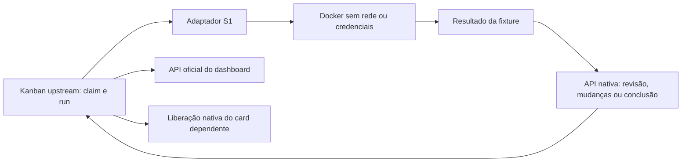

# S0/S1 — Referência preservada e integração Hermes/Kanban

Data: 24/10/2026. Decisão: [ADR 0001](ADR-0001-HERMES-FIRST.md).
Plano aprovado: [S0–S7](SIMPLIFICATION-REVIEW-2026-10-24.md).

## S0: referência e recuperação

A base anterior à simplificação está identificada por
`reference/pre-simplification-2026-10-24`, sobre `ad68e656`.
O backup comprimido existente foi conferido por hash do arquivo e do conteúdo;
uma restauração em diretório temporário passou no `PRAGMA integrity_check`.
O temporário foi descartado após a validação; não houve outra cópia persistente
do banco grande nem duplicação dos volumes.

O recibo detalhado permanece privado. A referência instalada segue selada e
drenada, com proxy parado. Nenhum ensaio antigo foi concluído, reclassificado
como aprovado ou migrado. O medidor e a pausa do provedor foram preservados.

## S1: escopo da prova

Hermes v0.22.0, commit `e06df9c2eae6901f4c88f464e0ae6e753c0428b8`, sem
patches upstream. O checkout e as dependências ficam fora da distribuição do
projeto; a proveniência está em
[`hermes-s1-sources.json`](../scripts/hermes-s1-sources.json).

A prova usa o `dispatch_once(spawn_fn=...)` real, banco real do Kanban, perfis
criados pela API upstream e contêineres Docker reais. Hermes continua dono das
claims, tentativas, revisões, dependências e recuperação. O adaptador cria o
processo isolado e devolve o resultado pela API nativa, vinculado ao run atual.
Não há outro banco de workflow, integração ACP, broker histórico ou scheduler
novo com estados próprios.

Os workers são **fixtures determinísticas**, não agentes com LLM. A fixture
grava uma primeira versão, o revisor exige a segunda, o autor corrige e o revisor
aprova. Essa sequência testa o mecanismo, sem afirmar autoria autônoma ou
qualidade de produto.



## Critérios exercitados

**Resultado: aprovado no escopo S1.** A versão final do roteiro passou com os
onze controles abaixo, com reconciliação nativa de órfãos habilitada. Sete testes
unitários da fronteira também passaram. Nenhuma imagem nova foi construída ou
instalada; todos os contêineres temporários da prova foram retirados.

| Critério | Evidência produzida |
|---|---|
| Handoff e revisão | Autoria → revisão → mudanças → mesmo autor → revisão → conclusão |
| Dependência | Filho permanece `todo` até o pai concluir e é executado depois |
| Resultado antigo | Run anterior não consegue concluir enquanto outro run está ativo |
| Worker morreu | Morte após gravação real; tentativa `crashed`; nova execução preserva o arquivo e conclui |
| Dispatcher terminou | Processo dispatcher sai com worker ainda ativo; outro processo reobserva sem duplicar o run |
| Capacidade | Dois workers no máximo; segundo card do mesmo perfil fica aguardando |
| Revisão imutável | Snapshot separado montado somente leitura; tentativa real de escrita é negada |
| Isolamento | UID sem privilégios, rootfs somente leitura, sem banco do host, socket Docker ou chave do provedor |
| Rede | `network=none` e tentativa de conexão externa negada |
| Conclusão por CLI/API/tool | Contrato nativo de PR recusa ausência de evidência em todas as superfícies |
| Dashboard | API oficial lê os mesmos cards e estados do banco do ensaio |
| Retirada | Contêineres agrupados; logs/metadados privados; auxiliares exatos retirados após parar |

O teste das três superfícies confere eventos `pr_acceptance` distintos no banco.
Isso impede contar erro de sintaxe ou de importação como recusa do gate de PR.
Não testa aprovação de um PR real com CI verde; isso pertence à S3.

A rejeição de resultado antigo foi testada com outro run ainda ativo, não apenas
depois de o card já estar `done`. No teste de reinício, o primeiro dispatcher
terminou enquanto seu worker estava ativo; um segundo processo executou o tick
e o histórico terminou com exatamente um run para aquele card.

## Código e limites

- [`kanban_lane.py`](../src/fabriquinha/kanban_lane.py): adaptador da fronteira,
  cerca de 200 linhas; sem import do broker antigo.
- [`hermes_s1_worker.py`](../scripts/hermes_s1_worker.py): fixture Docker de cerca
  de 40 linhas, sem modelo ou credenciais.
- [`qualify_hermes_s1.py`](../scripts/qualify_hermes_s1.py): roteiro de qualificação,
  separado da operação de produção.
- [`test_kanban_lane.py`](../tests/test_kanban_lane.py): sete testes unitários da
  decisão de fase, independência, conteúdo e rejeição de operações extras.

O conjunto adaptador + fixture + roteiro permanece abaixo de 500 linhas nesta
qualificação. A contagem não inclui testes unitários, documentação ou upstream.
Nenhuma mudança no loop do modelo, compactação ou executor de ferramentas Hermes.

Os primeiros ensaios de desenvolvimento falharam por uma suposição errada sobre
o evento `claimed`, uma diferença na apresentação de tmpfs pelo Docker e um
pacote faltante no checkout parcial do dashboard. Foram corrigidos no adaptador
ou no ambiente da prova; os registros anteriores permanecem privados como
tentativas falhas. Dois auxiliares recusados antes de iniciar foram arquivados
e retirados por ID exato. Nenhum desses erros foi convertido em entrega de produto.

## Reproduzir sem modelo

Requer Python 3.14, Git e Docker. O comando recusa um diretório de ensaio já
existente. Não apontar para o home Hermes instalado ou um board de produto.
Downloads de dependências e da imagem são preparação; os workers usam rede
desligada e não carregam configuração de modelo.

```bash
python3.14 -m venv .local-hermes-s1/venv
.local-hermes-s1/venv/bin/python -m pip install -r scripts/requirements-hermes-s1.txt
git clone --depth 1 --filter=blob:none --sparse --branch v0.22.0 https://github.com/NousResearch/hermes-agent.git .local-hermes-s1/upstream
git -C .local-hermes-s1/upstream sparse-checkout set hermes_cli agent tools gateway cron pm hermes_plugins hermes_platform plugins/kanban
```

Resolva uma imagem oficial Python local por ID exato; a referência qualificada
está no arquivo de proveniência. Não se trata de uma imagem Fabriquinha publicada.

```bash
.local-hermes-s1/venv/bin/python scripts/qualify_hermes_s1.py \
  --upstream .local-hermes-s1/upstream \
  --root .local-hermes-s1/qualification-new \
  --image sha256:392307d22300de8b5986851a12d9176dfc0fc073e65bf6523ebd7dcbeb23564e
```

O resultado detalhado fica no diretório privado, junto das atribuições, resultados,
políticas inspecionadas e logs. Não publicar esse diretório. A CI pública executa
os testes unitários sem modelo/Docker; a prova física é uma operação explícita.

## Limite de conclusão

S1 qualifica a fronteira do dispatcher/Kanban para continuar a implementação
pequena. Não instala o callback no gateway de produção, não configura Telegram,
não valida uma sessão real com modelo e não migra o Multica.

O resultado do board foi conferido pela API oficial. Não se afirma que o Desktop
do proprietário já foi conectado ao novo home. O encaixe no serviço contínuo e
a configuração do dashboard fazem parte da implantação do caminho novo.

TDD completo, revisão semântica com modelo, PR/CI reais, deploy, QA e rollback
continuam nos próximos marcos. A próxima fatia é S2/S3: executar uma feature
pequena por todos esses gates antes de generalizar. A migração segue condicionada
às entregas e à instalação reproduzível, conforme S6.
