# S2 — Primeira fatia de qualidade do caminho Hermes

Data: 24/10/2026. Referências: [plano aprovado](SIMPLIFICATION-REVIEW-2026-10-24.md),
[ADR 0001](ADR-0001-HERMES-FIRST.md), [prova S0/S1](HERMES-S1-QUALIFICATION.md).

**Resultado: mecanismos TDD qualificados no escopo isolado. S2 permanece parcial;
S3 e a autoria/revisão reais com modelo não estão concluídas.** Nenhuma migração
foi aplicada, nenhum serviço antigo foi reativado e nenhuma release foi homologada.

Avanço posterior da mesma data: [S3 parcial](HERMES-S3-QUALIFICATION.md) conecta
esta fatia ao Git e à fronteira PR/CI simulada. As pendências abaixo retratam o
checkpoint S2; a qualificação integrada continua sem modelo e sem homologação.
A [ponte nativa de ferramentas/sessões](HERMES-AGENT-QUALIFICATION.md) passou
posteriormente com `AIAgent`, respostas HTTP locais e retomada em outro processo.
A prova seguinte conectou submissão/parecer ao dispatcher nativo: dois cards,
seis atividades, devolução/correção e retomada de sessões, com 16 respostas locais.
Faltam o serviço contínuo e o trabalho com decisões de um modelo real.

## O que efetivamente foi executado

Hermes v0.22.0, no mesmo commit sem patches da prova S1. O roteiro usa banco,
claims, revisões, retorno ao autor e dependências nativos. Diferentemente de S1,
as claims deste roteiro são realizadas explicitamente pelo driver de teste;
ele não demonstra despacho contínuo pelo gateway.

A aplicação mínima de infraestrutura é um servidor HTTP Python. O teste
preexistente verifica `/health`; o novo verifica a resposta de `/greeting`.
O driver contém deliberadamente código e decisões de referência. São **fixtures
sintéticas**, não trabalho autônomo de Produto, desenvolvedor ou revisor.

O ciclo final percorreu:

1. Baseline aprovada e Red com falha real na asserção do teste novo.
2. Revisão que solicita mudança concreta no texto esperado.
3. Retorno ao mesmo autor, correção e outro Red real.
4. Rejeição de aprovação referente ao Red antigo; aprovação da revisão atual
   e congelamento dos testes em armazenamento privado.
5. Liberação nativa do card dependente com referência ao recibo congelado.
6. Implementação com edição normal e execução local dos testes para feedback.
7. Green confiável sobre o snapshot, preservando todo o inventário congelado.
8. Controle negativo que retira o comportamento novo; a suíte completa volta
   a falhar na asserção esperada, sem alterar os testes.
9. Revisão independente em snapshot somente leitura e nova execução da mesma
   suíte sobre a mesma entrega.

Foram sete jobs de validação reais no ciclo final: duas baselines, dois Red,
Green, controle negativo e validação de revisão. Cada job guarda saída, identidade,
resultado e manifesto em recibos privados. Resultados `done` dos cards não são
aprovação de produto: o recibo final mantém `delivery_approval=false` e
`merge_authorized=false`.

```mermaid
flowchart LR
    K[Hermes: card e run nativos] --> A[Autor sintético na sandbox]
    A --> S[Snapshot e recibos privados]
    S --> J[Job fixo: suíte completa]
    J --> R[Revisor sintético: decisão estruturada]
    R -->|Mudanças| K
    R -->|Testes aprovados| F[Testes congelados]
    F --> I[Implementação com feedback local]
    I --> G[Green e controle negativo]
    G --> V[Revisão imutável e revalidação]
    V --> N[Conclusão nativa do card]
    N -. S3 ainda não conectada .-> P[PR e CI; deploy, QA e rollback]
```



## Fronteiras comprovadas

| Controle | Resultado |
|---|---|
| Testes preexistentes na fase tests-only | Tentativa física de escrita negada; produto também somente leitura |
| Testes congelados na implementação | Escritas nos testes antigos e novos negadas pelo Docker |
| Revisão | Escrita no produto e nos testes negada; snapshot separado do workspace do autor |
| Autoria | Autor não pode executar a operação de aprovação da própria entrega |
| Revisão antiga | Red anterior não pode aprovar o handoff atual |
| Pedido de mudança | Evento nativo preserva resumo e referência ao recibo exato da revisão |
| Teste substituído/ignorado | Candidato adulterado recusado antes de obter Green |
| Isolamento do job confiável | Usuário 65534, sem rede, socket, credenciais ou banco; raiz e snapshot somente leitura |
| Resultado de suíte | Inventário completo, sem erros/skips, exit code coerente e vínculo ao run/snapshot |
| Evidência adulterada | Recibo ou árvore alterados são rejeitados na leitura |
| Efeito com confirmação perdida | Teste unitário comprova observação do efeito original sem reenviar a ação |

Uma prova física adicional executou um teste deliberadamente travado com prazo
de um segundo. O executor interrompeu o job, arquivou falha/saída/metadados e
retirou o contêiner exato. Outra instância do executor leu o mesmo resultado e
continuou rejeitando-o sem criar outro job. A perda de confirmação do `stop` foi
testada separadamente com transporte simulado; a falha de timeout permanece
persistente mesmo que uma saída posterior pareça positiva.

Todos os auxiliares destas provas foram retirados, agrupados em projetos Compose
de testes. Montagens, snapshots e recibos necessários à inspeção foram preservados.
As prévias de limpeza não selecionaram imagens antigas para remoção. Nenhum
recurso Toso, Reforma ou não relacionado foi alterado. Zero chamadas de modelo.

## Código pequeno e limites atuais

O caminho novo tem cerca de 1.060 linhas em oito módulos funcionais, além do
`__init__`. `board.py` consulta e altera o ciclo de vida pela fronteira nativa;
não há outro banco de workflow. `effects.py` guarda somente intenções e resultados
de efeitos externos. `artifacts.py` guarda árvores e recibos, não fases de tarefa.
`quality.py` inclui os pareceres; não foi criado um módulo vazio por item do plano.

A imagem canônica de validação parte de Python oficial por digest. Seu entrypoint
é fixo e não aceita shell fornecido pelo agente. O contrato inicial qualifica
apenas `unittest` Python; lint, tipos, build e outras stacks ainda não foram
configurados. O worker autor pode iterar dentro da sandbox; somente a execução
independente do controlador conta como gate.

Trinta e um testes unitários do caminho novo passaram. A suíte histórica executou
4.523 testes, com oito skips preexistentes e nenhuma falha; inclui uma regressão
nova para preservar as imagens referenciadas pelos novos fontes. Ela é mantida
separadamente e não representa cobertura de autonomia. Uma execução inicial foi
impedida pela sandbox de abrir um servidor HTTP loopback; a suíte completa foi
repetida com essa permissão, sem remover ou ignorar o teste.

Limitações ainda abertas:

- Integrar o executor ao serviço contínuo e às sessões reais Hermes, sem importar
  o broker antigo nem duplicar o estado do Kanban.
- Implantar o diagnóstico técnico executável, escalonamento comum e outbox; o
  journal de efeitos não é substituto de uma política de incidentes.
- Conectar PR/CI e validar o SHA integrado, artefato, deploy, QA e rollback (S3).
- Demonstrar autoria e julgamento independentes com modelo (S4), depois evolução,
  recuperação e memória entre perfis (S5), instalação limpa e cutover (S6).

## Falhas de desenvolvimento preservadas

O primeiro ensaio foi recusado pelo Docker antes de executar os testes: a
configuração de compressão herdada do daemon exigia mais de um arquivo de log.
A opção foi corrigida, sem contar esse ensaio como Red válido.

O segundo chegou ao congelamento, mas falhou ao buscar o handoff do pai concluído.
No Hermes, `current_run_id` fica vazio ao concluir. O adaptador passou a consultar
o último run concluído e seu evento correspondente. Uma regressão unitária
reproduziu o erro antes da correção. Os ciclos posteriores completaram a prova;
as tentativas anteriores continuam registradas como falhas privadas.

## Reproduzir sem modelo ou instalação de produção

Prepare o checkout e o ambiente Python 3.14 conforme [S1](HERMES-S1-QUALIFICATION.md).
Execute as prévias de limpeza previstas no `AGENTS.md`, sem apagar recursos ativos.
O contexto de build permite apenas o Dockerfile e o reporter, não o estado privado.

```bash
docker build --network=none --pull=false -f Dockerfile.validation \
  -t delivery-kit-hermes-validation:20261024.1 .
docker image inspect delivery-kit-hermes-validation:20261024.1 --format '{{.Id}}'
```

Use o ID observado no lugar de `sha256:ID_EXATO`. Cada comando exige uma raiz
nova e isolada. Não apontar para o board ou home instalado.

```bash
.local-hermes-s1/venv/bin/python scripts/qualify_hermes_s2.py \
  --upstream .local-hermes-s1/upstream \
  --root .local-hermes-s1/tdd-new --image sha256:ID_EXATO
.local-hermes-s1/venv/bin/python scripts/qualify_validation_failure.py \
  --root .local-hermes-s1/timeout-new --image sha256:ID_EXATO
```

Os roteiros não iniciam gateways, não chamam o provedor e não escrevem no GitHub.
Recibos completos são privados. Uma aplicação de referência pronta apenas
qualifica mecanismos; não pode ser promovida a evidência de entrega autônoma.
