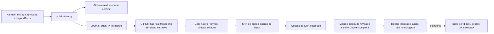

# S3 parcial — Publicação e validação do commit integrado

Data: 24/10/2026. [Plano aprovado](SIMPLIFICATION-REVIEW-2026-10-24.md),
[ADR 0001](ADR-0001-HERMES-FIRST.md), [fatia TDD S2](HERMES-S2-QUALIFICATION.md).

**Resultado: revisão → Git → fronteira PR/CI → suíte do commit integrado
funcionou no ensaio isolado. Git, Kanban e jobs Docker são reais; GitHub e suas
respostas de CI são simulados.** Não houve PR real de produto, modelo, instalação,
migração, deploy ou homologação. S3 continua parcial.

## Caminho implementado

`publication.py` acrescenta operações fixas do controlador, não um novo scheduler:

1. Confere o run nativo de integração e a entrega aprovada da dependência direta
   concluída. Revisão antiga, de outro projeto/release ou com mudanças pendentes
   não concede publicação.
2. Constrói o commit em repositório bare privado, a partir dos bytes/modos exatos
   do snapshot. Não executa código do produto, filtros, hooks ou shell do agente.
3. Publica uma branch sem force-push. A identidade e os efeitos permanecem ligados
   a card, execução, revisão, snapshot e base.
4. Cria um PR com autoria, revisor, comando confiável e referências de baseline,
   Red, freeze, Green, controles negativos e revalidação independente.
5. Usa `collect_acceptance` do Hermes fixado para checks obrigatórios do head
   exato. Não aceita ausência de política de checks como CI verde e não altera
   proteção de branch. A operação real de merge não usa `--admin`.
6. Confere head/base antes da integração e registra separadamente head e commit
   de merge. Confirmações perdidas são observadas, não reenviadas.
7. Confere os checks do commit integrado pelos contextos/aplicativos exigidos,
   usando o classificador upstream; verifica paginação e identidade do SHA.
8. Exporta o Git integrado, compara seu conteúdo ao snapshot revisado e executa
   novamente a suíte completa em Docker. Conteúdo diferente exige outra revisão.
   Avanço da branch também exige qualificar o novo candidato.

O recibo `integrated` identifica commit, snapshot, publicação, CI e job da suíte.
Ele **não** autoriza homologação: `delivery_approval` continua falso. Estado de
tarefa `done` não substitui estado/evidência da release.



## Evidência e alcance

A prova começa do Red de S2 e atravessa toda a fatia anterior, sem promover
recibos antigos. Ela usa o mesmo Kanban v0.22.0 sem patches. O controlador de
teste realiza as claims explicitamente; gateway contínuo e LLM não participam.

O simulador possui um remoto Git bare local. As operações de criação e merge
produzem estados externos simulados, mas o merge cria um objeto Git real, com
dois pais, diferente do SHA do PR. A árvore resultante foi exportada e validada
no oitavo job Docker do ciclo, depois dos sete jobs TDD.

Foram processadas 42 respostas simuladas pela implementação nativa de aceitação
e pela extensão de checks do merge. Isso **não** representa consultas à API real,
workflows GitHub executados ou crédito de provedor consumido.

| Controle | Resultado observado |
|---|---|
| Resposta de criação do PR perdida | Outra instância observa o mesmo PR; exatamente uma criação |
| Resposta do merge perdida | Outra instância observa o mesmo merge; exatamente uma integração |
| Head versus merge | SHAs distintos; checks e suíte associados ao merge |
| Resultado de outro SHA | Recusado pelo classificador, não promovido a CI do candidato |
| Sem checks obrigatórios | Política ausente recusada, mesmo com check aparentemente verde |
| Paginação incompleta | Evidência recusada |
| Aplicativo errado | Check de outro app não satisfaz contexto vinculado ao app exigido |
| Conclusão nativa | `complete_task` processa e registra seu próprio evento `pr_acceptance` |
| Isolamento | Mesmo job fixo S2: snapshot somente leitura, sem rede/socket/credenciais |

Quinze testes unitários da publicação também passaram, usando Git real local e
transporte GitHub simulado. Cobrem espera de CI com prazo persistente, revisão
antiga/não aprovada, dependência inválida, avanço da base, conteúdo de merge
diferente e bloqueio de escrita real no GitHub em modo de qualificação.

Total do caminho novo: 46 testes sem falhas. Suíte histórica: 4.523 testes,
oito skips preexistentes e nenhuma falha. Os registros completos ficam privados.
Todos os auxiliares Docker desta prova foram arquivados e retirados por ID exato.

## Limites e próxima implementação

- PR, CI e merge reais ainda precisam ser exercitados com entrega aprovada por
  agentes reais; a fixture não autoriza escrevê-los em GitHub. O modo de
  qualificação impede push real e mutações pela implementação real do cliente.
- Credenciais do perfil publicador são resolvidas na borda confiável. Não são
  montadas no autor, revisor ou job do produto. O caminho real desse login ainda
  será qualificado na instalação; não há fallback para a conta de outro perfil.
- Esperas de CI têm prazo persistente de quinze minutos. Falha, identidade
  divergente ou prazo esgotado não produz merge. O adaptador contínuo ainda
  precisa transformar a espera em estado nativo sem ocupar worker e encaminhar
  diagnóstico ao Tech Lead/CTO; esse requisito de S2 não está concluído.
- Faltam build canônico a partir do SHA integrado, deploy Compose por imagem
  exata, QA do ambiente implantado, rollback/retorno e recibo final da release.
- `HOMOLOGADA` continua indisponível nesta prova. Faltam ainda serviço contínuo,
  incidentes executáveis, modelo real, segunda release/memória e portabilidade.

O próximo passo é conectar o recibo integrado ao build/deploy/QA/rollback, sem
outro banco de fases, sem alterar o produto antigo e sem generalizar novas stacks
antes dessa fatia funcionar. Só depois seguir para S4 e consumo de modelo, com
a pausa do provedor resolvida pelo caminho autorizado.

## Reproduzir sem credenciais ou modelo

Prepare o upstream e o validador conforme [S1](HERMES-S1-QUALIFICATION.md) e
[S2](HERMES-S2-QUALIFICATION.md). Execute as prévias de limpeza do `AGENTS.md`.
Use uma raiz nova; o roteiro não aceita um home de produção.

```bash
.local-hermes-s1/venv/bin/python scripts/qualify_hermes_s3.py \
  --upstream .local-hermes-s1/upstream \
  --root .local-hermes-s1/integration-new --image sha256:ID_EXATO
```

O simulador está em `tests/fixtures/github_transport.py`, separado do código
operacional. Ele recusa repositório não local ou configuração sem qualificação.
Não publicar a raiz privada produzida pelo roteiro.
