# S3 — Cadeia offline até deploy, QA e rollback

Data: 24/10/2026. [Plano aprovado](SIMPLIFICATION-REVIEW-2026-10-24.md),
[ADR 0001](ADR-0001-HERMES-FIRST.md), [fatia TDD S2](HERMES-S2-QUALIFICATION.md).

**Resultado: cadeia offline completa na stack inicial Python/HTTP:** TDD → revisão
→ Git → fronteira PR/CI → suíte integrada → build → deploy → rollback/retorno →
QA independente em Chromium. Git, Kanban, imagens, Compose e navegador são reais;
autores, pareceres e transporte GitHub/CI são sintéticos. Não houve modelo,
PR real de produto, migração ou homologação de release. A prova é de infraestrutura,
não de autonomia. Publicação/CI reais e serviço contínuo continuam pendentes.

## Caminho implementado

`publication.py` acrescenta operações fixas do controlador, não um novo scheduler:

1. Confere o run nativo de integração e a entrega aprovada da dependência direta
   concluída. Revisão antiga, de outro projeto/release ou com mudanças pendentes
   não concede publicação.
2. Constrói o commit em repositório bare privado, a partir dos bytes/modos exatos
   do snapshot. Não executa código do produto, filtros, hooks ou shell do agente.
3. Publica uma branch sem force-push. A identidade e os efeitos permanecem ligados
   a card, execução, revisão, snapshot e base.
4. Cria um PR com autoria, revisor, comando confiável e referências de baseline,
   Red, freeze, Green, controles negativos e revalidação independente.
5. Usa `collect_acceptance` do Hermes fixado para checks obrigatórios do head
   exato. Não aceita ausência de política de checks como CI verde e não altera
   proteção de branch. A operação real de merge não usa `--admin`.
6. Confere head/base antes da integração e registra separadamente head e commit
   de merge. Confirmações perdidas são observadas, não reenviadas.
7. Confere os checks do commit integrado pelos contextos/aplicativos exigidos,
   usando o classificador upstream; verifica paginação e identidade do SHA.
8. Exporta o Git integrado, compara seu conteúdo ao snapshot revisado e executa
   novamente a suíte completa em Docker. Conteúdo diferente exige outra revisão.
   Avanço da branch também exige qualificar o novo candidato.

O recibo `integrated` identifica commit, snapshot, publicação, CI e job da suíte.
Ele **não** autoriza homologação: `delivery_approval` continua falso. Estado de
tarefa `done` não substitui estado/evidência da release.

```mermaid
flowchart LR
    K[Kanban: entrega aprovada e dependência] --> P[publication.py]
    P --> G[Git bare real: árvore e commit]
    P --> J[Journal: push, PR e merge]
    J --> H[GitHub: CLI fixa; transporte simulado na prova]
    H --> N[Gate nativo Hermes: checks exigidos]
    N --> M[SHA de merge distinto do head]
    M --> C[Checks do SHA integrado]
    C --> V[Mesmo conteúdo revisado e suíte Docker completa]
    V --> R[Recibo integrado; ainda não homologado]
    R --> D[Build por digest e Compose local]
    D --> B[Rollback e retorno ao candidato]
    B --> Q[Revisor independente: QA em Chromium]
    Q --> E[Evidência de entrega; sem aprovação de release]
```



## Evidência e alcance

A prova começa do Red de S2 e atravessa toda a fatia anterior, sem promover
recibos antigos. Ela usa o mesmo Kanban v0.22.0 sem patches. O controlador de
teste realiza as claims explicitamente; gateway contínuo e LLM não participam.

O simulador possui um remoto Git bare local. As operações de criação e merge
produzem estados externos simulados, mas o merge cria um objeto Git real, com
dois pais, diferente do SHA do PR. A árvore resultante foi exportada e validada
no oitavo job Docker do ciclo, depois dos sete jobs TDD.

Foram processadas 42 respostas simuladas pela implementação nativa de aceitação
e pela extensão de checks do merge. Isso **não** representa consultas à API real,
workflows GitHub executados ou crédito de provedor consumido.

| Controle | Resultado observado |
|---|---|
| Resposta de criação do PR perdida | Outra instância observa o mesmo PR; exatamente uma criação |
| Resposta do merge perdida | Outra instância observa o mesmo merge; exatamente uma integração |
| Head versus merge | SHAs distintos; checks e suíte associados ao merge |
| Resultado de outro SHA | Recusado pelo classificador, não promovido a CI do candidato |
| Sem checks obrigatórios | Política ausente recusada, mesmo com check aparentemente verde |
| Paginação incompleta | Evidência recusada |
| Aplicativo errado | Check de outro app não satisfaz contexto vinculado ao app exigido |
| Conclusão nativa | `complete_task` processa e registra seu próprio evento `pr_acceptance` |
| Isolamento | Mesmo job fixo S2: snapshot somente leitura, sem rede/socket/credenciais |

Dezesseis testes unitários da publicação também passaram, usando Git real local e
transporte GitHub simulado. Cobrem espera de CI com prazo persistente, revisão
antiga/não aprovada, dependência inválida, avanço da base, conteúdo de merge
diferente e bloqueio de escrita real no GitHub em modo de qualificação.

Total do caminho novo: 57 testes sem falhas. Suíte histórica: 4.523 testes,
oito skips preexistentes e nenhuma falha. Os registros completos ficam privados.
Todos os auxiliares Docker desta prova foram arquivados e retirados por ID exato.

## Build, rollback e QA reais

O `Dockerfile.web` é canônico, com Python oficial por digest, sem dependência da
imagem antiga do controlador e sem executar Dockerfile ou comandos do produto.
Seu contexto é montado a partir dos arquivos exatos do snapshot, em subdiretório
próprio: um `.dockerignore` do produto não pode esconder testes ou trocar o build.
Artefatos carregam commit integrado, manifesto, receita e ID real da imagem.

Foram construídas uma baseline com suíte aprovada e a candidata integrada. Cada
imagem foi construída uma vez e reutilizada por ID, sem rebuild entre deploy e QA.
O Compose executou baseline → candidata → rollback à baseline → retorno à candidata.
O controlador preservou logs/metadados antes de substituir cada contêiner e
verificou a imagem saudável em cada etapa. Não foram apagados volumes.

O pedido de QA foi registrado no Kanban e assumido por outro perfil. O job fixo
de navegador recebeu apenas driver e contrato declarativo dos testes congelados,
ambos somente leitura. Executou health/identidade, preencheu o formulário,
acionou o botão e verificou a resposta real. Uma captura PNG foi conferida
visualmente e preservada fora do contêiner, com hash no recibo. O controlador
também conferiu a URL de loopback e revalidou a mesma imagem/contêiner após o QA.

Um controle técnico adicional recusou a baseline antiga como candidata e executou
o navegador com SHA deliberadamente errado. O job falhou na identidade HTTP,
foi arquivado/retirado e não alterou o deployment atual. Esse probe é sintético,
sem claim de agente real, e não recebe aprovação de release.

O job usa rede interna exclusiva de QA, UID 10000, raiz somente leitura, recursos
limitados e nenhum socket, banco, credencial ou diretório privado do controlador
fornecido por mounts. O web usa UID 65534 e publicação somente em loopback.
Sua bridge permite egress; não descrevemos o produto como airgapped. A decisão
e a prova de rede estão no [ADR 0002](ADR-0002-LOCAL-WEB-AND-QA-NETWORKS.md).

O toolchain de navegador reutilizado é uma imagem local já existente, selecionada
por ID exato. Não foi baixada imagem grande nem iniciada dependência de modelo.
**Essa imagem ainda não é uma base pública reproduzível**; reconstruir/pinar o
toolchain de navegador continua obrigatório para S6. A funcionalidade do job não
depende de código do harness antigo, mas seus binários ainda vêm desse cache.

A evidência final liga PR simulado, commit de merge, suíte, imagem, URL, QA,
captura e rollback. `delivery_approval=false` permanece explícito: não existe
brief real aprovado nem autoria/julgamento por modelos neste ensaio.

### Tentativas preservadas e retirada

Antes da prova final, três tentativas não qualificaram a cadeia completa:

1. Argumento de imagem incompleto recusado antes de iniciar workers.
2. Servidor saudável em rede interna sem porta publicada; prazo persistente
   encerrou a espera sem repetir Compose. Probes confirmaram a causa.
3. Deploy/rollback e checks de navegador passaram, mas a captura guardada no
   tmpfs não sobreviveu ao término do job. O gate recusou a evidência incompleta.

O transporte foi corrigido para PNG limitado e validado na saída do driver,
sem acrescentar mount gravável. Uma regressão reproduziu a falha antes da correção.
A tentativa final começou do zero e atravessou toda a cadeia sem reparo em curso;
continua sendo uma execução sintética de infraestrutura, não entrega autônoma.

As claims das duas tentativas que executaram foram bloqueadas pela API nativa;
não ficaram workers ou runs abertos. Depois da prova substituta saudável, os dois
serviços obsoletos foram retirados com logs/metadados privados, conferência dos
artefatos, leases encerradas e validação dos IDs. A candidata final foi preservada.
Imagens de recuperação, snapshots, bancos e volumes não foram removidos; Toso,
Reforma e outros projetos não foram alterados.

Também foi reproduzida uma corrida de publicação anterior ao primeiro push:
um snapshot de autor antigo poderia apagar testes integrados por outra entrega.
Agora a baseline Red deve ser exatamente a árvore Git da base capturada. Uma base
mais nova exige rebase, preservação dos testes atuais e nova revisão, antes do PR.

## Limites e próxima implementação

- PR, CI e merge reais ainda precisam ser exercitados com entrega aprovada por
  agentes reais; a fixture não autoriza escrevê-los em GitHub. O modo de
  qualificação impede push real e mutações pela implementação real do cliente.
- Credenciais do perfil publicador são resolvidas na borda confiável. Não são
  montadas no autor, revisor ou job do produto. O caminho real desse login ainda
  será qualificado na instalação; não há fallback para a conta de outro perfil.
- Esperas de CI têm prazo persistente de quinze minutos. Falha, identidade
  divergente ou prazo esgotado não produz merge. O adaptador contínuo ainda
  precisa transformar a espera em estado nativo sem ocupar worker e encaminhar
  diagnóstico ao Tech Lead/CTO; esse requisito de S2 não está concluído.
  As confirmações perdidas foram retomadas no mesmo run. Outra claim, caso o
  agendamento nativo gere um novo `run_id`, ainda precisa de identidade de entrega
  estável para não duplicar PR/build/deploy. Isso é pré-condição de S4, não prova
  coberta pelo canário de restart do mesmo run.
- Build, deploy, QA e rollback foram conectados na stack Python/HTTP sem estado.
  Isso não qualifica migrações de banco, outras stacks, mobile, 3D ou produção.
- `HOMOLOGADA` continua indisponível nesta prova. Faltam ainda serviço contínuo,
  incidentes executáveis, modelo real, segunda release/memória e portabilidade.

O próximo passo é conectar os mecanismos qualificados ao dispatcher contínuo e
às sessões reais Hermes, com espera que libere capacidade, incidente executável
e notificação persistente. Não acrescentar outro banco de fases. Depois seguir
para S4 e consumo de modelo, com a pausa resolvida pelo caminho autorizado.

## Reproduzir sem credenciais ou modelo

Prepare o upstream e o validador conforme [S1](HERMES-S1-QUALIFICATION.md) e
[S2](HERMES-S2-QUALIFICATION.md). Execute as prévias de limpeza do `AGENTS.md`.
Use uma raiz nova; o roteiro não aceita um home de produção.

```bash
.local-hermes-s1/venv/bin/python scripts/qualify_hermes_s3.py \
  --upstream .local-hermes-s1/upstream \
  --root .local-hermes-s1/integration-new --image sha256:ID_EXATO
```

O simulador está em `tests/fixtures/github_transport.py`, separado do código
operacional. Ele recusa repositório não local ou configuração sem qualificação.
Não publicar a raiz privada produzida pelo roteiro.

Para incluir Compose, rollback e navegador, forneça também `--browser-image
sha256:ID_EXATO_DO_TOOLCHAIN` e um `--namespace delivery-kit-web-proof` novo.
O namespace não pode conter outro deployment atual: o controlador o preserva,
em vez de substituir recursos sem correspondência aos artefatos declarados.
A prova mantém a candidata final acessível. Retire uma prova antiga somente
com seu estado/evidência preservados, leases encerradas e propriedade revalidada.
