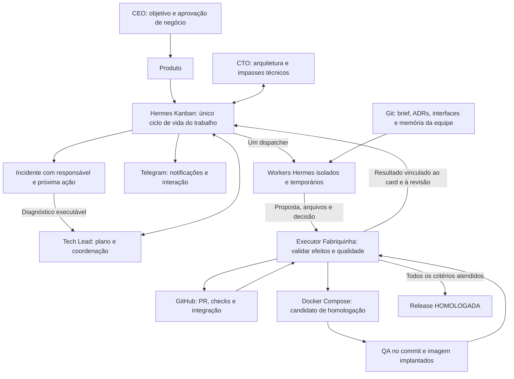
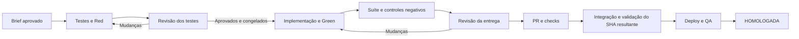

# Fabriquinha: revisão estratégica e plano de simplificação

Data: 24 de outubro de 2026. Base de código examinada: `e33c893f`.
Destinatários: proprietário do projeto e GPT 6.1 Sol, responsável pela futura execução.
Estado: **plano e mudanças de contrato aprovados pelo proprietário em 24/10/2026**.
S0/S1 concluídos; [resultado e limites da prova](HERMES-S1-QUALIFICATION.md).
S2 parcial: [mecanismos TDD qualificados sem modelo](HERMES-S2-QUALIFICATION.md).
[S3 passou no escopo offline Python/HTTP](HERMES-S3-QUALIFICATION.md), incluindo
build, Compose, QA em Chromium e rollback reais. GitHub e decisões permanecem
simulados; serviço contínuo e entrega por agentes reais ainda não qualificados.
A referência antiga e chamadas pagas continuam pausadas; nenhuma migração foi aplicada.

## 1. Decisão recomendada

Recomendo mudar a estratégia. O objetivo continua correto, mas a trajetória atual
de acrescentar um controle ou uma recuperação específica por incidente tornou-se
contraproducente. Não recomendo terminar toda a ponte v2 antes de simplificar.

**Opção preferencial: Hermes + Kanban como coordenação única, GitHub como fonte
do código e da integração, Docker como isolamento, e uma pequena camada de
entrega com operações determinísticas.** Retirar Multica do caminho obrigatório
de uma nova instalação após uma prova curta de viabilidade. Não reativar a antiga
instalação Hermes modificada nem copiar o broker atual para trás do Kanban.

Essa recomendação é condicional a uma fronteira concreta: o Hermes escolhido deve
conseguir despachar e recuperar workers isolados, com revisão somente leitura,
sem uma reconstrução extensa do seu runtime. A documentação upstream não oferece
essa integração pronta. A etapa S1 verifica isso antes de migrar estado ou
investir em outro controlador. Se ela falhar, a alternativa é **Multica enxuto**
com a mesma política simplificada, não flexibilizar o isolamento nem desenvolver
um novo framework durante semanas.

O ganho principal virá de reduzir as responsabilidades do código próprio.
Remover apenas Multica, mantendo paginação obrigatória, reinterpretação de sessões,
dezenas de gates de admissão e recuperações por caso, conservaria o problema.

Não introduzir Temporal, outro orquestrador, banco vetorial, novo sistema de filas
ou mais agentes nesta etapa. Não trocar o modelo dos agentes junto com a migração.
O pedido de análise pelo Astra não altera o modelo configurado nos workers.

## 2. O que a análise examinou

Foram examinados os documentos públicos, os contratos e os caminhos de código de
coordenação, execução, revisão, recuperação, memória, publicação e construção
das imagens. Também foram consultadas fontes oficiais de Hermes e Multica e
listados os contêineres, sem iniciar ou alterar serviços. Não houve novo ensaio
com modelo, teste de produto, instalação ou consulta à chave do provedor.

Inventário estático dos arquivos versionados em `e33c893f`:

| Medida | Resultado | Interpretação correta |
|---|---:|---|
| Arquivos em `team-delivery-kit/` | 1.947 | Inclui experimentos e história |
| Arquivos Python no kit | 1.448 | Não equivale a módulos ativos |
| Linhas físicas Python no kit | 176.346 | Inclui testes, comentários e fixtures |
| Python dentro de `tests/` | 700 arquivos / 70.683 linhas | Não é medida de autonomia |
| Python fora de `tests/` | 748 arquivos / 105.663 linhas | Inclui canários e utilitários |
| Módulos Python em `broker/` | 337 / 60.207 linhas | Há caminhos ativos e históricos |
| Arquivos Python do kit com `recovery` no nome | 72 | Sinal de recuperação especializada |
| Dockerfiles versionados no repositório | 326 | Muitos são camadas históricas |
| Nomes de tabelas encontrados em declarações SQL do kit | 284 | Não são 284 tabelas necessariamente instaladas |
| Linhas do README principal | 2.852 | Mistura apresentação, operação e histórico |

Contagens obtidas sobre `git ls-files`; arquivos não versionados foram excluídos.
Linhas foram contadas fisicamente. Tabelas foram identificadas por declarações
`CREATE TABLE IF NOT EXISTS`; essa métrica não substitui inspeção do banco vivo.
O volume não demonstra defeito sozinho. Sua importância aparece junto com a
ausência de uma entrega atual qualificada sem intervenção.

O [STATUS](STATUS.md) registra 4.522 testes offline, oito skips preexistentes e
nenhuma falha na última execução documentada. Registra também que a linhagem v2
ainda não congelou os testes nem chegou a Green/homologação. Há entregas históricas
descartáveis, com revisão, PR/CI e QA, mas elas exigiram reparos do operador.

A consulta Docker confirmou o proxy `delivery-kit-port2-model-proxy-1` parado,
o controlador instalado ainda na imagem anterior à candidata e os antigos
serviços Hermes/Truco parados. A interface e alguns serviços Multica continuam
em execução. Contêiner ativo não comprova despacho ou entrega.

## 3. Diagnóstico: por que a complexidade cresceu

### 3.1 Construímos um segundo sistema de coordenação sobre o primeiro

Multica mantém issues, sessões, tarefas e wakeups. O broker mantém suas próprias
admissões, grants, leases, fases, snapshots, observações e incidentes. Supervisores
host acrescentam outros registros e transições. O resultado exige reconciliação
contínua de identidades e estados que representam partes da mesma atividade.

Evidências: `broker/native.py`, `acp_wrapper.py`, `broker/server.py`,
`brief_delivery_supervisor.py` e `broker/quality_team_progress.py`.
O problema não é usar recibos ou persistência: isso é necessário. É utilizar
vários ciclos de vida concorrentes e reconstruir em código próprio grande parte
do funcionamento que se esperava obter da plataforma.

### 3.2 Segurança e correção do artefato foram misturadas com prova de comportamento mental

Montagem somente leitura, isolamento de credenciais, aprovação vinculada a SHA
e execução real de testes são controles úteis. Provar que cada página de cada
arquivo atravessou o contexto do modelo não prova compreensão nem qualidade da
revisão. Depois da compactação, também não prova que a informação foi retida.

O caminho atual exige leitura integral do snapshot para aprovação e controla
tuplas de página, repetições, offsets e spill. Isso gerou um subsistema próprio
de transporte e recuperação de leitura. A última revisão documentada percorreu
71 arquivos e 171 páginas, mas ainda produziu uma decisão inválida antes do 402.
O bloqueio por pagamento é real; não explica os problemas anteriores de leitura
e protocolo, nem deve ser usado como explicação única para o atraso do projeto.

Evidências: `broker/quality_review_reads.py`, `quality_review_paging.py`,
`quality_review_budget.py`, `quality_review_stop.py` e `quality_review_verdict.py`.

Recomendação: revisar o diff, os testes novos/alterados, os critérios de aceite
e as dependências afetadas; permitir busca e expansão de contexto no snapshot.
Registrar o que foi consultado para diagnóstico. Não usar leitura de 100% dos
bytes do repositório como condição universal de aprovação. Manter validação
das referências e evidência concreta dos achados.

### 3.3 O implementador perdeu o ciclo de feedback necessário ao TDD

Em `quality_phase_tools.py`, a implementação v2 dispõe essencialmente de leitura
e escrita integral nos caminhos declarados. `quality_implementation_admission.py`
manda escrever e parar; proíbe terminal, patches e execução Python. O controlador
testa depois. É possível produzir código assim, mas cada erro simples passa a
exigir outro handoff, snapshot, execução e contexto.

Um desenvolvedor competente precisa experimentar, testar e corrigir dentro de
sua tarefa. Recomendo permitir essas ações dentro da sandbox, preservando os
testes congelados e o isolamento. A execução independente do controlador/CI
continua sendo a evidência que habilita o gate. Logs do autor ajudam o feedback,
mas não substituem essa prova.

A fronteira deve ser o workspace isolado e seus recursos protegidos, não uma
lista de todos os arquivos que um operador adivinhou que o modelo precisaria
criar. Uma importação ou refatoração legítima não deveria exigir uma nova rota
de recuperação. Políticas, testes congelados, CI e credenciais continuam fora
da escrita comum; o plano de arquivos é orientação revisável pelo Tech Lead.

### 3.4 Bloqueio visível ainda não é recuperação executada

`quality_team_progress.py` inclui `technical_blocked` em seus estados terminais.
A seleção só revisita certos bloqueios com recuperações especializadas elegíveis.
`blocked()` registra dono e próxima ação, mas não cria por si só uma tarefa real
de diagnóstico. Isso explica por que há visibilidade sem continuidade garantida.

É correto não repetir indefinidamente uma ação defeituosa. A peça ausente é um
caminho geral: incidente → card técnico executável → decisão → ação permitida →
revalidação. Escrever `owner=cto` não equivale a despachar o CTO.

### 3.5 Estamos tentando assegurar demais antes de entregar uma fatia pequena

Há cadastros, qualificações sintéticas, reinstalações, pins de imagem e recuperações
específicas para diversas fases ainda não conectadas até a homologação. Cada
controle isolado pode estar correto, enquanto o sistema continua sem entregar.

O caminho de atualização também depende de imagens locais anteriores. Por exemplo,
`Dockerfile.quality-v2-controller` parte de uma imagem privada histórica e conserva
múltiplos rollbacks por incidente. Isso é compreensível durante diagnóstico, mas
não é uma base simples de distribuição para terceiros.

A decisão de tornar o projeto reutilizável foi correta. A generalização para
muitas situações antes de estabilizar um caso completo aumentou o trabalho.

### 3.6 Os ensaios passaram a testar a história acumulada do harness

A baseline descartável atual tem centenas de testes Python e dezenas de testes
Node. Preservá-los é correto ao evoluir aquele produto. Porém, usar essa aplicação
como única porta de validação de uma arquitetura nova confunde três problemas:
qualidade do produto de ensaio, compatibilidade do harness e autonomia da equipe.

Recomendação: começar a nova arquitetura com uma aplicação mínima nova e legítima,
declarada como novo ensaio. Não apagar testes para fazer o ensaio antigo passar,
nem reclassificar o bloqueio antigo como sucesso. A segunda release da nova
aplicação obrigatoriamente preservará e exercitará a regressão da primeira.

### 3.7 A memória protege proveniência, mas oferece pouca continuidade útil

`delivery_memory.py` limita o contexto a até duas entregas, 600 caracteres e TTL
de 30 dias. `decision_memory.py` acrescenta curadoria independente e validade
limitada. Há outros mecanismos de contexto, portanto esse não é todo o sistema
de memória; ainda assim, esses recibos não substituem arquitetura, decisões e
conhecimento de domínio recuperáveis por qualquer perfil.

Recomendação: memória de equipe principal em documentos versionados, com links
para critérios, decisões, interfaces, testes e incidentes. Conversa de perfil
é contexto auxiliar. Decisões arquiteturais continuam válidas até serem
substituídas; não expiram automaticamente porque passaram 30 dias.

### 3.8 As métricas incentivaram quantidade de controles em vez de entrega

4.522 testes verdes e a estimativa de 70% descrevem investimentos e confiança
parcial, mas não permitem concluir que faltam apenas 30% de esforço. A parte
restante inclui integrações entre componentes, justamente onde se concentraram
os bloqueios. Não recomendo substituí-la por outra porcentagem subjetiva.

A medida principal passa a ser: **quantas releases chegaram a homologação sem
reparo técnico ou condução de handoffs pelo operador, em quantas tentativas**.
Todo denominador, falha e intervenção deve aparecer no relatório.

## 4. O que está correto e deve ser preservado

- Aprovação de negócio pelo CEO, autoridade técnica com Tech Lead/CTO.
- TDD real, revisão independente, defesa contra remoção/skip/enfraquecimento de testes.
- Separação entre revisar testes, revisar entrega e homologar uma release.
- Snapshots imutáveis; revisor incapaz de alterar a entrega do autor.
- Aprovação vinculada ao conteúdo exato; alteração invalida a aprovação correspondente.
- Suíte real e QA sobre o artefato efetivamente implantado.
- Workers sem socket Docker, credenciais de infraestrutura ou acesso amplo ao host.
- Limites de consumo, capacidade, tentativas e observação de efeitos incertos.
- Git, licença MIT, histórico recuperável, Compose e limpeza com escopo verificado.
- Decisões e trabalho em fontes duráveis, sem depender de conversa bot-to-bot.

O investimento não foi todo perdido: aprendemos modos de falha importantes e
temos testes e controles aproveitáveis. O erro seria importar o conjunto inteiro
para a próxima implementação só para preservar investimento passado.

## 5. Hermes, Multica e Temporal: avaliação atual

### Capacidades verificadas e limites

A referência oficial do Hermes v0.22.0 descreve Kanban persistente, dependências,
revisão no próprio card, retorno ao implementador e contratos de conclusão de PR
com checks obrigatórios. Isso cobre boa parte da coordenação que precisamos.
Não comprova sozinho isolamento, qualidade semântica ou homologação do produto.
[Referência Kanban](https://raw.githubusercontent.com/NousResearch/hermes-agent/v0.22.0/website/docs/user-guide/features/kanban.md).

A documentação de lanes distingue o ciclo de vida do board da execução do worker.
Também afirma que a proteção de subprocessos é cooperativa, não confinamento de
sistema operacional, e que integrar executores externos ainda exige trabalho
específico. Portanto, trocar o nome do executor por um plugin não elimina o
risco de reconstruir uma camada grande. Essa é a hipótese a testar em S1.
[Contrato de lanes](https://raw.githubusercontent.com/NousResearch/hermes-agent/v0.22.0/website/docs/user-guide/features/kanban-worker-lanes.md).

O guia de múltiplos gateways determina um único dono do dispatcher; os demais
podem continuar entregando notificações. Essa separação serve ao grupo Telegram
sem permitir que nove gateways disputem o mesmo trabalho.
[Guia de gateways](https://hermes-agent.nousresearch.com/docs/user-guide/features/kanban-multi-gateway).

Multica v0.6.0 realmente possui wakeups por eventos, condições e tempo, inclusive
mudanças de PR e conclusão de dependências. Sua documentação separa esses fatos
da decisão de negócio sobre conclusão. Há benefício real de interface, identidade
e eventos; ele não substitui o contrato de entrega que adicionamos por fora.
[Wakeups v0.6.0](https://raw.githubusercontent.com/multica-ai/multica/v0.6.0/docs/engineering/issue-wakeups.md).

Essas fontes foram consultadas em 24/10/2026. A documentação corrente pode
divergir da imagem instalada; S1 deve fixar versão e verificar o código real.
A consulta à v0.22.0 não autoriza atualizar a instalação existente.

| Caminho | Benefício | Custo/limite | Parecer |
|---|---|---|---|
| Continuar o desenho atual | Preserva todos os adaptadores | Mantém acoplamento e recuperações por incidente | Não recomendado como estratégia principal |
| Multica com política e executor pequenos | Aproveita interface, eventos e identidades | Mantém backend, frontend, banco e runtime adicionais | Alternativa se S1 inviabilizar Hermes isolado |
| Hermes + Kanban + executor pequeno | Um plano de coordenação; aproxima-se da intenção original | Isolamento e gates precisam de integração comprovada | Preferido, com condição de viabilidade |
| Apenas prompts/SOULs no Hermes | Pouco código inicial | Não assegura imutabilidade, merge ou isolamento | Insuficiente para os requisitos aceitos |
| Introduzir Temporal agora | Poderia fornecer execução durável | Novo motor e migração sem resolver o contrato do agente | Adiar |

Não existe comparação controlada suficiente para afirmar que Multica piorou a
capacidade do modelo. As trocas de modelo, contrato, harness e runtime ocorreram
em períodos sobrepostos. A conclusão sustentada é mais estreita: **seus benefícios
observáveis ainda não compensaram, neste projeto, o custo da integração criada**.

Temporal só deve ser reavaliado quando houver necessidade comprovada de execução
durável distribuída que ultrapasse a coordenação single-host. Não é necessário
introduzi-lo para dois workers locais, nem corrigiria por si só um parecer errado.

## 6. Arquitetura-alvo mínima

Este é um desenho proposto, não o runtime instalado.



### Dono de cada informação

| Informação | Fonte canônica |
|---|---|
| Cards, dependências, responsável, tentativa, bloqueio | Hermes Kanban |
| Brief aprovado, ADRs, interfaces, código e testes | Git |
| PR, SHA integrado e checks | GitHub |
| Resultado de execução, manifesto de testes e imagem | Recibos privados do executor |
| Estado de release e incidentes | Cards/metadata no board, com referências aos recibos |
| Conversa e avisos | Telegram/dashboard; não concedem aprovação implicitamente |

O executor pode manter um pequeno diário de efeitos e uma outbox. Ele não deve
replicar o board, criar outro grafo de tarefas ou manter uma máquina concorrente
de fases. Eventos reapresentados devem ser idempotentes, com `run_id` e revisão.
Não escrever SQL diretamente no banco do Hermes: usar a interface qualificada.

O processo confiável que possui acesso a Docker/GitHub não executa código do
produto. Workers e jobs de teste executam em contêineres sem esses privilégios.
O proxy de modelo continua separando chave, limites e consumo do código gerado.
Um worker com permissão para editar o produto não recebe o banco do Kanban,
o diretório privado do executor nem tokens administrativos.

### Orçamento de complexidade proposto

Não é prova de correção nem motivo para minificar código; é um mecanismo para
impedir outra expansão silenciosa:

- Um dispatcher; um adaptador de execução; um executor de efeitos/gates.
- Até três serviços próprios permanentes: Hermes, executor e proxy de modelo,
  além dos serviços do produto. Dashboard integrado, se suportado pela versão.
- Até quatro Dockerfiles canônicos: Hermes, executor, toolchain/testes e browser
  QA. Atualizar tags por versão/digest, não criar um Dockerfile por incidente.
- Meta inicial de até 12 módulos e cerca de 3.000 linhas de código próprio ativo,
  sem contar testes, templates ou dependências upstream.
- Um diário privado de efeitos/outbox, sem tabela nova para cada classe de falha.
- Sem importar o `broker/server.py` antigo no novo caminho.
- Ultrapassar esses números exige registrar qual requisito concreto demanda isso
  e o que poderá ser removido. Não abrir automaticamente outra rodada de autorização
  para cada linha; reavaliar o desenho antes de codificar a expansão.

Não há promessa de atingir essas metas preservando todas as integrações históricas.
O escopo inicial é uma instalação single-host, um projeto ativo e uma stack
qualificada. Novas stacks serão acrescentadas depois por contratos de comandos.

## 7. Equipe e dinâmica de trabalho

Preservar os nove perfis como papéis disponíveis. Perfil não precisa ser um serviço
sempre ativo, um consumidor periódico do modelo ou uma passagem obrigatória de
todo card. Mobile permanece inativo em uma versão exclusivamente web.

| Papel | Trabalho normal | Acionamento/limite |
|---|---|---|
| Produto | Brief, critérios e perguntas de usuário | Início da versão e dúvidas de negócio |
| Tech Lead | Plano, dependências, integração e recuperação | Responsável pela entrega; não implementa tudo |
| CTO | Arquitetura, segurança estrutural, decisões e spikes | Decisões transversais e impasses técnicos |
| Backend/Data e Frontend | Implementação com feedback de testes | Cards pequenos e independentes quando possível |
| Quality/Security | Revisão de testes, regressão, segurança e QA | Independente da autoria que está avaliando |
| DevOps | Build, deploy, observação e rollback | Operações fixas pelo executor, sem shell no host |
| Designer | Fluxos e revisão visual | Quando há decisão visual relevante |
| Mobile | Aplicativo mobile | Somente quando fizer parte do escopo |

Manter a matriz de independência existente, com suplência explícita para evitar
starvation. Quem escreveu testes ou implementação não aprova sua própria entrega.
Uma sessão diferente do mesmo autor não vira revisão independente. Quando QA
autorar testes, Tech Lead revisa; alterações do Tech Lead vão ao CTO. DevOps é
revisado por Quality/Security. Especialistas não precisam aprovar mudanças fora
da sua área sem motivo concreto.

Dois workers é o teto, não obrigação de ocupar ambos. Começar sequencialmente;
qualificar concorrência depois do primeiro fluxo completo. Slots são liberados
ao aguardar revisão, credencial, CI ou decisão; uma espera não mantém worker vivo.

Telegram continua sendo a sala da equipe. Publicar início, entrega parcial,
solicitação de mudanças, bloqueio, atribuição do diagnóstico e homologação com
referência ao card. Conversa livre é útil; transferência de responsabilidade
somente ocorre quando o board registra e aceita o handoff.

No primeiro marco, usar um ponto de entrada/notificação para reduzir operação.
Os outros bots podem continuar disponíveis por menção com dispatcher desligado,
sem chamadas periódicas ao modelo. Não fazer comunicação bot-to-bot ser requisito
de progresso do trabalho.

## 8. TDD forte com menos atrito artificial

### Contrato a preservar

Manter a ordem já aprovada pelo proprietário:

1. Autor cria testes sobre a base correta e observa Red real.
2. Revisor independente avalia esses testes e o comportamento esperado.
3. Executor registra a revisão aprovada e congela os testes dessa tentativa.
4. Autor implementa, executa testes e corrige dentro da mesma atividade.
5. Executor executa suíte completa e controles negativos/mutações necessários.
6. Revisão independente da entrega, PR/CI e QA de homologação.

Red deve falhar pelo comportamento ainda ausente, não por dependência quebrada,
import inválido ou ambiente indisponível. Tests-only não exige que a implementação
futura já esteja Green. O autor pode obter feedback local, mas o gate depende de
execução confiável vinculada à base e ao conjunto de testes reais.

### Simplificações propostas do mecanismo

- Usar commits/árvores Git e um manifesto de testes como identidade da entrega.
  Um recibo contém card, tentativa, autor, revisor, base, SHA, resultado e links
  para logs. Identidades de sessão do modelo não precisam reaparecer em cada
  camada se a identidade de execução já foi autenticada no adaptador.
- Revisar mudanças e dependências relevantes; não exigir leitura de todo o repo.
  Permitir reread, busca e navegação no snapshot. Consumo repetitivo vira diagnóstico
  por ausência de progresso, não proibição de reler um arquivo legítimo.
- Dar ao implementador ferramentas normais de edição, patches e testes na
  sandbox. Testes congelados ficam protegidos por montagem/permissão e por
  comparação antes do gate. O job confiável não usa arquivos adulterados.
- Usar runners e relatórios convencionais da stack, com saída e inventário
  preservados. Não inferir sucesso de texto do modelo nem de um número de testes.
- Manter comparação contra a baseline: desaparecimento, renomeação, skip,
  alteração de descoberta ou redução de assertions dispara bloqueio e revisão.
  Contagem igual não detecta enfraquecimento semântico.
- Manter controles negativos obrigatórios antes do merge. Começar com os
  comportamentos concretos do card; não construir um framework universal de
  mutações antes de uma entrega. A otimização futura de executar só testes
  afetados nas mutações exige uma mudança de contrato separada; não é necessária
  para o primeiro marco deste plano.
- Uma falha de formato de parecer recebe feedback de schema limitado no mesmo
  orçamento. Após duas falhas iguais, encaminhar ao responsável técnico com o
  conteúdo preservado. Não criar um módulo de recuperação para cada mensagem.

Não enfraquecer testes para obter Green. Uma correção legítima de teste segue
solicitação de mudanças, nova revisão e novo manifesto, antes da implementação.
Mudança de comportamento aprovado pelo CEO continua exigindo decisão de produto.
Histórico de falhas antigas não é convertido em aprovação.

### Pontos de simplificação que alteram o contrato atual

As mudanças abaixo foram aprovadas pelo proprietário após a análise, para o
novo caminho. Não alteram retroativamente os ensaios históricos:

| Regra atual | Regra proposta | Garantia preservada |
|---|---|---|
| Ler integralmente todos os arquivos para aprovar | Revisar diff + testes + contexto afetado, expansível | Artefato imutável e decisão fundamentada |
| Implementador só lê/escreve arquivos enumerados | Edição e testes normais na sandbox, com proteções de fronteira | Sem credenciais; testes protegidos; gate confiável |
| Recuperação por rota específica da classe histórica | Política comum de incidentes e efeitos idempotentes | Evidência, limites e não duplicação |
| Histórico de sessão autentica repetidamente toda a cadeia | Identidade de execução na borda e recibos de artefato | Autoria/revisão/SHA rastreáveis |

O [ADR 0001](ADR-0001-HERMES-FIRST.md) registra essas escolhas. Sol não
deve manter as duas políticas contraditórias ativas simultaneamente nem chamar
essa mudança de aprovação retroativa.

## 9. Fluxo persistente e recuperação

### Grafo de trabalho



Preferir revisão nativa no mesmo card para evitar criar uma issue para cada troca
de frase. Pode haver um card de testes e um card de implementação, ligados por
dependência; ambos têm revisão. A release agrupa cards por `release_id`.
**Não tornar o card controlador ainda aberto uma dependência que bloqueia todos
os seus próprios filhos**: isso cria um ciclo lógico de conclusão.

Os estados da release continuam separados dos estados de um card. Somente a
release pode receber `HOMOLOGADA`, após todos os critérios. Card `done`, processo
encerrado ou parecer aceito não significam release entregue.

### Política geral de incidentes

| Classe | Tratamento | Responsável |
|---|---|---|
| Timeout/429/5xx transitório | Backoff com jitter e limite, mesma atividade se idempotente | Executor |
| Resposta incerta de PR/deploy/criação de job | Observar pelo identificador estável antes de repetir | Executor |
| Worker morreu | Preservar workspace, conferir efeito e retomar uma nova tentativa identificada | Executor + Tech Lead |
| Falha funcional de teste | Retornar evidência ao autor; correção sem editar testes congelados | Autor |
| Problema de contrato/arquitetura | Criar um card de diagnóstico ou SPIKE executável | Tech Lead → CTO |
| Parecer inválido repetido | Encaminhar evidência ao revisor técnico suplente/CTO | CTO |
| Falta de crédito/credencial | Pausa do provedor, aviso único e retomada após condição resolvida | Operador |
| Decisão de usuário/escopo | Pergunta com ID e alternativas, vinculada ao brief | Produto → CEO |
| Violação de isolamento/integridade | Quarentena da tentativa, diagnóstico com evidência | Executor + CTO |

Um incidente registra `id`, card/revisão, classe, evidência, tentativas,
responsável, próxima ação e prazo. A evidência importante é a mudança verificável:
commit, resultado de teste, diagnóstico ou efeito observado. Heartbeat e prosa
confirmam presença, não avanço.

Dez minutos sem atendimento geram alerta; trinta sem progresso justificam
escalonamento conforme o tipo de trabalho. Esses tempos são configuração, não
novas classes de código. Duas tentativas iguais sem evidência nova interrompem
a ação e geram diagnóstico. Backoff não pode bloquear outros cards elegíveis.

O executor cria/ativa **um** card técnico por incidente e estágio de escalonamento,
com chave estável. Tech Lead/CTO podem reatribuir, decompor, corrigir pré-condições
ou propor mudança de plano. Não recebem autoridade para desativar os gates.
O card de recuperação não depende da conclusão do card que ele precisa destravar.

O executor agenda com justiça e envelhecimento de prioridade. Recuperação tem
prioridade quando necessária, sem matar trabalho saudável ou exceder dois slots.
O prazo máximo do worker libera capacidade comprovadamente travada com preservação
dos arquivos. Um processo vivo que não progride também precisa desse limite.

Não prometer que qualquer tarefa terminará independentemente de orçamento,
provedor ou capacidade do modelo. O compromisso é não desaparecer no limbo:
todo trabalho permanece executável, com espera explícita ou com impedimento
atribuído. Encerrar um incidente exige evidência de recuperação; criar um worker
não basta. `CANCELADA_PELO_CEO` continua a única desistência de negócio autorizada.

## 10. Memória, contexto e observabilidade

Memória compartilhada mínima no repositório do produto:

```text
docs/product/brief.md
docs/product/acceptance.md
docs/architecture/decisions/ADR-*.md
docs/architecture/interfaces.md
docs/quality/strategy.md
docs/operations/runbook.md
docs/learning/lessons.md
```

Cada atividade recebe: objetivo, critérios que lhe pertencem, base atual, resultado
das dependências, decisões relevantes, ferramentas permitidas e links para a
evidência anterior. O contexto é selecionado pelo card e pelos arquivos afetados;
não injetar todas as conversas de todos os perfis em cada chamada.

O Hermes dispõe de memória curta curada por perfil e recuperação de sessões.
Ela pode conter preferências e índices, mas não é fonte suficiente de decisões
compartilhadas entre releases. [Memória oficial](https://hermes-agent.nousresearch.com/docs/user-guide/features/memory).

ADRs e contratos mudam por revisão no Git. Lições têm origem e condição de
aplicabilidade; podem ser propostas por qualquer agente, sem virar novas permissões.
Uma memória que se refere a uma versão antiga deve ser revalidada contra a base
atual. Não criar pipeline com duas aprovações de agente para cada nota operacional.
Skills aprendidas não alteram automaticamente políticas ou gates.

Teste da memória: um perfil novo, sem a conversa anterior, retoma um card dependente
depois de reinício e encontra a decisão necessária no repositório/board. A segunda
release deve demonstrar esse comportamento, incluindo uma decisão substituída.

Observabilidade inicial: logs estruturados, eventos do board e uma consulta de
status que informa execução atual, responsável, último avanço, bloqueio, próxima
ação e consumo. Falha de Telegram não impede trabalho: outbox durável com dedupe.
Não construir uma equipe de observabilidade antes da primeira entrega.

A intenção futura de métricas de produto/A-B permanece: cada feature registra
se deve ser instrumentada e por quê. DevOps cuida da operação; Produto cuida de
perguntas e interpretação. Papéis adicionais são ativados quando houver dados
e trabalho que justifiquem sua existência.

## 11. Plano de execução para GPT 6.1 Sol

### Regras de execução

Após aprovação do plano, executar os passos em ordem sem pedir autorização para
cada implementação rotineira. Respeitar orçamento, pausa do provedor, escopo de
GitHub, dados de recuperação e isolamento. A aprovação não autoriza gastar além
do limite, apagar produto, remover proteção de branch nem tocar em `toso-*`.

Implementar uma fatia vertical por vez. Uma falha sistêmica pede diagnóstico do
contrato ou da ferramenta; não responder automaticamente com outro adaptador,
mais leitura obrigatória ou aumento do orçamento de contexto.

S2 e S3 são a mesma primeira fatia vertical, separadas no documento apenas para
clareza das responsabilidades. Não implementar todos os módulos genéricos nem
todas as falhas de S5 antes de tentar S4. A meta do primeiro incremento é uma
feature pequena atravessando todos os gates, com a menor implementação que
preserve as garantias. Expandir depois de observar esse caminho real.

Cada etapa termina com um registro curto: comportamento demonstrado, evidências,
limitações, arquivos alterados e próxima etapa. Usar este documento como plano
durável; atualizar o quadro da seção 14. Não acrescentar cada incidente ao README.

### S0 — Fixar a decisão e preservar a referência

Entregáveis:

1. ADR com a opção escolhida, mudanças de contrato da seção 8 e escopo single-host.
2. Inventário do runtime/código que ficará ativo, histórico ou candidato a extração.
3. Referência Git recuperável e recibo privado do estado pausado. Usar backups
   existentes íntegros; não duplicar todos os volumes por rotina.
4. Manter bloqueios antigos como históricos não aprovados. Nenhuma migração de
   falha para `done`, nenhum reset do medidor ou atualização de produto.

Saída: há uma política futura única e uma forma verificada de consultar/restaurar
a referência. Não instalar a candidata v2 pendente como pré-requisito deste plano.

### S1 — Provar a integração Hermes/Kanban sem modelo

Esta é a primeira tarefa de implementação após aprovação. Escopo máximo: uma
prova de integração, não um novo framework de agentes.

1. Selecionar uma versão upstream verificável, fixar commit/digest e inspecionar
   APIs/hook reais. Não presumir que a imagem antiga tem as capacidades da documentação.
2. Em novo namespace e board descartável, usar um único dispatcher. Não modificar
   o banco antigo, gateways antigos ou o board de produto.
3. Substituir apenas o executor da prova por worker determinístico isolado. Usar
   interfaces públicas/plugin quando disponíveis. Se faltar um hook pequeno,
   isolar no máximo um patch de integração, testado e documentado; não alterar
   o loop de inferência, compactação ou executor de ferramentas upstream.
4. Demonstrar claim → execução → revisão → mudanças → mesmo autor → conclusão,
   dependência liberada e resultado visível no dashboard.
5. Demonstrar negação de escrita na revisão, acesso ao banco/segredo/socket
   indisponível, encerramento de worker, reinício do dispatcher, limite de dois
   workers e rejeição de resultado de uma tentativa antiga.
6. Confirmar que a fronteira de conclusão não permite contornar qualidade pelo
   CLI, UI ou ferramentas. No mínimo, nenhuma alteração de estado pode produzir
   merge/homologação sem recibos válidos; estados inconsistentes devem ser visíveis.
7. Medir quantos módulos/patches foram necessários e registrar lacunas.

Critério de decisão: escolher Hermes se a integração couber em um adaptador
pequeno, de ordem de até 500 linhas próprias para a fronteira, usando o ciclo de
vida nativo. A contagem é sinal de revisão, não um truque para comprimir código.
Se exigir manter outro scheduler, reproduzir identidades/sessões ACP ou carregar
o broker histórico, registrar a hipótese refutada e usar a alternativa Multica
enxuto com a mesma bateria. Não testar as duas plataformas indefinidamente.

No caminho Multica alternativo, substituir apenas a borda Kanban por issues e
wakeups nativos, mantendo um único dono de estados. Não reconstruir o framework
de grants/fases por trás do wrapper. A fronteira de isolamento continua obrigatória.

Saída: decisão sustentada por execução física sem modelo. Nenhuma autonomia de
produto é declarada por essa prova.

### S2 — Construir o caminho pequeno de qualidade e execução

Estrutura sugerida, criada separadamente do legado até a troca comprovada:

```text
src/fabriquinha/
  config.py          # projeto, papéis, comandos e orçamento
  board.py           # única integração de ciclo de vida
  executor.py        # sandbox, run_id e observação do worker
  artifacts.py       # Git/SHA, manifestos e evidência privada
  quality.py         # Red, freeze, Green e controles negativos
  review.py          # parecer independente e contexto de revisão
  effects.py         # intenção, execução e reconciliação idempotente
  recovery.py        # classes comuns e escalonamento executável
  publication.py     # PR, CI e integração
  deployment.py      # Compose, QA, identidade e rollback
  notifications.py   # outbox/status
  cli.py             # instalação e operação
profiles/
templates/
tests/unit/
tests/integration/
tests/acceptance/
compose.yaml
```

Os nomes são orientação de responsabilidade, não obrigação de criar 12 arquivos
vazios. Não mover os fontes antigos agora nem quebrar seus caminhos de imagem.
Não importar o legado inteiro para preencher essa estrutura.

Entregáveis e critérios:

- Um contrato declarativo de projeto: repositório, branch, comandos fixos de
  lint/tipos/testes/build, critérios, roles e Compose/QA. Comandos são aprovados
  na configuração; teste ou agente não escolhe arbitrariamente o comando do gate.
- Produto/Tech Lead produzem os pacotes de trabalho. O operador não pré-escreve
  código, nomes dos métodos de teste, achados do revisor ou a solução técnica
  para que a execução pareça autônoma. Configuração da stack é diferente de
  implementar manualmente o raciocínio de cada feature.
- Executor inicia workers sem credenciais ou socket, sob usuário sem privilégios,
  limites de CPU/memória/tempo, filesystem e rede delimitados.
- Testes-only pode criar os novos testes; implementação pode iterar no produto;
  revisão lê snapshot e invoca validações controladas. Código do produto não
  escreve o controlador, políticas, diretório de evidências ou banco do board.
- Contexto curto por fase. Parecer com decisão, justificativa e achados; o adaptador
  acrescenta card/SHA/revisor autenticados. O modelo não precisa copiar uma cadeia
  inteira de hashes. Saída inválida não concede aprovação.
- Um journal de efeitos com chave estável por projeto/card/tentativa/operação e
  observação de efeito incerto. A mesma operação não cria PRs ou deploys duplicados.
- Snapshot/manifesto imutável, nova revisão em mudanças e suíte real em sandbox.
- Uma imagem canônica reconstruível de upstream fixado; sem base local histórica.

Validar com controles negativos significativos: autor tentando aprovar, revisor
tentando escrever, SHA obsoleto, teste removido/skip, recibo inventado, descoberta
reduzida, job sem testes e efeito com resposta perdida. Não exigir reproduzir
todos os mecanismos internos antigos se as garantias forem demonstradas de outra forma.

### S3 — Conectar PR, CI e homologação desde o primeiro fluxo

Não deixar a publicação como ponte futura após meses de gates pré-Red.

1. Reusar/adaptar somente os componentes pequenos que passam no contrato novo.
2. Criar PR contra a branch de integração do ensaio, com evidências Red/Green,
   revisão e manifesto. Proteções de produto permanecem obrigatórias.
3. Ler checks exigidos do GitHub e conferir head/base atuais antes da integração.
4. Registrar o commit resultante do merge. **SHA da cabeça do PR e SHA de merge
   podem diferir**. Não afirmar identidade inexistente: reexecutar os gates sobre
   o candidato integrado, incluindo revisão/QA necessários, antes da homologação.
5. Construir uma vez o artefato qualificado; implantar por digest. QA consulta a
   identidade do serviço e testa aquela imagem/commit. Divergência bloqueia.
6. Exercitar rollback e volta ao candidato em ambiente descartável. Depois de
   rollback de teste, comprovar novamente qual artefato ficou disponível ao CEO.
7. Produzir recibo final com critérios cobertos, PRs, commit integrado, imagem,
   testes, QA, URL e rollback. Só então atualizar a release para `HOMOLOGADA`.

A primeira versão do ensaio deve usar uma aplicação pequena, com comportamento
web verificável e poucos critérios. Não adicionar 3D/mobile/analytics para testar
a plataforma. Também não usar uma fixture que já contenha a solução da feature.
Uma implementação sintética só qualifica infraestrutura, nunca autoria autônoma.

Saída offline: uma cadeia determinística inteira funciona, com critérios falhos
e efeitos duplicados rejeitados. Isso prepara S4; não substitui modelo real.

### S4 — Primeira entrega real pequena, sem condução do operador

Pré-condições: plataforma S1 escolhida, S2/S3 verdes, orçamento disponível e
pausa do provedor resolvida pelo caminho autorizado. A análise atual não removeu
a pausa financeira nem autorizou uma chamada diagnóstica adicional.

1. Usar repositório descartável já autorizado, com branch/namespace novos e sem
   apagar seu histórico. Criar aplicação mínima nova quando necessário, claramente
   separada das regressões da tentativa antiga.
2. Apresentar um objetivo curto de produto, com um ou dois comportamentos e QA
   de navegador. Produto refina; CEO aprova uma vez.
3. CTO/Tech Lead planejam. A equipe produz testes, revisão, implementação, PR,
   integração, deploy e QA. Sol observa e coleta evidências.
4. Nenhum humano escreve o código do produto, formata o parecer pelo revisor,
   move cards para destravar ou dispara cada handoff.
5. Se Sol precisar reparar o runtime, registrar **ensaio assistido/falhou para
   autonomia**, aplicar a correção e preparar uma tentativa nova identificada.
   Não reiniciar o mesmo experimento dizendo que foi sem intervenção.

Saída: uma release completa, com evidências preservadas e zero intervenções
técnicas externas após a aprovação do brief. Isso é um marco, não qualificação
de funcionamento universal.

### S5 — Segunda release, dependências, memória e falhas

Usar a mesma aplicação da S4 com uma nova mudança que dependa da entrega anterior.
Preservar todos os testes da S4. Incluir dois cards dependentes e outro perfil.

Experimentos, um por vez para identificar a causa:

- Revisão solicita uma mudança real; autor corrige; revisor aprova nova revisão.
- Worker termina abruptamente depois de gravar progresso; executor recupera sem
  perder arquivos ou duplicar publicação.
- Reinício do controlador/dispatcher; retoma estado persistente.
- Resposta da criação de PR se perde depois de o GitHub aceitar; observa o mesmo PR.
- Telegram indisponível; trabalho continua e notificação reaparece uma vez.
- Provedor indisponível; pausa/backoff libera slots, não consome tentativas funcionais.
- Um perfil novo recupera decisão arquitetural no Git e resultado da dependência.
- Tentativa de apagar/ignorar/enfraquecer um teste é rejeitada.
- Aprovação obsoleta e QA de imagem errada são rejeitados.

Não é preciso usar modelo para cada erro de rede ou violação de permissão:
fixtures determinísticas cobrem essas fronteiras. Pelo menos uma recuperação
real deve ser atravessada pela equipe até homologação, sem o operador resolver.

Saída: nova release preserva regressões e completa o ciclo; um incidente recebe
diagnóstico/ação efetiva pela equipe. O teste de zero orçamento deve terminar
em espera explícita, nunca em sucesso ou chamadas infinitas.

### S6 — Portabilidade e troca do caminho ativo

1. Instalar do Git em diretório/volumes novos, sem copiar sessões, imagens locais
   históricas, UUIDs, pins ou bancos da instalação original.
2. Repetir entrega em um segundo repositório descartável já autorizado, mudando
   apenas configuração de projeto e credenciais locais. Sem código específico
   de `descartavel`, `descartavel2`, `port2`, macOS ou IDs de ensaios.
3. Demonstrar `setup`, `doctor`, `start`, `pause`, `status`, `resume` e limpeza
   controlada. Declarar plataforma/stack efetivamente testadas; não vender
   suporte universal a qualquer projeto por ter duas fixtures.
4. Qualificar upgrade e rollback sem duplicar dispatch. Um controlador por board.
5. Somente então retirar o caminho Multica/legado da configuração ativa. Preservar
   referência Git e dados de recuperação; parar serviços conhecidos, sem excluir
   volumes ou recursos de outros projetos. Não manter dois motores sobre a mesma fila.
6. Aplicar a política existente de limpeza de containers/imagens em cada ciclo,
   com provas de propriedade e preservação do necessário. Backups grandes não
   substituem retenção definida e restore testado.

Saída: uma pessoa consegue reproduzir o ambiente por instruções públicas, sem
depender do histórico desta conversa. A escolha Hermes deve ter reduzido de fato
o código e os serviços do caminho ativo.

### S7 — Retomar Truco e ampliar por demanda

Reusar o objetivo original e decisões de negócio válidas, sem pedir tudo novamente.
Produto apresenta o brief atualizado; CEO confirma o escopo. Começar por uma
fatia de lobby entre dois navegadores e continuar pelo backlog aprovado.
Essa fatia não homologa toda a v0.1 nem dispensa o Truco Paulista/3D combinados.

Ativar mais especialidades, instrumentação de produto e paralelismo conforme
necessidade concreta. Escalar para mais hosts/projetos ou introduzir outro motor
somente depois de evidência de limite real do desenho simples.

## 12. Aproveitamento e aposentadoria do legado

| Área atual | Tratamento proposto |
|---|---|
| `docker_grouping.py`, limpeza scoped e publicação sem segredos | Preservar/adaptar depois de conferir dependências |
| Regras de TDD, imutabilidade e qualidade | Preservar garantias; reimplementar fronteira mínima quando necessário |
| `quality_*` puro, políticas e casos negativos | Extrair conceitos/testes úteis; não importar o grafo inteiro |
| Publicação, Compose, browser QA, rollback | Aproveitar operações pequenas e tornar configuráveis |
| Proxy de modelo | Preservar chave/medidor/limites; retirar responsabilidades de parecer do modelo |
| `native.py`, `acp_wrapper.py`, controladores duplicados | Aposentar do caminho Hermes após S6; no fallback, reduzir à borda estrita |
| Leitura integral, schema de cada página e recibos de compactação | Aposentar como gate de qualidade; manter logs de acesso úteis |
| Recuperações específicas e instaladores numerados | Histórico/referência, sem novos módulos por incidente |
| Antigos patches Hermes em `bootstrap/infra/` | Não reativar; comparar com upstream antes de aproveitar qualquer um |
| Memória por recibos/TTL | Preservar histórico; documentos Git viram memória principal |
| README e documentação cumulativa | Página de entrada curta, estado atual separado de histórico |

Não apagar testes antigos para que o código novo passe. Enquanto um caminho
continuar suportado, manter sua suíte. Ao aposentar código, registrar a cobertura
de invariantes no substituto e guardar código/testes juntos em referência Git.
Testes de detalhes de um mecanismo aposentado não precisam virar requisitos
do novo mecanismo, mas testes de garantias continuam obrigatórios.

## 13. Como saber se a simplificação funcionou

Não apresentar uma nova porcentagem subjetiva como se fosse medição. Publicar:

| Indicador | Como medir |
|---|---|
| Entrega autônoma | Releases homologadas sem intervenção técnica / tentativas iniciadas |
| Intervenção | Contar edição de produto, reparo de runtime, mudança manual de card ou handoff pelo operador |
| Recuperação | Incidentes recuperados pela equipe / incidentes recuperáveis injetados ou observados |
| Qualidade | Critérios atendidos, regressões e defeitos detectados após homologação |
| Latência | Tempo do brief aprovado à homologação; tempo bloqueado por classe |
| Eficiência | Chamadas, tokens e custo por release homologada; separar diagnóstico e implementação |
| Limbo | Cards não terminais sem worker, espera legítima ou ação agendada; meta zero |
| Reutilização | Instalação limpa e segundo projeto sem patch de código específico |
| Complexidade ativa | Serviços, módulos, patches upstream e linhas no caminho escolhido |

Marco de qualificação inicial proposto: três entregas completas — primeira
release, segunda release com regressão/memória e outro repositório — com os
limites de cada uma explícitos, mais recuperação real e controles negativos.
Três sucessos não constituem SLA estatístico. Uma falha sempre permanece no
denominador. O ensaio que exigiu reparo não vira autônomo depois do reparo.

Se duas tentativas consecutivas falharem pela mesma restrição do mecanismo,
revisar esse mecanismo antes de acrescentar outra camada. Se falharem por
capacidade do modelo sob ferramentas adequadas e contexto suficiente, fazer
uma avaliação pequena de modelo/custo isolada da arquitetura. Não endurecer
o protocolo indefinidamente para compensar julgamento fraco.

## 14. Quadro durável e instrução de continuidade

| Etapa | Estado atual | Prova necessária |
|---|---|---|
| Análise e plano | Concluídos em documento | Fontes e código citados acima |
| Aprovação da estratégia/contrato | Aprovada em 24/10 | Aceite explícito e ADR 0001 |
| S0 Referência e ADR | Concluída | Referência Git, hashes e restauração íntegra do backup |
| S1 Viabilidade Hermes isolado | Concluída com limites documentados | Onze controles físicos/nativos, zero modelo e zero patches upstream |
| S2 Executor/qualidade pequenos | Parcial: TDD, sandbox e recibos qualificados com fixtures | Faltam serviço contínuo, sessões reais e incidentes executáveis |
| S3 Publicação/deploy conectados | Cadeia offline Python/HTTP passou: TDD, Git, build, deploy/QA/rollback reais; GitHub simulado | Publicação real em S4 e toolchain de navegador reproduzível em S6 |
| S4 Primeira entrega autônoma | Não iniciado | Release real sem condução humana |
| S5 Evolução e recuperação | Não iniciado | Regressão, memória e incidente recuperado |
| S6 Instalação/segundo repo/cutover | Não iniciado | Reprodução limpa e caminho único |
| S7 Retomada do Truco | Não iniciado | Plataforma qualificada e brief confirmado |

Próxima fatia após a prova offline S3:

1. Integrar sessões e ferramentas reais Hermes ao mesmo `dispatch_once`, com
   terminal/edição na sandbox e submissão/parecer pelo controlador. Qualificar
   primeiro com transporte de modelo local fixo, sem confundi-lo com julgamento real.
2. Espera por CI/provedor/revisão deve liberar capacidade e preservar a fase.
   Não manter um processo ocupado só para observar, nem reiniciar efeito já aceito.
   Conferir a semântica upstream: se uma retomada agendada cria outro `run_id`,
   separar claim/autorização atual da identidade durável da entrega. Os efeitos
   atuais usam `Run.binding()` com número do run; a prova de confirmação perdida
   retomou o mesmo run e não qualifica uma nova claim. Antes de S4, provar que
   outra claim retoma o mesmo PR/build/deploy, preservando recibos e proveniência,
   sem criar outro ciclo de vida ou relaxar aprovação por revisão exata.
3. Completar a matriz com suplentes explicitamente permitidos. Hoje a configuração
   escolhe um revisor por autor e bloqueia conflito com autoria de testes; antes
   de S4 deve encaminhar ao suplente válido, sem dispensar independência. A
   integração/deploy deve ser de DevOps, com QA independente, não revisão de
   implementação pelo próprio autor dos testes.
4. Transformar falhas em diagnóstico executável de Tech Lead/CTO e implantar
   outbox/status persistentes, sem outro ciclo de vida. Registrar decisão técnica
   não equivale a despachar sua execução. CEO não é o fallback técnico.
5. Só depois resolver a pausa do provedor pelo caminho autorizado e executar S4
   com Produto/brief aprovado, modelo e GitHub reais. Preservar o contador e teto;
   não considerar uma fixture ou tarefa `done` como release homologada.

Ao retomar com GPT 6.1 Sol:

1. Ler este documento, `AGENTS.md` e a última linha de progresso registrada.
2. Considerar a aprovação registrada no ADR 0001 e ler os resultados S0/S1, S2 e S3.
3. Conferir estado vivo e autorização de consumo sem iniciar o legado por hábito.
4. Começar pela primeira etapa incompleta. Não retomar automaticamente a antiga
   tarefa de adicionar outra admissão/recuperação à ponte v2.
5. Atualizar este quadro com evidência e limitações. Usar um arquivo de resultados
   público conciso, sem UUIDs privados, credenciais, conversas ou recibos completos.
6. Manter código e documentos no Git. Mudanças da automação podem ir à `main`
   conforme autorização vigente; produtos continuam com PR/revisão/CI.

O proprietário aprovou o plano e autorizou a execução inicial de S0/S1. Essas
etapas demonstraram a viabilidade da fronteira Hermes/Kanban em ambiente separado.
O gateway de produção, modelo real e entrega de software ainda exigem as etapas
seguintes. Os experimentos existentes permanecem pausados, os bloqueios preservados
e nenhuma versão foi declarada homologada por essa qualificação.
