# Quality lifecycle v2

Status: owner-approved design; policy, offline sensitivity executor, persistent
operator enrollment, legacy admission fences and standalone full-suite Red
observer implemented in source. The Red observer also passed synthetic Docker
isolation checks. The v2 chain is not installed, enrolled or enabled in the
running controller. Historical runs retain v1.

## Required order

```mermaid
flowchart LR
    T[Tests-only snapshot] --> R[Actual full-suite Red]
    R --> V[Independent read-only test review]
    V --> F[Frozen test hashes and criterion witnesses]
    F --> I[Implementation and full-suite Green]
    I --> S[Same-Green positive and negative controls]
    S --> C[Independent immutable delivery review]
    C --> P[PR and CI on exact SHA]
    P --> H[Deploy and QA on exact SHA]
```

There is no independent positive implementation prerequisite before Red. A Red
is not a compilation error, missing dependency, infrastructure failure, setup
failure, skipped test or failure of a pre-existing baseline test. New tests must
execute assertions in their bodies and fail against the pre-implementation
snapshot. Independent review still judges whether those assertions express the
approved behavior; a failing assertion alone cannot prove this.

The test-review approval freezes the whole plan, the exact Red, its snapshot,
baseline and new-test hashes, acceptance IDs and their test-method witnesses.
It authorizes implementation only, not editing tests or approving delivery.
Green must retain those hashes and execute the full suite without selection,
skips, errors or reduced test count. Old approvals cannot apply to a new plan,
run, snapshot or contract.

## Sensitivity, after Green and before merge

- The positive is the actual Green implementation, not a model-authored oracle.
  A Path fixture used to load it must be byte-identical to its Green source.
- A negative changes only declared product-code/data paths in an isolated copy.
  It cannot change tests, the harness, discovery, mocks or CI configuration.
- Every negative reexecutes the complete frozen test inventory. The older
  single-selected-test calibration receipts are not v2 sensitivity evidence.
- Each claimed acceptance ID must have a frozen witness test that actually
  fails with an assertion in the test body. Setup/import errors, survivors,
  missing tests or changes to tests retain the technical hold.
- All required acceptance IDs must be covered. This mechanical coverage does
  not prove business correctness: an independent reviewer must also judge the
  mapping and mutation semantics. Sensitivity cannot replace delivery review.
- Positive, mutations, approval and subsequent publication must bind to the
  same Green snapshot and commit. A later change invalidates the proof.
- The sandbox has no network, credentials, host filesystem, or Docker socket.
  Snapshot and controls are read-only; scratch space is separate and bounded.

## Implemented source boundary

`broker/quality_lifecycle_v2.py` validates the plan, ordered evidence and semantic
facts. Its inputs are not self-authenticating. Its returned receipt explicitly
has `merge_authorized=false` and `delivery_approval=false`.

`post_green_sensitivity.py` reuses the existing multi-Path test loader, but
requires a distinct `post_green_sensitivity_policy_v2` input. It does not accept,
upgrade or emit a legacy calibration approval. It executes the complete declared
inventory for each negative and compares the positive fixtures to Green bytes.

These modules must not be exposed as worker authorization endpoints. A controller
adapter must authenticate native identities, independent decisions, complete
reads, fixed-job isolation, immutable manifests and actual execution receipts
before persisting a qualified transition. Caller-supplied booleans are not proof.

### Actual Red observation, without a positive prerequisite

`quality_red_observation.py` verifies the immutable base manifest, complete portable
contract, original product/protected bytes, baseline hashes and frozen snapshot.
The initial adapter executes Python unittest discovery over the complete pinned
test root. Static class/method inventory is compared with actual discovery;
`load_tests` selection hooks, undiscovered files/methods, skips, expected failures,
import errors, baseline regressions and setup/teardown/cleanup assertions cannot
become Red. Each accepted failure must have an actual traceback frame in the new
test method. An assertion in a body cannot hide a second teardown failure.

No positive fixture or implementation is supplied. Output is captured as a digest;
test/product data and assertion messages are not emitted as diagnostic prose.
The result contains `observed_red_v2` facts, not a controller grant, authenticated
native review, implementation approval or delivery approval. Unsupported runners
are rejected rather than silently substituted. Other runner adapters remain work
to qualify, not a claim of universal framework support.

`Dockerfile.quality-red-observer` builds this fixed entrypoint on a pinned Python
base without package downloads. `qualify_quality_red_observer.py` runs synthetic
Red, all-Green, setup-assertion and snapshot-write controls, baking inputs into
disposable test images. Jobs use a read-only root, no network, mounts, credentials
or Docker socket, an unprivileged user and bounded CPU/memory/PIDs. They are
grouped under the instance's `-tests` Compose project and synchronously retired
with `--rm`. Private contexts, commands, build logs and results are retained for
inspection; obsolete image retirement still follows the separate scoped policy.
The write-negative attempts chmod before writing, so a file's initial mode alone
cannot satisfy the check; each negative must fail for its expected category.
Delayed Docker removal is observed by the same exact name without repeating a
run/delete. An unsettled earlier probe blocks a new qualification invocation.

These Docker checks qualify only the observer on synthetic inputs. They do not
authenticate a completed native author task or persist a controller Red transition.
That adapter still must bind the exact source lease, immutable copy job, qualified
observer image and durable execution result to the enrolled issue before sending
an independent review. No historical `test_first_red` or calibration receipt is
upgraded by this component.

### Immutable enrollment and legacy fences

`broker/quality_lifecycle_enrollment.py` binds a new run and previously unexecuted
native issue to the complete portable contract, repository, registered base SHA,
base-volume manifest, native workspace/runtime and independent author/reviewer.
Its contract digest is the canonical compact JSON digest used by the v2 policy;
it is not silently substituted for any legacy digest format.

Enrollment requires the exact sealed/drained maintenance operation, no active
native tasks/leases/controller cycles and no outstanding execution capabilities.
Any prior native run, delivery route, handoff, contract revision or scope-recovery
record rejects conversion. A new plan cannot overwrite an existing issue/run.
SQLite serializes short admission transactions; slow native and Docker evidence
reads happen outside the admission lock and writer transaction. Durable authority
and base metadata are checked again before the final atomic insert. A timeout
persists no enrollment; a restart or duplicate request reads the same committed
record without creating a second run or replaying an external operation.

The initial state is **`enrolled_pending_adapter`**, not runnable or approved.
The baseline hashes are expectations bound to the frozen base; enrollment does
not claim that a runner already verified those bytes. No task, wakeup, tool grant,
model call, delivery approval or legacy-evidence conversion is produced.

The source admission checks in `native_grant`, `execute_grant` and legacy route
registration refuse enrolled v2 issues. In particular, a capability minted before
enrollment is checked again at launch. Legacy issues continue unchanged. These
checks are exercised through the actual Python entrypoints with isolated test
databases, not treated as installed/native end-to-end evidence.

There is deliberately no worker HTTP registration endpoint and no global v2
switch. Do not copy only the enrollment module into the installed controller:
the matching admission fences and remaining execution chain must be qualified
and installed together before any new v2 work is enabled.

## Installation gates still required

1. Qualify and install the source enrollment and legacy fences before any
   task/grant in a fresh run. Bind repository, base, contract and role identities;
   reject reuse of a legacy blocked issue.
2. Capture genuine Red without calling the old positive calibration prerequisite;
   reauthenticate its runner receipt before independent test review and freezing.
3. Bind the existing author continuation and immutable delivery to the new plan.
4. Let the technical team propose negatives against the actual Green snapshot;
   execute them through a durable fixed sandbox job and review their semantics.
5. Require the same qualified sensitivity proof at publication, immediately
   before merge and deployment; missing or stale proof must fail closed.
6. Verify crash recovery between every durable intent and external effect;
   do not reset author budgets or replay uncertain Docker/native operations.
7. Run a new end-to-end native qualification, including a surviving negative,
   rejected test edit, stale approval, correction and eventual homologation.

No existing hold, policy or historical receipt is rewritten by adopting v2.
There is no global switch that silently converts old routes. Legacy gates remain
installed until the new chain is complete and explicitly qualified. Source tests
or a synthetic probe alone never qualify the autonomous team.
